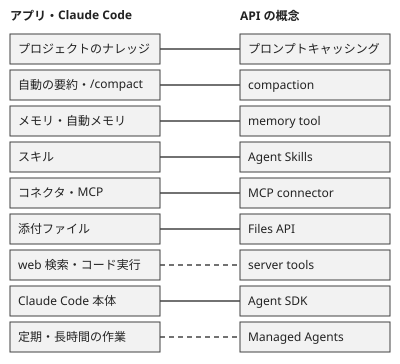

!!! abstract "要点"
    - **何ができるか**：アプリや Claude Code の機能が API のどの概念に当たるかが分かる。挙動の理由を知りたいなら違いまで読み、自分のプログラムで再現するなら対応する概念を選ぶ。
    - **いつ引くか**：アプリの挙動を仕組みから理解したいとき。アプリでしていることを、自分のプログラムで再現したいとき。
    - **前提**：<!-- link:begin rereads-whole-history -->[毎ターン全履歴を読み直す](../basics/rereads-whole-history.md)<!-- link:end -->、<!-- link:begin using-projects -->[プロジェクトの使いどころ](../app/using-projects.md)<!-- link:end -->

<!-- textlint-disable -->
別名：API との対応・機能と API の対応
<!-- textlint-enable -->

アプリの機能と API の概念の対応表は、アプリや Claude Code で見える挙動を、API の概念に置き換えて読むための表である。アプリで便利に使っている機能の多くは、API では呼び出し側が自分で組み立てる部品として現れる。対応は役割の近さであり、実装が同じとは限らない。

## 対応表 {#table}

アプリと Claude Code の機能を行に、対応する API の概念を列に並べると、次の 9 組になる。右の列の注意が、読み替えるときに落としやすい違いである。

| アプリ・Claude Code の機能 | API の概念 | 読み替えるときの注意 |
| --- | --- | --- |
| プロジェクトのナレッジ（アプリ） | プロンプトキャッシング | 公式は、アプリがナレッジをキャッシュして再利用時の消費を抑えると書く。API では呼び出し側が先頭を固定し、区切りを置く。 |
| 長い会話の自動の要約（アプリ）、`/compact` と自動の圧縮（Claude Code） | compaction | 古い発言を要約に置き換える考え方は同じだが、アプリ・Claude Code・API の 3 つは別の実装である。アプリは自動で、API は呼び出し側が方式を選ぶ。 |
| メモリ（アプリ）、自動メモリ（Claude Code） | memory tool | アプリは覚えた内容を見て消せる。API では保存先と読み書きを実装する側が持つ。 |
| スキル（アプリ・Claude Code） | Agent Skills | 名前と説明を先に読み、関わるときだけ本体を読む点が共通である。管理と配り方は面ごとに違う。 |
| コネクタ（アプリ）、mcp（Claude Code） | MCP connector | API では Messages API から remote MCP サーバーの道具を呼べて、自前の MCP クライアントが要らない。 |
| 添付ファイル（アプリ） | Files API | 一度上げたファイルを、後の要求から `file_id` で指す。 |
| web 検索・コードの実行（アプリ） | server tools | API では Anthropic が動かす道具として要求に足す。アプリの内部が同じ道具かは確かめていない。 |
| Claude Code 本体（`-p` を含む） | Agent SDK | Claude Code の道具・ループ・文脈の管理を、ライブラリとして自分のプログラムから使う。 |
| 長時間・定期の作業（Cowork の定期タスク） | Managed Agents | 公式は、Managed Agents が長時間の非同期作業と定期の実行に向くと書く。Cowork との対応は公式にない推測なので、役割の近さにとどめる。 |

各組を詳しく読むページは次のとおりである。

- キャッシュ：<!-- link:begin why-prompt-caching -->プロンプトキャッシング（先頭が変わらないことの価値）（準備中）<!-- link:end -->、<!-- link:begin prompt-caching-in-practice -->プロンプトキャッシングの実務（準備中）<!-- link:end -->、<!-- link:begin using-projects#knowledge -->[プロジェクトの使いどころ › ナレッジを置くと何が変わるか](../app/using-projects.md#knowledge)<!-- link:end -->を読む。
- 要約と圧縮：<!-- link:begin long-chat-limits -->長い会話の自動のコンテキスト管理と長さの上限（準備中）<!-- link:end -->と<!-- link:begin what-survives-compaction -->[圧縮（compaction）で何が残り、何が消えるか](../basics/what-survives-compaction.md)<!-- link:end -->を読む。
- メモリ：<!-- link:begin how-memory-works -->[アプリのメモリ（仕組み・範囲・消し方と止め方）](../app/how-memory-works.md)<!-- link:end -->、<!-- link:begin using-auto-memory -->自動メモリ（準備中）<!-- link:end -->を読む。
- スキル：<!-- link:begin skills-in-the-app -->アプリでスキルを使う（準備中）<!-- link:end -->、<!-- link:begin how-skills-load -->[スキルの考え方（手順を必要なときだけ読む）](../extend/how-skills-load.md)<!-- link:end -->を読む。
- コネクタと添付：<!-- link:begin connectors-in-the-app -->[コネクタ（MCP）をアプリで使う](../app/connectors-in-the-app.md)<!-- link:end -->、<!-- link:begin how-attachments-are-read#api -->[添付ファイルはどこまで読まれるか › API で渡すとき（Files API・PDF・画像）](../app/how-attachments-are-read.md#api)<!-- link:end -->を読む。
- 検索と道具：<!-- link:begin search-research-thinking -->[web 検索・リサーチ・拡張思考の使い分け](../app/search-research-thinking.md)<!-- link:end -->を読む。
- SDK とホスト：<!-- link:begin sdk-comparison#managed-agents -->[Client SDK・Agent SDK・Managed Agents・CLI の比較 › Managed Agents（Anthropic がループと環境を持つ）](sdk-comparison.md#managed-agents)<!-- link:end -->を読む。

この 12 の機能の面・成熟度・確認日は、データから作った次の表で確かめる。

<!-- gen:begin compare 面 成熟度 確認日 -->
<!-- textlint-disable -->

| 機能 | 面 | 成熟度 |
| --- | --- | --- |
| [プロジェクト（Projects）](../app/using-projects.md) | アプリ | GA |
| プロンプトキャッシング（prompt caching）（準備中） | API | GA |
| アプリの自動のコンテキスト管理（automatic context management）（準備中） | アプリ | GA |
| compaction（API）（準備中） | API | beta |
| [メモリ（アプリ。memory）](../app/how-memory-works.md) | アプリ | GA |
| memory tool（準備中） | API | GA |
| スキル（アプリ。skills）（準備中） | アプリ | GA |
| サーバーの道具（server tools）（準備中） | API | GA |
| [MCP connector](feature-to-api-mapping.md) | API | beta |
| [Files API](../app/how-attachments-are-read.md) | API | GA |
| Agent SDK（Claude Agent SDK）（準備中） | Claude Code・API | GA |
| [Managed Agents（Claude Managed Agents）](sdk-comparison.md) | API | beta |

すべて共通：確認日 2026-11-04。

<!-- textlint-enable -->
<!-- gen:end compare 面 成熟度 確認日 -->

## 対応から分かること {#insights}

対応表を使うと、アプリの挙動の理由を API の仕組みから説明できる。

- **長い会話が重い理由**：Claude は毎回、会話の最初から読み直して返事をする。<!-- link:begin stateless-messages-api#stateless -->Messages API と会話の正体 › 毎回、全体を渡す（準備中）<!-- link:end -->とあるとおり、API でも毎回、全体を渡す。アプリの自動の要約も API の compaction も、この読み直す量を減らす手段である。要約が起きる長い会話は、利用上限を多く使う。
- **資料をプロジェクトに置く理由**：同じ先頭が続けば読み直しが安く済む。<!-- link:begin prompt-caching-in-practice#invalidation -->プロンプトキャッシングの実務 › キャッシュを無効にする変更（準備中）<!-- link:end -->にあるとおり、途中を変えるとそこから後は外れる。資料と指示を毎回同じ形で置けるのが、プロジェクトの利点である。
- **圧縮の後に何が戻るか**：要約に置き換わったあとも、そのまま効くものと、溶けて消えるものがある。<!-- link:begin what-survives-compaction#kept -->[圧縮（compaction）で何が残り、何が消えるか › そのまま効くもの](../basics/what-survives-compaction.md#kept)<!-- link:end -->と<!-- link:begin how-skills-load#after-compaction -->[スキルの考え方（手順を必要なときだけ読む） › 圧縮の後に戻るもの](../extend/how-skills-load.md#after-compaction)<!-- link:end -->で確かめる。残したい規則は、要約に頼らず別の置き場所に出す。
- **会話を消してもメモリが残る理由**：メモリは会話の中身ではなく、会話をまたいで残す記録だからである。API の memory tool も、会話をまたいでファイルに残す仕組みである。残った記録が誤っていないかは、<!-- link:begin using-auto-memory#review -->自動メモリ › 誤った記録の見直し（準備中）<!-- link:end -->で見直す。

この対応には 2 つの限界がある。1 つ目は、対応が役割の近さにとどまることである。アプリは API のパラメータを自分では指定できない。API の文書にある閾値や寿命を、そのままアプリの挙動とは決めつけない。

2 つ目は、公式同士で記述が食い違う箇所があることである。たとえばスキルの管理と面をまたぐ同期は、Help Center と Platform の文書で書き方が違う。アプリの挙動はアプリの文書で確かめ、API の挙動は API の文書で確かめる。

## 再現するときの選び方 {#choose}

アプリでしていることを自分のプログラムで再現するときは、対応する API の概念を選ぶ。選ぶ基準は、文脈の中に置きたいのか、会話をまたいで残したいのか、である。

!!! example "判断例：夜間に長い調査を回したい"
    - **状況**：アプリで続けている長い調査を、同じ手順で夜間にスクリプトから回したい。途中で会話が長くなり、決めた方針を忘れさせたくない。
    - **迷う候補**：古い発言を compaction で要約に置き換える。決めた方針をファイルに出して memory tool で持たせる。
    - **選んだもの**：両方を使う。compaction で作業中の文脈を小さく保ち、残したい決定は memory tool のファイルに書く。
    - **理由**：公式は、compaction で文脈を小さく保ち、memory で要約後も残す情報を保存する組み合わせを勧める。要約だけでは方針が溶けて消えうる。詳しい分担は<!-- link:begin long-running-agent-context#external-state -->長時間エージェントのコンテキスト管理 › 状態をファイルに持たせる（準備中）<!-- link:end -->を読む。

!!! example "判断例：アプリの利用上限の減りが速い理由を知りたい"
    - **状況**：アプリの長い会話で、利用上限の減りが速い。理由を仕組みから知りたいが、自分でプログラムを書く予定はない。
    - **迷う候補**：API の文書を読んで閾値やキャッシュの設定を調べる。アプリの文書を読んで、会話の切り方と資料の置き場所を見直す。
    - **選んだもの**：アプリの文書で会話の切り方と置き場所を見直し、API は仕組みを知る補助として読む。
    - **理由**：アプリでは API のパラメータを自分で指定できない。効く操作は、会話を分ける、資料をプロジェクトに置く、のようにアプリ側にある。対処は<!-- link:begin long-chat-limits#at-the-limit -->長い会話の自動のコンテキスト管理と長さの上限 › 長さの上限に当たったとき（準備中）<!-- link:end -->を読む。

## 組み合わせ方 {#combine}

再現するときは、何をどこに置くかを機能ごとに決める。

- **変わらない指示と資料**：リクエストの先頭に置き、プロンプトキャッシングで読み直しを安くする。
- **作業中に増える履歴**：古い発言を compaction で要約へ置き換える。
- **会話をまたいで残す決定**：memory tool で、ファイルに書いて持たせる。
- **必要なときだけ読む手順**：Agent Skills にして、常駐の指示から外す。
- **外の道具**：remote MCP サーバーは MCP connector で、検索やコードの実行は server tools で足す。
- **大きなファイル**：Files API で一度上げ、`file_id` で指す。

API の機能には、ZDR（ゼロデータ保持）の対象外のものがある。MCP connector・Files API・Managed Agents がそうである。アプリで使えていた機能を移すときは、自分の契約でそのまま使えるかを先に確かめる。

長時間・定期の作業をホストに任せるときは、任せる前に守りを決める。定期で回してはいけない作業の線引きは<!-- link:begin tasks-and-schedules-in-the-app#what-not-to-schedule -->[タスクと定期タスク（Cowork） › 定期タスクにしないもの](../app/tasks-and-schedules-in-the-app.md#what-not-to-schedule)<!-- link:end -->にある。Managed Agents の層の選び方は<!-- link:begin sdk-comparison#managed-agents -->[Client SDK・Agent SDK・Managed Agents・CLI の比較 › Managed Agents（Anthropic がループと環境を持つ）](sdk-comparison.md#managed-agents)<!-- link:end -->で確かめる。

<!-- gen:begin references -->
<!-- textlint-disable -->

## 参考 {#references}

- [Usage limit best practices](https://support.claude.com/en/articles/9797557-usage-limit-best-practices)：Anthropic・英語・確認日 2026-11-04
- [Prompt caching](https://platform.claude.com/docs/en/build-with-claude/prompt-caching)：Anthropic・英語・確認日 2026-11-04
- [How large is the context window on paid Claude plans?](https://support.claude.com/en/articles/8606394-how-large-is-the-context-window-on-paid-claude-plans)：Anthropic・英語・確認日 2026-11-04
- [Compaction overview](https://platform.claude.com/docs/en/build-with-claude/compaction)：Anthropic・英語・確認日 2026-11-04
- [Use Claude’s chat search and memory to build on previous context](https://support.claude.com/en/articles/11817273-use-claude-s-chat-search-and-memory-to-build-on-previous-context)：Anthropic・英語・確認日 2026-11-04
- [Memory tool](https://platform.claude.com/docs/en/agents-and-tools/tool-use/memory-tool)：Anthropic・英語・確認日 2026-11-04
- [What are skills?](https://support.claude.com/en/articles/12512176-what-are-skills)：Anthropic・英語・確認日 2026-11-04
- [Agent Skills](https://platform.claude.com/docs/en/agents-and-tools/agent-skills/overview)：Anthropic・英語・確認日 2026-11-04
- [Server tools](https://platform.claude.com/docs/en/agents-and-tools/tool-use/server-tools)：Anthropic・英語・確認日 2026-11-04
- [MCP connector](https://platform.claude.com/docs/en/agents-and-tools/mcp-connector)：Anthropic・英語・確認日 2026-11-04
- [Files API](https://platform.claude.com/docs/en/build-with-claude/files)：Anthropic・英語・確認日 2026-11-04
- [Agent SDK overview](https://code.claude.com/docs/en/agent-sdk/overview)：Anthropic・英語・確認日 2026-11-04
- [Claude Managed Agents overview](https://platform.claude.com/docs/en/managed-agents/overview)：Anthropic・英語・確認日 2026-11-04

<!-- textlint-enable -->
<!-- gen:end references -->

<!-- gen:begin page-links -->
<!-- textlint-disable -->

**前提**

- [毎ターン全履歴を読み直す](../basics/rereads-whole-history.md)
- [プロジェクトの使いどころ](../app/using-projects.md)

**関連**

- Messages API と会話の正体（準備中）
- プロンプトキャッシングの実務（準備中）
- プロンプトキャッシング（先頭が変わらないことの価値）（準備中）
- [圧縮（compaction）で何が残り、何が消えるか](../basics/what-survives-compaction.md)
- 長い会話の自動のコンテキスト管理と長さの上限（準備中）
- [アプリのメモリ（仕組み・範囲・消し方と止め方）](../app/how-memory-works.md)
- 自動メモリ（準備中）
- アプリでスキルを使う（準備中）
- [スキルの考え方（手順を必要なときだけ読む）](../extend/how-skills-load.md)
- [コネクタ（MCP）をアプリで使う](../app/connectors-in-the-app.md)
- [web 検索・リサーチ・拡張思考の使い分け](../app/search-research-thinking.md)
- [添付ファイルはどこまで読まれるか › API で渡すとき（Files API・PDF・画像）](../app/how-attachments-are-read.md#api)
- [タスクと定期タスク（Cowork）](../app/tasks-and-schedules-in-the-app.md)
- [Client SDK・Agent SDK・Managed Agents・CLI の比較 › Managed Agents（Anthropic がループと環境を持つ）](sdk-comparison.md#managed-agents)
- 長時間エージェントのコンテキスト管理（準備中）
- [effort の段階と使い分け](../models/effort-levels.md)
- [全体地図：Claude の面と層](../start/product-map.md)

<!-- textlint-enable -->
<!-- gen:end page-links -->
