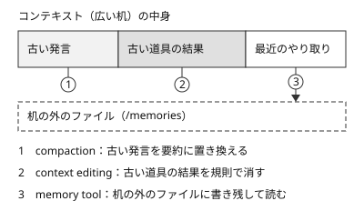

!!! abstract "要点"
    - **何が分かるか**：長く動くエージェントの文脈が溢れないよう、要約・古い結果の削除・外部の記憶をどう組み合わせるかが分かる。
    - **いつ引くか**：API で組んだエージェントを長く動かすと前に決めたことを忘れるとき。何時間も動かしても文脈が溢れないようにしたいとき。
    - **前提**：<!-- link:begin what-survives-compaction -->[圧縮（compaction）で何が残り、何が消えるか](../basics/what-survives-compaction.md)<!-- link:end -->・<!-- link:begin stateless-messages-api -->[Messages API と会話の正体](stateless-messages-api.md)<!-- link:end -->

<!-- textlint-disable -->
別名：compaction（API）・context editing・memory tool・コンテキスト編集
<!-- textlint-enable -->

長時間エージェントのコンテキスト管理は、API で組んだエージェントの文脈を、数時間の作業でも溢れさせず、決めたことを失わせないための設計である。手段は 3 つある。古い発言を要約に置き換える compaction、古い道具の結果を消す context editing、文脈の外のファイルに書き残す memory tool である。この 3 つを、何を失ってよいかで使い分け、組み合わせる。

## 何が起きるか {#what-happens}

API のエージェントを長く回すと、会話に道具の呼び出しと結果が積み上がる。Messages API は状態を持たず、呼び出し側が毎回それまでの全体を渡す（<!-- link:begin stateless-messages-api#stateless -->[Messages API と会話の正体 › 毎回、全体を渡す](stateless-messages-api.md#stateless)<!-- link:end -->）。だから会話が伸びるほど、毎回渡す量も伸びる。何時間も人が見ない実行では、文脈の管理より先に、結果を確かめる守りを整える（<!-- link:begin checking-unattended-runs#guards-first -->[無人実行の結果を確かめる › 先に整える守り](../verify/checking-unattended-runs.md#guards-first)<!-- link:end -->）。

文脈を広い机にたとえると、道具の結果という紙が机いっぱいに広がっていく状態である。机は有限で、溢れれば作業を続けられない。溢れる前でも、会話が長くなるほど品質が落ちるという。公式が compaction を勧める理由の 1 つがこれである。

例を挙げる。リポジトリの移行を数時間かけて進めるエージェントに、最初に「既存のテストを壊さない」「旧 API は残す」と決めさせた。道具の結果が数百件積み上がった後、このエージェントが旧 API を消す変更を出してきた。決めたことは会話の先頭近くにあり、要約に入らず落ちたか、大量の結果に埋もれたと考えられる。どちらになるかは手段で変わる。

手段を選ぶ前に、前提のページで 4 つの区別を確かめておくとよい。そのまま効くもの、入れ直されるもの、必要になったら読み直されるもの、要約に溶けて消えるものの違いである（<!-- link:begin what-survives-compaction#why -->[圧縮（compaction）で何が残り、何が消えるか › なぜ 4 つに分かれるか](../basics/what-survives-compaction.md#why)<!-- link:end -->）。API の compaction は、このうち「溶けて消える」側に細部を落とす。

## 三つの手段（compaction・context editing・memory tool） {#three-tools}

3 つの手段は、文脈のどこに効くかが違う。図は、広い机の中身のうち、どこに何が働くかを並べたものである。古い発言には compaction、古い道具の結果には context editing が効く。机の外のファイルには memory tool が書き、後で読む。

### compaction

compaction は、古い発言を、サーバー側で Claude が書く要約に置き換える。議事録だけ残して、発言の全文は捨てる操作である。方式は 2 つある。呼び出し側が好きな時に求める on demand と、入力のトークンが閾値に達すると自動で働く threshold である。公式は、使える場面では on demand を勧めている。

失うのは、要約に入らなかった細部である。要約は Claude が書くので、決めた理由や却下した案が落ちることがある。API の compaction は、Claude Code の `/compact` や自動圧縮とは別の仕組みである。Claude Code 側の扱いは<!-- link:begin compact-and-auto-compact -->[/compact と自動圧縮](../context/compact-and-auto-compact.md)<!-- link:end -->を見る。

### context editing

context editing は、古い道具の結果や thinking のブロックを、規則に従ってサーバー側で消す。要約はしない。消した部分は、文脈からなくなる。公式の説明では、多くの用途では compaction が主な手段で、context editing はより細かく制御したいときに使う。たとえば、大きな検索結果だけを古い順に落とし、会話の発言はそのまま残したい場面である。

### memory tool

memory tool は、会話をまたいで残したい情報を `/memories` ディレクトリのファイルに書き、後で読む道具である。道具は呼び出し側（client）で動き、保存先は実装する側が決める。作業を始める前にディレクトリを見る。要約に頼らず、決めたことを文脈の外に置ける。

公式は、compaction で文脈を小さく保ち、要約の後も残すべき情報を memory tool に保存する組み合わせを勧めている。Managed Agents の memory stores と、アプリの Memory は別のものである。

### 3 つの比べ方

| 手段 | 触るもの | 失うもの | 向く場面 |
| --- | --- | --- | --- |
| compaction | 古い発言全体 | 要約に入らなかった細部 | 会話全体を小さくしたい |
| context editing | 古い道具の結果、thinking のブロック | 消した中身そのもの | 結果だけを細かく落としたい |
| memory tool | 文脈の外のファイル | 書き忘れたこと、読み忘れた記録 | 決めたことを後まで残したい |

成熟度と確認日は、変わりやすいので次の表で確かめる。

<!-- gen:begin compare 成熟度 確認日 -->
<!-- textlint-disable -->

| 機能 | 成熟度 |
| --- | --- |
| [compaction（API）](long-running-agent-context.md) | beta |
| [context editing](long-running-agent-context.md) | beta |
| [memory tool](long-running-agent-context.md) | GA |

すべて共通：確認日 2026-11-04。

<!-- textlint-enable -->
<!-- gen:end compare 成熟度 確認日 -->

## 何に効くか {#effects}

compaction・context editing・memory tool の 3 つは、原理「見せる」と、原因「散らかっている」に関わる。Claude に見せるものは、文脈に載っているものだけである。古い道具の結果が机に溜まって散らかると、いま見せたいものが目立たなくなる。compaction と context editing は、見せる量を減らして散らかりを減らす。memory tool は、減らしたくない情報を、必要なときに見せ直せる形で外に置く。

どれも、失うものを持つ。何を捨ててよいかは、作業ごとに決める。

!!! example "判断例：移行エージェントの決めたことを守る"
    - **状況**：数時間かけてリポジトリを移行するエージェント。大きな検索結果の道具を何度も使う。最初に「テストを壊さない」「旧 API を残す」と決めた。
    - **迷う候補**：compaction だけを使って会話を小さく保つ。または、context editing で古い検索結果だけ消し、発言は残す。
    - **選んだもの**：compaction を基本にし、決めたことは memory tool で `/memories` のファイルに書き出す。
    - **理由**：決めたことは古い発言にあり、要約に溶けると戻らない。ファイルに出しておけば、要約の後も読み直せる。検索結果だけが重いなら context editing を足すが、発言まで消えるわけではない点を確かめる。

任せる幅を広げるほど、先に確かめを整える。何時間も人が見ていない実行は、文脈の管理より先に、結果を確かめる守りを置く。守りは<!-- link:begin checking-unattended-runs#guards-first -->[無人実行の結果を確かめる › 先に整える守り](../verify/checking-unattended-runs.md#guards-first)<!-- link:end -->と<!-- link:begin progress-logs-for-long-jobs -->[長時間ジョブの進捗ログを設計する](../delegate/progress-logs-for-long-jobs.md)<!-- link:end -->が持つ。

## 状態をファイルに持たせる {#external-state}

文脈に残すものと、ファイルに出すものは、寿命で分ける。文脈に残すのは、いまの作業の直近のやり取りである。ファイルに出すのは、会話が圧縮されても、新しいセッションが始まっても要るものである。決めたこと、未決のこと、やること、分かったことがそれに当たる。

ファイルの分け方、開始と更新の回し方、変えてよい欄を限る守りは、Claude Code の作業と同じ考え方で、<!-- link:begin progress-files#files -->[進捗ファイルで、途中から再開できるようにする › ファイルの分け方](../context/progress-files.md#files)<!-- link:end -->が持つ。API では、これを memory tool の `/memories` に置く。決めたことと聞くべきことは別の欄に分ける（<!-- link:begin progress-files#decided-vs-open -->[進捗ファイルで、途中から再開できるようにする › 決めたことと、聞くべきことを分ける](../context/progress-files.md#decided-vs-open)<!-- link:end -->）。未決のことが決めたことに混ざると、後のセッションが推測を事実として読む。

memory tool は、実装する側の責任が重い。保存先は呼び出し側が決めるので、Claude が指定するパスが `/memories` の外へ出ないよう検証する、path traversal（`../` などで保存先の範囲の外のファイルを読み書きされること）の対策が要る。これは公式が必須としている。

読み出しは、作業の始めに `/memories` を見る流れにする。これを省くと、書いた記録が読まれず、忘れたように見える。再開できるかは、新しいセッションで同じ依頼を出して確かめる（<!-- link:begin progress-files#check -->[進捗ファイルで、途中から再開できるようにする › 再開できるかの確かめ方](../context/progress-files.md#check)<!-- link:end -->）。

Claude Code で同じことをする方法は、context と delegate の分野が持つ。関連する案内は次のとおりである。

- 長い作業を文書に書いてから会話を新しくする方法：<!-- link:begin handoff-documents -->[handoff 文書と document-and-clear](../context/handoff-documents.md)<!-- link:end -->。
- アプリの機能と API の概念の対応：<!-- link:begin feature-to-api-mapping#table -->[アプリの機能と API の概念の対応表 › 対応表](feature-to-api-mapping.md#table)<!-- link:end -->。
- Agent SDK を使う場合：<!-- link:begin agent-sdk-basics -->[Agent SDK（Claude Code をライブラリとして使う）](agent-sdk-basics.md)<!-- link:end -->。

## 誤解 {#misconceptions}

- **「compaction すれば、全部覚えている」**：要約に入らなかった細部は消える（<!-- link:begin what-survives-compaction#dissolved -->[圧縮（compaction）で何が残り、何が消えるか › 要約に溶けて消えるもの](../basics/what-survives-compaction.md#dissolved)<!-- link:end -->）。決めたことは、要約に任せず、ファイルに書く。
- **「送る量を減らせば、文脈も減る」**：message threads は送る量を減らすだけで、モデルが読む量は変わらない（<!-- link:begin stateless-messages-api#message-threads -->[Messages API と会話の正体 › message threads（送る量だけを減らす）](stateless-messages-api.md#message-threads)<!-- link:end -->）。文脈を減らすのは、この 3 つの手段である。
- **「context editing は、compaction の上位版」**：別の手段である。context editing は要約せず、規則で消す。多くの用途では compaction が主な手段で、context editing は細かく制御したいときに足す。
- **「memory tool で、モデルに記憶が増える」**：増えるのはモデルの中ではなく、呼び出し側が持つファイルである。読まなければ効かず、保存先の安全は実装する側が守る。
- **「Claude Code の `/compact` と、同じものだ」**：別の仕組みである。Claude Code の圧縮は<!-- link:begin compact-and-auto-compact#compact-or-clear -->[/compact と自動圧縮 › 圧縮か、書き出して /clear か](../context/compact-and-auto-compact.md#compact-or-clear)<!-- link:end -->を見る。

<!-- gen:begin references -->
<!-- textlint-disable -->

## 参考 {#references}

- [Compaction overview](https://platform.claude.com/docs/en/build-with-claude/compaction)：Anthropic・英語・確認日 2026-11-04
- [Compaction at a token threshold](https://platform.claude.com/docs/en/build-with-claude/compaction-threshold)：Anthropic・英語・確認日 2026-11-04
- [Compaction on demand](https://platform.claude.com/docs/en/build-with-claude/compaction-on-demand)：Anthropic・英語・確認日 2026-11-04
- [Context editing](https://platform.claude.com/docs/en/build-with-claude/context-editing)：Anthropic・英語・確認日 2026-11-04
- [Memory tool](https://platform.claude.com/docs/en/agents-and-tools/tool-use/memory-tool)：Anthropic・英語・確認日 2026-11-04
- [Claude Platform release notes](https://platform.claude.com/docs/en/release-notes/overview)：Anthropic・英語・確認日 2026-11-04

<!-- textlint-enable -->
<!-- gen:end references -->

<!-- gen:begin page-links -->
<!-- textlint-disable -->

**前提**

- [圧縮（compaction）で何が残り、何が消えるか](../basics/what-survives-compaction.md)
- [Messages API と会話の正体](stateless-messages-api.md)

**関連**

- [無人実行の結果を確かめる](../verify/checking-unattended-runs.md)
- [長時間ジョブの進捗ログを設計する](../delegate/progress-logs-for-long-jobs.md)
- [進捗ファイルで、途中から再開できるようにする](../context/progress-files.md)
- [handoff 文書と document-and-clear](../context/handoff-documents.md)
- [/compact と自動圧縮](../context/compact-and-auto-compact.md)
- [アプリの機能と API の概念の対応表](feature-to-api-mapping.md)
- [Agent SDK（Claude Code をライブラリとして使う）](agent-sdk-basics.md)
- [自動メモリ](../extend/using-auto-memory.md)

<!-- textlint-enable -->
<!-- gen:end page-links -->
