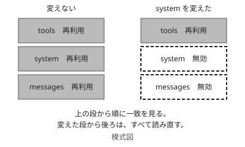

!!! abstract "要点"
    - **何ができるか**：毎回同じ先頭部分を再利用して、API の費用と待ち時間を抑えられる。
    - **いつ引くか**：長いシステムプロンプトや資料を毎回送る費用を抑えたいとき。キャッシュを指定したのに効いていないとき。
    - **前提**：<!-- link:begin why-prompt-caching -->[プロンプトキャッシング（先頭が変わらないことの価値）](../basics/why-prompt-caching.md)<!-- link:end -->、<!-- link:begin stateless-messages-api -->[Messages API と会話の正体](stateless-messages-api.md)<!-- link:end -->

<!-- textlint-disable -->
別名：prompt caching・cache_control・キャッシュのブレークポイント
<!-- textlint-enable -->

プロンプトキャッシングは、API の要求の先頭が前回と完全に同じとき、その部分の処理を使い回す機能である。出力の中身は変わらず、費用と待ち時間だけが下がる。このページは、API で長い前置きを繰り返し送る仕組みを作る人が、区切りの置き場所と、キャッシュを外す変更を判断するために引く。

## 使いどころ {#when}

長いシステムプロンプトや資料を毎回送る作りは、同じ前置きを毎回読み直させる分だけ、費用と待ち時間がかさむ。仕組みが用途に合っていない状態であり、これがこのページの機能が防ぐ原因（合っていない）である。API は状態を持たず、呼び出しのたびに全体を送る。その仕組みは <!-- link:begin stateless-messages-api#stateless -->[Messages API と会話の正体 › 毎回、全体を渡す](stateless-messages-api.md#stateless)<!-- link:end --> で分かる。

キャッシュを使うと、資料を毎回モデルに見せる作りは崩さずに、読み直しの分を安く済ませられる。向くのは次のような作りである。

- 長い指示や資料を固定で付け、質問だけが毎回変わる。
- 会話が続き、それまでの発言が毎回の先頭に積み上がる。
- ツールの定義が多く、毎回同じものを送る。

先頭が変わらないことの価値と、積み木の比喩の本体は <!-- link:begin why-prompt-caching#why -->[プロンプトキャッシング（先頭が変わらないことの価値） › なぜそうなるか](../basics/why-prompt-caching.md#why)<!-- link:end --> にある。このページは、API でそれを実際に使うときの判断だけを書く。

## どこまでがキャッシュされるか（tools・system・messages の順） {#prefix}

キャッシュされるのは、要求の先頭から区切りまでの部分で、順番は tools、system、messages である。この順に積んだ先頭が前回と完全に一致したときだけ、一致した範囲が使い回される。1 文字でも違えば、その段から後ろは使い回されない。



積み木にたとえると、下の段を替えれば、その上に載せた段は全部積み直しになる。上の図では、system を変えた要求で、tools は再利用され、system とそれ以降が読み直しになる。

この仕組みから、次の置き方が決まる。

- 変わらないものを前（tools、system）に、毎回変わるものを後ろ（messages の末尾）に置く。
- 要求ごとに変わる値（時刻、要求の番号、ユーザーごとの文）は、system の先頭付近に入れない。

自動のキャッシュと、区切りを自分で置く方法の 2 通りがある。自動のキャッシュは、要求のいちばん外側で指定する。区切りを自分で置く方法は、ブロックごとに指定する。どちらを使っても、先頭の一致で決まる点は同じである。

## 最小の使い方 {#minimal}

長い system の末尾のブロックに区切りを 1 つ置き、2 回目の要求でキャッシュから読み取られたかを応答の使用量で確かめる。次の雛形は、区切りをブロックごとに置く形の最小の例である。

<!-- gen:begin snippet prompt-caching-in-practice/minimal-request -->
<!-- textlint-disable -->

??? example "雛形：長い system の末尾に区切りを 1 つ置いた最小の要求"

    ```json
    {
      "model": "<使うモデルの id>",
      "max_tokens": 1024,
      "system": [
        {
          "type": "text",
          "text": "<毎回変わらない長い指示と資料>",
          "cache_control": {"type": "ephemeral"}
        }
      ],
      "messages": [
        {"role": "user", "content": "<毎回変わる質問>"}
      ]
    }
    ```

    動作を確かめていない雛形。

<!-- textlint-enable -->
<!-- gen:end snippet prompt-caching-in-practice/minimal-request -->

確かめ方は、応答の使用量の 2 つの欄を見ることである。`cache_creation_input_tokens` はキャッシュに書き込んだ量、`cache_read_input_tokens` はキャッシュから読み取った量である。最初の要求で書き込みの量が増え、同じ先頭の 2 回目で読み取りの量が増えれば、効いている。指定の細かい書き方と全パラメータは、公式の文書 [Prompt caching](https://platform.claude.com/docs/en/build-with-claude/prompt-caching) を見る。

## キャッシュを無効にする変更 {#invalidation}

キャッシュが無効になるのは、先頭の一致が崩れる変更をしたときである。段ごとに、どこから後ろが外れるかが違う。

!!! info "変更と、無効になる範囲"
    - **tool の定義を変える**：すべてのキャッシュが無効になる。tools が先頭にあるためである。
    - **system を変える**：system とそれ以降が無効になる。tools の分は残る。
    - **messages の先頭側を書き換える**：書き換えた箇所から後ろが無効になる。
    - **thinking や effort を変える**：messages 以降が無効になる。モデルによっては、それより前も無効になる。

thinking や effort は、本文に見えない設定なので、変えたことに気づきにくい。作業の途中で effort を上げ下げする運用は、そのたびにキャッシュを捨てることになる。段の意味と上げ下げの判断は <!-- link:begin effort-levels#levels -->[effort の段階と使い分け › 段ごとの振る舞い](../models/effort-levels.md#levels)<!-- link:end --> にある。

履歴を要約して置き換えるような処理も、先頭の一致を崩す。会話の途中で古い発言を削ったり書き換えたりすると、その箇所から後ろは使い回されない。

## 区切りの置き方 {#breakpoints}

区切り（ブレークポイント）は、キャッシュする範囲の終わりを示す印である。公式の勧めは、要求のあいだで変わらない最後のブロックに置くことである。

置き場所は、次の考え方で決める。

1. 要求のあいだで変わらないブロックを、前から数える。
2. その最後のブロックに区切りを置く。変わる部分の手前で止めるのが要点である。
3. 変わる頻度の違う部分が混ざるなら、あまり変わらない部分の末尾にも区切りを置く（区切りの数の上限の範囲で）。

区切りの数には上限がある（上限：<!-- fact:begin prompt-cache-max-breakpoints -->4 つまで（2026-11-06 時点）<!-- fact:end -->）。書き込みと読み取りの料金の倍率は、<!-- fact:begin prompt-cache-price-multipliers -->読み取りは多くのモデルで 0.1 倍（モデルにより 0.05 倍・0.025 倍の例外がある）。書き込みは 5 分の寿命で 1.25 倍、1 時間で 2 倍（2026-11-05 時点）<!-- fact:end --> である。上限と、キャッシュの寿命、倍率、キャッシュできる最小の長さは、モデルによって違う値で、変わりやすい。使うモデルの値は公式の文書で確かめ、費用の見積もりは <!-- link:begin reading-api-pricing#price-components -->API 料金の読み方<!-- link:end --> の手順で組む。

!!! example "判断例：固定の資料と、日付入りの指示がある"
    - **状況**：長い規約集（毎回同じ）と、「今日の日付は…」で始まる短い指示（毎日変わる）を system に入れ、質問だけを messages で送る。
    - **迷う候補**：日付の指示を先頭に置き、読みやすい順のまま全体の末尾に区切りを置く。規約集を先頭に置き、規約集の末尾に区切りを置いて、日付の指示をその後ろに回す。
    - **選んだもの**：規約集を先頭に置き、規約集の末尾に区切りを置く。日付の指示は区切りの後ろに回す。
    - **理由**：日付を先頭に置くと、毎日先頭が変わり、規約集の分まで使い回せない。読みやすさより、変わらない部分を前に置くことを優先する。変わる部分を後ろに回せば、規約集の分は日をまたいで使い回せる。

## 効かないとき・落とし穴 {#pitfalls}

キャッシュを指定したのに効かないときは、安く確かめられる順に次を見る。まず応答の使用量で、書き込みと読み取りがどちらも 0 のままなのか、書き込みだけが毎回起きているのかを分ける。

- **書き込みと読み取りがどちらも 0 のまま**：区切りの前の長さが、モデルの最小の長さ（<!-- fact:begin prompt-cache-min-length -->モデルによって 512 から 4,096 トークン（2026-11-06 時点）<!-- fact:end -->）に届いていない可能性がある。最小の長さに届かない部分は、キャッシュの対象にならない。
- **毎回書き込みだけが起きる**：先頭が毎回違っている。system に時刻や要求ごとの値が入っていないか、tool の定義が要求ごとに変わっていないかを見る。
- **しばらく間を空けると読み取りが 0 に戻る**：キャッシュの寿命が切れている（既定の寿命：<!-- fact:begin prompt-cache-default-ttl -->5 分（使うたびに延びる。1 時間の寿命も選べる）（2026-11-05 時点）<!-- fact:end -->）。寿命は使うたびに延びるので、間隔が寿命より長い使い方では効かない。
- **途中の設定を変えた直後に外れた**：thinking や effort を変えていないか見る。どちらも、変えると messages 以降のキャッシュが無効になる設定である。

先頭の一致は完全でなければならないので、目に見えない揺れも外れる原因になりうる。たとえば、同じ内容でも出力の順序や空白が要求ごとに変わる、といった揺れである（推論・実践例なし）。疑うときは、2 回の要求の先頭をそのまま比べる。

効いていることの確認は、使用量の欄で行う。出力の様子では確かめられない。キャッシュは出力の内容に影響しないからである。

## 比べる相手 {#compare}

費用を抑える手段は、キャッシュのほかにもある。仕事の性質で選ぶ。

- **急がない大量の処理**：<!-- link:begin batch-api-basics#fit -->Message Batches API（急がない大量の処理）<!-- link:end --> が向く。対話のように待てない処理では、先頭を使い回すキャッシュのほうが合う。
- **アプリのプロジェクト**：同じ資料を繰り返し使う場面の対応物である。プロジェクトのナレッジは再利用され、消費が抑えられる。<!-- link:begin using-projects#knowledge -->[プロジェクトの使いどころ › ナレッジを置くと何が変わるか](../app/using-projects.md#knowledge)<!-- link:end --> で、置くと何が変わるかが分かる。アプリと API の対応は <!-- link:begin feature-to-api-mapping#table -->[アプリの機能と API の概念の対応表 › 対応表](feature-to-api-mapping.md#table)<!-- link:end --> にある。
- **節約の順番**：キャッシュは、手戻りを減らすことの後に効く手段である。順番は <!-- link:begin saving-priorities#order -->[節約の優先順位（手戻りを減らすのが先） › 優先順位](../cost/saving-priorities.md#order)<!-- link:end --> にある。

このページの機能の属性（成熟度、入った時期、出典）は、ページ冒頭のバッジと末尾の参考にある。

<!-- gen:begin references -->
<!-- textlint-disable -->

## 参考 {#references}

- [Prompt caching](https://platform.claude.com/docs/en/build-with-claude/prompt-caching)：Anthropic・英語・確認日 2026-11-04
- [Claude Platform release notes](https://platform.claude.com/docs/en/release-notes/overview)：Anthropic・英語・確認日 2026-11-04

<!-- textlint-enable -->
<!-- gen:end references -->

<!-- gen:begin page-links -->
<!-- textlint-disable -->

<div class="ca-page-links" markdown>

**前提**

- [プロンプトキャッシング（先頭が変わらないことの価値）](../basics/why-prompt-caching.md)
- [Messages API と会話の正体](stateless-messages-api.md)

**関連**

- [アプリの機能と API の概念の対応表](feature-to-api-mapping.md)
- [プロジェクトの使いどころ](../app/using-projects.md)
- [effort の段階と使い分け](../models/effort-levels.md)
- [節約の優先順位（手戻りを減らすのが先）](../cost/saving-priorities.md)

</div>

<!-- textlint-enable -->
<!-- gen:end page-links -->
