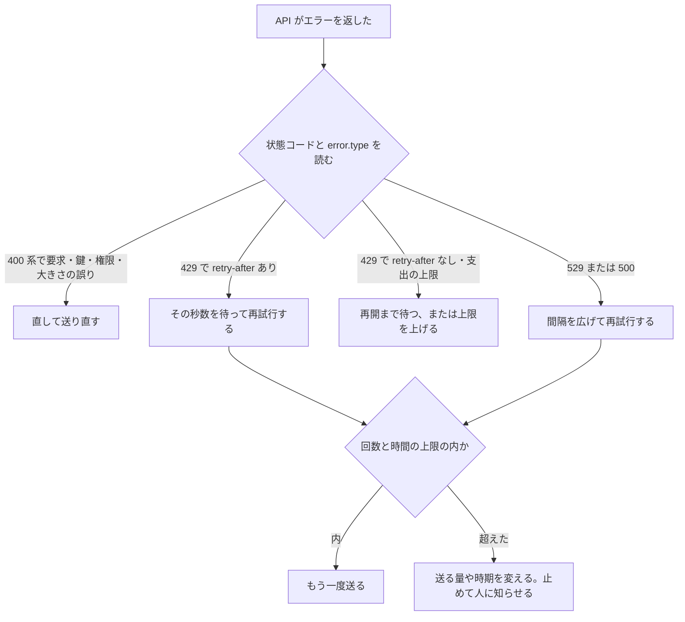

!!! abstract "要点"
    - **何が分かるか**：API が返す上限のエラーと混雑のエラーを見分け、待って再試行するか、送る量や時期を変えるかを決められる。
    - **いつ引くか**：API が 429 や 529 を返したとき。混雑や上限で失敗した呼び出しを安全に再試行したいとき。大量の呼び出しを流す前に、上限に当たらないかを確かめたいとき。
    - **前提**：なし

<!-- textlint-disable -->
別名：レート制限・API のエラー・429・529・overloaded・再試行・リトライ
<!-- textlint-enable -->

rate limits とエラーのページは、API が失敗を返したときに、原因の種類を読み分けて次の手を選ぶための仕組みを説明する。失敗には、待てば通るもの、送り方を変えれば通るもの、直さないと永久に通らないものがある。種類を見分けずに同じ呼び出しを繰り返すと、通らないものに時間と上限を使い切る。

このページの値と挙動は、2026-11-05 時点の Platform の文書で確かめた。上限の数値と再試行の既定は変わりやすいので、本文には書かず、自分の組織の画面と公式の文書で確かめる。

## エラーの見分け方（自分の上限・全体の混雑・要求の誤り） {#kinds}

API のエラーは、状態コードとエラーの種類（`error.type`）の組で読む。大きく 3 つに分かれる。自分の組織の上限に当たった、API 全体が混んでいる、要求そのものが誤っている、である。

| 状態コード | `error.type` | 何が起きたか | 次の手 |
| --- | --- | --- | --- |
| 429 | `rate_limit_error` | 組織の上限に当たった。`retry-after` ヘッダーが付くことが多い | ヘッダーの秒数だけ待って再試行する |
| 429 | `rate_limit_error`（`retry-after` なし。`error.details.error_code` が `enforced_spend_limit_reached`） | 使用の段ごとの月の支出の上限に達した | 再試行しない。再開の日時まで待つか、上限を上げる |
| 400 | `invalid_request_error`（メッセージが「specified API usage limits」で始まる） | 自分で決めた支出の上限に達した | 上限を上げるか外す。再試行では通らない |
| 529 | `overloaded_error` | API 全体が混んでいる。自分の上限ではない | 間隔を広げて再試行する。急がないなら時間を置く |
| 500 | `api_error` | Anthropic の側の予期しない失敗 | 間隔を広げて再試行する。続くなら request ID を添えて問い合わせる |
| 504 など | `timeout_error` | 処理が時間切れになった | 長い要求はストリーミングか一括の処理に替える |
| 400・401・403・404・413 など | `invalid_request_error` など | 要求・鍵・権限・大きさの誤り | 直して送り直す。そのままの再試行は同じ失敗になる |

表の読み方は 3 つある。

- **429 でも再試行して通るとは限らない。** 429 の種類は同じ `rate_limit_error` でも、短い時間の上限に当たったものと、月の支出の上限に達したものとで、待てば直るかどうかが逆になる。支出の上限の 429 には `retry-after` が付かず、SDK の自動の再試行を含めて、再開まで失敗し続ける。`error.details.error_code` を見て分ける。
- **529 は自分の上限ではない。** 全利用者にまたがる高い負荷で起きる。自分の送り方を変えても直らないことがあり、待つ以外の手は少ない。
- **急に量を増やすと、上限の数字の内側でも 429 になることがある。** 公式は、急な増加に対する別の制限（acceleration limits）の存在を書く。徐々に増やし、一定の使い方を保つのが避け方である。

エラーの本文は JSON で、`type`・`message`・`request_id` を含む。`request_id` は応答の `request-id` ヘッダーと同じ値で、問い合わせの目印になる。ストリーミングの応答では、200 が返ったあとにも途中でエラーが起きうる。この場合は上の通常の仕組みに乗らず、ストリーミングの文書にある error イベントの形で届く。

図で選び方をまとめる。

図の要点は次のとおりである。エラーを受けたら、まず状態コードと種類を読む。直すもの、待つもの、上限を変えるものに分かれ、待つものだけが再試行の対象になる。再試行には回数と時間の上限を置き、超えたら止めて送り方を変える。

## 上限の種類と、今の値の確かめ方 {#limit-types}

Claude API の上限は、大きく支出の上限と rate limits の 2 つに分かれる。どちらも組織の単位で効き、使用の段（usage tier）で決まる。組織は使用の履歴と状態に応じて、自動で段に置かれる。

- **支出の上限（spend limits）**：1 か月に使える費用の上限。段ごとの上限があり、自分でそれより低い上限を決めることもできる。
- **rate limits**：一定の時間に送れる量の上限。Messages API では、1 分あたりの要求数・入力トークン数・出力トークン数を、モデルのまとまりごとに数える。
- **ワークスペースの上限**：組織の中のワークスペースごとに、さらに低い上限を決められる。決めなければ組織の上限と同じになる。組織全体の上限は常に効く。
- **別枠の上限**：Message Batches API・Files API・Managed Agents・fast mode は、それぞれ別の上限を持つ。Messages API の上限とは数えない。

数え方で知っておくことが 3 つある。

- **補充は連続である。** 上限は token bucket の方式で、決まった時刻に全部戻るのではなく、上限まで少しずつ補充される。1 分の上限が、もっと短い間隔で強制されることがあるので、短い時間に集中して送ると、1 分の合計が内側でも当たる。
- **入力は、キャッシュから読んだ分を数えない（多くのモデル）。** 入力トークンの上限は、キャッシュの読み出し分を除いた入力で数える。モデルによっては例外があるので、確かめる。
- **出力は、実際に出た分を数える。** `max_tokens` の値は出力の上限の計算に入らない。大きく指定しても上限の面では損をしない。

今の値は、本文でなく次の場所で確かめる。

- **Console の Rate limits のページ**：自分の組織の段と、今の上限が出る。
- **Console の Usage のページ**：入力と出力の上限に対する直近の最大値と、キャッシュの率が出る。余裕の見積もりに使う。
- **Rate Limits API**：組織とワークスペースの上限を、プログラムから読む。ワークスペースの上限は、この API で設定する。
- **応答のヘッダー**：`anthropic-ratelimit-requests-*`・`anthropic-ratelimit-input-tokens-*`・`anthropic-ratelimit-output-tokens-*` は、上限・残り・補充の時刻を返す。
- **429 のヘッダー**：`retry-after` は待つ秒数を返す。`anthropic-ratelimit-tokens-*` は、いま最も厳しい上限の値を示す。

上限の表の数値や段の名前は、変わりやすいので、このページでは写さない。公式の [Rate limits](https://platform.claude.com/docs/en/api/rate-limits) の表を読む。新しい組織は、標準より低い段から始まることがあり、表の値と自分の値が違う場合がある。

サブスクリプションの利用枠は、ここで扱う API の上限とは別の仕組みである。アプリ・Claude Code・Desktop が分け合う枠の話は<!-- link:begin how-usage-limits-work#shared-limit -->[利用上限の仕組み（面をまたいで共有する枠） › 面をまたいで一つの枠](../cost/how-usage-limits-work.md#shared-limit)<!-- link:end -->で確かめる。

## 再試行の考え方（間隔を広げ、回数に上限を設ける） {#retry}

再試行は、待てば通る失敗にだけ使い、間隔を広げ、回数と時間に上限を置いて使う。上限のない再試行は、混雑をさらに悪くし、無人の処理では費用と時間を使い切る。

再試行の設計は 5 つの判断でできている。

1. **種類を先に見分ける。** 上の表で、待てば通るものだけを対象にする。支出の上限の 429 と、要求の誤りは、再試行の対象から外す。
2. **`retry-after` があれば、その秒数を待つ。** 公式は、それより早い再試行は失敗すると書く。ヘッダーがないとき（500 や 529 など）は、自分で間隔を決める。
3. **間隔は指数的に広げ、上限を置く。** 公式の SDK も、指数的に広げる間隔で再試行する。さらに、間隔にばらつきを足すと、多数のクライアントが同時に再試行して混雑を再燃させるのを避けられる。ばらつきは公式の文書にない一般の設計の定石で、この辞典の推奨である。
4. **回数と合計の時間に上限を置く。** 上限に達したら、止めて失敗として扱う。人に知らせるか、後の実行に回す。
5. **再試行の層を重ねない。** 公式の SDK は、一時的な失敗を既定で自動で再試行する。対象は接続の失敗・rate limits・5xx で、待ち時間には `retry-after` を使う。自前の再試行をその外側に足すと、回数が掛け合わさる（推論・実践例なし）。どちらか一方に決めて、回数を `max_retries` などの設定で握る。

自動の再試行の既定は、公式 SDK が <!-- fact:begin sdk-auto-retry-default -->2 回（接続の失敗・rate limits・5xx が対象）（2026-11-05 時点）<!-- fact:end --> である。Claude Code の既定は <!-- fact:begin claude-code-auto-retry-default -->10 回（CLAUDE\_CODE\_MAX\_RETRIES で変更。ウォッチドッグがなければ上限 15 回）。529 の待ちは初期 500 ms、上限 32 秒（2026-11-05 時点）<!-- fact:end --> である。必要なら設定で変える。

!!! example "判断例：夜間の一括処理が 429 と 529 を混ぜて返す"
    - **状況**：夜間に、数千件の文書を Messages API で順に処理している。途中から、429 と 529 が混ざって返りはじめた。
    - **迷う候補**：全部のエラーを同じ再試行の流れに入れる。または、種類で分けて、待つものと止めるものを決める。
    - **選んだもの**：種類で分ける。`retry-after` がある 429 はその秒数を待つ。529 は間隔を広げて再試行する。`enforced_spend_limit_reached` の 429 は再試行せず、処理を止めて人に知らせる。
    - **理由**：支出の上限は待っても直らず、全件が失敗し続ける。同じ流れに入れると、全件の再試行で時間と呼び出しを空費する。回数と合計の時間の上限も置き、超えたらその件を後の実行に回す。

無人で回る処理に再試行を入れるときは、止め方と確かめ方を先に決める。止める条件と、記録の残し方は<!-- link:begin checking-unattended-runs#guards-first -->[無人実行の結果を確かめる › 先に整える守り](../verify/checking-unattended-runs.md#guards-first)<!-- link:end -->で確かめる。

道具を呼ぶ往復（エージェントのループ）では、途中の失敗を最初からやり直すと、副作用のある道具の呼び出しを繰り返すことがある。Claude Code は、テキストや道具の呼び出しがすでに始まった後の失敗は再試行しない。自分の組み込みでも、副作用がない箇所だけを再試行の対象にする。

## 上限に当たりにくい送り方 {#reduce-pressure}

上限に当たりにくくする手は 6 つある。送る量を減らす手、時期や流す速さを整える手、枠や上限そのものを変える手に分かれる。再試行で押し切る前に、送り方を直す。

- **一定の速さで流す。** 急に増やすと acceleration limits にも当たる。徐々に増やし、使い方を一定に保つ。クライアント側に同時に流す数の上限を置き、応答のヘッダーの残りが少なくなったら遅くする。
- **キャッシュを使う。** 同じ先頭部分を何度も送るなら、キャッシュから読む分は入力の上限に数えない（多くのモデル）。区切りの置き方と無効になる変更は<!-- link:begin prompt-caching-in-practice#prefix -->[プロンプトキャッシングの実務 › どこまでがキャッシュされるか（tools・system・messages の順）](prompt-caching-in-practice.md#prefix)<!-- link:end -->で確かめる。
- **急がない処理は一括に回す。** 待てる大量の処理は、Message Batches API が別の上限を持つ。向く仕事と向かない仕事は<!-- link:begin batch-api-basics#fit -->Message Batches API（急がない大量の処理） › 向く仕事・向かない仕事（準備中）<!-- link:end -->で確かめる。
- **入力を減らす。** 不要な履歴や資料を送らない。
- **ワークスペースで枠を分ける。** 組織の枠を、用途ごとにワークスペースの上限で仕切ると、1 つの処理が全体の枠を食い尽くすのを防げる。
- **上限を上げてもらう。** Console の Rate limits のページから、段の引き上げを依頼できる。

送る量を差分にする仕組み（message threads、beta）は、上限を下げない。API が呼び出しの前に会話を組み立て直す。そのため、モデルが読む量は変わらず、料金と rate limits も同じである（2026-11-02 の Platform のリリースノートによる）。

費用の見積もりと合わせて上限を確かめたいときは、<!-- link:begin reading-api-pricing#estimate -->API 料金の読み方 › 見積もりの手順（準備中）<!-- link:end -->も併せて読む。

## エラーにならずに止まる応答（長さの上限・拒否） {#non-error-stops}

HTTP のエラーにならず、成功の応答として返ってきて、途中で止まっている場合がある。この場合は 429 や 529 の再試行の対象でなく、見分けて別のページへ振り分ける。

- **長さの上限で途切れた。** 応答の `stop_reason` が `max_tokens` のとき、出力は指定の長さで切れている。形を保証する機能を使っていても、途切れた出力は形が崩れる。扱いは<!-- link:begin structured-outputs-basics#not-guaranteed -->[structured outputs（形式を保証する） › 形が保証されない場合](structured-outputs-basics.md#not-guaranteed)<!-- link:end -->で確かめる。
- **拒否された。** API では、拒否は HTTP 200 の普通の応答で、`stop_reason` が `refusal` になる。`stop_details.category` に分類が入る。同じ要求をそのまま再試行しても、同じ止まり方をする。扱いは<!-- link:begin when-requests-are-refused#by-surface -->[正当な依頼が断られたとき › 面ごとの表示と仕組み（分類器が見るもの・自動のモデルの切り替え）](../safety/when-requests-are-refused.md#by-surface)<!-- link:end -->で確かめる。別のモデルへ送り直す fallback の設計は、公式の [Refusals and fallback](https://platform.claude.com/docs/en/build-with-claude/refusals-and-fallback) に書かれている。
- **ツールの呼び出しで止まった。** `stop_reason` が `tool_use` のときは、失敗でなく、アプリ側が道具を実行して結果を返す番である。

エラーの有無だけで成否を決めると、200 で返った途切れや拒否を成功として通してしまう。呼び出しの結果は、状態コードと `stop_reason` の両方で確かめる。

## Claude Code で同じエラーを見たとき {#in-claude-code}

Claude Code が 429 や 529 の表示を出したときも、考え方は同じで、まず種類を見分ける。Claude Code には errors のページがあり、表示の文と対処が載っている。

- **529 は API 全体の混雑で、自分の利用枠とは別のものである。** 公式は、529 は利用枠に数えないと書く。数分待って再試行するか、`/model` で別のモデルに替える。容量はモデルごとに管理されている。
- **一時的な 429 は、Claude Code が自動で再試行する。** 再試行の既定は、<!-- fact:begin claude-code-auto-retry-default -->10 回（CLAUDE\_CODE\_MAX\_RETRIES で変更。ウォッチドッグがなければ上限 15 回）。529 の待ちは初期 500 ms、上限 32 秒（2026-11-05 時点）<!-- fact:end -->。画面には再試行の何回目かが出る。
- **ゲートウェイの支出の上限による 429 は、再試行しない。** 一時的な制限とは別のものとして扱われる。
- **途中で失敗した応答は再試行しない。** テキストや道具の呼び出しが始まった後の失敗は、道具の呼び出しの繰り返しを避けるため、再試行されない。「応答が途中までかもしれない」旨の表示が出たら、`try again` と送ると、元の依頼は会話に残っているので続けられる。

サブスクリプションの利用枠に達した表示は、API の rate limits とは別の仕組みである。枠の種類と戻り方は<!-- link:begin how-usage-limits-work#when-you-hit-the-limit -->[利用上限の仕組み（面をまたいで共有する枠） › 上限に当たったとき](../cost/how-usage-limits-work.md#when-you-hit-the-limit)<!-- link:end -->で確かめる。障害や上限で AI が止まっても仕事を続ける備えは<!-- link:begin when-ai-is-unavailable#kinds -->[AI が使えないときの備え（障害・上限） › 止まり方の種類（障害・上限・規則）](../cost/when-ai-is-unavailable.md#kinds)<!-- link:end -->で確かめる。

Claude Code の errors のページは長く、この辞典は表示の文の一部だけを確かめた。ほかの OS や IDE 拡張での表示と動作は未確認である。

## どの原理に関わるか {#cause}

このページは、原理の「確かめる」と「握る」に関わる。

- **確かめる**：エラーを受けたら、状態コード・`error.type`・`error.details.error_code`・`retry-after`・残りのヘッダーを読んで、次の手を決める。「とりあえず再試行」と推測で決めない。成否も、状態コードだけでなく `stop_reason` で確かめる。
- **握る**：再試行の回数・間隔・合計の時間・同時に流す数を、自分で決めて握る。SDK の既定に任せきりにも、上限のない繰り返しにもしない。無人の処理では、止める条件を先に決める。

このページのエラーは、プロンプトや設定の誤りが原因の失敗とは別の層の問題である。容量と上限の問題なので、会話の設計を直しても、混雑は直らない。

## よくある誤解 {#misconceptions}

- **「429 はいつも待てば直る」**：支出の上限の 429 は、待っても直らず、`retry-after` も付かない。`error.details.error_code` で分ける。
- **「529 は自分が使いすぎたせいだ」**：529 は API 全体の混雑で、自分の上限とは別である。送る量を減らしても直らないことがある。
- **「`max_tokens` を小さくすれば出力の上限に当たりにくい」**：出力の上限は、実際に出たトークンで数える。`max_tokens` の値は計算に入らない。
- **「キャッシュを使っても上限の足しにならない」**：多くのモデルで、キャッシュから読んだ入力は入力の上限に数えない。例外のモデルもあるので、公式の注記で確かめる。
- **「エラーがなければ成功している」**：途切れ（`max_tokens`）や拒否（`refusal`）は、200 の応答で返る。`stop_reason` で確かめる。
- **「message threads を使えば上限が下がる」**：送る量は差分になるが、モデルが読む量は変わらないので、rate limits は変わらない。
- **「再試行を何重にも重ねれば確実に通る」**：層を重ねると回数が掛け合わさり、混雑を悪くする。層を 1 つに決める。

<!-- gen:begin references -->
<!-- textlint-disable -->

## 参考 {#references}

- [Rate limits](https://platform.claude.com/docs/en/api/rate-limits)：Anthropic・英語・確認日 2026-11-04
- [Claude API errors](https://platform.claude.com/docs/en/api/errors)：Anthropic・英語・確認日 2026-11-04
- [Error reference](https://code.claude.com/docs/en/errors)：Anthropic・英語・確認日 2026-11-04
- [Refusals and fallback](https://platform.claude.com/docs/en/build-with-claude/refusals-and-fallback)：Anthropic・英語・確認日 2026-11-04
- [Claude Platform release notes](https://platform.claude.com/docs/en/release-notes/overview)：Anthropic・英語・確認日 2026-11-04

<!-- textlint-enable -->
<!-- gen:end references -->

<!-- gen:begin page-links -->
<!-- textlint-disable -->

**前提**

- なし

**関連**

- [AI が使えないときの備え（障害・上限）](../cost/when-ai-is-unavailable.md)
- [利用上限の仕組み（面をまたいで共有する枠）](../cost/how-usage-limits-work.md)
- Message Batches API（急がない大量の処理）（準備中）
- [プロンプトキャッシングの実務](prompt-caching-in-practice.md)
- [無人実行の結果を確かめる](../verify/checking-unattended-runs.md)
- [structured outputs（形式を保証する） › 形が保証されない場合](structured-outputs-basics.md#not-guaranteed)
- [正当な依頼が断られたとき](../safety/when-requests-are-refused.md)
- API 料金の読み方（準備中）
- [Client SDK・Agent SDK・Managed Agents・CLI の比較](sdk-comparison.md)
- [Agent SDK（Claude Code をライブラリとして使う）](agent-sdk-basics.md)

<!-- textlint-enable -->
<!-- gen:end page-links -->
