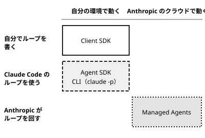

!!! abstract "要点"
    - **何ができるか**：ループを自分で書くなら Client SDK、Claude Code のループを借りるなら Agent SDK、環境ごと任せるなら Managed Agents、端末なら CLI を選べる。
    - **いつ引くか**：自分のアプリに Claude を組み込みたいとき、エージェントのループを自分で書くか任せるかを決めたいとき。
    - **前提**：<!-- link:begin choosing-a-surface -->[アプリ・Claude Code・API の選び方](../surfaces/choosing-a-surface.md)<!-- link:end -->・<!-- link:begin agent-loop -->[エージェントループと tool use](../basics/agent-loop.md)<!-- link:end -->

<!-- textlint-disable -->
別名：Claude Managed Agents・Agent SDK と Managed Agents の位置づけ・どの SDK を使うか・Anthropic SDK
<!-- textlint-enable -->

この比較ページは、Claude を自分のアプリや仕組みに組み込むときの 4 つの層を、誰がエージェントのループを回すかと、どこで動くかで比べる。層を選ぶことは、どこまで自分で握り、どこから任せるかを決めることである。

## 層ごとの比較（自分のプロセスに組み込む・Anthropic にホストさせる・CLI で動かす） {#comparison}

4 つの層は、エージェントのループを誰が回すかと、どこで動くかの 2 つの軸で分かれる。ループは、Claude が道具の呼び出しを頼み、呼び出し側が実行して結果を返す輪である（仕組みは <!-- link:begin tool-use-loop#who-runs-the-loop -->tool use のループ › ループを誰が回すか（準備中）<!-- link:end --> にある）。

図の見方は 1 つである。下の行へ行くほどループを任せる量が増え、右の列へ行くほど動かす場所を任せる量が増える。任せるほど手間は減るが、握れる範囲も減る。

| 層 | ループを回すのは | 向く用途 |
| --- | --- | --- |
| Client SDK | 自分のコード | Messages API を直接呼び、道具の実行・停止の条件・文脈の持ち方まで自分で決める。 |
| Agent SDK | Claude Code と同じループ | 自分のプログラムの中で、Claude Code の道具・文脈の管理・権限をライブラリとして使う。 |
| Managed Agents | Anthropic | 長時間の非同期の作業、状態を持つセッション、定期実行を、Anthropic に動かさせる。 |
| CLI | Claude Code | 端末での対話の開発と、`claude -p` によるスクリプトや CI からの呼び出し。 |

下の表は、データファイルから道具が作る。Client SDK は Messages API を呼ぶ層なので、Messages API の行がそれに当たる。成熟度は変わりやすいので、表で確かめる。

<!-- gen:begin compare 面 成熟度 -->
<!-- textlint-disable -->

| 機能 | 面 | 成熟度 |
| --- | --- | --- |
| Messages API（準備中） | API | GA |
| Agent SDK（Claude Agent SDK）（準備中） | Claude Code・API | GA |
| [Managed Agents（Claude Managed Agents）](sdk-comparison.md) | API | beta |
| [非対話モード（claude -p）](../delegate/headless-basics.md) | Claude Code | GA |

<!-- textlint-enable -->
<!-- gen:end compare 面 成熟度 -->

層によって、課金の経路と守りの置き場所も違う。

- **Client SDK**：API キーの課金である。道具の実行、権限の確認、止める条件を自分のコードに書く。呼び方を設定で縛る方法は <!-- link:begin tool-use-loop#forcing -->tool use のループ › 呼ばせ方を縛る（tool\_choice・strict）（準備中）<!-- link:end --> にある。
- **Agent SDK**：Claude Code の本体を動かすので、読み込む設定と権限の確認も Claude Code に準ずる。違いは <!-- link:begin agent-sdk-basics#same-and-different -->Agent SDK（Claude Code をライブラリとして使う） › Claude Code と同じもの・違うもの（準備中）<!-- link:end --> と <!-- link:begin agent-sdk-basics#permissions -->Agent SDK（Claude Code をライブラリとして使う） › 権限と承認（準備中）<!-- link:end --> で押さえる。課金は、プランでログインするか API キーで動かすかで変わる。詳しくは<!-- link:begin agent-sdk-basics#billing -->Agent SDK（Claude Code をライブラリとして使う） › 課金の経路（準備中）<!-- link:end --> にある。
    第三者が自分の製品で claude.ai のログインやプランの上限を提供することは、Anthropic の承認がない限り認められていない。製品に組み込むなら API キーで考える。
- **CLI**：`claude -p` は、公式が Agent SDK の CLI として説明する入口である。許す道具と止まる上限を明示して渡す（<!-- link:begin headless-basics#permissions -->[非対話モード（claude -p）の基本 › 許可と権限モード](../delegate/headless-basics.md#permissions)<!-- link:end -->、<!-- link:begin headless-basics#limits -->[非対話モード（claude -p）の基本 › 止まる上限（ターンと費用）](../delegate/headless-basics.md#limits)<!-- link:end -->）。
- **Managed Agents**：API の課金で、環境の守りは Anthropic のクラウドのサンドボックスに預ける。次の節で詳しく書く。

一部のプランに付く月の API credits は、Messages API・Managed Agents・API キーで動かす Agent SDK に使える。対話の Claude Code には使えない。アプリのチャット、Claude Code、API のどれで進めるかをまだ決めていないなら、先に <!-- link:begin choosing-a-surface#when-to-build-with-api -->[アプリ・Claude Code・API の選び方 › 自分のプログラムから呼ぶとき（API・SDK）](../surfaces/choosing-a-surface.md#when-to-build-with-api)<!-- link:end --> で決める。

## Managed Agents（Anthropic がループと環境を持つ） {#managed-agents}

Managed Agents は、Anthropic がエージェントのループと実行環境を持ち、自分は定義を渡して結果のイベントを受け取る層である。

構成要素は 4 つある。

- **Agent**：モデル、システムプロンプト、道具、MCP、スキルをまとめた定義。
- **Environment**：作業する場所。Anthropic のクラウドのサンドボックスが基本で、自前でホストする環境も選べる。
- **Session**：Agent を Environment で動かす 1 回の実行。状態を持つ。
- **Events**：セッションの途中経過と結果を受け取る流れ。

向くのは、長く動く非同期の作業、状態を持つセッション、定期実行である。利点は、自分のサーバでループを回し続けなくてよいことである。向かないのは、1 回のやり取りで終わる処理と、ループの途中に自分のコードを細かく挟みたい処理である。後者なら Client SDK か Agent SDK を選ぶ。

任せる幅が広い層なので、動かす前に守りを決める。

1. **確かめる手段を渡す**：合否を返すテストなどがないと、終わったように見えたところで止まる。渡し方は <!-- link:begin agent-loop#close-the-loop -->[エージェントループと tool use › 合否を返すものを渡してループを閉じる](../basics/agent-loop.md#close-the-loop)<!-- link:end --> にある。
2. **環境を囲う**：自前でホストする環境は、読み書きと通信を <!-- link:begin sandboxing -->[サンドボックスで封じ込める](../enforce/sandboxing.md)<!-- link:end --> で囲う。
3. **データの扱いを確かめる**：Managed Agents は ZDR（ゼロデータ保持。送ったデータを Anthropic 側に残さない契約）の対象外である。送ったデータが残る期間は、プランの種類を含めて <!-- link:begin where-your-data-goes#retention -->[送ったデータの行方（学習・保持期間） › 残る期間](../safety/where-your-data-goes.md#retention)<!-- link:end --> で確かめてから、送る内容を決める。

費用の面では、セッションが動いている時間に応じた料金がかかる。単価は <!-- fact:begin managed-agents-session-hour-price -->未確認<!-- fact:end -->（変わりやすいので、公式の料金表で確かめる）。この層は beta であり、機能の追加が多い。固定の前提にせず、使う前に Platform のリリースノートを見る。

## 選び方の判断例 {#examples}

!!! example "判断例：Slack から呼ぶ社内の問い合わせ窓口"
    - **状況**：社内の Slack から質問を受け、3 つの社内 API だけを呼んで答える窓口を作る。道具は決まっていて、呼び方の形も守らせたい。
    - **迷う候補**：Client SDK で tool use のループを書く。Agent SDK で Claude Code の道具ごと任せる。
    - **選んだもの**：Client SDK である。
    - **理由**：道具が少数で決まっているので、Claude Code の組み込みの道具（ファイルの編集やコマンドの実行）は要らない。呼ばせ方も設定で縛れる（<!-- link:begin tool-use-loop#forcing -->tool use のループ › 呼ばせ方を縛る（tool\_choice・strict）（準備中）<!-- link:end -->）。要らない能力を持ち込むと、権限の管理が増える。

!!! example "判断例：プルリクエストごとの変更の点検"
    - **状況**：CI で、プルリクエストが出るたびに差分を点検し、結果を決まった形式で受け取って次の工程へ渡す。
    - **迷う候補**：CLI の `claude -p`。Agent SDK を自分のプログラムから呼ぶ。
    - **選んだもの**：CLI の `claude -p` である。
    - **理由**：プロンプトを 1 つ渡して結果を受け取る形なので、出力の形式と終了コードで足りる（<!-- link:begin headless-basics#output-and-exit-codes -->[非対話モード（claude -p）の基本 › 出力の形式と終了コード](../delegate/headless-basics.md#output-and-exit-codes)<!-- link:end -->）。途中で承認を自分のコードで受けたい、フックを自分のプログラムに書きたい、となったら Agent SDK へ移る。

!!! example "判断例：夜通しかかる調査の依頼"
    - **状況**：数時間かかる調査を依頼して、結果だけを朝に受け取りたい。常時動くサーバは立てたくない。
    - **迷う候補**：Managed Agents に動かさせる。Agent SDK を自前のコンテナで動かす。
    - **選んだもの**：データの扱いに制約がなければ Managed Agents である。
    - **理由**：長時間の非同期の作業は、この層が想定する用途である。ただし ZDR の対象外なので、条件のある組織は Agent SDK を自分の環境で動かし、囲いも自分で用意する。どちらも筋が通り、分かれ目はデータの条件である。

!!! example "判断例：アプリの利用者に claude.ai でログインさせたい"
    - **状況**：自社の製品に Claude の機能を入れ、利用者が自分のプランで使えるようにしたい。
    - **迷う候補**：Agent SDK で、利用者の claude.ai のログインを通す。API キーで動かして、費用は自社が持つ。
    - **選んだもの**：API キーで動かす。
    - **理由**：第三者の製品が claude.ai のログインやプランの上限を提供することは、承認がない限り認められていない。Agent SDK を選ぶかどうかとは別に、課金の経路で決まる。

## 組み合わせ方 {#combine}

層は 1 つに絞る必要はなく、何をどこに置くかで組み合わせられる。

- **試作は CLI、製品は SDK**：端末の Claude Code で道具・権限・プロンプトを試し、固まったものを Agent SDK に移す。読み込む設定を明示して移す（<!-- link:begin agent-sdk-basics#setting-sources -->Agent SDK（Claude Code をライブラリとして使う） › 読み込む設定を決める（準備中）<!-- link:end -->）。
- **単純な呼び出しは Client SDK、作業は Agent SDK**：分類や要約のような 1 回で終わる呼び出しは Client SDK に置き、ファイルを触る作業だけを Agent SDK に任せると、権限の及ぶ範囲を狭くできる。
- **長く動く作業は文脈を外へ出す**：Client SDK や Agent SDK で長く動かすと、文脈が溢れる。要約・古い結果の削除・外部の記憶の組み合わせは <!-- link:begin long-running-agent-context#three-tools -->長時間エージェントのコンテキスト管理 › 三つの手段（compaction・context editing・memory tool）（準備中）<!-- link:end --> にある。Managed Agents でも、何を残し何を出すかの判断は同じである。
- **自分の作業の自動化は別の比較**：決まった時刻やイベントで自分の作業を回す方法の選び方は <!-- link:begin choosing-automation -->自動化の選び方（定期タスク・非対話モード・SDK）（準備中）<!-- link:end --> が持つ。この比較は、製品や仕組みに Claude を組み込む側を扱う。
- **アプリの機能との対応**：アプリや Claude Code の挙動が API のどの概念に当たるかは <!-- link:begin feature-to-api-mapping#table -->[アプリの機能と API の概念の対応表 › 対応表](feature-to-api-mapping.md#table)<!-- link:end --> にある。

<!-- gen:begin references -->
<!-- textlint-disable -->

## 参考 {#references}

- [Using the Messages API](https://platform.claude.com/docs/en/build-with-claude/working-with-messages)：Anthropic・英語・確認日 2026-11-04
- [Agent SDK overview](https://code.claude.com/docs/en/agent-sdk/overview)：Anthropic・英語・確認日 2026-11-04
- [Migrate to Claude Agent SDK](https://code.claude.com/docs/en/agent-sdk/migration-guide)：Anthropic・英語・確認日 2026-11-04
- [Use the Claude Agent SDK with your Claude plan](https://support.claude.com/en/articles/15036540-use-the-claude-agent-sdk-with-your-claude-plan)：Anthropic・英語・確認日 2026-11-04
- [Monthly API credits for Max, Ultra, and Team plans](https://support.claude.com/en/articles/17154008-monthly-api-credits-for-max-ultra-and-team-plans)：Anthropic・英語・確認日 2026-11-04
- [Claude Managed Agents overview](https://platform.claude.com/docs/en/managed-agents/overview)：Anthropic・英語・確認日 2026-11-04
- [Claude Platform release notes](https://platform.claude.com/docs/en/release-notes/overview)：Anthropic・英語・確認日 2026-11-04
- [Run Claude Code programmatically](https://code.claude.com/docs/en/headless)：Anthropic・英語・確認日 2026-11-04

<!-- textlint-enable -->
<!-- gen:end references -->

<!-- gen:begin page-links -->
<!-- textlint-disable -->

**前提**

- [アプリ・Claude Code・API の選び方](../surfaces/choosing-a-surface.md)
- [エージェントループと tool use](../basics/agent-loop.md)

**次に読む**

- Agent SDK（Claude Code をライブラリとして使う）（準備中）

**関連**

- tool use のループ（準備中）
- [非対話モード（claude -p）の基本](../delegate/headless-basics.md)
- 自動化の選び方（定期タスク・非対話モード・SDK）（準備中）
- [送ったデータの行方（学習・保持期間）](../safety/where-your-data-goes.md)
- [サンドボックスで封じ込める](../enforce/sandboxing.md)
- 長時間エージェントのコンテキスト管理（準備中）
- [アプリの機能と API の概念の対応表](feature-to-api-mapping.md)

<!-- textlint-enable -->
<!-- gen:end page-links -->
