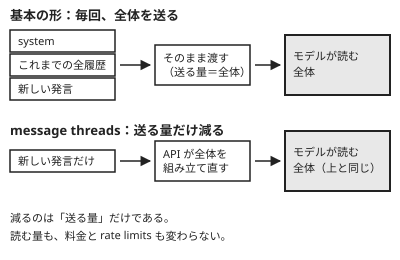

!!! abstract "要点"
    - **何が分かるか**：Messages API の基本の形は状態を持たず、呼び出し側が `system` と `messages` で毎回それまでの全体を渡すことが分かる。
    - **いつ引くか**：API で呼ぶと前の発言を覚えていないとき。API で会話を続けるには毎回何を送ればよいか知りたいとき。
    - **message threads**：送る量は減らせる。モデルが読む量は変わらない。
    - **前提**：<!-- link:begin rereads-whole-history -->[毎ターン全履歴を読み直す](../basics/rereads-whole-history.md)<!-- link:end -->

<!-- textlint-disable -->
別名：stateless・message threads・system と messages
<!-- textlint-enable -->

Messages API の基本の形は、呼び出しの間に会話を覚えておかない（stateless）。呼び出し側が `system` と `messages` に、それまでの全体を毎回入れて送る。この形を知ると、API で前の発言を覚えていないように見える理由と、会話を続けるときに何を送るかが分かる。message threads は送る量を減らすが、モデルが読む量は変えない。

## 毎回、全体を渡す {#stateless}

Messages API では、会話を続ける責任は呼び出し側にある。API の呼び出し 1 回は、その入力だけを読んで答える。

たとえば、1 回目の呼び出しで「Python で `parse_config` を書いて」と頼み、返事をもらったとする。2 回目に「さっきの関数に型を付けて」とだけ送ると、Claude には「さっきの関数」が何か分からない。2 回目の入力に、1 回目のやり取りがないからである。API で前の発言を覚えていないように見えるのは、この形のためである。

会話を続けるには、1 回目のやり取りを含めて送る。

```json
{
  "messages": [
    {"role": "user", "content": "Python で parse_config を書いて"},
    {"role": "assistant", "content": "（1 回目の返事の全文）"},
    {"role": "user", "content": "さっきの関数に型を付けて"}
  ]
}
```

公式の文書は、Messages API は状態を持たず、会話の履歴の全体を常に送ると説明している。履歴は呼び出し側が持ち、呼び出しのたびに組み立てて渡す。

Claude が毎回、最初から読み直して返事をする理由と、会話が長いほど遅く重くなる理由は、<!-- link:begin rereads-whole-history#why -->[毎ターン全履歴を読み直す › なぜそうなるか](../basics/rereads-whole-history.md#why)<!-- link:end -->に書いてある。毎回読み直す受験者の比喩で言えば、API は受験者に毎回、問題用紙の全体を渡す形である。渡す係は呼び出し側で、渡し忘れた分を受験者は知らない。

## system と messages {#system-and-messages}

Messages API の入力は、`system` と `messages` の 2 つに分けて渡す。それぞれの役目は次のとおりである。

| 渡す所 | 入れるもの | 呼び出し側の仕事 |
| --- | --- | --- |
| `system` | 最初の発言から効かせたい指示 | 毎回同じものを付ける |
| `messages` | これまでの発言と、今回の新しい発言 | 履歴を持ち、毎回の全体を組み立てる |

`system` は、公式の文書が、最初から効かせたい指示を入れる最上位の欄として案内している。`messages` には発言を `role`（`user` か `assistant`）と `content` の組で並べる。2 回目以降の呼び出しでは、前の返事も `assistant` の発言として `messages` に入れる。

`messages` の過去の `assistant` の発言は、Claude が実際に返したものでなくてもよい。公式の文書は、前の発言が Claude から出たものである必要はなく、合成した `assistant` の発言も使えると書いている。つまり、履歴は呼び出し側が自由に組み立てる入力である。古い往復を省く、要約に置き換える、といった編集も、呼び出し側のコードで行う。

この 2 つがコンテキストのどこに入り、どれだけ続いて効くかは、<!-- link:begin where-instructions-sit#positions -->[システムプロンプト・ユーザーメッセージ・CLAUDE.md の位置 › 指示が入る場所](../basics/where-instructions-sit.md#positions)<!-- link:end -->にある。毎回同じ先頭を送ることがキャッシュに効く理由は、<!-- link:begin prompt-caching-in-practice#prefix -->[プロンプトキャッシングの実務 › どこまでがキャッシュされるか（tools・system・messages の順）](prompt-caching-in-practice.md#prefix)<!-- link:end -->が扱う。

## message threads（送る量だけを減らす） {#message-threads}

message threads は、API が会話をサーバーに短い間だけ残し、後の要求では新しい発言だけを送れるようにする機能である。成熟度は <!-- gen:begin feature message-threads/maturity -->beta<!-- gen:end feature message-threads/maturity --> である。最初の要求で会話の全体を送り、その後は新しいメッセージと直前の応答の id だけを送る。



API は、モデルを呼ぶ前に会話を組み立て直す。そのため、減るのは呼び出し側が送る量だけである。モデルが読む量も、料金も、rate limits も変わらない。<!-- textlint-disable prh -->prompt caching<!-- textlint-enable prh --> も、使うなら自分で指定する。一方で、最初のトークンが出るまでの時間は短くなる。

基本の形と message threads の違いは次のとおりである。

| 比べる点 | 基本の形 | message threads |
| --- | --- | --- |
| 呼び出し側が送るもの | 履歴の全体と新しい発言 | 最初は全体、後は新しい発言と直前の応答の id |
| モデルが読むもの | 全体 | 全体（同じ） |
| 料金と rate limits | 読む量に応じる | 変わらない |
| 会話の置き場 | 呼び出し側だけ | 呼び出し側と、サーバー（短い間だけ） |

使うときに押さえることが 3 つある。

- **スレッドの寿命は短い**：寿命は次のとおりである（<!-- fact:begin message-threads-lifetime -->最後の要求から 5 分で切れ、最後に使ってから 1 時間以内に消える（2026-11-06 時点）<!-- fact:end -->）。期限の長さは変わりうるので、使う前に公式の文書で確かめる。
- **足すだけの形である**：会話を圧縮するには、要約から新しいスレッドを始める。圧縮や古い結果の削除の手段は、<!-- link:begin long-running-agent-context#three-tools -->[長時間エージェントのコンテキスト管理 › 三つの手段（compaction・context editing・memory tool）](long-running-agent-context.md#three-tools)<!-- link:end -->にある。
- **データの扱いが変わる**：公式の文書は、ZDR（ゼロデータ保持の契約）と HIPAA 対応の利用の対象外としている。会話がサーバーに残る間の扱いは、<!-- link:begin where-your-data-goes#retention -->[送ったデータの行方（学習・保持期間） › 残る期間](../safety/where-your-data-goes.md#retention)<!-- link:end -->と合わせて確かめる。

## 何に効くか {#effects}

このページの内容は、原理「見せる」と、防ぐ原因「散らかっている」に関わる。API では、Claude に何を見せるかを、呼び出し側が毎回の `messages` で決める。見せる量を決めるのは、設定ではなく、自分のコードである。

関係のない往復を履歴に積み続けると、渡す全体が散らかる。関係のない情報が増えるほど、大事な情報への注意が薄くなる理由は、<!-- link:begin attention-budget#effects -->[コンテキストウィンドウと注意の予算 › 何に効くか：見せることと、散らかっていること](../basics/attention-budget.md#effects)<!-- link:end -->にある。message threads で送る量を減らしても、Claude に見える中身は変わらない。散らかりは、送る側の工夫では減らない。

履歴の長さは、上限の減りにも響く。送り直しが利用枠を減らす様子は、<!-- link:begin what-uses-up-limits#long-sessions -->[上限を早く使う要因 › 長いセッションで増える理由](../cost/what-uses-up-limits.md#long-sessions)<!-- link:end -->にある。アプリの機能が API のどの概念に当たるかは、<!-- link:begin feature-to-api-mapping#table -->[アプリの機能と API の概念の対応表 › 対応表](feature-to-api-mapping.md#table)<!-- link:end -->で引ける。

!!! example "判断例：20 往復目で返事が遅く、費用も増えた"
    - **状況**：API で作った社内向けの質問応答が、20 往復目あたりから返事が遅くなり、費用も増えた。履歴の前半は、もう関係のない話題である。
    - **迷う候補**：message threads を使って送る量を減らす。または、古い往復を要約に置き換えて、履歴そのものを短くする。
    - **選んだもの**：古い往復を要約に置き換えて、履歴を短くする。
    - **理由**：message threads が減らすのは送る量だけである。モデルが読む量、料金、rate limits は変わらず、遅さと費用の原因には届かない。送信の手間や最初のトークンまでの時間が困りごとなら、message threads も候補になる。そのときは、beta であること、期限が短いこと、ZDR の対象外であることを先に確かめる。

## 誤解 {#misconceptions}

- **「API の Claude は会話を覚えている」**：基本の形は覚えていない。続いているように見えるのは、呼び出し側が履歴を送っているからである。アプリや Claude Code でも、毎回読み直す仕組みは同じである。
- **「message threads で送る量が減れば、料金も減る」**：減らない。料金は、モデルが読む量に応じる。message threads が減らすのは送る量だけで、読む量は変わらない。
- **「過去の `assistant` の発言は、Claude が実際に言ったものでなければならない」**：そうではない。公式の文書は、合成した `assistant` の発言も使えると書いている。履歴は呼び出し側が組み立てる入力である。
- **「状態を持たないなら、送ったデータは残らない」**：別の話である。状態を持たないのは、会話をモデルの文脈として覚えないという意味である。送ったデータの保持や学習の扱いは、<!-- link:begin where-your-data-goes#consumer-vs-commercial -->[送ったデータの行方（学習・保持期間） › 個人のプランと商用のプラン](../safety/where-your-data-goes.md#consumer-vs-commercial)<!-- link:end -->で確かめる。

<!-- gen:begin references -->
<!-- textlint-disable -->

## 参考 {#references}

- [Using the Messages API](https://platform.claude.com/docs/en/build-with-claude/working-with-messages)：Anthropic・英語・確認日 2026-11-04
- [Message threads](https://platform.claude.com/docs/en/build-with-claude/message-threads)：Anthropic・英語・確認日 2026-11-04
- [Claude Platform release notes](https://platform.claude.com/docs/en/release-notes/overview)：Anthropic・英語・確認日 2026-11-04

<!-- textlint-enable -->
<!-- gen:end references -->

<!-- gen:begin page-links -->
<!-- textlint-disable -->

<div class="ca-page-links" markdown>

**前提**

- [毎ターン全履歴を読み直す](../basics/rereads-whole-history.md)

**次に読む**

- [プロンプトキャッシングの実務](prompt-caching-in-practice.md)
- [長時間エージェントのコンテキスト管理](long-running-agent-context.md)

**関連**

- [アプリの機能と API の概念の対応表](feature-to-api-mapping.md)
- [システムプロンプト・ユーザーメッセージ・CLAUDE.md の位置](../basics/where-instructions-sit.md)
- [コンテキストウィンドウと注意の予算](../basics/attention-budget.md)
- [送ったデータの行方（学習・保持期間）](../safety/where-your-data-goes.md)
- [上限を早く使う要因](../cost/what-uses-up-limits.md)

</div>

<!-- textlint-enable -->
<!-- gen:end page-links -->
