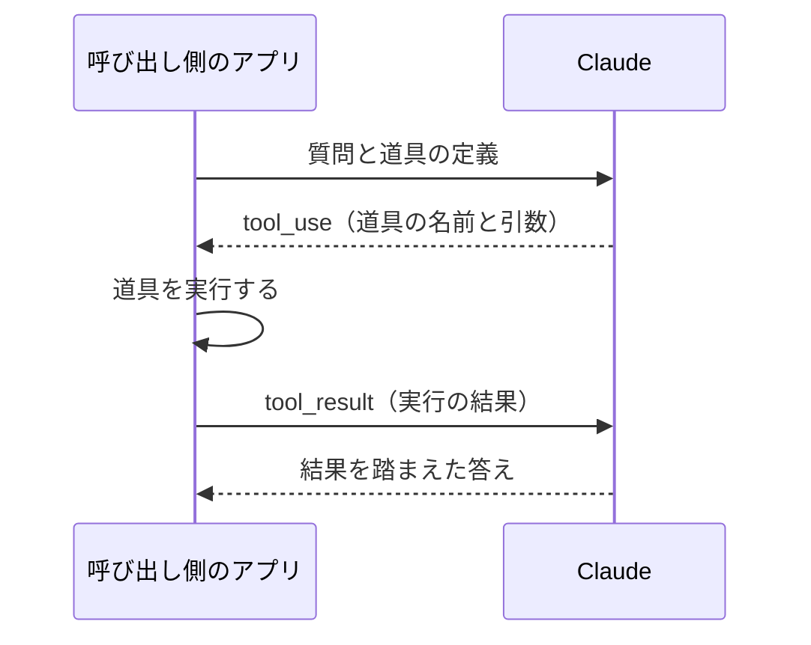

!!! abstract "要点"
    - **何が分かるか**：Claude は道具の呼び出しを頼むだけで、実行して結果を返すのは呼び出し側か Anthropic だと分かる。必ず呼ばせたいときは、指示でなく設定で縛る。
    - **いつ引くか**：自分の関数を Claude に呼ばせたいとき。道具を呼んでほしい場面で、呼ばずに答えてしまうとき。
    - **前提**：<!-- link:begin agent-loop -->[エージェントループと tool use](../basics/agent-loop.md)<!-- link:end -->

<!-- textlint-disable -->
別名：function calling・client tools・server tools・tool_choice
<!-- textlint-enable -->

tool use のループは、Claude API で Claude に道具を使わせる往復の形である。Claude が呼び出しを頼み、道具が動き、その結果が Claude に戻る。道具を動かす主体が 2 通りあることと、呼ばせ方を指示でなく設定で縛れることが、このページの中心である。

## ループの一周 {#round-trip}

ループの一周は、Claude の返答が道具の呼び出しの依頼で終わるところから始まる。自分で定義した `get_weather` という道具に「サンフランシスコの天気は」と聞く場面で追う。

1. リクエストに道具の定義（名前・説明・入力のスキーマ）と質問を載せて送る。
2. Claude は文章で答えず、`stop_reason: "tool_use"` と `tool_use` ブロックを返す。ブロックには道具の名前と、Claude が組み立てた引数が入る。
3. 呼び出し側のコードが、その名前と引数で実際の天気を取得する。
4. 実行の結果を `tool_result` ブロックに入れ、これまでの会話に足してもう一度送る。
5. Claude は結果を読み、質問への答えを文章で返す。

この往復の間、Claude 自身は何も実行していない。Claude が出すのは「この道具をこの引数で呼んでほしい」という構造化された依頼であり、実行と結果の返却は呼び出し側の仕事である。道具を呼ぶか答えるかは、依頼の内容と道具の説明から、Claude がターンごとに判断する（公式の文書）。

図の要点は 2 つである。実行は呼び出し側のアプリの中で起き、Claude に見えるのは `tool_result` に入れて返した結果だけである。道具の結果が返るたびに、Claude は次にまた呼ぶか、答えて終えるかを選ぶ。

## client tools と server tools {#client-and-server}

道具の種類は、コードが動く場所で分かれる。client tools は呼び出し側のアプリの中で動き、server tools は Anthropic の側で動く。

| 種類 | 実行する主体 | 呼び出し側がやること | 例 |
| --- | --- | --- | --- |
| client tools | 呼び出し側のアプリ | `tool_use` を読んで実行し、`tool_result` を返す | 自分で定義した関数。Anthropic がスキーマを決めた `bash` と `text_editor` |
| server tools | Anthropic のサーバー | 実行の処理は書かない。結果は応答に入って返る | web search・web fetch・code execution・tool search |

自分の関数を Claude に呼ばせたいときは、client tools を使う。関数の定義と実行を自分で持つので、何を許すか、どの資格情報で動かすかを自分で決められる。server tools は、検索やコード実行のように Anthropic が動かす道具を、実行の処理を書かずに使う手段である。

server tools では、`server_tool_use` のブロックと結果が同じ応答に入る。1 回のループが長く続くと、応答がいったん区切られて `pause_turn` で返ることがある。その続け方や、使えるプラットフォームと版が道具ごとに違う点は、公式の Server tools の文書を見る。server tool と自分の client tool が同じ応答で並列に呼ばれる場合の扱いは、公式の Stop reasons の文書を見る。

成熟度と入った版は、次の表が data から出している。

<!-- gen:begin compare 成熟度 入った版 -->
<!-- textlint-disable -->

| 機能 | 入った版 |
| --- | --- |
| [tool use](tool-use-loop.md) | 2024-05-30 |
| [サーバーの道具（server tools）](tool-use-loop.md) | 2025-05-07 |

すべて共通：成熟度 GA。

<!-- textlint-enable -->
<!-- gen:end compare 成熟度 入った版 -->

## 呼ばせ方を縛る（tool_choice・strict） {#forcing}

道具を呼ばせる確かさを上げる手段は、指示と設定の 2 段にある。「お願い」と「鍵」の違いは <!-- link:begin request-vs-lock#sorting -->[お願いと鍵（決定論的か、非決定論的か） › お願いと鍵の分け方](../basics/request-vs-lock.md#sorting)<!-- link:end --> にあり、tool_choice と strict は鍵の側に当たる。

**呼ぶか呼ばないか**。`tool_choice` の既定は <!-- fact:begin tool-choice-default -->auto（2026-11-05 時点）<!-- fact:end --> で、このとき Claude はターンごとに道具を呼ぶか直接答えるかを判断する。依頼が道具の説明に合い、答えがまだ文脈にないときに呼ぶ。この境界は、システムプロンプトで動かせる。公式は、「答える前に道具で調べる」という軽い一文で呼ぶ頻度が上がり、「必ず最初に道具を呼ぶ」のような強い形でさらに上がると書く。ただし、これは傾向を動かすお願いであり、毎回の呼び出しは保証しない。モデルによっては強い表現が過剰な呼び出しを招くので、公式の指針は「必ず使うこと」より「〜のときに使う」を勧める。

**必ず呼ばせる**。公式は、呼び出しを要求するならプロンプトに頼らず `tool_choice` で指定するよう書く。`tool_choice` には、呼ぶかどうかを任せる auto、何かしらの道具を呼ばせる any、特定の道具を呼ばせる tool、呼ばせない none がある。Claude が何を返すかを、リクエストの設定が決めるので、文章の解釈に左右されない。

**形を守らせる**。道具の定義に `strict: true` を付けると、Claude が組み立てる引数が、渡した入力のスキーマに必ず合う。引数の型が崩れて、受け取る側のコードが落ちる事故を止める。形を縛る仕組みの全体は <!-- link:begin structured-outputs-basics#two-modes -->[structured outputs（形式を保証する） › JSON outputs と strict tool use](structured-outputs-basics.md#two-modes)<!-- link:end --> にある。縛られるのは形であり、引数の中身が正しいかは別に確かめる。

!!! warning "モデルによって強制が使えない"
    新しいモデルの一部では、`tool_choice` の any と tool が 400 エラーになる。その場合の代わりの手段として、公式は auto か none と、strict または structured outputs を組み合わせる方法を示す。どのモデルで使えるかは変わりやすいので、リクエストを組む前に公式の文書で確かめる。

!!! example "判断例：呼んでほしい道具を呼ばないとき"
    - **状況**：天気を返す `get_weather` を渡したのに、「今日の天気は」と聞くと、Claude が道具を呼ばず、推測で答える。
    - **迷う候補**：システムプロンプトに「必ず `get_weather` を使え」と強く書く。`tool_choice` で `get_weather` を指定する。
    - **選んだもの**：先に道具の説明を直し、それでも足りなければ `tool_choice` を使う。モデルが強制を受け付けないときは、auto のまま、道具の説明と軽い一文で呼ぶ頻度を寄せ、引数の形は strict で守る。
    - **理由**：呼ばない原因は、道具の説明が依頼に合っていないことが多い。説明を直すのが一番安い。毎回必ず呼ぶ必要があるなら、文章でなく設定で縛るのが確実である。強い文句は、呼ぶ必要のない場面まで呼ばせる副作用がある。

道具を呼ぶ判断は、依頼と道具の説明から Claude が行う。説明の書き方と道具の数の絞り方は <!-- link:begin designing-agent-tools#fewer-tools -->エージェント用のツールを設計する原則 › 少なく、まとめて（準備中）<!-- link:end --> にある。

## ループを誰が回すか {#who-runs-the-loop}

ループの 1 周を実行する主体と、複数周を繰り返す主体は、呼び出し側が決める。client tools では、`tool_use` が返るたびに実行して結果を返す繰り返しを、誰かが書く必要がある。

回す手段は、大きく 3 つある。

- **自分で書く**。応答の `stop_reason` が `tool_use` の間、道具を実行して結果を返す繰り返しを自分のコードで持つ。停止の条件（周回の上限・エラーの扱い・人の承認）を自分で決められる。
- **tool runner を使う**。SDK の tool runner が、道具の実行と結果の返却の往復を肩代わりする。往復の処理は書かずに済むが、停止の細かい制御は SDK に寄る。
- **ホストさせる**。Anthropic 側がループと実行環境を持つ層もある。層ごとの違いは <!-- link:begin sdk-comparison#comparison -->[Client SDK・Agent SDK・Managed Agents・CLI の比較 › 層ごとの比較（自分のプロセスに組み込む・Anthropic にホストさせる・CLI で動かす）](sdk-comparison.md#comparison)<!-- link:end --> にある。

往復を自動で回すほど、道具が実行する範囲は広がる。その前に、2 つの守りを先に置く。1 つ目は、道具の結果は外から入ってくる入力であり、中に命令に見える文が混じりうることだ。Claude は読ませた文をデータと命令に確実には分けられない（<!-- link:begin data-vs-instructions#why -->[データと命令を区別できない（prompt injection の原理） › なぜ区別できないのか](../basics/data-vs-instructions.md#why)<!-- link:end -->）。2 つ目は、信頼できない入力・秘密のデータ・外への送信の 3 つを同じ構成に同時に持たせないことだ（<!-- link:begin lethal-trifecta#three-capabilities -->[三つを同時に持たせない（lethal trifecta と Rule of Two） › 三つの能力](../safety/lethal-trifecta.md#three-capabilities)<!-- link:end -->）。3 つが要るときは、道具の実行の手前に人の承認を挟む。承認や許可の判定は、Claude への指示でなく、呼び出し側のコードに置く。

自分で書く場合の最小の制約は、周回の上限を置くことである。上限がなければ、結果を確かめる手段のないまま、同じ道具を呼び続ける形になりうる。結果を確かめて輪を閉じる考え方は <!-- link:begin agent-loop#close-the-loop -->[エージェントループと tool use › 合否を返すものを渡してループを閉じる](../basics/agent-loop.md#close-the-loop)<!-- link:end --> にある。外部の道具の集まりを MCP でつなぐ場合は <!-- link:begin connecting-mcp -->[MCP をつなぐ](../extend/connecting-mcp.md)<!-- link:end --> を見る。

## 何に効くか {#what-it-helps}

このページの仕組みは、原理の「縛る」と「見せる」、原因の「縛っていない」と「境界がない」に関わる。

- **縛る × 縛っていない**。「道具を使って」と文章で頼むのは、Claude が読んで判断するお願いである。`tool_choice` と `strict` は、呼ぶこと・形を守ることを設定で決める鍵である。道具を呼ばずに答えてしまう症状の多くは、呼ぶ条件を文章でしか書いていないことから起きる。
- **見せる × 縛っていない**。Claude が道具を呼べるのは、道具の定義（名前・説明・スキーマ）が見えているときだけである。説明が依頼と合わなければ、そもそも候補に挙がらない。見せる中身が、呼ぶ判断の材料になる。
- **縛る × 境界がない**。client tools では、実行の前後を呼び出し側のコードが握る。ここが、何を許し、何を止め、どこで人に確認するかの境界になる。Claude への指示でなくコードに置いた境界は、会話の文脈に左右されない。

## 誤解 {#misconceptions}

- **「Claude が道具を実行している」**。client tools では、Claude は依頼を返すだけで、実行は呼び出し側のコードがする。server tools の実行も、Claude ではなく Anthropic のサーバーが行う。
- **「強い言葉で頼めば必ず呼ぶ」**。強い言葉は呼ぶ頻度を上げるが、保証ではない。必ず呼ばせるのは `tool_choice` の仕事である。強すぎる言葉は、不要な場面で呼ぶ副作用も生む。
- **「strict にすれば中身も正しい」**。strict が保証するのは、引数がスキーマに合う形であることだ。値が現実に合うか、呼ぶ判断が妥当かは、別に確かめる。
- **「server tools なら安全だ」**。実行が Anthropic の側で行われても、取ってきた内容は外からの入力であり、命令に見える文が混じりうる。
- **「どのモデルでも tool_choice で強制できる」**。モデルによっては使えない。この点は変わりやすいので、モデルを替えるときに確かめる。

<!-- gen:begin references -->
<!-- textlint-disable -->

## 参考 {#references}

- [Tool use with Claude](https://platform.claude.com/docs/en/agents-and-tools/tool-use/overview)：Anthropic・英語・確認日 2026-11-04
- [Define tools](https://platform.claude.com/docs/en/agents-and-tools/tool-use/define-tools)：Anthropic・英語・確認日 2026-11-04
- [Server tools](https://platform.claude.com/docs/en/agents-and-tools/tool-use/server-tools)：Anthropic・英語・確認日 2026-11-04
- [Claude Platform release notes](https://platform.claude.com/docs/en/release-notes/overview)：Anthropic・英語・確認日 2026-11-04
- [Prompting best practices](https://platform.claude.com/docs/en/build-with-claude/prompt-engineering/claude-prompting-best-practices)：Anthropic・英語・確認日 2026-11-04

<!-- textlint-enable -->
<!-- gen:end references -->

<!-- gen:begin page-links -->
<!-- textlint-disable -->

**前提**

- [エージェントループと tool use](../basics/agent-loop.md)

**次に読む**

- エージェント用のツールを設計する原則（準備中）

**関連**

- [structured outputs（形式を保証する）](structured-outputs-basics.md)
- [Client SDK・Agent SDK・Managed Agents・CLI の比較](sdk-comparison.md)
- [三つを同時に持たせない（lethal trifecta と Rule of Two）](../safety/lethal-trifecta.md)
- [データと命令を区別できない（prompt injection の原理）](../basics/data-vs-instructions.md)
- [お願いと鍵（決定論的か、非決定論的か）](../basics/request-vs-lock.md)
- [MCP をつなぐ](../extend/connecting-mcp.md)

<!-- textlint-enable -->
<!-- gen:end page-links -->
