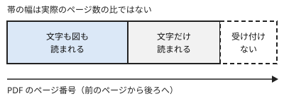

!!! abstract "要点"
    - **何ができるか**：添付した資料のうち、図まで読まれるのは PDF の前のほうのページだけだと分かり、分け方と確かめ方を選べる。
    - **いつ引くか**：Word の資料に入れた図を読んでくれないとき。大きな資料を漏れなく読ませたいとき。
    - **前提**：なし

<!-- textlint-disable -->
別名：ファイルのアップロード・Upload files・Files API・PDF support・vision
<!-- textlint-enable -->

添付ファイルは、ファイルの種類とページ数によって、読まれる中身が変わる。このページは、アップロードした資料が Claude に「見えていない」状態になる境目を示し、見せ方と確かめ方を選ぶためのものである。

## PDF とそれ以外の文書 {#pdf-and-others}

添付した資料の読まれ方は、PDF かそれ以外かと、PDF の何ページ目かで決まる。

PDF は、前のほうのページでは文字と図表などの視覚要素の両方が解析される。その先のページは文字だけが処理され、図は解析されない。さらに先は受け付けられない。境目のページ数と、ファイルの大きさ・数の上限は、変わりうる値である。このページには写さず、公式の記事 [Upload files to Claude](https://support.claude.com/en/articles/8241126-upload-files-to-claude) で確かめる。



PDF 以外の文書（Word など）は、文字だけが抽出され、中に埋め込んだ画像は読まれない。「Word の資料に入れた図を読んでくれない」のは、不具合ではなく、この仕様による。

表計算ファイル（XLSX）は、コードの実行を有効にしておく必要がある。コードの実行の側は <!-- link:begin files-and-code-execution -->ファイル作成とコード実行（準備中）<!-- link:end --> が受け持つ。

図を読ませたいときの手段は 3 つある。

- 資料を PDF にして、図が読まれる範囲に収める
- 図だけを画像にして、別に添える。画像の渡し方は <!-- link:begin images-and-voice#images -->画像・スクリーンショット・音声で渡す › 画像で渡すと速いもの（準備中）<!-- link:end --> にある
- 図の中身を文字で書き添える

!!! example "判断例：Word の資料に入れた図を読ませたい"
    - **状況**：数ページの Word の報告書に、結果を示すグラフが 2 つ入っている。要約を頼むと、グラフの数値に触れない。
    - **迷う候補**：報告書全体を PDF に書き出して渡す。グラフだけを画像にして、Word と一緒に添える。
    - **選んだもの**：グラフだけを画像にして、Word と一緒に添える。
    - **理由**：図が少なく、答えに要る図がはっきりしているので、見せたいものだけを確実に見せられる。PDF への書き出しで図が視覚要素として残るかは、書き出しの結果次第であり、どちらの手でも、読まれたかをページの番号と引用で確かめる（方法は「読まれたかを確かめる」の節にある）。図が多く、資料の形のまま読ませたいときは、PDF への書き出しを選ぶ。

## 大きな資料の分け方 {#splitting}

大きな資料を漏れなく読ませるには、図が要る部分は、図が読まれる範囲の大きさで分けて渡す。

分け方は、読まれ方の違いで決める。

1. 図表が答えに要る部分は、図が読まれる範囲の PDF に切り出す。章や図表のまとまりで切ると、あとで引用を確かめやすい。
2. 文字だけで足りる部分は、文字だけが処理される範囲に入っていてもよい。分けすぎない。
3. 質問のたびに、その質問に要る部分だけを添える。資料を全部つけたままにしない。

読まれる範囲に収まっていても、長い資料の中ほどの情報は使われにくい傾向がある。2023 年の研究が、当時の言語モデルでこの傾向を報告した（根拠：中）。現行の Claude にそのまま当てはめるのは類推にとどまる（類推）。この傾向の詳細は <!-- link:begin context-rot#lost-in-the-middle -->[context rot と紛らわしい情報 › 中ほどの情報は使われにくいか（lost in the middle）](../basics/context-rot.md#lost-in-the-middle)<!-- link:end --> にある。分けて渡すと、この傾向にも効く。

大きな PDF を実行環境の中で処理する方法もある。ファイルの作成の記事は、大きな PDF を会話の context に載せず、実行環境の中で処理できると書く。context に載せない分、Claude が PDF の中身を見て答えるのではなく、コードで取り出した結果を読む形になる。手順は <!-- link:begin files-and-code-execution#outputs -->ファイル作成とコード実行 › 作ったファイルの受け取り方（準備中）<!-- link:end --> の側にある。

分け方と形の直し方の全般は、次のページが受け持つ。

- 長い資料の分け方と形の直し方：<!-- link:begin handing-long-documents#split-and-convert -->長い資料を渡すとき › 分ける・形を直す（準備中）<!-- link:end -->
- 資料の後半を読んでいない疑いの切り分け：<!-- link:begin skipped-later-pages#diagnosis -->[添付した資料の後半を読んでいない › 原因を安く確かめる順](../symptoms/skipped-later-pages.md#diagnosis)<!-- link:end -->
- 資料の置き場がプロジェクトのとき：<!-- link:begin too-much-project-knowledge#curate -->プロジェクトのナレッジが多すぎるとき › 資料の絞り方と入れ直し方（準備中）<!-- link:end -->

!!! example "判断例：図が後半にもある長い報告書"
    - **状況**：長い PDF の報告書を添付した。図は前半と後半にあり、後半のグラフを聞くと、答えが曖昧になる。
    - **迷う候補**：全体を 1 つの PDF のまま渡す。図のある章を別の PDF に切り出して、章ごとに渡す。
    - **選んだもの**：図のある章を切り出して、質問に要る章だけを渡す。
    - **理由**：後半は文字だけの処理になるので、後半のグラフは分けないと見えない。文字だけで足りる章は、全体のままでもよい。

## 読まれたかを確かめる（ページの番号と引用） {#verify}

読まれたかは、答えに使ったページの番号と原文の引用を出させ、手元の資料と照らして確かめる。

添付ファイルは、アップロードできたことと、読まれたことが別である。Claude は読めていない部分についても、もっともらしい答えを返すことがある。そこで、依頼にページの番号と逐語の引用を足す。答えの前に引用を抜き出させる手法は、公式の [Reduce hallucinations](https://platform.claude.com/docs/en/test-and-evaluate/strengthen-guardrails/reduce-hallucinations) にある。ここではその応用で、添付ファイルでの効果を測った数値はない。

<!-- gen:begin snippet how-attachments-are-read/page-and-quote -->
<!-- textlint-disable -->

??? example "雛形：ページの番号と引用を付けて答えさせる依頼の雛形"

    ```text
    添付した PDF「（ファイル名）」について聞く。

    質問：（質問を書く）

    答える前に、次をして。
    1. 質問に関係する箇所を、ページ番号を付けて、原文のまま <quotes> に抜き出す。ページ番号は、PDF のビューアで開いたときの通し番号にする。
    2. 図や表が関係するときは、その図や表の見出しと、読み取れた数値や凡例を、ページ番号付きで書く。読み取れなかったときは「読めていない」と書く。
    3. 関係する箇所が見つからないときは「該当なし」と書く。

    そのあとで、<quotes> に抜き出した内容だけに基づいて、答えを <answer> に書いて。
    ```

    動作を確かめていない雛形。

<!-- textlint-enable -->
<!-- gen:end snippet how-attachments-are-read/page-and-quote -->

確かめるときに見る点は 3 つある。

- 引用が資料にそのまま出ているか。PDF を文字列で検索して照らす。PDF に印刷された番号とビューアの通し番号はずれることがあるので、ページの番号は通し番号で出させる。
- 図の説明が、図の見出しと数値に合っているか。図は逐語の引用ができないので、図の見出し・凡例・数値を読み上げさせ、図を自分の目で見て照らす。
- 引用に「該当なし」や「読めていない」が出たとき、その部分を分けて渡し直す。

先に、何が見えているかを尋ねる方法もある。

<!-- gen:begin snippet how-attachments-are-read/what-did-you-read -->
<!-- textlint-disable -->

??? example "雛形：何が見えているかを先に尋ねる依頼の雛形"

    ```text
    添付した「（ファイル名）」について、要約はまだしないで、次を教えて。
    - 読めたページの範囲
    - 図や写真が入っているページのうち、図の中身まで見えているページと、文字だけが見えているページ
    - 画像として埋め込まれていて、中身が見えていない部分

    見えていないものを推測で埋めないで。見えていないときは「見えていない」と書いて。
    ```

    動作を確かめていない雛形。

<!-- textlint-enable -->
<!-- gen:end snippet how-attachments-are-read/what-did-you-read -->

この返答は Claude の自己申告であり、確定した事実ではない。中身を知っている図を 1 つ選び、その内容を答えさせて、自己申告を確かめる。

=== "アプリ"

    会話に PDF を添付し、ページの番号と引用を付けて答えさせる雛形の形で頼む。引用とページの番号が返ったら、PDF を開いて照らす。

=== "API"

    PDF や画像を、メッセージの中身として渡す。依頼の文面は、アプリと同じ雛形が使える。ファイルの渡し方は、「API で渡すとき」の節にある。

引用の確かめ方の詳細は、次のページが受け持つ。

- 引用や出典の誤りの形と確かめる手順：<!-- link:begin checking-citations#steps -->引用や出典の確かめ方 › 確かめる手順（準備中）<!-- link:end -->
- 答えの前に引用を抜かせる頼み方：<!-- link:begin long-context-first#quote-first -->[長い資料は先、質問は最後 › 答えの前に引用を抜かせる](../prompting/long-context-first.md#quote-first)<!-- link:end -->
- 日本語の PDF を渡す前と後に確かめること：<!-- link:begin documents-in-japanese#pdf -->日本語の資料を読ませる・書かせる › 日本語の PDF を渡す前と後に確かめること（準備中）<!-- link:end -->

## API で渡すとき（Files API・PDF・画像） {#api}

API では、PDF・画像・テキストを Files API にアップロードし、後の要求から `file_id` で指して使い回せる。毎回送り直さなくてよい。

Files API は、スキルとコードの実行が作ったファイルを取り出す口にもなる。ゼロデータリテンション（ZDR）の対象外なので、データの扱いに条件のある組織では、使う前に確認する。公式の文書は [Files API](https://platform.claude.com/docs/en/build-with-claude/files) にある。

PDF の対応（文字と図の両方の解析）と、画像を読む機能（vision）も使える。成熟度は [Features overview](https://platform.claude.com/docs/en/build-with-claude/overview) と [Claude Platform のリリースノート](https://platform.claude.com/docs/en/release-notes/overview) で確かめる。API で渡す PDF や画像の上限は、アプリの上限とは別に API の文書で確かめる。アプリの値をそのまま当てはめない。

アプリと API の違いを、道具が作る表で示す。

<!-- gen:begin compare 面 成熟度 -->
<!-- textlint-disable -->

| 機能 | 面 |
| --- | --- |
| [ファイルのアップロード（アプリ）](how-attachments-are-read.md) | アプリ |
| [Files API](how-attachments-are-read.md) | API |

すべて共通：成熟度 GA。

<!-- textlint-enable -->
<!-- gen:end compare 面 成熟度 -->

アプリの機能が API のどの概念に当たるかは、<!-- link:begin feature-to-api-mapping#table -->アプリの機能と API の概念の対応表 › 対応表（準備中）<!-- link:end --> にある。

## 効かない場面・落とし穴 {#pitfalls}

添付ファイルの読まれ方で、間違えやすい点は 4 つある。

- アップロードできても、全部が図まで読まれたとは限らない。「受け付けた」は「図も読んだ」ではない。
- 上限の数字は、公式の記事の間で食い違うことがある。会話へのアップロードの記事と、ファイルの作成の記事で、1 ファイルの大きさの上限が違って書かれている。実際に上げるときは、画面に出る上限を優先する。
- 範囲に収まっていても、中ほどの情報は使われにくい。重要な箇所は、引用で確かめる。
- Claude Code での資料の読み込みは、このページの対象外である。このページはアプリと API だけを扱う。

古くなった助言の台帳に、この機能の行はない。

<!-- gen:begin references -->
<!-- textlint-disable -->

## 参考 {#references}

- [Upload files to Claude](https://support.claude.com/en/articles/8241126-upload-files-to-claude)：Anthropic・英語・確認日 2026-11-04
- [Create and edit files with Claude](https://support.claude.com/en/articles/12111783-create-and-edit-files-with-claude)：Anthropic・英語・確認日 2026-11-04
- [Files API](https://platform.claude.com/docs/en/build-with-claude/files)：Anthropic・英語・確認日 2026-11-04
- [Claude Platform release notes](https://platform.claude.com/docs/en/release-notes/overview)：Anthropic・英語・確認日 2026-11-04
- [Features overview](https://platform.claude.com/docs/en/build-with-claude/overview)：Anthropic・英語・確認日 2026-11-04
- [Reduce hallucinations](https://platform.claude.com/docs/en/test-and-evaluate/strengthen-guardrails/reduce-hallucinations)：Anthropic・英語・確認日 2026-11-04
- [Lost in the Middle: How Language Models Use Long Contexts](https://arxiv.org/abs/2307.03172)：arXiv（Liu, Nelson F. ほか）・英語・確認日 2026-11-04

<!-- textlint-enable -->
<!-- gen:end references -->

<!-- gen:begin page-links -->
<!-- textlint-disable -->

<div class="ca-page-links" markdown>

**前提**

- なし

**関連**

- [添付した資料の後半を読んでいない](../symptoms/skipped-later-pages.md)
- 長い資料を渡すとき（準備中）
- [context rot と紛らわしい情報 › 中ほどの情報は使われにくいか（lost in the middle）](../basics/context-rot.md#lost-in-the-middle)
- [長い資料は先、質問は最後](../prompting/long-context-first.md)
- 画像・スクリーンショット・音声で渡す（準備中）
- 引用や出典の確かめ方（準備中）
- プロジェクトのナレッジが多すぎるとき（準備中）
- ファイル作成とコード実行（準備中）
- 日本語の資料を読ませる・書かせる（準備中）
- アプリの機能と API の概念の対応表（準備中）

</div>

<!-- textlint-enable -->
<!-- gen:end page-links -->
