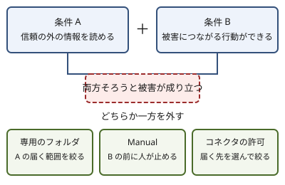

!!! abstract "要点"
    - **何ができるか**：確認なしで進む Auto と毎回確かめる Manual を選び、任せる範囲を低いリスクから広げられる。
    - **いつ引くか**：アプリに自分のファイルやブラウザを操作させるとき、確認なしで進めつつ危ない操作だけは止めたいとき。
    - **強制力**：<!-- gen:begin feature app-permission-modes/enforcement -->鍵<!-- gen:end feature app-permission-modes/enforcement -->。これは Manual の許可確認と、ファイルを完全に消す前の確認を指す。Auto の審査は Claude が動作ごとに行う判断で、鍵ではない。
    - **前提**：<!-- link:begin choosing-a-surface -->[アプリ・Claude Code・API の選び方](../surfaces/choosing-a-surface.md)<!-- link:end -->・<!-- link:begin lethal-trifecta -->[三つを同時に持たせない（lethal trifecta と Rule of Two）](../safety/lethal-trifecta.md)<!-- link:end -->

<!-- textlint-disable -->
別名：Trusted folders・Storage folder
<!-- textlint-enable -->

アプリの権限モードは、Claude に操作を任せたときに、各ステップを確認なしで進めるか、毎回人に確かめるかを決める設定である。この設定は会話全体に効き、いつでも変えられる（[Claude Cowork and chat are one Claude](https://support.claude.com/en/articles/16761823-claude-cowork-and-chat-are-one-claude)）。モードの選び方よりも先に、何を読ませて何をさせるかの置き方で、被害の起きやすさが決まる。

## Auto と Manual {#modes}

アプリの権限モードには、Auto、Manual、Skip の 3 つの段がある。Auto は、各ステップを確認なしで進め、事前に自動の安全チェックが走る。Manual は、動作の前に毎回許可を求める。Skip は何も確かめないので、このページでは勧めない（[Get started with Claude Cowork](https://support.claude.com/en/articles/13345190-get-started-with-claude-cowork)）。

2 つのモードで、止まり方の性質が違う。

- **Manual**：許可を求める確認は、人が答えるまで先へ進まない。仕組みとして止める鍵である。
- **Auto**：安全かどうかは、Claude が動作ごとに審査して判断する。危ないと判断したものは止まるが、審査が見落とすことはありうる。

どの段でも、ファイルを完全に消す前には確認が出る。新しい会話の既定の段は、プランと、組織の管理者の設定で変わる。管理者が Auto を出すかどうかと、新しいタスクの既定を決める組織もある。自分の手元の既定は、画面の表示で確かめてから任せる。プランごとの既定は、早見表の <!-- link:begin default-safety-settings#defaults-by-surface -->[安全の早見表（面ごとの既定と、段階ごとに足すもの） › 面ごとの既定（生成の表）](../safety/default-safety-settings.md#defaults-by-surface)<!-- link:end --> に置く。

Claude Code の auto モードは、この Auto とは別の文書に書かれた仕組みである。同じ分類器かどうかは確かめていないので、片方の挙動をもう片方に当てはめない。Claude Code 側の止め方は <!-- link:begin what-auto-mode-stops -->[auto モードは何を止め、何を止めないか](../enforce/what-auto-mode-stops.md)<!-- link:end --> と <!-- link:begin permission-modes-overview -->[権限モードの選び方](../cli/permission-modes-overview.md)<!-- link:end --> にある。

## 読める範囲と行動できる範囲を同時に広げない {#two-conditions}

読める範囲と行動できる範囲は、片方ずつ広げる。両方を同時に広げると、被害が成り立つからである。

Claude に仕込まれた指示（prompt injection）が被害につながるのは、2 つの条件がそろったときである。

- **条件 A**：信頼の外の情報を読める。たとえば、Web ページ、受け取ったファイル、他人が書いた文書である。
- **条件 B**：被害につながる行動ができる。たとえば、ファイルを消す・書き換える、メールを送る、購入する操作である。

2 つがそろうと、読んだ文書に紛れた指示で、Claude が意図しない行動をしうる（[Use Claude Cowork safely](https://support.claude.com/en/articles/13364135-use-claude-cowork-safely)）。片方を外せば、攻撃は難しくなる。この考え方を一般化したものが <!-- link:begin lethal-trifecta -->[三つを同時に持たせない（lethal trifecta と Rule of Two）](../safety/lethal-trifecta.md)<!-- link:end --> で、仕込まれた指示の経路は <!-- link:begin prompt-injection-in-practice#channels -->[プロンプトインジェクションの実際 › 指示が入ってくる経路](../safety/prompt-injection-in-practice.md#channels)<!-- link:end --> にある。



条件を外す手段として、アプリで使えるものは次の 3 つである。

- **専用のフォルダ**：Claude に見せるフォルダを専用のものに絞ると、読めるものが減る。条件 A の範囲を狭める。
- **Manual**：行動の前に毎回人が確かめるので、条件 B を人が握る。
- **コネクタの許可**：つなぐコネクタを選んで許可すると、届く先が絞られる（推論・実践例なし。公式の抜き出しに直接の記述はない）。

Auto で進めたいときは、条件 A か条件 B のどちらかを先に絞ってから切り替える。確認を減らすことと、範囲を広げることを、同じ時点でしない。

画面を直接操作させる computer use には、Claude とアプリの間を隔てるサンドボックスがない。許可はアプリごとに求められる。銀行・医療・行政系のアプリはオフにしておくよう案内されている（[Let Claude use your computer in Cowork](https://support.claude.com/en/articles/14128542-let-claude-use-your-computer-in-cowork)）。ブラウザと画面の操作の選び方は <!-- link:begin browser-control#which-to-use -->[Claude in Chrome と computer use（ブラウザと画面の操作） › コネクタ・ブラウザ・画面の順に選ぶ](../surfaces/browser-control.md#which-to-use)<!-- link:end -->、任せない作業は <!-- link:begin browser-agent-cautions#what-not-to-do -->[ブラウザや画面の操作を任せるときの注意 › 任せない作業](../safety/browser-agent-cautions.md#what-not-to-do)<!-- link:end --> にある。

!!! example "判断例：Web で調べた資料をフォルダに整理させる"
    - **状況**：Web で調べて、結果をローカルのフォルダの文書にまとめる作業を頼みたい。フォルダには、ほかの仕事の文書も入っている。
    - **迷う候補**：Auto にして、手元の大きなフォルダ全体を見せたまま進める。または、専用のフォルダを 1 つ作り、その中だけを見せる。
    - **選んだもの**：専用のフォルダに絞って、Auto で進める。
    - **理由**：Web のページは信頼の外にあり、条件 A に当たる。ファイルの書き換えは条件 B に当たる。フォルダを絞ると、仕込まれた指示があっても触れる範囲が専用のフォルダの中に収まる。モードを Manual にしなくても、条件 B の影響範囲を狭められる。

## 専用のフォルダと、低いリスクの作業から {#start-small}

任せる範囲は、低いリスクの作業から広げる。Cowork の安全の指針も、次の順で進めるよう案内している（[Use Claude Cowork safely](https://support.claude.com/en/articles/13364135-use-claude-cowork-safely)）。

1. **専用の作業フォルダを作る**：Claude 専用のフォルダを作り、見せるものをそこに絞る。Desktop の出力は Storage folder に保存され、アクセスを許可したフォルダは Trusted folders に並ぶ（[Claude Cowork and chat are one Claude](https://support.claude.com/en/articles/16761823-claude-cowork-and-chat-are-one-claude)）。許可したフォルダの一覧は、ときどき見直す。
2. **低いリスクのタスクから始める**：壊れても困らない、取り戻せる作業を先に任せる。結果を確かめて、期待どおりに進んだら、次の段階へ進む。
3. **バックアップを取る**：見せるフォルダのファイルは、任せる前にコピーを持っておく。
4. **信頼できる MCP とプラグインだけを使う**：つなぐものが増えるほど、読める範囲と届く先が広がる。
5. **取り消しにくい操作を定期タスクにしない**：送信や購入のように戻せない操作は、人のいない時間に走るタスクへ入れない。定期タスクで避ける作業は <!-- link:begin tasks-and-schedules-in-the-app#what-not-to-schedule -->[タスクと定期タスク（Cowork） › 定期タスクにしないもの](tasks-and-schedules-in-the-app.md#what-not-to-schedule)<!-- link:end --> にある。

Claude がした行動の責任は、ユーザーにある。確認なしで進めた結果も、任せた側の判断になる。

最初のタスクを頼む依頼の例を、次に置く。専用のフォルダの中だけで動かし、作るファイルを 1 つに絞り、取り消しにくい操作は止まらせる。

<!-- gen:begin snippet permission-modes-in-the-app/first-low-risk-task -->
<!-- textlint-disable -->

??? example "雛形：低いリスクの最初のタスクを頼む依頼"

    ```markdown
    このタスクは、専用の作業フォルダ「claude-work」の中だけで進めてください。

    やること：フォルダの中の `notes/` にあるメモを読み、見出しごとに要約した一覧を `summary.md` として新しく作る。

    守ること：
    - 作るのは `summary.md` だけにする。既存のファイルは書き換えない。
    - フォルダの外のファイル、ブラウザ、ほかのアプリには触れない。
    - 消す・送る・購入する操作はしない。必要だと思ったら、実行せずに理由を書いて止まる。

    終わったら、読んだファイルの一覧と、作ったファイルの場所を報告してください。
    ```

    動作を確かめていない雛形。安全のための雛形なので、守りとして頼る前に、止めたい操作が自分の環境で止まるかを確かめる。

<!-- textlint-enable -->
<!-- gen:end snippet permission-modes-in-the-app/first-low-risk-task -->

依頼文に書いた「守ること」は、お願いであって鍵ではない。鍵として止めるのは、専用のフォルダへの絞り込みと、Manual の許可確認である。

!!! example "判断例：Manual から Auto に切り替える時期"
    - **状況**：専用のフォルダで、Manual のまま、メモの要約を数回任せた。確認はほとんど「許可」を押すだけだった。
    - **迷う候補**：Manual のまま続けて、確認を読み続ける。または、Auto に切り替えて、確認の回数を減らす。
    - **選んだもの**：同じ専用のフォルダの、同じ種類の作業に限って Auto に切り替える。
    - **理由**：確認が多すぎると、中身を読まずに承認するようになり、確認が安全の仕組みとして働かなくなる。範囲を変えないまま、確認の負担だけを減らせる。フォルダを広げる、ブラウザを加えるといった拡大は、別の段階として Manual に戻して試す。

確認が多い・少ないの調整は <!-- link:begin approval-fatigue#reduce-prompts -->[承認疲れ › 確認を減らす順番](../safety/approval-fatigue.md#reduce-prompts)<!-- link:end --> と <!-- link:begin wrong-amount-of-approvals -->[承認の確認が多すぎる・少なすぎる](../symptoms/wrong-amount-of-approvals.md)<!-- link:end --> にある。

## 効かない場面・落とし穴 {#limits}

- **Auto は安全を保証しない**：Auto は確認を減らす仕組みで、審査は Claude の判断である。止められなかった操作は実行される。止められたときの見直し方は <!-- link:begin what-auto-mode-stops#when-blocked -->[auto モードは何を止め、何を止めないか › 止められたときの見直し方](../enforce/what-auto-mode-stops.md#when-blocked)<!-- link:end --> にある。
- **預けすぎる**：Auto にした上で、見せるフォルダも広げ、ブラウザも加えると、2 つの条件が同時に広がる。信頼の外の情報を読める範囲が条件 A、被害につながる行動ができる範囲が条件 B である。1 回の変更で広げるのは 1 つだけにする。
- **会話全体に効く**：権限モードは会話全体の設定である。途中で変えると、その後の操作すべてに効く。切り替えたら、どちらのモードで動いているかを画面で確かめる。
- **隔離のない操作**：computer use にはサンドボックスがない。専用のフォルダに絞っても、画面の操作は開いているほかのアプリへ届く。
- **確かめていない範囲**：Desktop と Web の設定画面の既定と切り替え方は、確かめていない。段階展開の途中なので、同じプランでも見え方が違うことがある。

## 比べる相手 {#compare}

- **Claude Code の権限モード**：端末で動く Claude Code には、別の権限モードがある。選び方は <!-- link:begin permission-modes-overview -->[権限モードの選び方](../cli/permission-modes-overview.md)<!-- link:end -->、auto モードが何を止めるかは <!-- link:begin what-auto-mode-stops -->[auto モードは何を止め、何を止めないか](../enforce/what-auto-mode-stops.md)<!-- link:end --> を引く。
- **面ごとの既定**：アプリ・Claude Code・API の権限・通信・データの既定は <!-- link:begin default-safety-settings -->[安全の早見表（面ごとの既定と、段階ごとに足すもの）](../safety/default-safety-settings.md)<!-- link:end --> で比べる。
- **動く場所**：クラウド、自分の PC、リモート操作のどこで動くかで、触れるものが変わる。<!-- link:begin where-it-runs -->[実行場所の違い（クラウド・自分の PC・リモート操作）](../surfaces/where-it-runs.md)<!-- link:end --> を引く。
- **アプリのタスク**：多段の作業を結果で頼み、PC を閉じても進める使い方は <!-- link:begin tasks-and-schedules-in-the-app -->[タスクと定期タスク（Cowork）](tasks-and-schedules-in-the-app.md)<!-- link:end --> にある。

<!-- gen:begin page-links -->
<!-- textlint-disable -->

<div class="ca-page-links" markdown>

**前提**

- [アプリ・Claude Code・API の選び方](../surfaces/choosing-a-surface.md)
- [三つを同時に持たせない（lethal trifecta と Rule of Two）](../safety/lethal-trifecta.md)

**次に読む**

- [タスクと定期タスク（Cowork）](tasks-and-schedules-in-the-app.md)

**関連**

- [auto モードは何を止め、何を止めないか](../enforce/what-auto-mode-stops.md)
- [承認疲れ](../safety/approval-fatigue.md)
- [ブラウザや画面の操作を任せるときの注意](../safety/browser-agent-cautions.md)
- [Claude in Chrome と computer use（ブラウザと画面の操作）](../surfaces/browser-control.md)
- [実行場所の違い（クラウド・自分の PC・リモート操作）](../surfaces/where-it-runs.md)
- [安全の早見表（面ごとの既定と、段階ごとに足すもの）](../safety/default-safety-settings.md)
- [プロンプトインジェクションの実際](../safety/prompt-injection-in-practice.md)
- [承認の確認が多すぎる・少なすぎる](../symptoms/wrong-amount-of-approvals.md)
- [権限モードの選び方](../cli/permission-modes-overview.md)

</div>

<!-- textlint-enable -->
<!-- gen:end page-links -->

<!-- gen:begin references -->
<!-- textlint-disable -->

## 参考 {#references}

- [Get started with Claude Cowork](https://support.claude.com/en/articles/13345190-get-started-with-claude-cowork)：Anthropic・英語・確認日 2026-11-04
- [Claude Cowork and chat are one Claude](https://support.claude.com/en/articles/16761823-claude-cowork-and-chat-are-one-claude)：Anthropic・英語・確認日 2026-11-04
- [Use Claude Cowork safely](https://support.claude.com/en/articles/13364135-use-claude-cowork-safely)：Anthropic・英語・確認日 2026-11-04
- [Let Claude use your computer in Cowork](https://support.claude.com/en/articles/14128542-let-claude-use-your-computer-in-cowork)：Anthropic・英語・確認日 2026-11-04

<!-- textlint-enable -->
<!-- gen:end references -->
