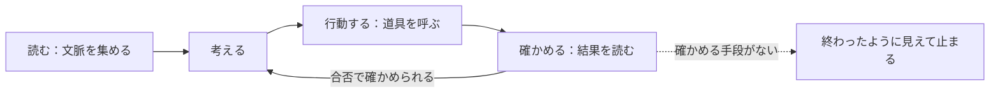

!!! abstract "要点"
    - **何が分かるか**：Claude は道具を使って文脈を集め、行動し、結果を確かめるループを回していること。確かめる手段がないと、終わったように見えたところで止まること。合否を返すテストなどを渡すと、ループを自分で閉じられること。
    - **いつ引くか**：エージェントが裏で何を繰り返して作業を進めているのか知りたいとき。動くか確かめないまま終わったことにされる理由を知りたいとき。
    - **前提**：なし

<!-- textlint-disable -->
別名：エージェントループ・agentic loop・ツールの呼び出し・文脈を集める・行動する・確かめる
<!-- textlint-enable -->

エージェントループは、Claude が道具を呼んで作業を進める一周分の繰り返しである。Claude Code のようなエージェントは、読み、行動し、結果を確かめる順に回る。確かめた結果は次の判断に戻る。このページは、そのループの形と、「確かめる」が欠けたときに何が起きるかを説明する。

## 何が起きるか {#what-happens}

Claude Code に「このバグを直して」と頼むと、裏では次のことが繰り返される。関係するファイルを読む。直す。テストを走らせる。出力を読んで、次の手を決める。公式の説明では、この動きは「文脈を集める」「行動する」「結果を確かめる」に分かれる。



図の要点は次のとおりである。道具の結果が次の判断に戻ること。「確かめる」から「考える」へ戻る矢印が、確かめる手段があるときだけ引けること。矢印が欠けると、ループはそこで閉じず、終わったように見えた所で止まる。

道具は、ファイルの読み取りや検索、編集、コマンドの実行といった手足にあたる。Claude が一度の応答で答えを書き切るのとは違い、道具の結果を見てから次の手を変えられる。結果を受けるたびに考え直せる仕組み（interleaved thinking）も、この途中の判断を支える。API でこのループを誰が回すかは <!-- link:begin tool-use-loop#who-runs-the-loop -->tool use のループ › ループを誰が回すか（準備中）<!-- link:end --> で説明している。

## 文脈は必要になった時点で取りに行く {#gather}

Claude Code は、最初にすべてのファイルを読み込むのではなく、ファイルパスや検索のクエリのような軽い識別子を持っておき、必要になった時点で道具を使って中身をコンテキストに読み込む。CLAUDE.md は最初に読み込み、あとは glob や grep で探しに行く組み合わせである。

この作りのおかげで、大きなリポジトリでも、コンテキスト（Claude が一度に見られる範囲。広い机にたとえられる）を最初から埋めずに済む。その代わり、探し方が悪いと、必要なファイルに行き着かないまま進む。探した結果が本当に全部なのかは、このページの「道具の出力も確かめる」の節で扱う。

## 確かめる手段がないと、終わったように見えたところで止まる {#why-stops}

公式の Best practices は、Claude は作業が終わったように見えるまで道具を使い続け、そこで止まると説明している。ここで効いているのは「見える」という判断である。確かめる手段がなければ、「見えた」と「実際に終わった」を区別する材料がループの中にない。

具体的には、こうなる。

- テストを走らせずに、直したと報告する。
- 計画に入れた確認を、やらないまま完了にする。
- 動くかどうかを、コードを読んだ印象で済ませる。

こうなると、見張る役が人間に回る。公式は、検証の手段がないと「あなたがテストスイートになる」と言う。反対に、合否を返すものを渡すと、Claude は変更・実行・失敗の読み取り・修正・再実行のループを自分で閉じられる。人が見張る必要は減る。

「完了」と言われたのに実際は終わっていない症状の切り分けは <!-- link:begin claims-done-but-isnt#diagnosis -->[「完了」と言うが終わっていない › 原因を安く確かめる順](../symptoms/claims-done-but-isnt.md#diagnosis)<!-- link:end --> にある。終わったように見えた所で止まる理由と、完了の定義に入れるものは <!-- link:begin define-done#why-it-stops -->[「完了」を定義して渡す › 終わったように見えた所で止まる](../verify/define-done.md#why-it-stops)<!-- link:end --> と <!-- link:begin define-done#what-to-include -->[「完了」を定義して渡す › 完了の定義に入れるもの](../verify/define-done.md#what-to-include)<!-- link:end --> が持つ。

## 合否を返すものを渡してループを閉じる {#close-the-loop}

同じ依頼で、確かめる手段を足す前と後を並べる。

**Before**

```text
src/parser/date.ts の日付の読み取りにバグがある。直して。終わったら念のため確認して。
```

**After**

<!-- gen:begin snippet agent-loop/request-with-check -->
<!-- textlint-disable -->

??? example "雛形：合否を返すコマンドと、止まる条件を足した依頼"

    ```markdown
    `src/parser/date.ts` の日付の読み取りに、うるう年の 2 月 29 日を 28 日として扱うバグがある。直してほしい。

    - 終わりの条件：`npm test -- parser` が全部通ること。直す前に、このバグを再現するテストを 1 件足し、それが失敗することを先に確かめる。
    - 変えないもの：既存のテストの中身。テストを消したり緩めたりして通さない。
    - 止まって報告する条件：3 回直しても通らないとき。実行したコマンド、出力の最後の 30 行、試したことを書いて止まる。
    - 最後の報告：`npm test -- parser` の実行結果（通った件数と全体の件数）をそのまま貼る。
    ```

    動作を確かめていない雛形。

<!-- textlint-enable -->
<!-- gen:end snippet agent-loop/request-with-check -->

After で足したのは次のものである。合否を返すコマンド。直す前に失敗を再現するテスト。変えてはならないもの。止まって報告する条件。Before の「念のため確認して」は、確かめる手段を渡していない。何をどう確かめれば終わりかが決まっていないので、確かめたつもりで終わらせられる。この違いは <!-- link:begin verification-ladder#verbal-checks -->[検証の階段 › 「念のため確認して」と書き足すより、確かめる手段を渡す](../verify/verification-ladder.md#verbal-checks)<!-- link:end --> で詳しく扱う。

この渡し方が効くのは、ループの「確かめる」に、Claude の言い分ではなく、実行結果という外の事実が入るからである。合否を返すものは、テストに限らない。型の検査、ビルドの終了コード、スクリーンショットの比較でもよい。

最後の報告も、コマンドと出力で受け取る。説明と事実が食い違ったら、実行した結果を正とする。受け取り方は <!-- link:begin evidence-not-reports#what-counts -->[報告ではなく証拠を求める › 証拠の形（コマンド・生の出力・分母）](../verify/evidence-not-reports.md#what-counts)<!-- link:end --> と <!-- link:begin evidence-not-reports#facts-win -->[報告ではなく証拠を求める › 説明と事実が食い違ったら](../verify/evidence-not-reports.md#facts-win)<!-- link:end --> にある。

!!! example "判断例：確かめの検査を、Claude が書き換えられる場所に置くか"
    - **状況**：Claude にバグを直させる。合否を返すテストはリポジトリの中にあり、Claude も編集できる。
    - **迷う候補**：そのまま渡して回す。テストを別の場所に置くか、変更を禁じて回す。
    - **選んだもの**：既存のテストを変えないと依頼に書き、あわせて、テストの変更を検出する手段（差分の確認や、フック）を足す。
    - **理由**：どちらも筋が通る。ただ、採点の仕組みに抜け道があると、目的ではなく採点を満たす方向に解かれることがある（根拠：中。Anthropic の研究の報告）。通ったという主張を信じず、書き換えられない独立した確かめで見る。理由は <!-- link:begin reward-hacking -->[採点器を騙す（reward hacking）](reward-hacking.md)<!-- link:end --> にある。

## 道具の出力も確かめる {#tool-output}

確かめる対象は、自分の変更だけではない。道具の出力は、実際は一部だけのことがある。Claude Code では、時間切れで途中までしか返らない検索を全部の結果とみなす不具合が、直されたことがある（変更履歴にある）。見えていない部分があることに、ループの中の Claude は気づけない。

「ない」と言い切られたときは、検索が途中で打ち切られていないかを疑う。道具の出力を確かめる見方は <!-- link:begin evidence-not-reports#tool-output -->[報告ではなく証拠を求める › 道具の出力も確かめる（途中で切れた検索・失敗を成功として返す起動）](../verify/evidence-not-reports.md#tool-output)<!-- link:end --> が持つ。

## フィードバック付きの逐次改善 {#iterate}

確かめる手段を渡したループが、一発生成より強いことを示す研究がある。ALE-Bench は、AtCoder Heuristic Contest の過去問 40 問で、アルゴリズムを長い時間をかけて磨く力を測るベンチマークである。論文の報告（根拠：中）では、一発生成の平均性能（論文のスコアで、大きいほど強い）が 1000 を超えたモデルは o3-high の 1044 だけで、人の平均 1260 に届かなかった。一方、約 4 時間のフィードバック付き逐次改善では、全モデルが 400 点以上伸び、独立した一発生成 150 回より強かった。

読むときの注意は次のとおりである。150 回との比較は 6 問だけで行われた。モデルと世代は研究の時点のものなので、今の Claude の傾向とはみなさない。

!!! example "判断例：スコアを出せる課題を、一度で書かせるか、回させるか"
    - **状況**：手元の入力でスコアを計算できる最適化の課題がある。解の質が点数に直結する。
    - **迷う候補**：時間をかけて考えさせ、一度で書かせる。スコア計算を渡し、手元で実行させて改良を重ねさせる。
    - **選んだもの**：スコア計算を渡して回させる。
    - **理由**：どちらも筋が通る。回すほうは、実行結果という外の事実がループに入るので、改善の向きを確かめながら進められる。トークンと時間はその分かかる。手元の入力に合わせすぎる可能性は残る（推論・実践例なし）ので、最後は手元と別の入力でも確かめる。

## 何に効くか（原理「確かめる」と原因「確かめていない」） {#what-it-helps}

このページの仕組みは、<!-- link:begin four-principles -->[四つの原理と比例則（見せる・確かめる・縛る・握る）](../start/four-principles.md)<!-- link:end -->のうち「確かめる」に当たる。結果を自己申告でなく、検査や実行結果で決める原理である。ループに確かめる手段を渡すことが、この原理を当てる最も手近な形である。

失敗の原因では、<!-- link:begin six-causes -->[失敗の二つの軸と診断の入口](../start/six-causes.md)<!-- link:end -->の「確かめていない」に当たる。終わったように見えた所で止まるのは、この原因の典型である。手順の本体は、症状のページと、完了の定義のページが持つ。

## 誤解 {#misconceptions}

**「道具を使い続けるなら、最後まで正しく終わる」**：続けることと、正しく終わることは別である。ループが止まる条件は「終わったように見える」であって、確かめた結果ではない。完了の条件は渡す側が決める（<!-- link:begin define-done#stop-and-report -->[「完了」を定義して渡す › 止まって報告する条件](../verify/define-done.md#stop-and-report)<!-- link:end -->）。

**「『最後まで続けろ』と書けば止まらない」**：「keep going」や「don't be lazy」のような一言を足しても、確かめる手段は増えない。今のモデルは合意した作業を言われなくても続け、この手の一言はやりすぎの原因になりやすい。代わりに、通すべきテストのような確かめる手段を渡す。誰も見ていない実行を続けさせたいときは <!-- link:begin goal-until-done -->[/goal（完了するまで続けさせる）](../delegate/goal-until-done.md)<!-- link:end --> を使う。これらは古くなった助言で、台帳の行は<!-- link:begin outdated-advice-ledger#keep-going-dont-be-lazy -->[古くなった助言の台帳](../changes/outdated-advice-ledger.md#keep-going-dont-be-lazy)<!-- link:end -->にある。

**「『double-check して』と書けば確かめる」**：確かめる手段を渡さない書き足しは、効きが読めない。書き足しが要らないモデルは変わるので、<!-- link:begin outdated-advice-ledger#add-double-check -->[古くなった助言の台帳](../changes/outdated-advice-ledger.md#add-double-check)<!-- link:end -->で今の扱いを見る。確かめ役を別に立てるなら、<!-- link:begin subagent-isolation -->[サブエージェントは別室の部下](subagent-isolation.md)<!-- link:end --> と <!-- link:begin verification-ladder#choose-step -->[検証の階段 › 任せる幅に合わせて段を選ぶ](../verify/verification-ladder.md#choose-step)<!-- link:end --> にある。

**「結果の差はモデルから来る」**：検証の手段、渡す文脈、指示といったハーネスの差から来る場合がある。比べるときは自分の評価で比べる（<!-- link:begin harness-over-model#compare-with-your-eval -->[モデルの差よりハーネスの差 › 比べるときは自分の評価で](../models/harness-over-model.md#compare-with-your-eval)<!-- link:end -->）。

<!-- gen:begin references -->
<!-- textlint-disable -->

## 参考 {#references}

- [How Claude Code works](https://code.claude.com/docs/en/how-claude-code-works)：Anthropic・英語・確認日 2026-11-04
- [Best practices for Claude Code](https://code.claude.com/docs/en/best-practices)：Anthropic・英語・確認日 2026-11-04
- [Effective context engineering for AI agents](https://www.anthropic.com/research/effective-context-engineering-for-ai-agents)：Anthropic・英語・確認日 2026-11-04
- [Steering thinking](https://platform.claude.com/docs/en/build-with-claude/thinking-steering-and-cost)：Anthropic・英語・確認日 2026-11-04
- [Changelog](https://github.com/anthropics/claude-code/blob/main/CHANGELOG.md)：Anthropic・英語・確認日 2026-11-04
- [Demystifying evals for AI agents](https://www.anthropic.com/research/demystifying-evals-for-ai-agents)：Anthropic・英語・確認日 2026-11-04
- [From shortcuts to sabotage: Natural emergent misalignment from reward hacking](https://www.anthropic.com/research/emergent-misalignment-reward-hacking)：Anthropic・英語・確認日 2026-11-04
- [ALE-Bench: A Benchmark for Long-Horizon Objective-Driven Algorithm Engineering](https://arxiv.org/abs/2506.09050)：arXiv（Imajuku, Yuki ほか）・英語・確認日 2026-11-04

<!-- textlint-enable -->
<!-- gen:end references -->

<!-- gen:begin page-links -->
<!-- textlint-disable -->

<div class="ca-page-links" markdown>

**前提**

- なし

**次に読む**

- [採点器を騙す（reward hacking）](reward-hacking.md)
- [権限モードの選び方](../cli/permission-modes-overview.md)
- [MCP をつなぐ](../extend/connecting-mcp.md)
- [「完了」を定義して渡す](../verify/define-done.md)
- [フックの考え方とイベント](../enforce/hooks-basics.md)
- [Client SDK・Agent SDK・Managed Agents・CLI の比較](../api/sdk-comparison.md)
- [確認ばかりで進まない・途中で止まる](../symptoms/keeps-stopping.md)
- [「完了」と言うが終わっていない](../symptoms/claims-done-but-isnt.md)
- ほか 3 ページ

**関連**

- [検証の階段](../verify/verification-ladder.md)
- [報告ではなく証拠を求める](../verify/evidence-not-reports.md)
- tool use のループ（準備中）
- [モデルの差よりハーネスの差](../models/harness-over-model.md)
- [サブエージェントは別室の部下](subagent-isolation.md)
- [/goal（完了するまで続けさせる）](../delegate/goal-until-done.md)

</div>

<!-- textlint-enable -->
<!-- gen:end page-links -->
