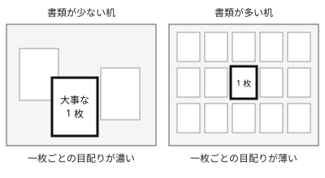

!!! abstract "要点"
    - **何が分かるか**：コンテキストウィンドウに入ることと、中身をよく使えることは別で、関係のない情報が増えるほど大事な情報への注意が薄くなる。
    - **いつ引くか**：窓が広くなったので資料を全部入れてよいのか知りたいとき。資料を多く渡すほど大事な点が拾われにくくなる理由を知りたいとき。
    - **前提**：<!-- link:begin tokens -->[トークンとは](tokens.md)<!-- link:end -->

<!-- textlint-disable -->
別名：context window・attention budget・注意の予算・広い机
<!-- textlint-enable -->

コンテキストウィンドウと注意の予算は、Claude が一度に目の前に置ける量と、その中身をどれだけ丁寧に使えるかを分けて考えるための見方である。窓の広さは「入る量」を決めるだけで、「どれだけ丁寧に読まれるか」は決めない。これはアプリ・Claude Code・API のどの面でも同じである。

## 資料を全部貼ったのに、肝心の点が拾われない {#what-happens}

新機能の設計を相談する場面を考える。手元には設計メモ、半年分の議事録、関係しそうなログの束がある。窓が広いと聞いたので、全部を貼って「この設計の問題点を挙げて」と頼んだ。

返ってきた答えは、議事録の古い議論に触れ、ログの末尾にあった無関係なエラーを問題として挙げた。設計メモにある制約の 1 行は、取り上げられなかった。資料は全部入っているのに、肝心の 1 行が答えに効いていない。

- 入らなかったのではない。窓には収まっている。
- 読まれなかったと決めつけることもできない。次の節の見立てでは、その 1 行に向く注意が、ほかの大量の文に分け合われて薄くなっている。
- 資料を絞って同じ依頼を出し直すと、制約に触れた答えが返ることがある。

この場面は筋書きの例であり、実際の結果は課題と資料の中身で変わる。入力が長いほど、また似て非なる情報が混ざるほど答えの質が下がる研究の結果は <!-- link:begin context-rot -->[context rot と紛らわしい情報](context-rot.md)<!-- link:end --> にある。

## 広い机でも一枚ごとの目配りは薄くなる {#why}

Claude が一度に扱えるすべての文脈を、1 つの机に置いた書類にたとえる。コンテキストウィンドウは机の広さで、置ける書類の枚数の上限を決める。窓の大きさを数える単位であるトークンは、<!-- link:begin tokens#what-happens -->[トークンとは › 何が起きるか](tokens.md#what-happens)<!-- link:end --> で扱う。

机が広いことと、置いた全部の書類を同じ濃さで見られることは別である。書類が増えると、1 枚ごとに向けられる目配りは薄くなる。

図の左は書類が 3 枚の机、右は書類が 14 枚の机である。太い枠の「大事な 1 枚」は、どちらの机でも同じ書類である。机が広くなっても、書類が増えれば、この 1 枚に向く目配りは薄くなる。

Anthropic は、コンテキストエンジニアリングの解説でこれを「注意の予算（attention budget）」と呼んだ。モデルは大量の文脈を読むときにこの予算を使い、新しいトークンが入るたびに予算が減る。トークンの数が n なら、トークンどうしの関係は n の 2 乗に比例して増えるので、文脈が長くなるほど 1 つ 1 つの関係に回る注意が引き延ばされる、という説明である。（根拠：中）

この説明は、内部で何が起きているかを Anthropic が整理したもので、Claude のどのモデルでも同じ割合で薄くなると言っているわけではない。この辞典は「薄くなる方向に傾く」という使い方にとどめ、割合を言わない。

同じ解説は、そこから置くべき文脈の量の考え方も引いている。目指すのは多くを入れることではなく、望む結果が出る確率を最大にする、できるだけ小さな「高シグナルなトークンの集合」である。（根拠：中）

## 何に効くか：見せることと、散らかっていること {#effects}

この見方は、4 つの原理のうち「見せる」と、防ぐ原因のうち「散らかっている」に関わる。

- **見せる**：Claude に必要な情報を見える形で渡す原理である。注意の予算を踏まえると、見せることは「全部を入れる」ではなく「必要なものを、埋もれない量で見えるようにする」ことになる。見せることには、不要なものを机から下ろす片付けも含まれる。原理全体は <!-- link:begin four-principles#show -->[四つの原理と比例則（見せる・確かめる・縛る・握る） › 見せる](../start/four-principles.md#show)<!-- link:end --> にある。
- **散らかっている**：関係のない資料や、失敗した試みの跡が窓に残り、大事な情報が埋もれた状態である。窓の広さに関係なく起き、広い窓は散らかりを隠すだけで消さない。

これが実際の行動をどう変えるかを、3 つに分けて書く。

**資料は選んでから渡す**。関係しそうというだけの資料は、渡す前に絞る。絞れないときは、全部を渡して「このうち関係があるのはどれか」を先に挙げさせてから、本題に入る手もある。

**窓の広さを理由に、片付けをやめない**。溢れる心配が減ったので、窓を埋めないための節約はやめてよい。一方、関係のない作業へ移るときに会話を新しくする片付けは、答えの質と費用のために続ける。やめてよいことと続けることの切り分けは、<!-- link:begin large-context-window#what-to-stop -->広いコンテキストウィンドウとの付き合い方 › やめてよいこと（準備中）<!-- link:end --> にある。窓を節約する古い決まりが手元に残っているなら、<!-- link:begin outdated-advice-ledger#save-context-for-200k -->[古くなった助言の台帳](../changes/outdated-advice-ledger.md#save-context-for-200k)<!-- link:end --> が今どうするかを示している。

**いま何が机を占めているかは、見て確かめる**。会話・読み込んだファイル・常駐するものの内訳は Claude Code の画面で見られ、読み方は <!-- link:begin inspect-context#reading -->[/context で中身を見る › 内訳の読み方](../context/inspect-context.md#reading)<!-- link:end --> にある。毎回乗る常駐の部分は、<!-- link:begin always-on-costs#resident-vs-on-demand -->[常駐するもののコスト（CLAUDE.md・MCP・スキル） › 常駐するものと、使うときだけ読むもの](../context/always-on-costs.md#resident-vs-on-demand)<!-- link:end --> が分けている。片付けの 4 つの動作は <!-- link:begin tidy-the-desk#four-actions -->[机を整える：新鮮さ・巻き戻し・書き出し・委任 › 四つの動作](../context/tidy-the-desk.md#four-actions)<!-- link:end --> にある。

## 資料を渡す量の判断例 {#examples}

!!! example "判断例：設計の相談に、どこまで資料を渡すか"
    - **状況**：新機能の設計の問題点を Claude に挙げさせたい。手元には設計メモ 1 枚、半年分の議事録、全モジュールのソースがある。窓には全部入る。
    - **迷う候補**：A は全部を貼って、Claude に任せる。B は設計メモと関係するモジュールだけを渡し、議事録は関係する決定の抜粋にする。
    - **選んだもの**：B。抜粋で外した資料の場所は伝え、必要なら読みに行けるようにする。
    - **理由**：窓に入るかどうかは基準にならず、大事な 1 行が埋もれない量かどうかが基準になる。抜粋に自信がないときは、A に近い形から始めて、先に関係する箇所を挙げさせる進め方も筋が通る。
    - **注意**：B で絞りすぎると、必要な資料が見えないので、Claude は推測で埋める。絞る目的は少なくすることではなく、埋もれさせないことである。

## 誤解 {#misconceptions}

**「窓が広くなったので、何でも入れてよい」**：入れられることと、よく使われることは別である。入れてよいのは、答えに関わる情報である。広い窓との付き合い方は <!-- link:begin large-context-window -->広いコンテキストウィンドウとの付き合い方（準備中）<!-- link:end --> にまとまっている。

**「窓に入った情報は、すべて同じ強さで使われる」**：同じ強さではない。似ているが違う情報が混ざると取り違えやすくなる。位置による差が実際にあるかは別の問いで、<!-- link:begin context-rot#lost-in-the-middle -->[context rot と紛らわしい情報 › 中ほどの情報は使われにくいか（lost in the middle）](context-rot.md#lost-in-the-middle)<!-- link:end --> で扱う。

**「資料を多く渡せば、それだけ安全である」**：多く渡すと費用も増える。Claude は毎回、会話の最初から全部を読み直して返事をするので、窓に置いた資料はターンごとに費用と時間を使う。仕組みは <!-- link:begin rereads-whole-history -->[毎ターン全履歴を読み直す](rereads-whole-history.md)<!-- link:end --> にある。

**「少ないほど、必ずよい」**：必要な資料が見えないと、Claude は推測で埋める。作業を別の文脈に切り離し、要約だけ受け取る手もあり、それは <!-- link:begin subagent-isolation -->[サブエージェントは別室の部下](subagent-isolation.md)<!-- link:end --> にある。

<!-- gen:begin page-links -->
<!-- textlint-disable -->

**前提**

- [トークンとは](tokens.md)

**次に読む**

- [context rot と紛らわしい情報](context-rot.md)
- [サブエージェントは別室の部下](subagent-isolation.md)
- [長い資料は先、質問は最後](../prompting/long-context-first.md)
- [/context で中身を見る](../context/inspect-context.md)
- [長い資料を渡すとき](../context/handing-long-documents.md)
- [アプリの指示の置き場所（Claude への指示・プロジェクト・メモリ・スキル）](../app/where-to-put-instructions.md)
- [プロジェクトの使いどころ](../app/using-projects.md)
- [拡張機能の全体図と使い分け早見表](../extend/extensions-at-a-glance.md)
- ほか 2 ページ

**関連**

- [毎ターン全履歴を読み直す](rereads-whole-history.md)
- 広いコンテキストウィンドウとの付き合い方（準備中）
- [机を整える：新鮮さ・巻き戻し・書き出し・委任](../context/tidy-the-desk.md)
- [常駐するもののコスト（CLAUDE.md・MCP・スキル）](../context/always-on-costs.md)
- [四つの原理と比例則（見せる・確かめる・縛る・握る） › 見せる](../start/four-principles.md#show)

<!-- textlint-enable -->
<!-- gen:end page-links -->

<!-- gen:begin references -->
<!-- textlint-disable -->

## 参考 {#references}

- [Effective context engineering for AI agents](https://www.anthropic.com/research/effective-context-engineering-for-ai-agents)：Anthropic・英語・確認日 2026-11-04
- [Best practices for Claude Code](https://code.claude.com/docs/en/best-practices)：Anthropic・英語・確認日 2026-11-04
- [Explore the context window](https://code.claude.com/docs/en/context-window)：Anthropic・英語・確認日 2026-11-04
- [Context windows](https://platform.claude.com/docs/en/build-with-claude/context-windows)：Anthropic・英語・確認日 2026-11-04

<!-- textlint-enable -->
<!-- gen:end references -->
