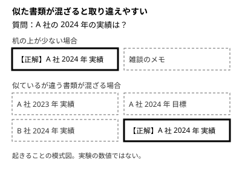

!!! abstract "要点"
    - **何が分かるか**：入力が長いほど、また似て非なる情報が混ざるほど、答えの質が下がりやすいことが分かる。
    - **いつ引くか**：長い会話で答えの質が落ちる理由、失敗した試みが残ると同じ誤りに戻る理由、長い資料の真ん中が使われにくいかを知りたいとき。
    - **前提**：<!-- link:begin attention-budget -->[コンテキストウィンドウと注意の予算](attention-budget.md)<!-- link:end -->

<!-- textlint-disable -->
別名：コンテキストの劣化・長い会話の劣化・distractor・失敗の残骸・lost in the middle・中ほどの情報は使われにくい・位置の効果・U 字型の性能
<!-- textlint-enable -->

context rot は、入力が長くなるにつれてモデルの答えの質が下がっていく現象の呼び名である。Chroma の研究報告がこの名前を使った。この辞典では、似ているが違う情報（紛らわしい情報）が混ざって質が下がる場合も、同じ話として扱う。

## 何が起きるか

長い会話で、設定の不具合の直し方を頼む場面を考える。1 回目の案は効かず、2 回目の案も違った。3 回目に出てきた案は、1 回目の案とほとんど同じだった。会話には、直したい設定の説明と並んで、失敗した案とその訂正が積み上がっている。モデルから見ると、どれも「この不具合に関係がありそうな文」である。

研究でも、似た形で質が下がることが確かめられている。Chroma の技術報告（2025 年 7 月）は、18 のモデルで、入力を長くしながら同じ質問に答えさせた。対象には Claude の Opus 4・Sonnet 4・Sonnet 3.7・Sonnet 3.5・Haiku 3.5 が入り、ほかに 3 社のモデルも試された。単純な課題でも、入力が長くなると性能が下がった。（根拠：中）

- 探す情報と質問が似ていないほど、入力が長くなったときの落ち込みが大きかった。
- 紛らわしい情報（distractor）が 1 つ混ざるだけで、混ざらない場合より成績が下がり、4 つ混ざるとさらに下がった。
- 見つからないと答えるか、自信を持って誤答するかは、モデルの系列で傾向が分かれた。Claude の系列は、見つからないと答えることが多かった。

これは 2025 年の時点の旧い世代のモデルの結果であり、現行の Claude の傾向としては読めない。報告の著者らも、試した課題は単純で、実際の複雑な作業の全体は表さないと書いている。

## なぜそうなるか

要点は、入力に入ることと、中身を同じようによく使えることは別だ、という点である。この辞典の比喩では、コンテキストは広い机である。机に載る書類が増えるほど、探す書類は埋もれる。しかも似た書類が混ざると、取り違える。理由は <!-- link:begin attention-budget -->[コンテキストウィンドウと注意の予算](attention-budget.md)<!-- link:end --> にある。

紛らわしい情報の正体は、次の 2 点である。

- 正解に近い書類ほど取り違えやすい。年だけ、会社だけが違う書類は、質問との距離が近い。
- 会話に残った失敗した試みは、まさにこの型の書類である。正しい案と形が同じで、中身だけが違う。

Chroma の実験が測ったのは、入力が長いときの成績であり、内部の仕組みの説明ではない。報告の著者らも、仕組みの解明は別の研究が要ると書いている。そのため、会話に残った失敗が答えを引きずる、という説明は、紛らわしい情報の実験を会話に当てはめた類推である。（類推）対処は、この類推が外れても損をしない形をとる。目の前の作業に関係のないものを、見えないところへ移すだけだからである。

## 何に効くか

この辞典の原理でいうと、context rot は「見せる」に関わる。モデルに見せる文脈を、目の前の作業に必要なものへ絞ることである。防ぐ原因は「散らかっている」である。無関係な情報と紛らわしい情報が文脈に残り、大事な情報が埋もれる状態を指す。

何が散らかっているかで、手を選ぶ。

- 失敗した試みが残っている：訂正を重ねず、前のメッセージを直して送り直すか巻き戻す。理由は <!-- link:begin rewind-dont-correct#why -->[違うと返すより、巻き戻す・編集する › なぜ訂正より巻き戻しか](../context/rewind-dont-correct.md#why)<!-- link:end -->、面ごとの戻し方は <!-- link:begin rewind-dont-correct#how -->[違うと返すより、巻き戻す・編集する › 面ごとの戻し方](../context/rewind-dont-correct.md#how)<!-- link:end --> にある。
- 話題が変わった：新しい会話にする。合図は <!-- link:begin when-to-start-fresh#signals -->[新しい会話を始めるタイミング › 新しくする合図](../context/when-to-start-fresh.md#signals)<!-- link:end -->、新しくする前に残すものは <!-- link:begin when-to-start-fresh#before-clearing -->[新しい会話を始めるタイミング › 新しくする前に残すもの](../context/when-to-start-fresh.md#before-clearing)<!-- link:end --> にある。
- 続きの作業を新しい会話に移したい：目的・今の状態・試して駄目だったこと・次の一手を文書に書かせる。書かせる項目は <!-- link:begin handoff-documents#four-items -->[handoff 文書と document-and-clear › 書かせる四項目](../context/handoff-documents.md#four-items)<!-- link:end --> にある。
- 整頓の全体を見たい：<!-- link:begin tidy-the-desk#four-actions -->[机を整える：新鮮さ・巻き戻し・書き出し・委任 › 四つの動作](../context/tidy-the-desk.md#four-actions)<!-- link:end --> にある。

症状の側から入るなら、次の 2 つで原因を安く切り分ける。長い会話で前提を忘れるときは <!-- link:begin forgets-in-long-chats#diagnosis -->[長い会話で前提を忘れる・雑になる › 原因を安く確かめる順](../symptoms/forgets-in-long-chats.md#diagnosis)<!-- link:end -->。同じ失敗が戻ってくるときは <!-- link:begin going-in-circles#diagnosis -->[同じ失敗を繰り返す（堂々巡り） › 原因を安く確かめる順](../symptoms/going-in-circles.md#diagnosis)<!-- link:end --> を見る。

!!! example "判断例：3 回直しても違う"
    - **状況**：長い会話で、設定の不具合の直し方を頼んだ。3 回続けて効かず、3 回目の案は 1 回目と似ていた。
    - **迷う候補**：4 回目も「違う、こうしてほしい」と訂正を重ねる。または、巻き戻して最初の依頼に、分かったことを足して出し直す。
    - **選んだもの**：巻き戻して出し直す。
    - **理由**：訂正を重ねるほど、失敗した案が似た書類として会話に積み上がり、同じ案に戻りやすくなる。ただし、直す点が 1 つで方向が合っているなら、訂正のほうが速く、それも筋は通る。

## 中ほどの情報は使われにくいか（lost in the middle） {#lost-in-the-middle}

長い資料の真ん中の情報は使われにくい、という話は、条件つきで読む必要がある。いつでも成り立つ法則ではない。

Liu らの研究（2023 年に arXiv で公開）は、複数の文書からの質問応答と、key-value の検索で、関連する情報の位置を変えて精度を測った。関連情報が入力の先頭か末尾にあるときに精度が最も高く、中ほどにあると落ちる、U 字型の性能が出た。長い入力向けのモデルでも、同じ傾向が残った。（根拠：中）これは 2023 年当時のモデルの結果である。取得した arXiv のページに掲載誌の記載がなく、出版先は確かめられていない。

一方、Chroma の実験（2025 年。前の節で紹介した研究）では、探す情報の位置を 11 通りに変えても、目立った差は出なかった。（根拠：中）2 つの研究は課題が違うため、矛盾とは言えない。位置の効果は、課題の種類とモデルの世代で変わる、と読むのが妥当である。（推論・実践例なし）

使うときの結論は 2 つである。

- 「真ん中は必ず落とされる」と決めて、資料を並べ替える作業に時間をかけない。
- 大事な箇所が答えに使われなかったかもしれないときは、並べ方を疑う前に、読まれたかを確かめる。確かめ方は <!-- link:begin skipped-later-pages#diagnosis -->[添付した資料の後半を読んでいない › 原因を安く確かめる順](../symptoms/skipped-later-pages.md#diagnosis)<!-- link:end --> にある。

並べ方の手段は <!-- link:begin long-context-first#order -->[長い資料は先、質問は最後 › 資料を先、質問を最後に置く](../prompting/long-context-first.md#order)<!-- link:end -->、資料を分けたり形を直したりする手段は <!-- link:begin handing-long-documents#split-and-convert -->[長い資料を渡すとき › 分ける・形を直す](../context/handing-long-documents.md#split-and-convert)<!-- link:end --> が持つ。

## 誤解

- **窓が広がったから、もう関係ない**：窓が広がって溢れる心配は減ったが、関係のない文脈が答えの質と費用を下げる点は変わらない。やめてよい節約と続ける片付けの分け方は <!-- link:begin large-context-window#what-to-stop -->広いコンテキストウィンドウとの付き合い方 › やめてよいこと（準備中）<!-- link:end --> にある。窓を最優先で節約するという古い助言は <!-- link:begin outdated-advice-ledger#save-context-for-200k -->[古くなった助言の台帳](../changes/outdated-advice-ledger.md#save-context-for-200k)<!-- link:end --> で、今どうするかを確かめられる。
- **長い入力なら、どの課題でも同じように落ちる**：研究が示したのは、試した課題と試したモデルでの傾向である。割合を今の Claude の目安として覚えない。
- **失敗を残しておけば、モデルが学ぶ**：同じ会話の中では、失敗した試みは学びである前に、似た書類として残ると考えられる。（類推）学んだことは、書き出して新しい会話に持ち込むほうが、紛らわしさが少ない。（推論・実践例なし）

<!-- gen:begin references -->
<!-- textlint-disable -->

## 参考 {#references}

- [Context Rot: How Increasing Input Tokens Impacts LLM Performance](https://www.trychroma.com/research/context-rot)：Chroma・英語・確認日 2026-11-04
- [Lost in the Middle: How Language Models Use Long Contexts](https://arxiv.org/abs/2307.03172)：arXiv（Liu, Nelson F. ほか）・英語・確認日 2026-11-04

<!-- textlint-enable -->
<!-- gen:end references -->

<!-- gen:begin page-links -->
<!-- textlint-disable -->

**前提**

- [コンテキストウィンドウと注意の予算](attention-budget.md)

**次に読む**

- [机を整える：新鮮さ・巻き戻し・書き出し・委任](../context/tidy-the-desk.md)
- [新しい会話を始めるタイミング](../context/when-to-start-fresh.md)
- [違うと返すより、巻き戻す・編集する](../context/rewind-dont-correct.md)
- [@参照と、何を読ませるかの絞り込み](../context/choose-what-to-read.md)
- [誤りを認めずに言い張る](../symptoms/insists-on-mistakes.md)
- [添付した資料の後半を読んでいない](../symptoms/skipped-later-pages.md)
- [長い会話で前提を忘れる・雑になる](../symptoms/forgets-in-long-chats.md)
- [同じ失敗を繰り返す（堂々巡り）](../symptoms/going-in-circles.md)
- ほか 1 ページ

**関連**

- [handoff 文書と document-and-clear](../context/handoff-documents.md)
- 広いコンテキストウィンドウとの付き合い方（準備中）
- [長い資料は先、質問は最後](../prompting/long-context-first.md)
- [長い資料を渡すとき](../context/handing-long-documents.md)

<!-- textlint-enable -->
<!-- gen:end page-links -->
