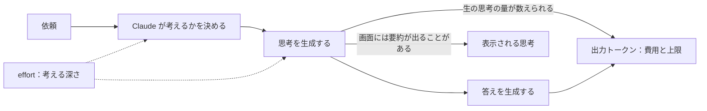

!!! abstract "要点"
    - **何が分かるか**：Claude は答える前の思考の量を effort で変えられ、考えた分も出力として費用と上限に数えられる。
    - **いつ引くか**：考える量を増やすと何が良くなり、何が悪くなるのかを知りたいとき。
    - **前提**：<!-- link:begin tokens -->[トークンとは](tokens.md)<!-- link:end -->

<!-- textlint-disable -->
別名：thinking・extended thinking・adaptive thinking・考える量・拡張思考
<!-- textlint-enable -->

思考（thinking）は、Claude が答えを書く前に、問題を分けたり手順を確かめたりする作業である。この作業の量は一定ではなく、依頼ごとに変わる。このページは、その量を決める仕組みと、考えた分が何として数えられるかを説明する。段の選び方と既定の段は、持ち主のページに任せる。

## 何が起きるか {#what-happens}

同じ依頼でも、effort が違うと Claude の動きが変わる。effort は、考える深さを調整する設定である。

たとえば Claude Code に「このテストが落ちる原因を調べて」と頼む。effort が低いと、見えている手がかりから早めに答えを返しやすい。effort が高いと、関係するファイルを多く読み、仮説を立てて確かめる手数が増えやすい。答えが深くなりうる代わりに、待ち時間が延び、使用量も増える。effort が変えるのは考える深さだけではなく、ツールの使い方も含む。この釣り合いは、公式が effort の役割として説明している。

もう 1 つの動きが、考えるかどうか自体の判断である。新しいモデルでは、Claude が要求ごとに「考えるか」「どれだけ考えるか」を自分で決める。これを adaptive thinking と呼ぶ。簡単な依頼では考えが短く、ときには省かれる。ツールの結果を読んで次へ進むだけの後続の要求でも、考えは省かれやすい。どの effort でも、毎回、思考の出力が付くとは限らない。

!!! example "判断例：誤字の修正と設計の相談"
    - **状況**：同じセッションで、README の誤字を 1 つ直す依頼と、認証まわりの設計の見直しの相談が続けて来る。
    - **迷う候補**：セッションの effort を高いまま通す。依頼ごとに effort を上げ下げする。
    - **選んだもの**：誤字の修正は低めの段で済ませ、設計の相談は高めの段に上げて頼む。
    - **理由**：誤字の修正に深い思考は要らず、待ち時間と使用量だけが増える。設計の相談は、浅い考えで筋違いの答えが出るほうが高くつく。どちらの候補も筋は通るが、作業の重さで決めるほうが損が少ない。

段の一覧と、モデル × 面ごとの既定の段は、<!-- link:begin effort-levels#levels -->[effort の段階と使い分け › 段ごとの振る舞い](../models/effort-levels.md#levels)<!-- link:end --> と <!-- link:begin effort-levels#defaults-by-surface -->[effort の段階と使い分け › 既定の段（モデル × 面の表）](../models/effort-levels.md#defaults-by-surface)<!-- link:end --> にある。既定の段は面ごとに違うので、手元の表示で確かめてから上げ下げする。

## なぜそうなるか {#why}

Claude は、答えの文字を出す前に、思考の文字も出力として生成する。この思考の分も、<!-- link:begin tokens#what-happens -->[トークンとは › 何が起きるか](tokens.md#what-happens)<!-- link:end --> で見た出力トークンとして数えられる。だから、考える量を増やすことは、出力を増やすことと同じに働く。

図の要点は 3 つある。1 つ目は、effort が「考えるか」と「どれだけ考えるか」の両方に働くこと。2 つ目は、数えられるのが画面に出る文章ではなく、生の思考の量であること。3 つ目は、画面に出る思考は要約のことがあること。そのため、数えられる量は、見えている思考の文章よりずっと大きい場合がある。

数えられる先は、API の費用だけではない。契約のプランの利用上限も、同じ出力の分を使う。そのため、考える量を上げ続けると、上限に早く届きやすくなる。上限の仕組みは、持ち主のページに任せる。

手動で考える量を決める古い形は、budget_tokens を使う拡張思考である。いまの推奨は、thinking を adaptive にして、深さを effort で変える形である。新しいモデルは、budget_tokens を使う要求を断る。具体的な対応は <!-- link:begin outdated-advice-ledger#budget-tokens -->[古くなった助言の台帳](../changes/outdated-advice-ledger.md#budget-tokens)<!-- link:end --> にある。

effort を変えると、プロンプトキャッシュが外れることがある。先頭を変えないことの価値は、<!-- link:begin why-prompt-caching -->プロンプトキャッシング（先頭が変わらないことの価値）（準備中）<!-- link:end --> に任せる。プロンプトキャッシュは、前回と同じ先頭の部分を安く読み直す仕組みである。ここでは、途中で effort を替えると、この安い読み直しが効かなくなりうる点だけを覚えておけばよい。

## 何に効くか {#effects}

このページが主に関わるのは、Claude 側の原因のうち「依頼と答えが合っていない」ものの、effort の選び違いである。依頼に対して考える深さが浅すぎると、答えの筋が外れる。逆に深すぎると、待ち時間と使用量だけが増える。辞典の原理（Claude の仕組みを分ける見方）のどれにも主には当たらないので、ここでは原理ではなく原因で整理する。

- **浅すぎるとき**：難しい調査や設計に、低い段のまま頼むと、手がかりを拾い切らずに答えが出る。段を上げるのが先で、モデルを替えるのはその後になる。順番の理由は <!-- link:begin choosing-a-model#effort-first -->モデルの選び方（三段階） › モデルより effort を先に動かす理由（準備中）<!-- link:end --> にある。
- **深すぎるとき**：単純な作業に高い段を使うと、答えの質が上がらないまま、待ち時間と使用量が増える。
- **確かめる手段になるか**：考える量を増やしても、答えが正しい保証は得られない。結果は、テストや原文など独立した手段で確かめる。

考える量を増やすことは、良くなる面と悪くなる面を同時に連れてくる。良くなるのは、複雑な依頼での筋の通りやすさである。悪くなるのは、待ち時間、出力の量、使用量である。どちらが勝つかは作業で決まるので、自分の作業で試して確かめる。

## 誤解 {#misconceptions}

**「よく考えて」と書けば effort が上がる**。上がらない。think hard や「熟考」などの言い回しは、キーワードとして扱われず、普通の文として渡る。深く考えさせたいときは effort を上げる。Claude Code では、ultrathink だけが、その 1 ターンを深く考えさせる言葉として認識される。詳しくは <!-- link:begin thinking-keywords#plain-text-phrases -->「考えて」と書くことの現在（ultrathink） › 普通の文として渡る言い回し（準備中）<!-- link:end --> と <!-- link:begin thinking-keywords#ultrathink -->「考えて」と書くことの現在（ultrathink） › ultrathink の使いどころ（準備中）<!-- link:end --> にある。古い助言としての扱いは <!-- link:begin outdated-advice-ledger#think-hard-keywords -->[古くなった助言の台帳](../changes/outdated-advice-ledger.md#think-hard-keywords)<!-- link:end --> にある。

**画面に出る思考が、Claude の計算のすべてである**。そうとは限らない。画面に出るのは要約であることがあり、数えられるのは生の思考の量である。要約や説明が、実際の内部の処理と一致する保証もない。この点は <!-- link:begin unfaithful-reasoning -->表示された思考は内部の計算と一致するとは限らない（準備中）<!-- link:end --> にある。

**推論の全文を本文に書かせれば、確かめやすくなる**。確かめやすくはならない。推論を本文に書かせる指示の効き方は、モデルと版で変わる（推論・実践例なし）。根拠が要るなら、短い説明を頼むか、表示される思考の要約を読む。やり方は <!-- link:begin asking-for-reasoning#alternatives -->推論を見せてほしいとき › 短い根拠と思考の要約で読む（準備中）<!-- link:end -->、台帳の行は <!-- link:begin outdated-advice-ledger#thinking-tags -->[古くなった助言の台帳](../changes/outdated-advice-ledger.md#thinking-tags)<!-- link:end --> にある。

**thinking は、いつでも切れる**。モデルで違う。新しいモデルの中には、thinking を切れないものがある。切れるかどうかは、使うモデルと面の組で確かめる。切り替えの扱いは <!-- link:begin effort-levels#thinking-toggle -->[effort の段階と使い分け › thinking の切り替え](../models/effort-levels.md#thinking-toggle)<!-- link:end --> にある。

**effort を上げれば、答えは必ず良くなる**。必ずではない。浅すぎる原因のときに効く設定であり、依頼の書き方が曖昧なまま上げても、的外れな答えが長くなるだけのことがある。

<!-- gen:begin references -->
<!-- textlint-disable -->

## 参考 {#references}

- [Steering thinking](https://platform.claude.com/docs/en/build-with-claude/thinking-steering-and-cost)：Anthropic・英語・確認日 2026-11-04
- [Effort](https://platform.claude.com/docs/en/build-with-claude/effort)：Anthropic・英語・確認日 2026-11-04
- [Thinking](https://platform.claude.com/docs/en/build-with-claude/thinking)：Anthropic・英語・確認日 2026-11-04
- [Extended thinking](https://platform.claude.com/docs/en/build-with-claude/extended-thinking)：Anthropic・英語・確認日 2026-11-04
- [Prompt caching](https://platform.claude.com/docs/en/build-with-claude/prompt-caching)：Anthropic・英語・確認日 2026-11-04
- [Model configuration](https://code.claude.com/docs/en/model-config)：Anthropic・英語・確認日 2026-11-04
- [Best practices for Claude Code](https://code.claude.com/docs/en/best-practices)：Anthropic・英語・確認日 2026-11-04
- [Manage costs effectively](https://code.claude.com/docs/en/costs)：Anthropic・英語・確認日 2026-11-04
- [Change the model, effort, and thinking settings](https://support.claude.com/en/articles/8664678-change-the-model-effort-and-thinking-settings)：Anthropic・英語・確認日 2026-11-04

<!-- textlint-enable -->
<!-- gen:end references -->

<!-- gen:begin page-links -->
<!-- textlint-disable -->

**前提**

- [トークンとは](tokens.md)

**次に読む**

- [effort の段階と使い分け](../models/effort-levels.md)
- 表示された思考は内部の計算と一致するとは限らない（準備中）

**関連**

- 「考えて」と書くことの現在（ultrathink）（準備中）
- モデルの選び方（三段階）（準備中）
- 推論を見せてほしいとき（準備中）
- プロンプトキャッシング（先頭が変わらないことの価値）（準備中）

<!-- textlint-enable -->
<!-- gen:end page-links -->
