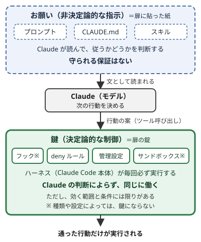

!!! abstract "要点"
    - **何が分かるか**：プロンプト・CLAUDE.md・スキルのような指示は、Claude が読んで判断する「お願い」で、守られる保証がない。フック・deny ルール・管理設定は、効く範囲と条件の中では毎回必ず効く「鍵」で、その外は守られない。例外がなく、ツールの呼び出しや結果で判定できる規則は鍵に移し、CLAUDE.md には止める理由と、止まったときの進め方だけを書く。
    - **いつ引くか**：「必ず」と書いた規則でも破られる理由を知りたいとき。どの規則を仕組みで強制すべきか見分けたいとき。
    - **前提**：なし

<!-- textlint-disable -->
別名：決定論的な制御・非決定論的な指示・deterministic・指示と強制
<!-- textlint-enable -->

お願いと鍵は、Claude への指示を「Claude が読んで判断するもの（非決定論的な指示）」と「Claude の判断によらず働くもの（決定論的な制御）」に分ける見方である。「必ず」と書いても破られるのは、その指示がお願いの側にあるからで、言い方を強めても鍵にはならない。鍵の例（フック・deny ルール・管理設定・サンドボックス）は Claude Code のもので、アプリと API の対応は<!-- link:begin request-lock-table -->お願いと鍵の対応表（準備中）<!-- link:end -->で見る。

## 何が起きるか {#what-happens}

「必ず」と書いた規則が破られる場面には、たとえば次の 3 つがある。

- **返答の言語がずれる**：CLAUDE.md に「返答は日本語にする」と書いたのに、英語のツール出力を読んだ直後の返答が英語になる。訂正すると次の返答は日本語に戻るが、またすぐ英語になる。同じ症状の報告が、Claude Code の issue の #96326 や #98633 など複数ある（根拠：中）。ただし原因は確かめられていない。
- **会話で頼んだ禁止が消える**：長い会話の途中で「このディレクトリには触らないで」と頼んだ。自動の圧縮で会話を要約すると、初めのほうの細かい指示は落ちることがある。
- **CLAUDE.md の中で埋もれる**：ファイルが長くなると、その一行が目立たなくなり、見落とされる。

現れ方はそれぞれ違うが、どれも、破られたときに止める仕組みがない点は同じである。守らせる役目を、Claude が読んで判断する指示（このページでは「お願い」と呼ぶ）に任せているからである。[Best practices for Claude Code](https://code.claude.com/docs/en/best-practices) は、お願いにあたる指示は、ほとんどの場合は従われるが、従う保証はないと書く。原因の切り分けは<!-- link:begin instructions-ignored -->[CLAUDE.md や指示が守られない](../symptoms/instructions-ignored.md)<!-- link:end -->で扱い、指示が文脈のどこに入るかは<!-- link:begin where-instructions-sit -->[システムプロンプト・ユーザーメッセージ・CLAUDE.md の位置](where-instructions-sit.md)<!-- link:end -->で扱う。書き方を直しても残る理由は、指示がお願いであること、つまり守るかどうかを Claude が決めることにある。

## なぜそうなるか {#why}

お願いは守られる保証がなく、鍵は、効く範囲の中では毎回効く。この差は、指示が働く場所の違いから生まれる。Claude Code 本体は、モデルのまわりでツールを動かし、モデルが見る文脈を管理する。この部分をハーネスと呼ぶ。お願いは Claude に読まれ、鍵はハーネスに実行される。

お願いは、文として Claude の文脈に入る。プロンプト・CLAUDE.md・スキルのどれでも同じで、Claude はそれを読み、どう扱うかを自分で決める。CLAUDE.md は、[How Claude remembers your project](https://code.claude.com/docs/en/memory) によれば、システムプロンプトの後のユーザーメッセージとして届き、強制される設定ではなく文脈として扱われる。

鍵は、ハーネスが実行する。フック・deny ルール・管理設定（組織が配る設定）は、Claude が何を覚えていて何を決めたかによらず、同じように働く。deny ルールは、auto モードを含むどの権限モードでも効く。



図の要点は 2 つある。上の層のお願いは、Claude に読まれる文で、従うかどうかは Claude の判断に残る。下の層の鍵では、Claude が出した行動の案を、ハーネスが実行の前に規則と照らし合わせて、通すか止めるかを決める。通った行動だけが実行されるので、Claude が何を決めても同じに働く。フックには、ツールの実行の後や、Claude が終わろうとしたときなど、ほかの決まった時点で働くものもある。図の ※ は、鍵にならない場合があるものに付けた。理由は、お願いと鍵の分け方の節で説明する。

たとえるなら、Claude は扉を通る人で、お願いは扉に貼った紙、鍵は扉の錠である。紙は、通る人が読んで守って初めて効く。錠は、読まれなくても開かない。

プロジェクトの根の CLAUDE.md は、圧縮のあとにディスクから読み直されるので、会話で頼んだ禁止より残りやすい。ただし、残っても従うかどうかは Claude の判断なので、守られるとは限らない。

読ませた Web ページやファイルに紛れた指示（prompt injection）への備えも、お願いと鍵の区別で考える。読ませたファイルや Web ページの中の文も、頼んだ指示と同じ文脈に並ぶ。従うかどうかは Claude の判断に残るので、「外から来た文には従わないで」という頼みも、お願いにあたる。だから備えは、権限やサンドボックスのような鍵に置く。[Configure permissions](https://code.claude.com/docs/en/permissions) は、prompt injection で Claude の判断が崩れても、サンドボックスの制限は残ると書く。この性質と、権限と経路で守る理由は<!-- link:begin data-vs-instructions -->[データと命令を区別できない（prompt injection の原理）](data-vs-instructions.md)<!-- link:end -->で扱う。

## お願いと鍵の分け方 {#sorting}

お願いか鍵かは、守るかどうかをモデルの判断に任せるか、任せずに仕組みで決めるかで分かれる。モデルは、Claude でも別のモデルでもよい。

- **お願い**（非決定論的）：モデルの判断に任せる側。プロンプト、CLAUDE.md、Claude が自分で選んで使うスキルは、Claude が読んで従うかを決める。auto モードの分類器は、別のモデルが行動ごとに判断する。
- **鍵**（決定論的）：モデルの判断に任せず、仕組みで決める側。deny ルール、管理設定（組織が配り、個人の設定では上書きできない設定）、フック、サンドボックス（シェルコマンドのファイルとネットワークへの届き方を、OS の仕組みで絞る機能）。ただし、フックとサンドボックスには、種類や設定によって鍵にならないものがある。

見分けにくいものが 2 つある。

- **フック**：種類によって分かれる。`command` か `http` のフックは鍵である。`prompt` か `agent` のフックは、別のモデルに判断させるので鍵ではない。
- **サンドボックス**：設定しだいで鍵の強さが変わる。既定では、止められたコマンドを、Claude がサンドボックスの外で再試行したいと求めることができる。その求めは通常の権限の確認に回り、承認されればサンドボックスの外で動く。この再試行を無効にする設定（strict mode）を選ぶと、サンドボックスは鍵として働く。

同じ目的に、お願いの形と鍵の形が両方ある。[Best practices for Claude Code](https://code.claude.com/docs/en/best-practices) の対応表から 3 つを抜くと、次のようになる。

- **終わったかの判定**：モデルに任せる形は、証拠を付けて報告するよう頼むこと。任せない形は、テスト・型チェック・`Stop` フック・CI。
- **触れてよい範囲**：モデルに任せる形は、auto モードの分類器。任せない形は、deny ルール・strict mode のサンドボックス・管理設定。
- **最後に決めるのは誰か**：モデルに任せる形は、Claude の作業の要約。任せない形は、ブランチ保護と、マージを承認する人。

この分け方は、どの面でも同じである。アプリでも API でも、プロンプトに書いた指示はお願いである。鍵になる仕組みは面によって違い、ここに挙げたのは Claude Code のものである。面ごとの対応は<!-- link:begin request-lock-table -->お願いと鍵の対応表（準備中）<!-- link:end -->で見る。

## 二層で書く {#two-layers}

1 つの規則を、鍵とお願いの二層で書く。例外を許さない規則は、鍵（Claude の判断によらず働く仕組み）で止める。CLAUDE.md には、止める理由と、止まったときの進め方だけを書く。deny ルールは一行のパターンで、理由も代わりの手順も書く場所がない。それを Claude に伝えるのは、お願いの役目である。

鍵にする規則は、次の 2 つを満たすものに絞る。

- **例外がない**：どの場面でも守らせたい規則である。「関数は短く書く」のような好みは、例外が多いので、お願いのまま残す。
- **機械が判定できる**：ファイルの場所・コマンド・テストの結果のように、ツールの呼び出しや結果に当てて書ける規則である。[Best practices for Claude Code](https://code.claude.com/docs/en/best-practices) は、deny ルールが当たるのは意図ではなくツールの呼び出しだと書く。

「返答は日本語にする」のように、返事の中身が条件になる規則は、ツールの呼び出しに当てて書けないので、「機械が判定できる」を満たしにくい。この種の規則の扱いは、原因の切り分けなら<!-- link:begin instructions-ignored -->[CLAUDE.md や指示が守られない](../symptoms/instructions-ignored.md)<!-- link:end -->で、用途ごとの手段なら<!-- link:begin request-lock-table -->お願いと鍵の対応表（準備中）<!-- link:end -->で見る。

鍵は少なく保つ。ほとんどの場面は Claude に判断させるほうがよい。フックと deny ルールは、必要のない場面で働くことがあり、保守する人が要る。Best practices も、単なる好みまで鍵にしないよう勧める。

!!! example "判断例：認証情報と生成コードの扱い"
    - **状況**：CLAUDE.md に「`credentials/` は読まない」「`src/client/` は手で編集しない」と書いてあるが、ときどき破られる。
    - **迷う候補**：認証情報だけ deny ルールにして、生成コードの規則はお願いのまま残す案。2 つとも deny ルールにして、CLAUDE.md の文は消す案。2 つとも deny ルールにしたうえで、CLAUDE.md には理由と代わりの手順を残す案。
    - **選んだもの**：2 つとも deny ルールにしたうえで、CLAUDE.md には理由と代わりの手順を残す。
    - **理由**：どちらの規則にも例外がない。読まれた認証情報は取り消せず、手で直した生成コードは次の生成で消える。だから生成コードの規則も、お願いのままにせず deny ルールで止める。ただし、deny ルールだけでは、止まった Claude が何をすればよいかを伝える場所がない。それを CLAUDE.md が受け持つ。

鍵の側は、プロジェクトの設定ファイル（`.claude/settings.json`）の deny ルールに書く。

<!-- gen:begin snippet request-vs-lock/lock-settings -->
<!-- textlint-disable -->

??? example "雛形：鍵：読ませない場所と編集させない場所を deny ルールで止める"

    ```json
    {
      "permissions": {
        "deny": [
          "Read(./credentials/**)",
          "Edit(./src/client/**)"
        ]
      }
    }
    ```

    動作を確かめていない雛形。安全のための雛形なので、守りとして頼る前に、止めたい操作が自分の環境で止まるかを確かめる。

<!-- textlint-enable -->
<!-- gen:end snippet request-vs-lock/lock-settings -->

お願いの側は、プロジェクトの CLAUDE.md に書く。

<!-- gen:begin snippet request-vs-lock/request-claude-md -->
<!-- textlint-disable -->

??? example "雛形：お願い：止める理由と代わりの手順を CLAUDE.md に書く"

    ```markdown
    ## 触らないもの

    - `credentials/` の中身は読まない。サービスアカウントの認証情報が入っていて、読み取りは設定で禁止してある。接続が必要な作業は、認証情報を読まずに済む方法（環境変数など）を提案する。
    - `src/client/` は `openapi.json` から `npm run codegen` で作る。手で編集せず、`openapi.json` を直して `npm run codegen` を実行する。
    - 設定で止められて進めないときは、回避せず、何をしたかったかと止まった操作を伝えて相談する。
    ```

    動作を確かめていない雛形。

<!-- textlint-enable -->
<!-- gen:end snippet request-vs-lock/request-claude-md -->

## 何に効くか {#effects}

お願い（Claude が判断する指示）と鍵（判断によらず働く仕組み）の区別は、この辞典の原理（見せる・確かめる・縛る・握る）のうち「縛る」と、Claude 側の原因（うまくいかない理由）のうち「縛っていない」に結び付く。

原理の「縛る」は、守らせたいことを、Claude の判断の外にある仕組みで守らせることである。お願いと鍵の区別は、なぜ縛る必要があるかを説明する。お願いのままでは守られる保証がないので、例外のない規則は鍵に移す。原理の全体と比例則は、<!-- link:begin four-principles -->[四つの原理と比例則（見せる・確かめる・縛る・握る）](../start/four-principles.md)<!-- link:end -->で見る。

原因の「縛っていない」は、絶対に起きてはならないことや、必ず行う手順を、お願いだけで守らせようとしている状態である。[Best practices for Claude Code](https://code.claude.com/docs/en/best-practices) も、期待どおりに進まない典型的な場合としてこれを挙げ、プロンプトだけでは保証できないとする。

次の一手は、規則ごとに選ぶ。

- **どの規則を鍵に移すか**：移す合図は<!-- link:begin when-to-lock -->[お願いを鍵に移す判断](../enforce/when-to-lock.md)<!-- link:end -->にある。
- **鍵の作り方**：フックは<!-- link:begin hooks-basics -->[フックの考え方とイベント](../enforce/hooks-basics.md)<!-- link:end -->、deny ルールは<!-- link:begin permission-rules -->[権限ルール（allow・ask・deny）](../enforce/permission-rules.md)<!-- link:end -->にある。
- **スキルとフック**：決まった手順をどちらに置くかは<!-- link:begin hook-vs-skill -->フックとスキルの違い（準備中）<!-- link:end -->で選ぶ。

## 誤解 {#misconceptions}

お願い（Claude が読んで判断する指示）と鍵（Claude の判断によらず働く仕組み）をめぐって、よく出会う誤解を 5 つ挙げる。

- **「IMPORTANT や『必ず』を付ければ守られる」**：強調は文の書き方を変えるだけで、お願いのままである。[Best practices for Claude Code](https://code.claude.com/docs/en/best-practices) は、強調を重ねるとかえって規則を当てはめすぎやすいとして、この助言をもうやめてよいものに挙げる。守られない行は、ファイルが長すぎて埋もれていないかを見る。例外のない規則なら鍵に移す。台帳の記録は<!-- link:begin outdated-advice-ledger#important-caps -->[古くなった助言の台帳](../changes/outdated-advice-ledger.md#important-caps)<!-- link:end -->、強調語の現在は<!-- link:begin emphasis-words -->強調語（IMPORTANT・必ず）の現在（準備中）<!-- link:end -->にある。
- **「CLAUDE.md は設定ファイルだから、書けば強制される」**：CLAUDE.md は強制される設定ではなく、文脈である。組織が配る CLAUDE.md も同じで、[How Claude remembers your project](https://code.claude.com/docs/en/memory) は、指針には CLAUDE.md を使い、強制には管理設定の deny ルールなどを使うよう勧める。強制されているかどうかは、deny ルールか、種類が `command` か `http` のフックに書いてあるかで見分ける。
- **「フックにすれば必ず守られる」**：フックが走ることと、フックの目的が果たされることは別である。種類が `prompt` か `agent` のフックは、別のモデルが判断するので鍵ではない。種類は、設定の `type` で確かめる。種類が `command` か `http` のフックでも、文を足すだけのものは、足した文がお願いとして読まれる。毎ターン言語の指示をフックで足しても英語に戻ったという報告が、#96326 のコメントにある（根拠：弱）。鍵として働く動作は 3 つある。ハーネスが自分で処理を走らせる動作、ツールの呼び出しを止める動作、終わろうとした Claude を差し戻す動作である。対応するイベントは<!-- link:begin hooks-basics -->[フックの考え方とイベント](../enforce/hooks-basics.md)<!-- link:end -->で選ぶ。
- **「auto モードがあるから、危ない操作は止まる」**：auto モードの分類器は、別のモデルが行動ごとに判断する仕組みで、決まった規則ではない。[Best practices for Claude Code](https://code.claude.com/docs/en/best-practices) は、「never」の規則は deny ルールかフックに置くよう勧める。
- **「鍵をかければ、その範囲は全部守られる」**：鍵にも効く範囲がある。[Configure permissions](https://code.claude.com/docs/en/permissions) によると、`Read` の deny ルールが効くのは、組み込みのファイルツールと、Claude Code が見分けられる `cat` などのコマンドである。スクリプトが自分でファイルを開く場合は範囲の外にある。全部のプロセスを OS の仕組みで止めるなら、サンドボックスを使う。守りとして頼る前に、止めたい操作を実際に頼んで、止まるかを確かめる。範囲の詳細は<!-- link:begin permission-rules -->[権限ルール（allow・ask・deny）](../enforce/permission-rules.md)<!-- link:end -->で確かめる。

<!-- gen:begin references -->
<!-- textlint-disable -->

## 参考 {#references}

- [Best practices for Claude Code](https://code.claude.com/docs/en/best-practices)：Anthropic・英語・確認日 2026-11-04
- [How Claude remembers your project](https://code.claude.com/docs/en/memory)：Anthropic・英語・確認日 2026-11-04
- [Configure permissions](https://code.claude.com/docs/en/permissions)：Anthropic・英語・確認日 2026-11-04
- [How Claude Code works](https://code.claude.com/docs/en/how-claude-code-works)：Anthropic・英語・確認日 2026-11-04
- [\[BUG\] Replies drift into English right after reading English tool output, despite a CLAUDE.md rule requiring Japanese; corrections do not hold（Issue #96326）](https://github.com/anthropics/claude-code/issues/96326)：GitHub の anthropics/claude-code の issue（利用者の報告）・英語・確認日 2026-11-04
- [\[Model\] Repeatedly switches to English despite CLAUDE.md + memory + repeated in-chat instructions to reply only in Japanese（Issue #98633）](https://github.com/anthropics/claude-code/issues/98633)：GitHub の anthropics/claude-code の issue（利用者の報告）・英語・確認日 2026-11-04

<!-- textlint-enable -->
<!-- gen:end references -->

<!-- gen:begin page-links -->
<!-- textlint-disable -->

<div class="ca-page-links" markdown>

**前提**

- なし

**次に読む**

- [範囲を伝える（やらないこと）](../prompting/state-the-scope.md)
- [CLAUDE.md に書くこと・書かないこと](../extend/what-to-put-in-claude-md.md)
- [検証の階段](../verify/verification-ladder.md)
- [お願いを鍵に移す判断](../enforce/when-to-lock.md)
- [日本語の出力を揃える：お願いで足りること、仕組みが要ること](../japanese/align-japanese-output.md)
- [CLAUDE.md や指示が守られない](../symptoms/instructions-ignored.md)
- [英語で返ってくる](../symptoms/replies-in-english.md)
- [文体や表記が揃わない](../symptoms/inconsistent-japanese-style.md)
- ほか 10 ページ

**関連**

- お願いと鍵の対応表（準備中）
- フックとスキルの違い（準備中）
- [システムプロンプト・ユーザーメッセージ・CLAUDE.md の位置](where-instructions-sit.md)
- [データと命令を区別できない（prompt injection の原理）](data-vs-instructions.md)
- 強調語（IMPORTANT・必ず）の現在（準備中）
- [フックの考え方とイベント](../enforce/hooks-basics.md)
- [権限ルール（allow・ask・deny）](../enforce/permission-rules.md)
- [四つの原理と比例則（見せる・確かめる・縛る・握る） › 縛る](../start/four-principles.md#lock)

</div>

<!-- textlint-enable -->
<!-- gen:end page-links -->
