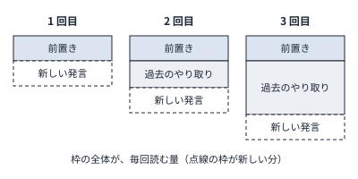

!!! abstract "要点"
    - **何が分かるか**：Claude は毎回、会話の最初から全部を読み直して返事をする。長い会話ほど遅く重く、上限も早く減る理由が分かる。
    - **いつ引くか**：長い会話ほど返事が遅く、上限の減りも早くなる理由を知りたいとき。
    - **前提**：<!-- link:begin tokens -->[トークンとは](tokens.md)<!-- link:end -->

<!-- textlint-disable -->
別名：会話全体の再送・ステートレス・長い会話が重い理由・読み直す受験者
<!-- textlint-enable -->

Claude は、返事をするたびに、会話の最初から今の発言までをすべて読み直す。前の返事を覚えていて続きから話すのではなく、毎回、全体を渡されてから答える。長い会話が遅く、重く、上限を使いやすいのは、この仕組みのためである。

## 何が起きるか {#what-happens}

同じ会話の中でも、1 回目の質問と 20 回目の質問では、Claude の読む量がまったく違う。

| 何回目の発言か | Claude が返事の前に読むもの |
| --- | --- |
| 1 回目 | 前置き（指示やツールの定義）と、今の質問 |
| 2 回目 | 前置きと、1 回目の質問と返事と、今の質問 |
| 20 回目 | 前置きと、1 回目から 19 回目までのやり取りのすべてと、今の質問 |

20 回目の質問が「さっきの関数名を直して」の一行でも、Claude は 19 回分のやり取りを全部読んでから答える。ツールを使う場面でも同じである。Claude Code の公式の文書は、会話の全体を毎回の request で送ること、ツールを使うたびに、その結果を加えた request がもう一度送られることを説明している。

読む量が増えると、次の 3 つが起きる。

- **返事が遅くなる**：読む量に応じて、返事を始めるまでの処理も増える。
- **上限の減りが早くなる**：読むものはトークンで数える。一行の質問でも、会話全体の分が数えられる。
- **古い内容が混ざる**：話題を替えたあとも、前の話題のやり取りは毎回読まれる。

## なぜそうなるか {#why}

Claude は、会話の状態を自分の中に持ち続けない。API の基本の形では、呼び出す側が `system` と `messages` で、それまでの全体を毎回渡す。この仕組みは<!-- link:begin stateless-messages-api#stateless -->[Messages API と会話の正体 › 毎回、全体を渡す](../api/stateless-messages-api.md#stateless)<!-- link:end -->で詳しく扱う。Claude Code は、利用者に代わって、この「全体を渡す」作業を毎回行っている。

比喩にすると、Claude は「毎回、会話を最初から読み直してから返事をする筆記試験の受験者」である。前の回の答案を手元に持ち越さない。毎回、問題用紙の束がまるごと机に置かれ、受験者はそれを頭から読んで答える。机の広さ（コンテキスト）が足りるかどうかとは別に、束が厚いほど読むのに時間がかかり、読んだ分だけ費用がかかる。

図の要点は、新しい発言は毎回少ししか増えないのに、読む全体は回ごとに積み上がることである。読む量は、新しい発言の長さではなく、会話の長さで決まる。

公式の [Explore the context window](https://code.claude.com/docs/en/context-window) は、セッションが進むにつれて文脈の窓が埋まっていく様子を、動かして見られる図にしている（数は代表の値）。

### 誰が送り直すか

=== "アプリ"

    アプリでは、会話の全体を Claude へ渡す作業をアプリが行う。利用者から見ると、続きの発言を書くだけに見える。アプリが内部で何をどう送っているかの細部は、この辞典では確認していない（未確認）。

=== "Claude Code"

    Claude Code が、毎回の request に会話の全体を載せる。公式の文書は、長い会話では、一行の質問でも会話の全体の分が使用量に数えられると説明している。何がどれだけ入っているかは `/context` で見る。

=== "API"

    呼び出す側のコードが、毎回、それまでの全体を渡す。message threads という仕組みを使うと、送る量を差分だけに減らせる。ただし、API は呼び出しの前に会話を組み立て直す。モデルが読む量も、料金も変わらない。送る量と読む量は別である。詳しくは<!-- link:begin stateless-messages-api#message-threads -->[Messages API と会話の正体 › message threads（送る量だけを減らす）](../api/stateless-messages-api.md#message-threads)<!-- link:end -->を見る。

### 前置きが同じなら安くなる理由

読み直す部分が前回と同じなら、その分は安く済ませられる。積み木で言えば、下の段が前回とまったく同じなら、そこは積み直さずに使える。この仕組みがプロンプトキャッシングである。Claude Code の公式の文書は、キャッシュがあっても、履歴は読み直され、その分は使用量に数えられると説明している。安くなるのは、読み直しの単価であって、読み直しそのものはなくならない。何が同じなら効くか、途中で変えると何が外れるかは<!-- link:begin why-prompt-caching -->[プロンプトキャッシング（先頭が変わらないことの価値）](why-prompt-caching.md)<!-- link:end -->で扱う。

## 何に効くか {#effects}

毎ターン全履歴を読み直す仕組みは、原理の「見せる」に関わる。Claude が使えるのは、そのターンに見せられたものだけである。裏返せば、見せたものは、今の用事に関係があるかどうかにかかわらず、毎ターン、すべて見せ直される。この性質が、次の 2 つの原因に効く。

- **散らかっている**：失敗した試行、話題が変わる前のやり取り、古くなった前提が、会話に残ったまま毎回読まれる。読むものが散らかるほど、今の用事に必要な部分への注意が薄くなる。注意の仕組みは<!-- link:begin attention-budget -->[コンテキストウィンドウと注意の予算](attention-budget.md)<!-- link:end -->で扱う。話題を替えるときの判断は<!-- link:begin when-to-start-fresh#signals -->[新しい会話を始めるタイミング › 新しくする合図](../context/when-to-start-fresh.md#signals)<!-- link:end -->にある。
- **合っていない**：Claude が読むものと、今の用事がずれる。履歴に書いたことは毎回読まれるので、古い指示や撤回した条件も読まれ続ける。逆に、会話の外で伝えたことや、圧縮で要約に溶けたことは読まれない。何が残り、何が消えるかは<!-- link:begin what-survives-compaction#dissolved -->[圧縮（compaction）で何が残り、何が消えるか › 要約に溶けて消えるもの](what-survives-compaction.md#dissolved)<!-- link:end -->で確かめる。

利用上限の面にも効く。長い会話は、1 回の発言ごとに会話の全体の分を使うので、上限を早く使う。長いセッションで増える理由は<!-- link:begin what-uses-up-limits#long-sessions -->[上限を早く使う要因 › 長いセッションで増える理由](../cost/what-uses-up-limits.md#long-sessions)<!-- link:end -->に、症状から原因を切り分ける順は<!-- link:begin hits-limits-quickly#diagnosis -->[すぐ上限に当たる › 原因を安く確かめる順](../symptoms/hits-limits-quickly.md#diagnosis)<!-- link:end -->にある。

!!! example "判断例：続けるか、新しい会話にするか"
    - **状況**：同じ会話の中で、午前はログイン機能の修正を 2 回やり直した。午後は、まったく別の画面の文言を直したい。
    - **迷う候補**：今の会話をそのまま続ける。または、新しい会話を始めて、必要な前提だけを書き直す。
    - **選んだもの**：新しい会話を始める。前の会話から引き継ぐのは、結論と守るべき条件の数行だけにする。
    - **理由**：今の会話を続けると、ログインの修正の失敗したやり取りも、文言を直すあいだ毎回読まれる。新しい会話なら、読むものが今の用事に絞られ、答えが合いやすく、使う量も減る。前の会話の細部が要るなら、続ける理由になる。

## 誤解 {#misconceptions}

この仕組みをめぐって、よくある誤解を 4 つ挙げる。

- **「Claude は前の発言を覚えているから、続きの質問は軽い」**：覚えているのではなく、毎回、読み直している。続きの質問ほど、読み直す量は多い。
- **「キャッシュが効くなら、長い会話でも使用量は増えない」**：キャッシュで安くなるのは読み直しの単価である。履歴を読み直すこと自体は変わらず、その分は使用量に数えられる。しばらく間が空くと、キャッシュが外れて、全体を読み直し直すこともある。
- **「message threads を使えば、モデルが読む量も減る」**：減るのは送る量である。モデルが読む量も、料金も変わらない。
- **「新しい会話を始めるのは、窓が溢れそうなときだけ」**：窓に余裕があっても、話題を替えるなら新しくするほうが、答えが合いやすく使う量も減る。自動の圧縮は、窓の溢れそうなときに働く別の仕組みである。

<!-- gen:begin references -->
<!-- textlint-disable -->

## 参考 {#references}

- [Manage costs effectively](https://code.claude.com/docs/en/costs)：Anthropic・英語・確認日 2026-11-04
- [Message threads](https://platform.claude.com/docs/en/build-with-claude/message-threads)：Anthropic・英語・確認日 2026-11-04
- [Explore the context window](https://code.claude.com/docs/en/context-window)：Anthropic・英語・確認日 2026-11-04

<!-- textlint-enable -->
<!-- gen:end references -->

<!-- gen:begin page-links -->
<!-- textlint-disable -->

**前提**

- [トークンとは](tokens.md)

**次に読む**

- [プロンプトキャッシング（先頭が変わらないことの価値）](why-prompt-caching.md)
- [圧縮（compaction）で何が残り、何が消えるか](what-survives-compaction.md)
- [机を整える：新鮮さ・巻き戻し・書き出し・委任](../context/tidy-the-desk.md)
- [新しい会話を始めるタイミング](../context/when-to-start-fresh.md)
- [常駐するもののコスト（CLAUDE.md・MCP・スキル）](../context/always-on-costs.md)
- [長い会話の自動のコンテキスト管理と長さの上限](../app/long-chat-limits.md)
- [アプリの機能と API の概念の対応表](../api/feature-to-api-mapping.md)
- [Messages API と会話の正体](../api/stateless-messages-api.md)
- ほか 3 ページ

**関連**

- [コンテキストウィンドウと注意の予算](attention-budget.md)
- [上限を早く使う要因](../cost/what-uses-up-limits.md)
- [すぐ上限に当たる](../symptoms/hits-limits-quickly.md)

<!-- textlint-enable -->
<!-- gen:end page-links -->
