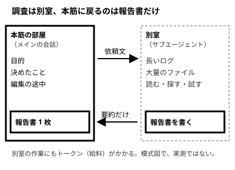

!!! abstract "要点"
    - **何が分かるか**：サブエージェントは別のコンテキストで作業して要約だけを返すので、本筋を散らかさずに済むが、賢くはならず、トークンは余分にかかる。
    - **いつ引くか**：調べものを別の担当に任せると、何が得で何が損かを知りたいとき。
    - **前提**：<!-- link:begin attention-budget -->[コンテキストウィンドウと注意の予算](attention-budget.md)<!-- link:end -->

<!-- textlint-disable -->
別名：文脈の隔離・別のコンテキストで調べさせる・別室の部下
<!-- textlint-enable -->

サブエージェントは、本筋の会話とは別のコンテキストで作業し、結果の要約だけを本筋に返す担当である。この辞典では、調査を別室の部下に頼み、報告書 1 枚だけを受け取る形にたとえる。部下は別室で資料の山を読むので、本筋の机は散らからない。ただし部下も給料（トークン）を取り、同じ問いを回しても答えは賢くならない。

## 何が起きるか {#what-happens}

本筋で認証まわりの修正を進めている最中に、「この設定キーを使っている箇所をすべて洗い出して」と頼む場面を考える。

本筋の Claude が自分で探すと、検索の結果と読んだファイルの中身が、そのまま本筋の会話に積もる。サブエージェントに任せると、流れは次のようになる。

1. 本筋の Claude が、依頼文を書いてサブエージェントを起動する。
2. サブエージェントは新しいコンテキストで動き出す。持つのは、自分のシステムプロンプト、指定したスキル、CLAUDE.md、git status である。本筋の会話は持たない。
3. 別室で、検索と読み取りを必要なだけ繰り返す。
4. 最後の報告だけが本筋に戻る。読んだファイルの中身や検索の途中経過は戻らない。

組み込みの Explore と Plan は、CLAUDE.md と git status のどちらも持たない。親の会話を引き継ぐ fork という形もあり、その場合は新しいコンテキストに本筋の会話が入る。このページが扱うのは、会話を引き継がない形である。なお、メインの会話が圧縮されても、サブエージェントの記録は影響を受けない。

このページの説明は、Claude Code のサブエージェントに基づく。API でエージェントを作るときの分け方は扱わない。

## なぜ本筋が散らからないのか {#why}

図の要点は、読んだ山が別室の机に置かれ、本筋の机に載るのは報告書だけ、ということである。

Claude は、コンテキストに入っているものを読んで答える。関係のない情報が増えるほど、大事な情報への注意が薄くなる（<!-- link:begin attention-budget -->[コンテキストウィンドウと注意の予算](attention-budget.md)<!-- link:end -->）。調べものの長い出力が本筋に積もれば、本筋の机は散らかる。

別のコンテキストなら、その出力は本筋の机に載らない。机が別なので、散らかるのも別室の机である。

報告書は、部下が選んだ内容だけを運ぶ。選び損ねたものは本筋に届かない。そこで、結論だけでなく、根拠の場所も戻させる。頼み方は <!-- link:begin research-in-subagents#how -->[出力の多い調査はサブエージェントに任せて要約だけ受け取る › 頼み方と戻させる形](../context/research-in-subagents.md#how)<!-- link:end --> に譲る。

## 賢くはならず、費用がかかる {#cost}

別室の部下は、本筋と同じモデルである。同じ問いを部下に回しても、答えはよくならない。得られるのは隔離だけである。

例外は、レビューである。書く過程を見ていない部下は、書いた本人が見落とした点に気づける。理由と分け方は <!-- link:begin independent-review#hide-reasoning -->[書いた本人ではない者にレビューさせる › 推論を見せない](../verify/independent-review.md#hide-reasoning)<!-- link:end --> にある。

部下も給料を取る。別室の読み取りと検索には、そのぶんトークンがかかる。新しいサブエージェントは文脈を一から集め直すので、小さな作業では、かえって遅くなることもある。費用の見方は <!-- link:begin research-in-subagents#cost -->[出力の多い調査はサブエージェントに任せて要約だけ受け取る › 費用と使いすぎ](../context/research-in-subagents.md#cost)<!-- link:end --> にある。

## 何に効くか（原理「見せる」と原因「散らかっている」） {#what-it-helps}

原理「見せる」は、Claude に何を見せるかを選ぶ、という考え方である。見せることには、見せないものを片付けることも含まれる。サブエージェントは、本筋に見せるものを減らす道具である。

防ぐ原因は「散らかっている」である。長いログや多数のファイルが本筋に積もり、大事な情報が埋もれる状態を、別室に閉じ込めて避ける。

今も向く場面は 3 つある。どれも、トークンは余分にかかる。

- **並列の作業**：互いに独立した作業を、同時に別室へ出す。方式の選び方は <!-- link:begin choosing-parallel-modes#who-coordinates -->[並列の方式の選び方 › 誰が調整するか](../delegate/choosing-parallel-modes.md#who-coordinates)<!-- link:end --> にある。
- **うるさい出力の切り離し**：テストの全件実行や広い検索のように、結果が長く、本筋には結論だけ要るもの。
- **独立したレビュー**：書く過程を見ていない者による確認。誰にさせるかは <!-- link:begin independent-review#who -->[書いた本人ではない者にレビューさせる › 誰にレビューさせるか](../verify/independent-review.md#who)<!-- link:end --> にある。

任せる幅が広がると、確かめる手間も増える。報告書は部下の自己申告なので、戻させた根拠の場所を見るか、合否を返すものを渡して確かめる（<!-- link:begin agent-loop#close-the-loop -->[エージェントループと tool use › 合否を返すものを渡してループを閉じる](agent-loop.md#close-the-loop)<!-- link:end -->）。並列にした分だけ、確かめる人の手間は増える。

コンテキストウィンドウが溢れることはまれになった。そのため、ウィンドウを守るためだけには使わない。この助言が古くなった経緯は、<!-- link:begin outdated-advice-ledger#subagents-to-save-context -->[古くなった助言の台帳](../changes/outdated-advice-ledger.md#subagents-to-save-context)<!-- link:end --> にある。

!!! example "判断例：設定キーの使用箇所を洗い出す"
    - **状況**：大きなリポジトリで、ある設定キーの使われている箇所を洗い、その結果をもとに本筋の修正を続けたい。
    - **迷う候補**：本筋の Claude が自分で検索する。調べる部分だけをサブエージェントに任せる。
    - **選んだもの**：サブエージェントに任せ、使用箇所の一覧と根拠の場所だけを戻させる。
    - **理由**：ヒットが多く、本筋の作業と独立しており、途中経過は本筋に要らないからである。数ファイルで済みそうなら、集め直す費用のほうが大きいので、本筋で探す。

使いどころと使わない場面の定義の書き方は、<!-- link:begin writing-subagents#when-to-use -->[サブエージェントの作り方と使いどころ › 使いどころと、使わない場面](../extend/writing-subagents.md#when-to-use)<!-- link:end --> にある。スキルとの違いは <!-- link:begin skill-vs-subagent -->[スキルとサブエージェントの違い](../extend/skill-vs-subagent.md)<!-- link:end --> で選べる。

## 誤解 {#misconceptions}

**「サブエージェントに回せば答えがよくなる」**：隔離はするが、賢くはならない。「subagent を使え」と書き足しても、同じ作業の質は上がらない。古くなった助言の台帳の行は <!-- link:begin outdated-advice-ledger#tell-it-to-use-subagents -->[古くなった助言の台帳](../changes/outdated-advice-ledger.md#tell-it-to-use-subagents)<!-- link:end --> にある。大きく独立した作業だけに任せる。

**「工程ごとに部下を作ると本筋が散らからない」**：小さな作業まで分けると、集め直しの費用と待ち時間が増える。文脈を分ける意味のある作業だけに使う。台帳の行は <!-- link:begin outdated-advice-ledger#subagent-per-step -->[古くなった助言の台帳](../changes/outdated-advice-ledger.md#subagent-per-step)<!-- link:end --> にある。

**「部下は、こちらの決まりを全部知っている」**：会話で伝えただけの制約は、別室に届かない。必ず届けたい規則は、委任の文に書き直す。届かないものの一覧は <!-- link:begin what-subagents-dont-inherit -->サブエージェントに引き継がれないもの（準備中）<!-- link:end --> にある。

**「報告書は確かめなくてよい」**：報告書は、部下が選んで書いた要約である。結論と根拠の場所を見て、本筋の側でも確かめる。

<!-- gen:begin references -->
<!-- textlint-disable -->

## 参考 {#references}

- [Create custom subagents](https://code.claude.com/docs/en/sub-agents)：Anthropic・英語・確認日 2026-11-04
- [Extend Claude Code](https://code.claude.com/docs/en/features-overview)：Anthropic・英語・確認日 2026-11-04
- [Best practices for Claude Code](https://code.claude.com/docs/en/best-practices)：Anthropic・英語・確認日 2026-11-04
- [Best practices for Claude Code（改稿後。Internet Archive の写し、2026-10-27 08:15 UTC）](https://web.archive.org/web/20261027081520/https://code.claude.com/docs/en/best-practices)：Anthropic（写し）・英語・確認日 2026-11-04

<!-- textlint-enable -->
<!-- gen:end references -->

<!-- gen:begin page-links -->
<!-- textlint-disable -->

**前提**

- [コンテキストウィンドウと注意の予算](attention-budget.md)

**次に読む**

- [出力の多い調査はサブエージェントに任せて要約だけ受け取る](../context/research-in-subagents.md)
- [サブエージェントの作り方と使いどころ](../extend/writing-subagents.md)
- [スキルとサブエージェントの違い](../extend/skill-vs-subagent.md)
- [書いた本人ではない者にレビューさせる](../verify/independent-review.md)
- [並列の方式の選び方](../delegate/choosing-parallel-modes.md)
- 計画・実装・サブエージェントでモデルを分ける（準備中）

**関連**

- サブエージェントに引き継がれないもの（準備中）
- [エージェントループと tool use](agent-loop.md)

<!-- textlint-enable -->
<!-- gen:end page-links -->
