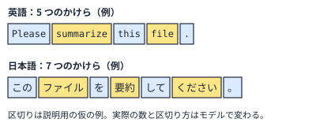

!!! abstract "要点"
    - **何が分かるか**：Claude が文章を読み書きする単位がトークンで、コンテキストの大きさ・費用・利用上限はどれもトークンで数える。数はモデルと言語で変わるので、手元で数えて確かめる。
    - **いつ引くか**：上限や費用で言う「トークン」が何を数えているのか知りたいとき。
    - **前提**：なし

<!-- textlint-disable -->
別名：token・トークン数・トークンの数え方
<!-- textlint-enable -->

トークンは、Claude が文章を読み書きするときの最小の単位である。文字数や単語数とは別の物差しで、モデルが違えば、同じ文章でも数が変わる。コンテキストの大きさ、費用、利用上限の話に出てくる「トークン」は、すべてこの単位を指す。

## 何が起きるか {#what-happens}

トークンの数が文字数や単語数と合わない場面には、たとえば次の 3 つがある。

- **文字数で見積もった長さが外れる**：議事録を Claude へ渡す前に、文字数から「この程度なら収まる」と見積もる。実際に数えると、見積もりと違う数になる。1 トークンが表す文字数は、モデルと言語で違うからである。
- **モデルを替えると、同じ文章の数が増える**：新しい世代のモデルは、新しい tokenizer（文章をトークンに区切る部分）を使う。公式の用語集によると、同じ文章でも、以前のモデルより数が増える。増える割合は、Opus 4.7 の場合で<!-- fact:begin tokenizer-token-increase-opus-4-7 -->約 30%（2026-11-05 時点）<!-- fact:end -->である（公式の用語集）。
- **上限や使用量の数字が、文字数と結び付かない**：利用上限や API の使用量は、トークンで表される。何を数えた値なのかが分からないと、減り方を読めない。

どれも、トークンを文字数の言い換えとして扱ったときに起きる。トークンは文字の数ではなく、モデルが区切った「かけら」の数である。

## なぜそうなるか {#why}

トークンは、公式の用語集によると、単語・語の一部・文字・バイトのどれにも当たりうる単位である。モデルは、入力された文字の列を、いったんトークンの列に変換してから処理する。1 トークンが表す文字数は、モデルと言語による。Opus 4.7 より前のモデルの目安は<!-- fact:begin chars-per-token-earlier-models -->約 3.5 文字（2026-11-05 時点）<!-- fact:end -->である。

図の要点は 2 つある。1 つ目は、トークンが文字とも単語とも違う、語のかけらだということである。2 つ目は、同じ意味の依頼でも、言語によってかけらの数が変わりうることである。ただし図の区切りは説明のための仮の例で、実際の数と区切りは、モデルの tokenizer が決める。公式は、言語ごとの倍率を出していない。移行の手引きも、増え方は内容による、と範囲で案内するだけである。

区切り方はモデルの世代で変わる。だから、あるモデルで数えた値を、別のモデルにそのまま当てはめられない。数が知りたいときは、推測せず、使うモデルで数える。数え方は、このページの「手元で数えて確かめる」の節にある。

トークンの数は、コンテキストの大きさにも結び付く。コンテキストは、Claude が一度に机の上に広げて見られる資料の量にあたる。この広い机の広さは、文字数ではなくトークンで測る。机に載せた資料の量を測る物差しが、そのまま費用と利用上限の物差しにもなっている。

日本語で頼んだときに数がどう変わるか、英語に替えて節約すべきかは、<!-- link:begin can-i-prompt-in-japanese#tokens -->日本語で指示して大丈夫か › 日本語のトークン数と、上限への効き方（準備中）<!-- link:end -->で扱う。このページでは、数がモデルと言語で変わるという考え方までにとどめる。

## 手元で数えて確かめる {#count}

数は推測せず、使うモデルで数えて確かめる。公式の用語集も、正確な数が要るときは token counting を使うよう案内している。面によって、数える手段が違う。

=== "アプリ"

    アプリには、会話のトークン数を数える専用の画面を、この辞典では確認していない（未確認）。使った分の目安は、利用上限の残りを見る場所で確かめる。見る場所は<!-- link:begin how-usage-limits-work#where-to-check -->[利用上限の仕組み（面をまたいで共有する枠） › 残りを見る場所](../cost/how-usage-limits-work.md#where-to-check)<!-- link:end -->にある。

=== "Claude Code"

    `/context` で、会話・読み込んだファイル・常駐するものが、コンテキストのどれだけを占めているかを見る。読み方は<!-- link:begin inspect-context#reading -->[/context で中身を見る › 内訳の読み方](../context/inspect-context.md#reading)<!-- link:end -->にある。起動直後の値を控えておくと、増えた分が分かる。

=== "API"

    token counting を使うと、送る前に、入力が何トークンになるかを数えられる。数えるときは、実際に使うモデルを指定する。モデルが違うと、同じ入力でも数が変わるからである。詳しい使い方は、公式の [Token counting](https://platform.claude.com/docs/en/build-with-claude/token-counting) を見る。

!!! example "判断例：長い日本語の資料を渡す前に、収まるかを知りたい"
    - **状況**：数十ページの日本語の仕様書を Claude に渡して要約させたい。コンテキストに収まるか、先に知りたい。
    - **迷う候補**：文字数から「1 トークンは何文字」と割り戻して見積もる案。実際に送ってみて、結果を見る案。使うモデルで数える案。
    - **選んだもの**：使うモデルで数える。API なら token counting を使い、Claude Code なら読み込んだ後に `/context` で占める量を見る。
    - **理由**：割り戻しは、言語・内容・モデルの世代で外れる。送ってから分かると、収まらなかったときに手戻りが出る。文字数の見積もりは、桁を見るための目安にとどめる。

## 何に効くか {#effects}

トークンの考え方は、この辞典の原理のうち「見せる」と、Claude 側の原因のうち「合っていない」に結び付く。

原理の「見せる」は、Claude に必要な情報を、見える形で渡すことである。見せられる量には上限があり、その量はトークンで測る。何を見せるかを選ぶときは、文字数ではなくトークンで量を考えるとずれにくい。原理の全体は<!-- link:begin four-principles -->[四つの原理と比例則（見せる・確かめる・縛る・握る）](../start/four-principles.md)<!-- link:end -->で見る。

原因の「合っていない」は、頼み方や量の見積もりが、Claude の仕組みと噛み合っていない状態である。文字数で見積もって「収まるはず」と渡す、モデルを替えたのに前の数を使い続ける、といった場面がこれにあたる。トークンで数える習慣が、この食い違いを減らす。

次の一手は、知りたい点に合わせて選ぶ。

- **注意の使われ方**：コンテキストに入ることと、よく使えることは別である。<!-- link:begin attention-budget -->[コンテキストウィンドウと注意の予算](attention-budget.md)<!-- link:end -->で見る。
- **会話が長くなる理由**：毎回、最初から読み直す仕組みは<!-- link:begin rereads-whole-history -->[毎ターン全履歴を読み直す](rereads-whole-history.md)<!-- link:end -->にある。
- **利用上限**：枠の仕組みは<!-- link:begin how-usage-limits-work -->[利用上限の仕組み（面をまたいで共有する枠）](../cost/how-usage-limits-work.md)<!-- link:end -->、早く減る原因は<!-- link:begin what-uses-up-limits -->[上限を早く使う要因](../cost/what-uses-up-limits.md)<!-- link:end -->にある。
- **中身の確かめ方**：何が場所を取っているかは<!-- link:begin inspect-context -->[/context で中身を見る](../context/inspect-context.md)<!-- link:end -->で見る。

## 誤解 {#misconceptions}

トークンをめぐって、よく出会う誤解を 4 つ挙げる。

- **「1 トークンは 1 文字（または 1 語）」**：トークンは語のかけらで、1 文字より短いことも、1 語より長いこともある。1 トークンが表す文字数は、モデルと言語で違う。
- **「日本語は英語の何倍、と決まっている」**：公式は、言語ごとの固定の倍率を出していない。倍率は tokenizer と内容で変わる。数が要るなら数える。
- **「モデルを替えても、トークン数は同じ」**：新しい世代のモデルは新しい tokenizer を使い、同じ文章でも数が増える。モデルを替えたら、数え直す。
- **「会話を片付ければ、使った分は戻る」**：コンテキストの量を減らすことと、すでに使った利用枠が戻ることは別である。戻り方は<!-- link:begin how-usage-limits-work -->[利用上限の仕組み（面をまたいで共有する枠）](../cost/how-usage-limits-work.md)<!-- link:end -->で確かめる。

<!-- gen:begin references -->
<!-- textlint-disable -->

## 参考 {#references}

- [Glossary](https://platform.claude.com/docs/en/about-claude/glossary)：Anthropic・英語・確認日 2026-11-05
- [Token counting](https://platform.claude.com/docs/en/build-with-claude/token-counting)：Anthropic・英語・確認日 2026-11-04
- [Claude Opus 5.5 migration guide](https://platform.claude.com/docs/en/models/opus-5-5/migration-guide)：Anthropic・英語・確認日 2026-11-04

<!-- textlint-enable -->
<!-- gen:end references -->

<!-- gen:begin page-links -->
<!-- textlint-disable -->

**前提**

- なし

**次に読む**

- [コンテキストウィンドウと注意の予算](attention-budget.md)
- [毎ターン全履歴を読み直す](rereads-whole-history.md)
- [思考（thinking）と effort の仕組み](how-thinking-works.md)
- API 料金の読み方（準備中）
- 日本語で指示して大丈夫か（準備中）

**関連**

- 日本語で指示して大丈夫か › 日本語のトークン数と、上限への効き方（準備中）
- [利用上限の仕組み（面をまたいで共有する枠）](../cost/how-usage-limits-work.md)
- [上限を早く使う要因](../cost/what-uses-up-limits.md)
- [/context で中身を見る](../context/inspect-context.md)

<!-- textlint-enable -->
<!-- gen:end page-links -->
