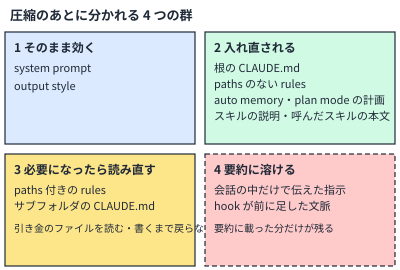

!!! abstract "要点"
    - **何が分かるか**：圧縮で会話が要約に置き換わるとき、何がそのまま効き、何が入れ直され、何が要約に溶けるかが分かる。残したい規則の置き場所を決める土台になる。
    - **いつ引くか**：圧縮のあとに何が残り、何が消えるのか知りたいとき。
    - **前提**：<!-- link:begin rereads-whole-history -->[毎ターン全履歴を読み直す](rereads-whole-history.md)<!-- link:end -->、<!-- link:begin where-instructions-sit -->[システムプロンプト・ユーザーメッセージ・CLAUDE.md の位置](where-instructions-sit.md)<!-- link:end -->

<!-- textlint-disable -->
別名：compaction・要約圧縮・What survives compaction・議事録だけ残す
<!-- textlint-enable -->

圧縮（compaction）は、会話の履歴を要約に置き換える操作である。何が残るかは、中身が会話の中にあったか、会話の外から読み込まれたかで決まる。このページは、その違いを 4 つの群にして一覧にする。

## 何が起きるか {#what-happens}

長い作業を任せていて、自動の圧縮が走った場面を考える。

- **序盤の口約束**：作業の最初に「`migrations/` の下は触らないで」と会話で頼んだ。CLAUDE.md にはテストの実行手順だけが書いてある。
- **圧縮の前**：Claude は頼みを守り、手順どおりにテストを流している。
- **圧縮の後**：テストの手順は変わらず守られる。一方で `migrations/` の禁止は、要約に載らなければ消える。しばらくして、Claude がその下のファイルを編集する。

同じ圧縮で、片方は残り、片方は消えた。違いは、手順が CLAUDE.md という会話の外の置き場所にあり、禁止が会話の中にしかなかったことである。公式の表は、会話の中だけで伝えた指示を「要約に溶ける」ものに分類する。要約に載ることはあっても、載る保証はない。

このページの一覧は、Claude Code の公式の表に基づく。アプリの長い会話で上限が近づいたときの自動の整理は<!-- link:begin long-chat-limits#auto-management -->長い会話の自動のコンテキスト管理と長さの上限 › 上限が近づくと何が起きるか（準備中）<!-- link:end -->が扱う。API の compaction は別の仕組みで、この一覧をそのまま当てはめない。

## なぜ 4 つに分かれるか {#why}

圧縮は、会話の履歴を要約に置き換える。ただし、システムの指示や、ディスクにあるファイルは、会話の履歴ではない。圧縮のあとに Claude が読み込み直せるものは、もう一度手元に戻る。会話の中にしかなかったものは、要約が書いた分だけが残る。

図の見方は単純である。左上と右上は、会話の外にあって、圧縮に巻き込まれないか、すぐ戻るもの。左下は、戻るのに引き金が要るもの。右下の破線の枠だけが、要約に頼るものである。

たとえると、圧縮は「会議の議事録だけを残して、録音を消す」操作にあたる（比喩）。議事録に書かれなかった口約束は消える。社内規程のように、毎回配られる文書は会議の外にあるので、消えずに配り直される。

## そのまま効くもの {#kept}

圧縮の影響を受けず、そのまま効き続けるのは、システムプロンプトと出力スタイルである。どちらも会話の履歴ではなく、会話の前に置かれる土台だからである。

会話の外で動いているものも、圧縮の後に続く。

- **動き続けるもの**：バックグラウンドのコマンドとサブエージェント。まだ動いているものを Claude に知らせ、重複して始めないようにする。
- **もう一度走るもの**：`compact` に合う SessionStart フック。出力を圧縮後の文脈に足す。

後者は、圧縮の後に必ず見せたい短い文脈を、フックで足す手になる。フックの出力は<!-- fact:begin hook-output-max-chars -->10000 文字まで（2026-11-05 時点）<!-- fact:end -->である。仕様は公式の [Hooks reference](https://code.claude.com/docs/en/hooks) で確かめる。

## 入れ直されるもの {#reloaded}

圧縮のあとに、ディスクや現在の状態から作り直されて戻るものが、いちばん多い。

<!-- gen:begin compare 強制力 圧縮で残るか -->
<!-- textlint-disable -->

| 機能 | 強制力 | 圧縮で残るか |
| --- | --- | --- |
| 圧縮（/compact と自動圧縮）（準備中） | — | 未確認 |
| [CLAUDE.md](../extend/what-to-put-in-claude-md.md) | お願い | 残る |
| rules（.claude/rules/）（準備中） | お願い | 条件による |
| 自動メモリ（auto memory）（準備中） | お願い | 残る |
| [スキル（skills）](../extend/writing-skills.md) | お願い | 残る |

<!-- textlint-enable -->
<!-- gen:end compare 強制力 圧縮で残るか -->

表は、このページが扱う機能の強制力と、圧縮で残るかを並べたものである。「条件による」は、次の節の読み直しで決まる。表の下の項目は、入れ直されるものごとの細部を足す。

- **根の CLAUDE.md と paths のない rules**：「根の CLAUDE.md」はプロジェクトの最上位にある CLAUDE.md、「paths」は rules が効くファイルを絞るフロントマターの指定である。どちらもディスクから入れ直される。入れ直されても、CLAUDE.md の強制力は「<!-- gen:begin feature claude-md/enforcement -->お願い<!-- gen:end feature claude-md/enforcement -->」で、文脈として読まれるだけである。
- **自動メモリ**：セッションの開始に読み込む MEMORY.md の先頭から<!-- fact:begin auto-memory-startup-load -->200 行または 25KBの早いほうまで（2026-11-05 時点）<!-- fact:end -->、ディスクから入れ直される。話題ごとのファイルは、Claude が必要なときに読む。
- **plan mode で書いた計画**：ディスクから入れ直される。
- **スキルの説明**：圧縮の後、今のスキルから作り直して入れ直される。
- **呼んだスキルの本文**：上限つきで入れ直される。1 つあたり<!-- fact:begin skill-reattach-tokens-each -->先頭から 5000 トークンまで（2026-11-04 時点）<!-- fact:end -->、全体で<!-- fact:begin skill-reattach-tokens-total -->合計 25000 トークンまで（2026-11-04 時点）<!-- fact:end -->で、古く呼んだものから落ちる。先頭を残して切るので、大事な指示は SKILL.md の上のほうに書く。
- **git status**：起動時に取っていたセッションだけ、新しく取り直される。
- **読んだか編集したファイル**：最近変更されたものから、<!-- fact:begin compaction-reread-files-max -->最大 5 個（2026-11-05 時点）<!-- fact:end -->が再び読み込まれる。大きさの上限は <!-- fact:begin compaction-reread-file-tokens-max -->1 つあたり 5000 トークンまで（2026-11-05 時点）<!-- fact:end --> で、これを超えるファイルは中身なしで、パスの参照（`Referenced file`）として戻る。個数と大きさの上限は版で変わりうるので、公式の表で確かめる。

「入れ直される」は、「元の形のまま戻る」とは限らない。上限で切られるものと、パスだけが戻るものがある。長い規則や手順は、先頭に大事なことを置く。

## 必要になったら読み直されるもの {#reread-on-demand}

圧縮のあと、自分では戻らず、引き金が引かれたときに読み直されるものがある。

- **paths 付きの rules**：一致するファイルを Claude が読むか書くまで戻らない。
- **サブフォルダの CLAUDE.md**：そのフォルダのファイルを Claude が読むか書くまで戻らない。

圧縮を越えて残したい規則は、paths を外すか、根の CLAUDE.md に移す。これは公式の勧めである。paths 付きの rules の読み込みの時期は<!-- link:begin path-scoped-rules#after-compaction -->.claude/rules と paths で必要なときだけ読ませる › 圧縮の後に戻る時期（準備中）<!-- link:end -->にある。

読み直しは、Claude がそのフォルダやファイルを再び扱ったときにだけ起きる。扱わない間は、その規則は文脈にない。圧縮の直後に、別の場所の作業へ移ると、その規則は守られない。

## 要約に溶けて消えるもの {#dissolved}

公式の表が「要約に溶ける」と分類するのは、次の 2 つである。

- **会話の中だけで伝えた指示**：頼み方がどれほど強くても、会話にしかなければ要約しだいである。
- **圧縮より前にフックが会話へ足した文脈**：会話の一部なので、会話と一緒に要約されうる。

この「要約に溶ける」群は、守らせたい規則を置く場所として使わない。置き場所の決め方は<!-- link:begin promises-after-compaction#where-to-put -->[圧縮で消えない場所に約束を置く › 約束の種類ごとの置き場所](../context/promises-after-compaction.md#where-to-put)<!-- link:end -->が持つ。会話で言った禁止が薄れる仕組みと、鍵に移す合図は<!-- link:begin when-to-lock#spoken-rules-fade -->[お願いを鍵に移す判断 › 会話で言った禁止は圧縮で消える](../enforce/when-to-lock.md#spoken-rules-fade)<!-- link:end -->にある。圧縮のあとに約束を忘れたと感じたときは、<!-- link:begin forgot-after-compaction#diagnosis -->[圧縮の後に約束を忘れた › 原因を安く確かめる順](../symptoms/forgot-after-compaction.md#diagnosis)<!-- link:end -->で原因を安い順に確かめる。

要約で失いたくない長い作業は、重要な状態を書き出してから会話を新しくする手がある。置き場所と再開の仕方は<!-- link:begin handoff-documents#where -->[handoff 文書と document-and-clear › 置き場所（圧縮で消えない所）](../context/handoff-documents.md#where)<!-- link:end -->にある。

## 何に効くか {#effects}

このページが結び付ける原理と原因は次のとおりである。

- **見せる（原理）**：圧縮のあとも見える場所に、必要な文脈を置く。システムの土台、根の CLAUDE.md、自動メモリ、計画は、会話が置き換わっても戻る。見せるべき情報を会話の中だけに置くと、要約が書かなかった分は見えなくなる。
- **縛る（原理）**：CLAUDE.md は入れ直されても文脈であり、お願いである。例外を許さない規則は、圧縮と関係なく効く権限ルールやフックに移す。判断の目安は<!-- link:begin when-to-lock#signals -->[お願いを鍵に移す判断 › 鍵に移す合図](../enforce/when-to-lock.md#signals)<!-- link:end -->にある。
- **散らかっている（原因）**：長い会話には、失敗した試みや関係のない出力が積もる。圧縮はこれを減らす機会になる。ただし、減らすときに必要な規則まで会話の中に置いていると、一緒に失う。規則は先に会話の外へ出しておく。
- **縛っていない（原因）**：会話で一度言っただけの禁止は、縛りがない状態である。圧縮でさらに薄れる。

!!! example "判断例：フロントエンドの規約を置く場所"
    - **状況**：`src/web/` の規約を、長い作業の最後まで守らせたい。自動の圧縮が何度か走る見込みである。
    - **迷う候補**：paths 付きの rules に置き、そのフォルダのときだけ読ませる。または、paths を付けず、根の CLAUDE.md に置く。
    - **選んだもの**：圧縮を越えて残したいので、paths を付けずに根の CLAUDE.md に置く。
    - **理由**：paths 付きの rules は、圧縮のあと、`src/web/` のファイルを再び読むか書くまで戻らない。常駐を減らせる利点は、圧縮を越えて守らせたい規則では、守られない期間の危険に見合わない。常駐の量を減らしたい規則だけを、paths 付きにする。

## 誤解 {#misconceptions}

- **CLAUDE.md は、どれも圧縮のあと再注入される**：戻るのは根の CLAUDE.md である。サブフォルダの CLAUDE.md は、そのフォルダのファイルを扱うまで戻らない。
- **スキルは圧縮で消える**：スキルの説明は今のスキルから作り直されて戻り、呼んだスキルの本文も上限つきで戻る。ただし、上限を超えた分や古く呼んだものは落ちる。
- **入れ直されるなら、必ず守られる**：入れ直しは、規則が文脈に戻ることまでを意味する。従うかどうかは、お願いである限り Claude の判断に残る。守りたい規則は<!-- link:begin when-to-lock -->[お願いを鍵に移す判断](../enforce/when-to-lock.md)<!-- link:end -->で鍵に移すかを決める。
- **要約が丁寧なら、口約束も残る**：残ることはあるが、保証はない。残すと決めた規則は、会話の外に置く。
- **圧縮の操作を覚えれば足りる**：操作は<!-- link:begin compact-and-auto-compact#focused-compact -->/compact と自動圧縮 › /compact に焦点を指示する（準備中）<!-- link:end -->にある。このページの一覧を知らずに焦点だけ指示しても、会話の外へ出していない規則は守れない。

<!-- gen:begin references -->
<!-- textlint-disable -->

## 参考 {#references}

- [Explore the context window](https://code.claude.com/docs/en/context-window)：Anthropic・英語・確認日 2026-11-04
- [How Claude remembers your project](https://code.claude.com/docs/en/memory)：Anthropic・英語・確認日 2026-11-04
- [Extend Claude with skills](https://code.claude.com/docs/en/skills)：Anthropic・英語・確認日 2026-11-04
- [Hooks reference](https://code.claude.com/docs/en/hooks)：Anthropic・英語・確認日 2026-11-04
- [How Claude Code works](https://code.claude.com/docs/en/how-claude-code-works)：Anthropic・英語・確認日 2026-11-04

<!-- textlint-enable -->
<!-- gen:end references -->

<!-- gen:begin page-links -->
<!-- textlint-disable -->

**前提**

- [毎ターン全履歴を読み直す](rereads-whole-history.md)
- [システムプロンプト・ユーザーメッセージ・CLAUDE.md の位置](where-instructions-sit.md)

**次に読む**

- [圧縮で消えない場所に約束を置く](../context/promises-after-compaction.md)
- [お願いを鍵に移す判断](../enforce/when-to-lock.md)
- [圧縮の後に約束を忘れた](../symptoms/forgot-after-compaction.md)
- /compact と自動圧縮（準備中）
- 拡張機能の全体図と使い分け早見表（準備中）
- 長時間エージェントのコンテキスト管理（準備中）

**関連**

- [お願いを鍵に移す判断 › 会話で言った禁止は圧縮で消える](../enforce/when-to-lock.md#spoken-rules-fade)
- [handoff 文書と document-and-clear](../context/handoff-documents.md)
- .claude/rules と paths で必要なときだけ読ませる（準備中）
- 長い会話の自動のコンテキスト管理と長さの上限（準備中）

<!-- textlint-enable -->
<!-- gen:end page-links -->
