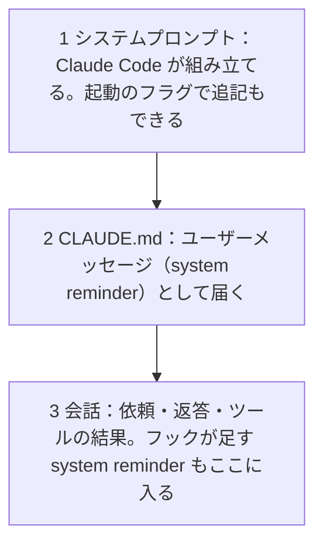

!!! abstract "要点"
    - **何が分かるか**：システムプロンプト・CLAUDE.md・会話の発言は、文脈の別の場所に入り、続き方も違う。どれも強制ではなく、Claude が読んで扱いを決める文脈である。
    - **いつ引くか**：CLAUDE.md やプロジェクトの指示がどこに入り、どれだけ効くのか知りたいとき。
    - **前提**：なし

<!-- textlint-disable -->
別名：system prompt・user message・system reminder・システムリマインダー・CLAUDE.md の位置づけ
<!-- textlint-enable -->

システムプロンプト・ユーザーメッセージ・CLAUDE.md の位置とは、書いた指示がコンテキストのどこに、どの形で入るかを指す。CLAUDE.md は強制される設定ではなく、システムプロンプトの後のユーザーメッセージとして届く文脈である。入る場所によって、圧縮の後に残るか、サブエージェントに届くかが変わる。

## 何が起きるか {#what-happens}

指示を書いたのに効かない場面には、たとえば次の 3 つがある。

- **CLAUDE.md の規則が破られる**：「テストは `pnpm` で走らせる」と書いたのに、別のコマンドで走らせる。ファイルは読み込まれているのに、規則は守られなかった。
- **会話で頼んだことが、長い作業の後で消える**：依頼の途中で「この関数の名前は変えないで」と頼んだ。長い作業の途中で会話が圧縮されると、細かい頼みは要約に残らないことがある。
- **別の担当には届かない**：Claude Code の組み込みのサブエージェント Explore と Plan は、CLAUDE.md を受け取らない。クラウドのセッションは、ユーザーの `~/.claude/CLAUDE.md` を読まない。

現れ方は違うが、原因の土台は同じである。指示は、コンテキストに入った文のひとつにすぎない。どの場所に入ったかで、いつ読まれ、何があれば残り、誰に届くかが決まる。破られたときに止める仕組みは、その位置にはない。

## 指示が入る場所 {#positions}

指示の入る場所は、面によって違う。まず Claude Code の並びを図で示す。

図の要点は 2 つある。CLAUDE.md は、システムプロンプトの一部ではなく、その後に続くユーザーメッセージとして届くこと。あなたの依頼やツールの結果は、会話の中身として、その後ろに積み重なっていくことである。

面ごとの対応は、次のタブで確かめる。

=== "アプリ"

    アプリの指示の置き場所は 3 つある。

    - **Claude への指示（Instructions for Claude）**：設定の Instructions に書く。全部の会話に使われる。
    - **プロジェクトの指示（project instructions）**：プロジェクトの中の全部の会話に使われる。
    - **スキル**：応答の調子や形式、繰り返す振る舞いを入れる。

    公式は、これらを Claude が応答で使う指示と書き、強制の仕組みとは書かない。会話の文脈のどこに入るかは、確かめた公式の文書に書かれていない。アプリでの置き場所の選び方は<!-- link:begin where-to-put-instructions#how-to-choose -->[アプリの指示の置き場所（Claude への指示・プロジェクト・メモリ・スキル） › どこに置くかの選び方](../app/where-to-put-instructions.md#how-to-choose)<!-- link:end -->で扱う。

=== "Claude Code"

    Claude Code では、次のものが別々の場所に入る。

    - **システムプロンプト**：既定のものを Claude Code が組み立てる。`--append-system-prompt` で書き足せるが、これは起動のたびのフラグで、設定ファイルのキーとしては書けない。圧縮の後も効く。
    - **CLAUDE.md**：システムプロンプトの後のユーザーメッセージ（system reminder）として届く。作業ディレクトリから上の階層の分はセッション開始で、サブディレクトリの分は、Claude がそのディレクトリのファイルを読み書きしたときに読み込まれる。階層と順序は<!-- link:begin claude-md-loading-order -->CLAUDE.md の階層と読み込み順（準備中）<!-- link:end -->で扱う。
    - **出力スタイル**：公式は「Claude が従う指示で、何も強制しない」と書く。毎回のリクエストで送られ、圧縮の後も効く。主の会話では system reminder として届く。
    - **フックが足す文**：`UserPromptSubmit` フックの標準出力か `additionalContext` は、プロンプトごとに system reminder として足される。
    - **会話の発言**：あなたの依頼と Claude の返答は、会話の中身として文脈に積まれる。

=== "API"

    CLAUDE.md は Claude Code の機能で、API には自動で読み込む仕組みがない。システムプロンプトと、メッセージの並びに何を入れるかは、呼び出す側が決める。公式の多言語の案内は、本番では応答言語をシステムプロンプトで明示するのが最も確実だと書く。API で指示がメッセージのどこに入るかの詳細は、このページでは確かめていない。

## なぜ強制ではなく文脈になるか {#why}

どの指示も、Claude が読む文として文脈に入り、従うかどうかは Claude が決める。この辞典の比喩では、コンテキストは広い机であり、システムプロンプトも CLAUDE.md も会話の依頼も、机に載る書類の 1 枚である。書類は読まれて初めて効く。

公式は、CLAUDE.md を強制される設定ではなく文脈として扱うと書き、厳密に守られる保証はないとする。出力スタイルも、指示であって必ず起きることは保証しないと書く。プロジェクトの指示や Claude への指示も、Claude が使う指示と書かれ、強制の仕組みではない。

位置の違いは、たとえで見ると分かりやすい。CLAUDE.md は、始業のたびに机へ配られる社内規程にあたる。会話の依頼は、その場で言われた口頭の指示にあたる。圧縮は、会議の記録だけを残して机を片付けることにあたる。規程は片付けの後に配り直されるので残るが、口頭の指示は記録に書かれなければ消える。ただし、配られた規程に従うかどうかは、どちらの場合も担当者（Claude）の判断に残る。この「配る」と「従う」は別の話で、位置が決めるのは配られ方と続き方までである。

このページが示すのは、指示が入る場所と続き方である。書く位置や書き方によって、どれだけ守られやすくなるかの比較は、確かめた公式の文書に書かれていない。守られない原因の切り分けは<!-- link:begin instructions-ignored -->[CLAUDE.md や指示が守られない](../symptoms/instructions-ignored.md)<!-- link:end -->で扱い、強制の層との分け方は<!-- link:begin request-vs-lock#why -->[お願いと鍵（決定論的か、非決定論的か） › なぜそうなるか](request-vs-lock.md#why)<!-- link:end -->で扱う。

## どれだけ続いて効くか {#duration}

指示が続いて効く長さは、入る場所で決まる。CLAUDE.md と、出力スタイル、アプリの指示を並べると、次のようになる。表の「未確認」は、公式が書いていないか、まだ確かめていないことを指す。「—」は、この辞典がまだ値を持っていない欄である。

<!-- gen:begin compare 面 強制力 読み込みの時期 圧縮で残るか -->
<!-- textlint-disable -->

| 機能 | 面 | 読み込みの時期 | 圧縮で残るか |
| --- | --- | --- | --- |
| [CLAUDE.md](../extend/what-to-put-in-claude-md.md) | Claude Code | セッション開始 | 残る |
| 出力スタイル（output styles）（準備中） | Claude Code | セッション開始と切り替えたとき | 残る |
| [プロジェクトの指示（project instructions）](../app/using-projects.md) | アプリ | — | 未確認 |
| [Claude への指示（Instructions for Claude）](../app/where-to-put-instructions.md) | アプリ | — | 未確認 |

すべて共通：強制力 お願い。

<!-- textlint-enable -->
<!-- gen:end compare 面 強制力 読み込みの時期 圧縮で残るか -->

表に載らない 2 つを足す。

- **システムプロンプト**：圧縮の後もそのまま効く。
- **会話の発言**：会話が続く間は文脈にある。自動の圧縮で会話が要約に置き換わると、細かい指示は落ちることがある。

CLAUDE.md は、圧縮の後で扱いが分かれる。プロジェクトの根の CLAUDE.md はディスクから入れ直され、入れ子の CLAUDE.md は要約から消え、必要になったとき読み直される。圧縮で何が残り、何が消えるかは<!-- link:begin what-survives-compaction -->[圧縮（compaction）で何が残り、何が消えるか](what-survives-compaction.md)<!-- link:end -->で扱う。続く長さが違っても、残った指示を Claude が守るかどうかは、別の問題である。

## 何に効くか {#effects}

位置を知ると、次の 2 つの原理と 2 つの原因に結び付く。

- **縛る（原理）と、縛っていない（原因）**：CLAUDE.md・出力スタイル・プロジェクトの指示は、どれも位置が文脈なので、書いても縛ったことにならない。例外を許さない規則は、文脈に書くのではなく、仕組みで縛る。分け方は<!-- link:begin request-vs-lock#sorting -->[お願いと鍵（決定論的か、非決定論的か） › お願いと鍵の分け方](request-vs-lock.md#sorting)<!-- link:end -->で扱う。
- **見せる（原理）**：指示は、必要な場面で Claude の文脈に載っていなければ効かない。圧縮で消えた会話の頼み、Explore と Plan、クラウドのセッションがその例である。サブエージェントに渡したい規則は、委任の文に書く。方法は<!-- link:begin what-subagents-dont-inherit -->サブエージェントに引き継がれないもの（準備中）<!-- link:end -->で扱う。
- **散らかっている（原因）**：CLAUDE.md はセッションの間ずっと文脈に載り続ける。長い規則や一時的な頼みを混ぜると、肝心の行が埋もれる。置き場所を分ける基準は<!-- link:begin claude-md-vs-rules-skills-styles#how-to-choose -->[CLAUDE.md・rules・スキル・出力スタイルの違い › 指示の置き場所の選び方](../extend/claude-md-vs-rules-skills-styles.md#how-to-choose)<!-- link:end -->で扱う。

!!! example "判断例：毎回の規則と、今日だけの頼み"
    - **状況**：新しいリポジトリで作業する。「テストは `pnpm` で走らせる」はいつも要る。「今日はこの関数の名前を変えない」は、この作業の間だけ要る。
    - **迷う候補**：両方を CLAUDE.md に書く案。両方を会話で頼む案。前者を CLAUDE.md に、後者を会話に分ける案。
    - **選んだもの**：前者を CLAUDE.md に書き、後者を会話で頼む。
    - **理由**：毎回の規則は、セッションごとに読み込まれる CLAUDE.md に置くと、会話が変わっても届く。一時的な頼みを CLAUDE.md に混ぜると、ずっと文脈を占め、消し忘れる。会話の頼みは圧縮で落ちることがあるので、長い作業では、要る場面で頼み直す。破られたら困る規則は、どちらにも置かず、フックや deny ルールのような、毎回必ず効く仕組み（鍵）に移す。

## 誤解 {#misconceptions}

- **「CLAUDE.md はシステムプロンプトに入る」**：公式は、CLAUDE.md をシステムプロンプトの後のユーザーメッセージとして届くと書く。システムプロンプトとは別の場所で、圧縮の後の扱いも違う。
- **「書いたからには守られる」**：CLAUDE.md は強制される設定ではなく文脈である。公式も、厳密に守られる保証はないとする。
- **「IMPORTANT や YOU MUST を付ければ守られる」**：強調しても、文脈に入る文のままで、位置は変わらない。この助言は、いまはやめてよいものに入っている。台帳の記録は<!-- link:begin outdated-advice-ledger#important-caps -->[古くなった助言の台帳](../changes/outdated-advice-ledger.md#important-caps)<!-- link:end -->にある。
- **「会話で一度頼めば、ずっと効く」**：会話の発言は、圧縮の要約で落ちることがある。続けたい規則は、読み込まれる場所に置く。
- **「出力スタイルは CLAUDE.md の別名」**：別の機能である。Claude Code の出力スタイルは応答の形を変える指示で、サブエージェントには、fork を除いて届かない。混同しやすい機能の整理は<!-- link:begin claude-md-vs-rules-skills-styles#similar-names -->[CLAUDE.md・rules・スキル・出力スタイルの違い › 混同されやすい別の機能](../extend/claude-md-vs-rules-skills-styles.md#similar-names)<!-- link:end -->で扱う。

返答の言語を揃える例では、これらの位置の違いが重なる。設定・指示・フックのどれが、どこまで届くかは<!-- link:begin keep-replies-in-japanese#reach -->[日本語で返し続けさせる › 届かない所（サブエージェント・圧縮の要約・クラウドのセッション）](../japanese/keep-replies-in-japanese.md#reach)<!-- link:end -->で扱う。

<!-- gen:begin page-links -->
<!-- textlint-disable -->

**前提**

- なし

**次に読む**

- [圧縮（compaction）で何が残り、何が消えるか](what-survives-compaction.md)
- [アプリの指示の置き場所（Claude への指示・プロジェクト・メモリ・スキル）](../app/where-to-put-instructions.md)
- [CLAUDE.md に書くこと・書かないこと](../extend/what-to-put-in-claude-md.md)
- [別の会話やプロジェクトの内容が混ざる](../symptoms/unexpected-memories.md)
- [CLAUDE.md や指示が守られない](../symptoms/instructions-ignored.md)
- [毎回同じ説明をしている](../symptoms/repeating-the-same-explanation.md)
- /init と最初の CLAUDE.md（準備中）

**関連**

- [お願いと鍵（決定論的か、非決定論的か）](request-vs-lock.md)
- CLAUDE.md の階層と読み込み順（準備中）
- [CLAUDE.md・rules・スキル・出力スタイルの違い](../extend/claude-md-vs-rules-skills-styles.md)
- サブエージェントに引き継がれないもの（準備中）
- [日本語で返し続けさせる](../japanese/keep-replies-in-japanese.md)

<!-- textlint-enable -->
<!-- gen:end page-links -->

<!-- gen:begin references -->
<!-- textlint-disable -->

## 参考 {#references}

- [How Claude remembers your project](https://code.claude.com/docs/en/memory)：Anthropic・英語・確認日 2026-11-04
- [Output styles](https://code.claude.com/docs/en/output-styles)：Anthropic・英語・確認日 2026-11-04
- [Explore the context window](https://code.claude.com/docs/en/context-window)：Anthropic・英語・確認日 2026-11-04
- [Extend Claude Code](https://code.claude.com/docs/en/features-overview)：Anthropic・英語・確認日 2026-11-04
- [Best practices for Claude Code](https://code.claude.com/docs/en/best-practices)：Anthropic・英語・確認日 2026-11-04
- [Hooks reference](https://code.claude.com/docs/en/hooks)：Anthropic・英語・確認日 2026-11-04
- [CLI reference](https://code.claude.com/docs/en/cli-reference)：Anthropic・英語・確認日 2026-11-04
- [Create custom subagents](https://code.claude.com/docs/en/sub-agents)：Anthropic・英語・確認日 2026-11-04
- [Configure cloud environments](https://code.claude.com/docs/en/cloud-environments)：Anthropic・英語・確認日 2026-11-04
- [Understanding Claude's personalization features](https://support.claude.com/en/articles/10185728-understanding-claude-s-personalization-features)：Anthropic・英語・確認日 2026-11-04
- [How can I create and manage projects?](https://support.claude.com/en/articles/9519177-how-can-i-create-and-manage-projects)：Anthropic・英語・確認日 2026-11-04
- [What are projects?](https://support.claude.com/en/articles/9517075-what-are-projects)：Anthropic・英語・確認日 2026-11-04
- [What are skills?](https://support.claude.com/en/articles/12512176-what-are-skills)：Anthropic・英語・確認日 2026-11-04
- [Multilingual support](https://platform.claude.com/docs/en/build-with-claude/multilingual-support)：Anthropic・英語・確認日 2026-11-04

<!-- textlint-enable -->
<!-- gen:end references -->
