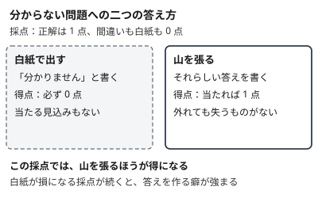
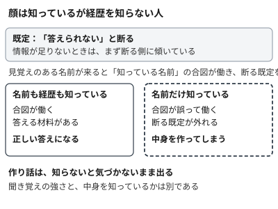

!!! abstract "要点"
    - **何が分かるか**：分からないときも答えを作るのは、推測が得になる訓練と、知っているつもりの誤作動が重なるためだと分かる。
    - **いつ引くか**：もっともらしい誤りを自信を持って言われた理由を知りたいとき。聞き覚えのある名前について、中身をでっち上げられたとき。
    - **前提**：なし

<!-- textlint-disable -->
別名：hallucination・幻覚・もっともらしい嘘・でっち上げ
<!-- textlint-enable -->

ハルシネーションとは、Claude が事実と違う内容を、もっともらしい文章と落ち着いた口調で答えることである。原因は 1 つではなく、訓練のかけ方と、モデルの中の仕組みの両方にある。仕組みが分かると、どこで確かめるべきかが決まる。

## 何が起きるか {#what-happens}

ハルシネーションは、本来は「分からない」で終わるはずの所に、分かったような答えが出る形で現れる。典型は次の 2 つである。

- 聞き覚えのある名前、たとえば小さなライブラリの作者について尋ねると、経歴や代表作がそれらしく並ぶ。実在の記録とは合わない。
- コードを頼むと、実在しない関数や引数が使われる。このときの切り分けは <!-- link:begin uses-nonexistent-apis#diagnosis -->[存在しない関数やパッケージを使う › 原因を安く確かめる順](../symptoms/uses-nonexistent-apis.md#diagnosis)<!-- link:end --> で扱う。

どちらも、間違いの部分だけ口調が変わるわけではない。正しい答えと同じ調子で出るので、読むだけでは見分けにくい。症状として現れたときの切り分けは <!-- link:begin plausible-falsehoods#diagnosis -->[もっともらしい嘘・出典の誤り › 原因を安く確かめる順](../symptoms/plausible-falsehoods.md#diagnosis)<!-- link:end --> にある。このページは、そうなる理由を扱う。

## 分からなくても答えるほうが得になる訓練 {#guess-pays}

言語モデルは、分からない問題でも答えを出すほうが得になる採点で磨かれている。これが 1 つ目の理由である。試験で言えば、白紙は 0 点で、山を張った答えは当たれば点になる。外れても失うものがないので、山を張る受験生が得をする。

2025 年の論文 Why Language Models Hallucinate は、これを次のように論じる。事前学習の段階では、正しい文と誤った文を見分けきれない所から、統計的な圧力で誤りが生まれる。その誤りが残るのは、訓練と評価が、不確かさを認めるより推測を報いる作りになっているからだという。評価の採点を改めることが解決の筋だと主張する。言語モデル一般についての議論で、特定の Claude の測定ではない（根拠：中）。

競技プログラミングの実践者にも、同じ見立てがある。AI は常に何かを出力してしまい、自分の答えが誤りだと判断して提出を控えることができない、という指摘である。誤答に罰のある場では、これが誤提出という形で表に出る（根拠：弱）。

## 名前を知っているだけで断る既定が外れる {#known-name}

2 つ目の理由は、Claude の内部にある「知っている」という感じの誤作動である。Anthropic の解釈可能性の研究は、Claude 3.5 Haiku の内部を調べ、次のように報告した。

- 情報が足りないときに「答えられない」と断る回路が、既定で働いている。
- 見覚えのある名前が来ると、「知っている名前」を表す別の特徴が働き、断る回路を抑える。これで答えられる。
- 名前に見覚えがあるだけで中身を知らないときも、この特徴が働くことがある。断る回路が誤って抑えられ、もっともらしい作り話が出る。

研究者は、「知っている名前」側の特徴を強めるか、「答えられない」側を弱めると、実在しない人物がチェスを指すと言い続けさせられることも示した。因果の確認になっている（根拠：中）。この結果は、研究時点のモデルでの観察である。今の Claude で同じ回路が同じ強さで働くかは、この研究からは言えない。

例えるなら、顔は知っているが経歴を知らない人について、知り合いのつもりで話してしまうことである。聞き覚えの強さと、中身を知っているかは別のものだ。この 2 つを Claude が分けて自覚できていないように見える（推論・実践例なし）。

資料が薄い領域でも、同じ構図が出やすいと考えられる。CTF で最後まで残った問題が、情報収集型・推測型・文書の薄い内部実装に偏ったという実践者の報告があり、学習データが薄い領域で弱いという一般化と合う（根拠：弱・類推）。

## 何に効くか {#what-helps}

ハルシネーションの対処は、強く命令することではなく、次の 3 つに分かれる。材料を渡す、白紙（分からないという答え）を許す、確かめる、である。訓練の傾きと内部の誤作動は利用者が直せないので、頼み方と確かめ方の側で備える。このページの原理は「見せる」と「確かめる」で、防ぐ原因は「見えていない」と「確かめていない」である。

- **見せる（防ぐ原因：見えていない）**：根拠となる資料を渡し、その範囲で答えさせる。知らない名前について、記憶で埋める余地を減らせる。渡した資料の範囲に限る頼み方は <!-- link:begin fact-checking#sources-only -->[事実を確かめる（引用・照合・best-of-N） › 渡した資料の範囲で答えさせる](../verify/fact-checking.md#sources-only)<!-- link:end --> と <!-- link:begin allow-i-dont-know#source-only -->[「分からない」と言ってよいと伝える › 渡した資料だけを根拠にさせる](../prompting/allow-i-dont-know.md#source-only)<!-- link:end --> にある。
- **白紙を許す（防ぐ原因：見えていない）**：分からなければ分からないと答えてよい、根拠のない所は推測と書け、と伝える。山を張るほうが得という傾きを、頼み方の側で和らげる。手順は <!-- link:begin allow-i-dont-know#escape-hatch -->[「分からない」と言ってよいと伝える › 分からないと言える逃げ道を作る](../prompting/allow-i-dont-know.md#escape-hatch)<!-- link:end --> にある。答えを迫るほど作り話が増える点は <!-- link:begin allow-i-dont-know#pressure -->[「分からない」と言ってよいと伝える › 答えを迫ると作り話が増える](../prompting/allow-i-dont-know.md#pressure)<!-- link:end --> で扱う。
- **確かめる（防ぐ原因：確かめていない）**：出てきた事実を、そのまま使わない。主張ごとに引用させる手がある（<!-- link:begin fact-checking#quotes -->[事実を確かめる（引用・照合・best-of-N） › 主張ごとに引用させる](../verify/fact-checking.md#quotes)<!-- link:end -->）。同じ質問を繰り返して食い違いを見る手もある（<!-- link:begin fact-checking#best-of-n -->[事実を確かめる（引用・照合・best-of-N） › 何度か聞いて比べる（best-of-N）](../verify/fact-checking.md#best-of-n)<!-- link:end -->）。挙げられた出典は原文と照らす（<!-- link:begin checking-citations#steps -->引用や出典の確かめ方 › 確かめる手順（準備中）<!-- link:end -->）。

Anthropic の公式の案内も、資料を渡す・分からないと言わせる・引用させるといった工夫で大きく減るが、無くなりはしないと述べる。重要な情報は、特に判断を左右するものほど、最後に人が確かめる。

## よくある誤解 {#misconceptions}

- **新しい版では起きなくなる**：減ることはあっても、ゼロを前提にしてはいけない。訓練と評価の傾きも、内部の誤作動も、版が変わるだけでは消える保証がない。
- **自信のある口調は正しさの合図になる**：口調は確かさを映さない。「知っている」感じは名前への見覚えでも生じるので、流暢さを根拠にしない。
- **「正確に答えて」と書けば直る**：「正確に」という念押しは、推測が得になる傾きを変えない。効くのは、分からないと言ってよいという許可と、資料の指定である。それでも無くならない。
- **最近のことを知らない問題と同じ**：知識の古さによる誤りは別の原因で、日付や検索結果を渡して防ぐ。<!-- link:begin knowledge-cutoff -->[知識カットオフと「今」を知らない問題](knowledge-cutoff.md)<!-- link:end --> で扱う。このページの誤りは、古さと関係なく起こる。
- **答えが毎回違うのは壊れているから**：答えのばらつきは非決定性による。むしろ、何回か聞いて食い違う点は、不確かな点の合図として使える。<!-- link:begin nondeterminism -->[同じ質問でも答えが変わる（非決定性）](nondeterminism.md)<!-- link:end --> を参照。
- **要約なら安全**：渡した資料の要約でも、原文の条件を落として言い切る形の誤りが出る。<!-- link:begin summary-overgeneralization -->[要約は原文より強く言いがち（過度な一般化）](summary-overgeneralization.md)<!-- link:end --> を参照。

<!-- gen:begin references -->
<!-- textlint-disable -->

## 参考 {#references}

- [Why Language Models Hallucinate](https://arxiv.org/abs/2509.04664)：arXiv（Kalai, Adam Tauman ほか）・英語・確認日 2026-11-04
- [Tracing the thoughts of a large language model](https://www.anthropic.com/research/tracing-thoughts-language-model)：Anthropic・英語・確認日 2026-11-04
- [Reduce hallucinations](https://platform.claude.com/docs/en/test-and-evaluate/strengthen-guardrails/reduce-hallucinations)：Anthropic・英語・確認日 2026-11-04
- [競技プログラミングと生成AIの今 2025/07/02版](https://chokudai.hatenablog.com/entry/2025/07/02/151841)：chokudai・確認日 2026-11-04
- [CTFs in the AI Era](https://blog.includesecurity.com/2026/04/ctfs-in-the-ai-era/)：Include Security・英語・確認日 2026-11-04

<!-- textlint-enable -->
<!-- gen:end references -->

<!-- gen:begin page-links -->
<!-- textlint-disable -->

**前提**

- なし

**次に読む**

- [「分からない」と言ってよいと伝える](../prompting/allow-i-dont-know.md)
- [事実を確かめる（引用・照合・best-of-N）](../verify/fact-checking.md)
- [もっともらしい嘘・出典の誤り](../symptoms/plausible-falsehoods.md)
- [存在しない関数やパッケージを使う](../symptoms/uses-nonexistent-apis.md)

**関連**

- 引用や出典の確かめ方（準備中）
- [知識カットオフと「今」を知らない問題](knowledge-cutoff.md)
- [同じ質問でも答えが変わる（非決定性）](nondeterminism.md)
- [要約は原文より強く言いがち（過度な一般化）](summary-overgeneralization.md)

<!-- textlint-enable -->
<!-- gen:end page-links -->
