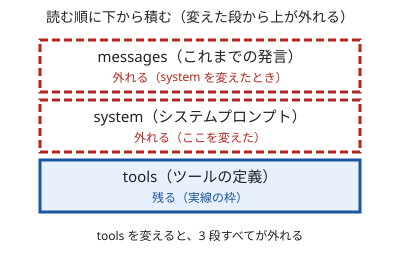

!!! abstract "要点"
    - **何が分かるか**：会話の先頭が前回と同じなら読み直しが安く済み、途中で変えるとそこから後のキャッシュが外れる。
    - **いつ引くか**：セッションの途中でモデルや設定を変えると費用が増える理由を知りたいとき。
    - **前提**：<!-- link:begin rereads-whole-history -->[毎ターン全履歴を読み直す](rereads-whole-history.md)<!-- link:end -->

<!-- textlint-disable -->
別名：cache・キャッシュが切れる・先頭部分の一致
<!-- textlint-enable -->

プロンプトキャッシングは、前回の request と先頭が完全に同じ部分の読み込みを使い回して、処理の時間と費用を減らす仕組みである。先頭が 1 か所でも変わると、そこから後ろは使い回せない。

## 何が起きるか {#what-happens}

Claude は毎回、会話の最初から読み直してから答える。この読み直しのうち、前回と同じ先頭の部分は、安く済ませられる。

次の 2 つの場面で比べる。

| 場面 | 先頭の部分 | 起きること |
| --- | --- | --- |
| 同じ設定のまま質問を重ねる | 前回と同じ | 先頭は使い回され、新しく足した発言だけを読む |
| 途中で effort を変えてから質問する | 変わった | 変えた所から後ろは使い回せず、その分を読み直す |

後者では、会話は同じ長さなのに、その 1 回だけ読み直しの費用が増える。次の回からは、新しい先頭がまた使い回される。費用の増え方はモデルと設定で違う。数字は <!-- link:begin prompt-caching-in-practice -->[プロンプトキャッシングの実務](../api/prompt-caching-in-practice.md)<!-- link:end --> と公式の文書で確かめる。

!!! example "判断例：長い作業の途中で effort を上げたい"
    - **状況**：Claude Code で長い調査を進めていて、次の質問だけ深く考えさせたくなった。
    - **迷う候補**：今のセッションで `/effort` を上げる。または、いまの区切りまで進めてから切り替える。
    - **選んだもの**：いまの区切りまで進めてから、まとめて切り替える。どうしても今の質問に要るときだけ、すぐ上げる。
    - **理由**：effort を変えると、そこから後ろのキャッシュが外れて、1 回分の読み直しの費用が増える。必要な切り替えなら払う価値があるが、気分で何度も往復すると、そのたびに外れる。

## なぜそうなるか {#why}

キャッシュは、先頭から順に一致した所までを使い回す。途中で 1 文字でも違えば、そこから後ろは別の内容になるので、使い回せない。

Claude に渡される先頭は、次の順に積まれている。

1. `tools`：使えるツールの定義
2. `system`：システムプロンプト（CLAUDE.md などの常駐する指示もここに入る）
3. `messages`：これまでの発言

比喩で言えば積み木である。下の段から順に積み、ある段を抜いて替えると、その上に載っていた段は全部崩れる。下の段は残る。

図が言いたいことは、変える段が下であるほど、外れる範囲が広いことである。公式の文書は、ある段の変更はその段とそれより後の段を無効にすると説明している。たとえばツールの定義を変えると 3 段すべてが外れ、会話に画像を足したり消したりすると messages だけが外れる。どの変更がどの段を外すかの一覧は <!-- link:begin prompt-caching-in-practice#invalidation -->[プロンプトキャッシングの実務 › キャッシュを無効にする変更](../api/prompt-caching-in-practice.md#invalidation)<!-- link:end --> にある。

キャッシュには寿命もある。使うたびに延びるが、しばらく使わないと切れて、次の request は全部を読み直す。寿命の長さはモデルや設定で選べるので、数字はここに書かず、公式の文書で確かめる。

## 何に効くか {#effects}

このページが結び付く原理は「見せる」、防ぐ原因は「合っていない」である。Claude には、渡したものしか見えない。そのうえで、毎回渡すものが前回と同じなら、見せ直す費用が小さく済む。逆に、先頭を頻繁に変える使い方は、見せ直す費用を毎回払うことになる。

- **費用と上限の減り**：途中の変更でキャッシュが外れると、読み直しの費用が増え、上限も早く減る。減る要因の全体は <!-- link:begin what-uses-up-limits#causes -->[上限を早く使う要因 › 枠を早く減らす原因](../cost/what-uses-up-limits.md#causes)<!-- link:end --> にある。
- **常駐するものの置き方**：CLAUDE.md やツールの一覧は毎回の先頭に乗る。頻繁に書き換えると、そのたびにキャッシュが外れる。常駐を小さく安定させる理由の 1 つがこれである。詳しくは <!-- link:begin always-on-costs#why-small -->[常駐するもののコスト（CLAUDE.md・MCP・スキル） › なぜ常駐を小さく保つのか](../context/always-on-costs.md#why-small)<!-- link:end --> を見る。
- **途中で変えないもの**：モデル、effort、ツールの定義、システムプロンプトは、同じセッションの中では変えないほうが安い。変えるなら、新しいセッションを始めるか、変える回数を減らす。
- **席を外す前後**：長く使わないとキャッシュが切れるので、戻った最初の 1 回は読み直しになる。圧縮との関係は <!-- link:begin compact-and-auto-compact#idle-compaction -->[/compact と自動圧縮 › 席を外すとき（idle compaction と cache 切れ）](../context/compact-and-auto-compact.md#idle-compaction)<!-- link:end --> にある。

面ごとに、効く場所が違う。

=== "アプリ"

    よく使う資料は、毎回貼らずに、プロジェクトに置く。公式の推奨では、繰り返し参照する主要な資料を最初にプロジェクトへアップロードしておくと、キャッシュが効いて、再利用のときの使用量の消費が少なくなる。ただし一定時間使わないとキャッシュが切れ、全量を数える状態に戻る。置き方は <!-- link:begin using-projects#knowledge -->[プロジェクトの使いどころ › ナレッジを置くと何が変わるか](../app/using-projects.md#knowledge)<!-- link:end --> にある。

=== "Claude Code"

    セッションの途中で、effort やモデルや使う道具を変えると、そこから後ろのキャッシュが外れる。費用と上限の減りが増える理由は、これである。変える必要があるときは、区切りのいい所でまとめて変える。自分の場合に何が使っているかの確かめ方は <!-- link:begin what-uses-up-limits#find-what-uses-it -->[上限を早く使う要因 › /usage の内訳の読み方（自分の場合を確かめる）](../cost/what-uses-up-limits.md#find-what-uses-it)<!-- link:end --> にある。

=== "API"

    `tools`・`system`・`messages` の順にキャッシュされるので、変わらないものを先頭に、変わるものを後ろに置く。どこに区切りを置くか、何を変えると外れるかは <!-- link:begin prompt-caching-in-practice#breakpoints -->[プロンプトキャッシングの実務 › 区切りの置き方](../api/prompt-caching-in-practice.md#breakpoints)<!-- link:end --> と <!-- link:begin prompt-caching-in-practice#prefix -->[プロンプトキャッシングの実務 › どこまでがキャッシュされるか（tools・system・messages の順）](../api/prompt-caching-in-practice.md#prefix)<!-- link:end --> で扱う。応答の `usage` に、キャッシュから読んだ量と書き込んだ量が分かれて出るので、効いているかはそこで確かめる。

effort の変更を例にすると、公式の文書は、effort を既定以外の値に変えると messages のキャッシュが外れると書いている。既定のままなら外れない。effort そのものの仕組みは <!-- link:begin how-thinking-works#effects -->[思考（thinking）と effort の仕組み › 何に効くか](how-thinking-works.md#effects)<!-- link:end --> にある。

## 誤解 {#misconceptions}

- **「キャッシュは前の答えを使い回す」**：使い回されるのは、先頭を読み込んだ処理である。答えは毎回、新しく作られる。
- **「会話の末尾に足すだけでも外れる」**：末尾に新しい発言を足すのは、外れる操作ではない。先頭が前回と同じなので、新しい部分だけが読まれる。外れるのは、途中の内容を変えたときである。
- **「キャッシュが効けば費用はゼロになる」**：読み取りは安くなるが、ゼロではない。長い会話そのものが重いことは、<!-- link:begin rereads-whole-history#effects -->[毎ターン全履歴を読み直す › 何に効くか](rereads-whole-history.md#effects)<!-- link:end --> にある。
- **「モデルを替えるのは、設定の微調整と同じ軽さだ」**：替えた先のモデルは、同じ先頭をはじめて読む。切り替えの最初の 1 回は、読み直しの費用を見込む。モデルをまたいだキャッシュの扱いは、公式の文書で確かめる。

!!! example "判断例：資料を毎回貼るか、先頭に固定するか"
    - **状況**：同じ仕様書を参照しながら、何度も質問を重ねる作業をする。
    - **迷う候補**：質問のたびに仕様書の該当箇所を貼る。または、仕様書をプロジェクトか先頭の指示に置いて固定する。
    - **選んだもの**：仕様書を先頭に固定し、質問は後ろに足す。
    - **理由**：毎回貼る内容が少しずつ違うと、先頭が変わり、キャッシュが外れる。固定すれば、先頭が使い回されて安くなる。ただし仕様書が頻繁に変わるなら、固定の利点は小さい。

<!-- gen:begin references -->
<!-- textlint-disable -->

## 参考 {#references}

- [Prompt caching](https://platform.claude.com/docs/en/build-with-claude/prompt-caching)：Anthropic・英語・確認日 2026-11-04
- [Claude Platform release notes](https://platform.claude.com/docs/en/release-notes/overview)：Anthropic・英語・確認日 2026-11-04

<!-- textlint-enable -->
<!-- gen:end references -->

<!-- gen:begin page-links -->
<!-- textlint-disable -->

**前提**

- [毎ターン全履歴を読み直す](rereads-whole-history.md)

**次に読む**

- [プロンプトキャッシングの実務](../api/prompt-caching-in-practice.md)

**関連**

- [プロジェクトの使いどころ](../app/using-projects.md)
- [/compact と自動圧縮](../context/compact-and-auto-compact.md)
- [常駐するもののコスト（CLAUDE.md・MCP・スキル）](../context/always-on-costs.md)
- [上限を早く使う要因](../cost/what-uses-up-limits.md)
- [思考（thinking）と effort の仕組み](how-thinking-works.md)

<!-- textlint-enable -->
<!-- gen:end page-links -->
