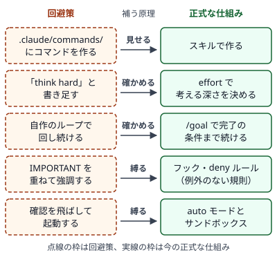

!!! abstract "要点"
    - **何ができるか**：撤回・置換・条件付きになった助言を、今どうするか・変わった時期と版・どの原理の回避策だったかと並べて引ける。回避策が正式な仕組みに置き換わる規則から、次に古くなるものの見当もつく。
    - **いつ引くか**：前は効いた書き方や設定を、今はどうすればよいか知りたいとき。ネットで見た小技が今も使えるか確かめたいとき。「think hard」や「よく考えて」が効くのか知りたいとき（答えは[台帳の該当の行](#think-hard-keywords)にある）。
    - **前提**：なし

<!-- textlint-disable -->
別名：古い助言・撤回された助言・使えなくなった小技・もうやめてよい助言・What you can stop doing
<!-- textlint-enable -->

古くなった助言の台帳は、記事や手順書に残る書き方や設定のうち、撤回・置換されたものを、今のやり方と並べて引ける一覧である。今も効くが前提が変わったものと、名前や画面だけが変わったものも載せ、変わった時期と、どの原理（見せる・確かめる・縛る・握る）の回避策だったかを行ごとに添えてある。見つけた小技の言い回しで[台帳](#ledger)の行を探し、「今どうするか」の欄から読む。

## 台帳の読み方（状態と、どの原理の回避策だったか） {#how-to-read}

台帳の 1 行は、古い助言の言い回しを見出しにし、その下の欄で今のやり方と、変わった経緯を示す。欄は次のとおりである。

- **今どうするか**：最初に読む欄である。今のやり方を書いてあり、古いやり方が今も動く行では、そのことも書いてある。
- **変わった時期**：変わった日と、Claude Code の変更なら版である。
- **状態**：撤回・置換・条件付きのどれかである。
- **どの原理の回避策だったか**：その助言が補っていた原理である（2 つ並ぶ行もある）。名前や画面だけが変わった行は回避策ではないので、その機能が受け持つ原理を示す。原理は次の 4 つで、詳しい定義は<!-- link:begin four-principles -->[四つの原理と比例則（見せる・確かめる・縛る・握る）](../start/four-principles.md)<!-- link:end -->にある。
    - **見せる**：必要なものを、Claude と自分の両方から見える状態にし、余計なものは片付けること。
    - **確かめる**：結果を、自己申告でなく検査・測定・証拠で決めること。この欄では、結果の質を保つ調整（考える量や出力の安定など）も含める。
    - **縛る**：例外を許さないものを、頼みごとではなく仕組みに任せること。
    - **握る**：何を採り、どこまで任せ、どれだけ使うかの判断を、人が持つこと。
- **かつてなぜ正しかったか**：当時、その助言が正しかった理由である。
- **自分の設定や記事で見つける方法**：その助言が自分の設定や読んでいる記事に残っていないかを探す、場所と言い回しである。
- **関わるページ・出典**：この辞典の関連ページと、確かめた公式の資料である。

状態は、古い助言に何が起きたかを 3 つに分ける。

- **撤回**：その助言のやり方は、使えないか、使わないほうがよい。従わずに、「今どうするか」へ進む。
- **置換**：同じ目的を、別の正式な仕組みや新しい名前が担うようになった。古いやり方が今も動くかは行によって違う。動く場合も、新しく作るものは今の仕組みで作る。
- **条件付き**：今も効く場面があるが、前提（モデル・コンテキストウィンドウの大きさ・プランなど）が変わった。自分の条件が行の前提と合うかを確かめてから使う。

変わった時期は、次のように読む。

- **日付**：読んだ記事の日付が行の変わった日より前なら、記事は変更の前のやり方を書いている。それより後の記事でも、古い記事を写しただけのことがあるので、「今どうするか」と照らす。
- **「〜」**：変化に幅がある行は、始まりと終わりの日付を〜で結ぶ。順に展開された行のほかに、変わった日を日までは絞れなかった行もある。記事の日付が始まりより前なら前のやり方、終わりより後なら新しいやり方の記事と読む。間なら、どちらもありうるので、「今どうするか」と照らす。
- **版**：Claude Code の変更で版が確かめられた行には、版が付く。付かない行は、日付で比べる。手元の版を `claude --version` で確かめ、行の版以上なら、その変更はもう手元に入っている。
- **「ごろ」**：日付の後の「ごろ」は、日の単位まで確かめられていないことを示す。

記事の日付と版の見分け方は、<!-- link:begin dating-information#check-date-and-version -->いつの情報かを見分ける › 日付と版の確かめ方（準備中）<!-- link:end -->にある。

**かつてなぜ正しかったか**の欄は、当時の条件を書く。自分が古いモデルや古い版を使い続けているなど、当時の条件が今も当てはまるなら、古い助言が今も通じることがある。行によっては、今も通じる条件を「今どうするか」にも書いてある。

!!! example "判断例：コマンドのスキルへの移行を急ぐか"
    - **状況**：記事に「カスタムコマンドはスキルに統合された」とあり、手元のリポジトリには `.claude/commands/` のコマンドが十数個ある。
    - **迷う候補**：全部をすぐスキルに移す。何もしない。必要なものだけ移す。
    - **選んだもの**：台帳の [`.claude/commands/` の行](#commands-directory)を引き、補助のファイルを置く・Claude が自分で読み込む・呼ぶ人を決める、といったスキルの働きが要るものだけを移す。ほかは今のまま残す。
    - **理由**：行の状態は置換で、`.claude/commands/` のファイルは今も同じように動く。動かなくなったわけではないので、全部を急いで移す理由がない。ただし、新しく作るものはスキルで作る。

## 回避策は正式な仕組みに置き換わる {#workarounds}

古くなった助言には、原理を満たす手段が足りなかった時期の回避策だったものがある。原理とは、見せる（必要なものを見える形にする）・確かめる（結果を証拠で決める）・縛る（例外のないものを仕組みに任せる）・握る（採否と任せ方の判断を人が持つ）の 4 つである。公式の [Best practices](https://code.claude.com/docs/en/best-practices#what-you-can-stop-doing) には、もうやめてよい助言を並べた表がある。表の前の説明には、載せた助言は書かれた当時のよい助言で、多くはモデルがまだ確実にできなかったことの回避策だった、とある。この台帳の行にも、同じ事情の回避策が少なくない。製品に正式な仕組みがなかった時期に、言葉や手順や自作のスクリプトで補ったものも、この台帳では回避策と呼ぶ。

回避策は、正式な仕組みが入るか、モデルが言われなくてもできるようになると、役目を終える。代表的な 5 組を、補っていた原理を添えた図で示す。



図の 5 組は、次のとおりである。

- **見せる**：`.claude/commands/` にコマンドを作る → スキルで作る。古いファイルは今も動く。移り先は<!-- link:begin writing-skills -->[スキルの作り方](../extend/writing-skills.md)<!-- link:end -->。
- **確かめる**：「think hard」と書き足す → effort で考える深さを決める。「think hard」はふつうの文として渡り、effort を上げない。移り先は<!-- link:begin effort-levels -->[effort の段階と使い分け](../models/effort-levels.md)<!-- link:end -->と<!-- link:begin thinking-keywords -->[「考えて」と書くことの現在（ultrathink）](../models/thinking-keywords.md)<!-- link:end -->。
- **確かめる**：自作のループで回し続ける → `/goal` で完了の条件まで続けさせる。移り先は<!-- link:begin goal-until-done#from-homemade-loops -->[/goal（完了するまで続けさせる） › 自作ループ（Ralph など）から移る](../delegate/goal-until-done.md#from-homemade-loops)<!-- link:end -->。
- **縛る**：IMPORTANT を重ねて強調する → ふつうの言葉で書き、例外のない規則はフックか deny ルールにする。移り先は<!-- link:begin emphasis-words -->[強調語（IMPORTANT・必ず）の現在](../prompting/emphasis-words.md)<!-- link:end -->。
- **縛る**：`--dangerously-skip-permissions` で確認を飛ばして起動する → auto モードにして、サンドボックスを重ねる。移り先は<!-- link:begin default-safety-settings#by-stage -->[安全の早見表（面ごとの既定と、段階ごとに足すもの） › 段階ごとに足すもの](../safety/default-safety-settings.md#by-stage)<!-- link:end -->。

この規則は、次に古くなるものの見当にも使える。自分が今使っている小技ごとに、次の 2 つを確かめる。

1. その小技は、どの原理を補っているか。
2. その原理に応える公式の仕組み（5 組の移り先のようなもの）が、もうあるか。

仕組みが既にあれば、その小技は置き換わる候補である。公式の仕組みがあるかは、変更履歴・リリースノート・公式の文書の改稿で確かめる。手順は<!-- link:begin checking-for-updates -->最新を自分で確かめる方法（準備中）<!-- link:end -->にある。

!!! example "判断例：自作のループは置き換わる候補か"
    - **状況**：シェルのスクリプトで `claude -p` をループから呼び、テストが通るまで同じ依頼を流し直している。台帳に載っているかは、まだ調べていない。
    - **迷う候補**：このまま使い続ける。公式の仕組みに替える。2 つの問いで見当をつけてから決める。
    - **選んだもの**：2 つの問いで見当をつける。このループは、完了を証拠（テストの結果）で決める「確かめる」を、外から補っている。その原理に応える仕組みとして、完了の条件まで続けさせる `/goal` が既にある。そこで置き換わる候補と見て、変更履歴と公式の文書で確かめる。
    - **理由**：回避策は、正式な仕組みが入ると役目を終える。台帳の[自作ループの行](#ralph-loops)も、同じ移り先を挙げる。確かめられたら、新しく作るものは `/goal` にして、今のスクリプトは、止まる条件と使う量の上限がないものから見直す。

置き換わった後も、古いやり方は動き続けることがある。動くことと、今も勧められることは別である。規則の詳しい説明は<!-- link:begin dating-information#workarounds -->いつの情報かを見分ける › 回避策は正式な仕組みに置き換わる（準備中）<!-- link:end -->にある。

## 台帳 {#ledger}

この節は、はじめに一覧表で全行の状態・変わった時期・面を見比べられ、その後に各行が続く。見つけた小技の言い回し（コマンド名・設定のキー・決まり文句）で、表の「古い助言」の欄か、ページ内の検索で探し、行へ移る。たとえば「think hard」や「よく考えて」は、[think → think hard → ultrathink の段階、日本語の「熟考」](#think-hard-keywords)の行にある。この行の時期は、ultrathink が戻った版の日である。think hard などの段階のキーワードが外れた日は、確かめられていない。

状態は、撤回（使えないか使わないほうがよい）・置換（別の仕組みや新しい名前が担う）・条件付き（今も効くが前提が変わった）のどれかである。詳しくは[台帳の読み方](#how-to-read)にある。「関わるページ」がある行は、そこから詳しいページへ進める。2026 年の変更を時期の順に見たいときは、<!-- link:begin change-timeline-2026 -->2026 年の主な変更の年表（準備中）<!-- link:end -->を使う。

台帳に載るのは、この辞典が扱う範囲の古い助言の一部である。載っていない小技が、今も有効とは限らない。見つからないときは、[回避策の 2 つの問い](#workarounds)で見当をつけ、そこに書いた手順で確かめる。

<!-- gen:begin ledger-index -->
<!-- textlint-disable -->

| 古い助言 | 状態 | 変わった時期 | 面 |
| --- | --- | --- | --- |
| [「#」で始めると CLAUDE.md に記憶される](#hash-to-memorize) | 撤回 | 2025-12-15・Claude Code 2.0.70 | Claude Code |
| [.claude/commands/ にカスタムコマンドを作る、/project:name 記法](#commands-directory) | 置換 | 2026-01-09・Claude Code 2.1.3 | Claude Code |
| [/agents でサブエージェントを作る](#agents-command) | 撤回 | 2026-07-01・Claude Code 2.1.198 | Claude Code |
| [think → think hard → ultrathink の段階、日本語の「熟考」](#think-hard-keywords) | 置換 | 2026-03-04・Claude Code 2.1.68 | Claude Code |
| [IMPORTANT や YOU MUST で強調すれば守られる](#important-caps) | 撤回 | 2026-10-27 ごろ | アプリ・Claude Code・API |
| [--dangerously-skip-permissions で YOLO 運用](#yolo-skip-permissions) | 置換 | 2026-08-14〜2026-09-28 | Claude Code |
| [最初は毎回承認を求められる](#approve-everything-first) | 撤回 | 2026-08-14〜2026-09-28・Claude Code 2.1.283 | Claude Code |
| [200k を前提にコンテキストを最優先で節約する](#save-context-for-200k) | 条件付き | 2026-10-27 ごろ | Claude Code |
| [アーキテクチャやファイル構成を CLAUDE.md に書く](#architecture-in-claude-md) | 撤回 | 2026-10-27 ごろ | Claude Code |
| [「keep going」「don't be lazy」と書く](#keep-going-dont-be-lazy) | 撤回 | 2026-10-27 ごろ | アプリ・Claude Code・API |
| [「最後に double-check して」と書き足す](#add-double-check) | 条件付き | 2026-07-24 | アプリ・Claude Code・API |
| [「subagent を使え」と書き足す](#tell-it-to-use-subagents) | 撤回 | 2026-07-24〜2026-10-27 | Claude Code |
| [工程ごとにサブエージェントを大量に作る](#subagent-per-step) | 撤回 | 2026-07-24〜2026-10-27 | Claude Code |
| [prefill で JSON の形を強制する](#prefill-for-json) | 置換 | 2026-02-05 | API |
| [budget\_tokens で思考量を指定する](#budget-tokens) | 置換 | 2026-02-05 | API |
| [&lt;thinking&gt; タグに推論を書かせる](#thinking-tags) | 条件付き | 2026-06-09 | API |
| [Console の prompt generator / improver を使う](#console-prompt-generator) | 撤回 | 2026-08-17 | API |
| [公式インタラクティブチュートリアルが最新の作法](#interactive-tutorial) | 条件付き | 2026-02-05〜2026-04-20 | API |
| [Cowork は別アプリ、Web search はトグルで入れる](#cowork-separate-app) | 条件付き | 2026-09-16 | アプリ |
| [メモリは会話の後に日次で要約される](#memory-daily-summary) | 撤回 | 2026-07-10 | アプリ |
| [Claude Code on the Web と --remote を使う](#code-on-the-web-remote) | 置換 | 2026-09-10〜2026-09-17 | アプリ・Claude Code |
| [routines で定期実行を作る](#routines-name) | 置換 | 2026-10-20 ごろ | アプリ・Claude Code |
| [/cost・/stats で使用量を見る](#slash-cost-and-stats) | 置換 | 2026-04-23・Claude Code 2.1.118 | Claude Code |
| [/fork で会話を分岐する](#fork-to-branch) | 置換 | 2026-03-17・Claude Code 2.1.77 | Claude Code |
| [/vim・/tag・/pr-comments・ultraplan・TaskOutput ツールを使う](#removed-commands) | 撤回 | 2026-04-02〜2026-09-18 | Claude Code |
| [MCP を SSE transport でつなぐ](#mcp-sse-transport) | 置換 | 2025-03-26 | Claude Code |
| [GitHub Action を @beta と direct\_prompt で書く](#action-beta-direct-prompt) | 置換 | 2025-08-26 | Claude Code |
| [「workflow」と書いて workflows を起動し、超過分は extra usage で払う](#workflow-keyword-extra-usage) | 置換 | 2026-06-02・Claude Code 2.1.160 | Claude Code |
| [プラグインや自作の bash ループで回し続ける](#ralph-loops) | 置換 | 2026-05-11〜2026-05-28・Claude Code 2.1.139 | Claude Code |
| [tmux で自作のエージェント組織を作る](#tmux-agent-orgs) | 置換 | 2026-02-05〜2026-05-11・Claude Code 2.1.32 | Claude Code |
| [Opus は高いので避ける](#avoid-opus-as-expensive) | 条件付き | 2026-09-22・Claude Code 2.1.280 | アプリ・Claude Code・API |
| [Max は 5x と 20x から選ぶ](#max-5x-or-20x) | 置換 | 2026-10-30 | アプリ・Claude Code |
| [有料プランは 5 時間の上限に当たったら待つしかない](#wait-out-5-hour-limit) | 条件付き | 2026-10-30 | アプリ・Claude Code |
| [Customize の「Skills」「Connectors」「Plugins」の各タブで管理する](#customize-tabs) | 置換 | 2026-10-29〜2026-11-30 | アプリ |
| [temperature（や top\_p・top\_k）を下げて出力を安定させる](#lower-temperature) | 撤回 | 2026-10-21 | API |
| [スタイル（Styles）で応答の調子と形式を切り替える](#styles-for-tone) | 置換 | 2026-06-01 | アプリ |
| [コンテキストを守るためにサブエージェントに調べさせる](#subagents-to-save-context) | 条件付き | 2026-10-27 ごろ | Claude Code |

<!-- textlint-enable -->
<!-- gen:end ledger-index -->

<!-- gen:begin ledger -->
<!-- textlint-disable -->

### 「#」で始めると CLAUDE.md に記憶される {#hash-to-memorize}

古い助言（状態：撤回）

- **今どうするか**：CLAUDE.md に足したいことは、Claude に CLAUDE.md の編集を頼むか、/memory でファイルを開いて自分で書く。セッションの中で学んだことは、自動メモリが書き残す。
- **変わった時期**：2025-12-15・Claude Code 2.0.70
- **状態**：撤回
- **どの原理の回避策だったか**：見せる
- **かつてなぜ正しかったか**：2.0.70 より前は、入力の先頭に # を付けると、その行を CLAUDE.md に書き足す近道があった。
- **自分の設定や記事で見つける方法**：記事や手順書で、入力の先頭に # を付けて覚えさせる手順を探す。手元の版を claude --version で確かめ、2.0.70 以上ならこの近道はない。今の入力の記号の表（Interactive mode の Quick commands）に # はない。
- **関わるページ**：[入力の記号（/ ! @）と Esc](../cli/input-symbols.md)・/init と最初の CLAUDE.md（準備中）・[CLAUDE.md に書くこと・書かないこと](../extend/what-to-put-in-claude-md.md)・[毎回同じ説明をしている](../symptoms/repeating-the-same-explanation.md)
- **出典**：[Changelog](https://github.com/anthropics/claude-code/blob/main/CHANGELOG.md)、[Claude Code changelog](https://code.claude.com/docs/en/changelog)、[How Claude remembers your project](https://code.claude.com/docs/en/memory)、[Interactive mode](https://code.claude.com/docs/en/interactive-mode)

### .claude/commands/ にカスタムコマンドを作る、/project:name 記法 {#commands-directory}

古い助言（状態：置換）

- **今どうするか**：新しく作るものはスキル（.claude/skills/&lt;名前&gt;/SKILL.md）にする。.claude/commands/ のファイルも今も同じように動き、同じ名前のスキルがあればスキルが優先される。名前に project: や user: は付けず /&lt;名前&gt; で呼ぶ（サブディレクトリのファイルは /&lt;フォルダ&gt;:&lt;名前&gt;）。
- **変わった時期**：2026-01-09・Claude Code 2.1.3
- **状態**：置換
- **どの原理の回避策だったか**：見せる
- **かつてなぜ正しかったか**：スキルが入る前は、繰り返す頼み方を .claude/commands/ の Markdown にしてスラッシュコマンドで呼ぶのが公式のやり方だった（0.2.31 から）。以前は、コマンドの名前に project: と user: の前置きが付いていた。
- **自分の設定や記事で見つける方法**：リポジトリと ~/.claude/ に commands/ のフォルダがあるかを見る。動くので急いで移さなくてよいが、補助のファイルを置く、Claude が自分で読み込む、呼ぶ人を決める、といったスキルの働きが要るものから移す。記事の /project:&lt;名前&gt; は /&lt;名前&gt; で呼ぶ。
- **関わるページ**：主要コマンド早見表（準備中）・[スキルの作り方](../extend/writing-skills.md)・[記事や前のやり方が通じない](../symptoms/old-advice-doesnt-work.md)・[毎回同じ説明をしている](../symptoms/repeating-the-same-explanation.md)
- **出典**：[Changelog](https://github.com/anthropics/claude-code/blob/main/CHANGELOG.md)、[Claude Code changelog](https://code.claude.com/docs/en/changelog)、[Extend Claude with skills](https://code.claude.com/docs/en/skills)

### /agents でサブエージェントを作る {#agents-command}

古い助言（状態：撤回）

- **今どうするか**：Claude にサブエージェントを作らせるか直させる（どこに置き、何をさせ、どの道具を許すかを頼む）。または .claude/agents/ か ~/.claude/agents/ の Markdown を直接書く。今の /agents は、このやり方を知らせる文を出すだけになった。
- **変わった時期**：2026-07-01・Claude Code 2.1.198
- **状態**：撤回
- **どの原理の回避策だったか**：見せる
- **かつてなぜ正しかったか**：サブエージェントが入った 1.0.60（2025-07-24）から 2.1.197 まで、/agents は作成と管理の対話の画面（ウィザード）を開いた。
- **自分の設定や記事で見つける方法**：記事や手順書で、/agents の画面の操作（作成のウィザード、Running と Library のタブ）を説明していないかを見る。2.1.198 以上で /agents を打つと、案内の文だけが出る。
- **関わるページ**：主要コマンド早見表（準備中）・[サブエージェントの作り方と使いどころ](../extend/writing-subagents.md)・[記事や前のやり方が通じない](../symptoms/old-advice-doesnt-work.md)
- **出典**：[Changelog](https://github.com/anthropics/claude-code/blob/main/CHANGELOG.md)、[Claude Code changelog](https://code.claude.com/docs/en/changelog)、[Commands](https://code.claude.com/docs/en/commands)、[Create custom subagents](https://code.claude.com/docs/en/sub-agents)

### think → think hard → ultrathink の段階、日本語の「熟考」 {#think-hard-keywords}

古い助言（状態：置換）

- **今どうするか**：think・think hard・think harder・「熟考」・「よく考えて」と書いても、effort は上がらない。これらはキーワードとして扱われず、effort の範囲で少し後押しするふつうの文として渡る。考える深さは effort（/effort・--effort・設定）で決める。ultrathink だけは、そのターンだけ深く考えるよう頼む言葉として認識され、セッションの effort は変えない。Claude Code が Anthropic の API で Opus 5.5・Sonnet 5.5・Haiku 5.5・Fable 5.1 を使うときは、ultrathink のターンを xhigh で動かす。この動きは、対話のターミナル（2.1.311 以上）と VS Code（2.1.316 以上）で働く。CLAUDE\_CODE\_DISABLE\_ULTRATHINK（2.1.316 以上）で切れる。
- **変わった時期**：2026-03-04・Claude Code 2.1.68（ultrathink が戻った版。think hard などの段階のキーワードが外れた時期は、確かめられていない）
- **状態**：置換
- **どの原理の回避策だったか**：確かめる
- **かつてなぜ正しかったか**：0.2.44 で think・think harder・ultrathink と書いて考える量を頼めるようになり、1.0.8（2025-06-02）で英語以外の言語でも思考を起動できるようになった。effort の段を選ぶ手段がまだなく、言葉で考える量を変えるのが公式のやり方だった。段階のキーワードがいつ外れたかは、一次資料に版の記述がない。変わった時期に書いた 2.1.68 は、ultrathink だけが戻った版である。
- **自分の設定や記事で見つける方法**：CLAUDE.md・スキル・保存した頼み方で、think hard・think harder・「熟考」「よく考えて」などを探す。effort を上げる働きはないので、深く考えさせたいターンは ultrathink か effort で頼む。/doctor prompt-audit（2.1.283 以上）は、古いモデル向けに書いた指示を洗い出す。
- **関わるページ**：[思考（thinking）と effort の仕組み](../basics/how-thinking-works.md)・[「考えて」と書くことの現在（ultrathink）](../models/thinking-keywords.md)・[日本語で指示して大丈夫か](../japanese/can-i-prompt-in-japanese.md)・[急に賢くなくなった気がする](../symptoms/seems-less-capable.md)
- **出典**：[Changelog](https://github.com/anthropics/claude-code/blob/main/CHANGELOG.md)、[Claude Code changelog](https://code.claude.com/docs/en/changelog)、[Model configuration](https://code.claude.com/docs/en/model-config)、[Best practices for Claude Code](https://code.claude.com/docs/en/best-practices)、[How Claude remembers your project](https://code.claude.com/docs/en/memory)

### IMPORTANT や YOU MUST で強調すれば守られる {#important-caps}

古い助言（状態：撤回）

- **今どうするか**：強調せず、ふつうの言葉で書く。それでも守られないなら、ファイルが長すぎて埋もれていないかを見て短くするか、例外を許さない規則ならフックか deny ルールにする。強調を重ねると、Claude が規則を当てはめすぎる原因にもなる。
- **変わった時期**：2026-10-27 ごろ
- **状態**：撤回
- **どの原理の回避策だったか**：縛る
- **かつてなぜ正しかったか**：以前のモデルは、強調しないと指示を落とすことがあった。改稿前の Best practices も、守られない 1 行にだけ IMPORTANT などの強調を付けるよう勧めていた（多くの行を強調すると、どれも目立たなくなるとも書いていた）。
- **自分の設定や記事で見つける方法**：CLAUDE.md・rules・スキルで、IMPORTANT・YOU MUST・NEVER・全部が大文字の行を探す。/doctor prompt-audit（2.1.283 以上）は、古いモデル向けに書いた指示や食い違う指示を洗い出す。
- **関わるページ**：[システムプロンプト・ユーザーメッセージ・CLAUDE.md の位置](../basics/where-instructions-sit.md)・[お願いと鍵（決定論的か、非決定論的か）](../basics/request-vs-lock.md)・[新しいモデルに替えたら見直すこと](../models/after-switching-models.md)・[強調語（IMPORTANT・必ず）の現在](../prompting/emphasis-words.md)・[CLAUDE.md の長さと剪定](../extend/claude-md-length.md)・[お願いを鍵に移す判断](../enforce/when-to-lock.md)・[お願いと鍵の対応表](../enforce/request-lock-table.md)・[CLAUDE.md や指示が守られない](../symptoms/instructions-ignored.md)
- **出典**：[Best practices for Claude Code](https://code.claude.com/docs/en/best-practices)、[Best practices for Claude Code（改稿前。Internet Archive の写し、2026-10-26 19:44 UTC）](https://web.archive.org/web/20261026194435/https://code.claude.com/docs/en/best-practices)、[Best practices for Claude Code（改稿後。Internet Archive の写し、2026-10-27 08:15 UTC）](https://web.archive.org/web/20261027081520/https://code.claude.com/docs/en/best-practices)、[How Claude remembers your project](https://code.claude.com/docs/en/memory)

### --dangerously-skip-permissions で YOLO 運用 {#yolo-skip-permissions}

古い助言（状態：置換）

- **今どうするか**：ふだんの対話は auto モード（今の既定）にし、サンドボックスを重ねる。bypassPermissions（--dangerously-skip-permissions と同じ）は、使い捨てのコンテナや VM の中だけで使う。permissions.blockWritesOutsideWorkingDirectories（2.1.314 以上）は、bypass でも Write・Edit・NotebookEdit が作業ディレクトリの外に書くのを止める。ただしシェルのコマンドは止めないので、隔離の代わりにはならない。
- **変わった時期**：2026-08-14〜2026-09-28（始まり：Pro・Max・Team の新しいセッションで auto モードが既定になった日。終わり：対話のセッション全体で既定になった日）
- **状態**：置換
- **どの原理の回避策だったか**：縛る
- **かつてなぜ正しかったか**：auto モードが使えるようになる前は、確認なしに長い作業を進める手段が、allow ルールを積み上げるか、bypass で確認をすべて飛ばすかしかなかった。
- **自分の設定や記事で見つける方法**：--dangerously-skip-permissions・--allow-dangerously-skip-permissions・bypassPermissions を探す。探す場所は、シェルの alias・スクリプト・CI の設定・settings.json。コンテナや VM の外で使っていたら、auto モードとサンドボックスに替える。
- **関わるページ**：[権限モードの選び方](../cli/permission-modes-overview.md)・[auto モードは何を止め、何を止めないか](../enforce/what-auto-mode-stops.md)・[bypassPermissions と無人の実行はどこで動かすか](../safety/where-bypass-is-ok.md)・[任せ方の段階と、無人で走らせる前の五つの問い](../delegate/five-questions-before-delegating.md)・[非対話モード（claude -p）の基本](../delegate/headless-basics.md)・[消してはいけないものを消された](../symptoms/deleted-something-important.md)・[承認の確認が多すぎる・少なすぎる](../symptoms/wrong-amount-of-approvals.md)
- **出典**：[Choose a permission mode](https://code.claude.com/docs/en/permission-modes)、[All settings](https://code.claude.com/docs/en/settings-reference)、[Changelog](https://github.com/anthropics/claude-code/blob/main/CHANGELOG.md)、[Claude Code changelog](https://code.claude.com/docs/en/changelog)、[Auto mode is now the default in Claude Code for Pro, Max, Ultra, and Team plans](https://claude.com/resources/articles/auto-mode-default-in-claude-code)

### 最初は毎回承認を求められる {#approve-everything-first}

古い助言（状態：撤回）

- **今どうするか**：何も設定していなければ、ターミナルと VS Code の対話のセッションは auto モードで始まる（2.1.283 以上）。毎回確かめたいなら、permissions.defaultMode を default（表示は Manual）にするか、--permission-mode manual で起動する。claude -p と Agent SDK は、決めていなければ Manual で動く。
- **変わった時期**：2026-08-14〜2026-09-28・Claude Code 2.1.283（始まり：Pro・Max・Team の新しいセッションで auto モードが既定になった日。終わり：どのプランと提供元でも既定になった日。2.1.283 は、公式の文書が既定の境とする版）
- **状態**：撤回
- **どの原理の回避策だったか**：縛る
- **かつてなぜ正しかったか**：既定の権限モードが default（今の表示は Manual）だったころは、読み取り以外の操作のたびに確認が出た。
- **自分の設定や記事で見つける方法**：記事や社内の手順書が「最初はすべて確認が出るので承認していく」前提で書かれていないかを見る。起動したときのモードは、画面の下の表示（auto mode on・manual mode on など）で分かる。
- **関わるページ**：[権限モードの選び方](../cli/permission-modes-overview.md)・[auto モードは何を止め、何を止めないか](../enforce/what-auto-mode-stops.md)・承認疲れ（準備中）・[承認の確認が多すぎる・少なすぎる](../symptoms/wrong-amount-of-approvals.md)
- **出典**：[Choose a permission mode](https://code.claude.com/docs/en/permission-modes)、[Changelog](https://github.com/anthropics/claude-code/blob/main/CHANGELOG.md)、[Claude Code changelog](https://code.claude.com/docs/en/changelog)、[Auto mode is now the default in Claude Code for Pro, Max, Ultra, and Team plans](https://claude.com/resources/articles/auto-mode-default-in-claude-code)

### 200k を前提にコンテキストを最優先で節約する {#save-context-for-200k}

古い助言（状態：条件付き）

- **今どうするか**：今の多くのモデルは 1M トークンのコンテキストウィンドウを持ち、圧縮も自動なので、溢れることはまれになった。関係のない作業に移るときの /clear は、答えの質とコストのために今も勧められる。大きな会話（既定で 200K トークン以上）を 1 時間ほど放置すると、プロンプトキャッシュが切れる前に要約される（idle compaction）。ターミナルは 2.1.299、VS Code と Desktop の Code タブは 2.1.314 から働き、idleCompaction を false にするか /config で止められる。
- **変わった時期**：2026-10-27 ごろ
- **状態**：条件付き
- **どの原理の回避策だったか**：見せる
- **かつてなぜ正しかったか**：窓が 200K トークンだったころは長い作業で埋まりやすく、改稿前の Best practices も「窓はすぐ埋まり、埋まるほど性能が落ちる」という制約から多くの勧めを導いていた。
- **自分の設定や記事で見つける方法**：CLAUDE.md や手順書で、窓を節約するための決まり（毎回要約させる、ファイルを読ませない、など）を探す。今の窓の使い方は /context で見る。
- **関わるページ**：[コンテキストウィンドウと注意の予算](../basics/attention-budget.md)・[context rot と紛らわしい情報](../basics/context-rot.md)・広いコンテキストウィンドウとの付き合い方（準備中）・[机を整える：新鮮さ・巻き戻し・書き出し・委任](../context/tidy-the-desk.md)・[新しい会話を始めるタイミング](../context/when-to-start-fresh.md)・[/compact と自動圧縮](../context/compact-and-auto-compact.md)・[長い会話で前提を忘れる・雑になる](../symptoms/forgets-in-long-chats.md)
- **出典**：[Best practices for Claude Code](https://code.claude.com/docs/en/best-practices)、[Best practices for Claude Code（改稿前。Internet Archive の写し、2026-10-26 19:44 UTC）](https://web.archive.org/web/20261026194435/https://code.claude.com/docs/en/best-practices)、[Best practices for Claude Code（改稿後。Internet Archive の写し、2026-10-27 08:15 UTC）](https://web.archive.org/web/20261027081520/https://code.claude.com/docs/en/best-practices)、[Changelog](https://github.com/anthropics/claude-code/blob/main/CHANGELOG.md)、[Claude Code changelog](https://code.claude.com/docs/en/changelog)、[All settings](https://code.claude.com/docs/en/settings-reference)

### アーキテクチャやファイル構成を CLAUDE.md に書く {#architecture-in-claude-md}

古い助言（状態：撤回）

- **今どうするか**：Claude はリポジトリを自分で読むので、構成やファイルの並びは書かない。書くのは、リポジトリを読んでも分からないこと（推測できない理由・決まり・落とし穴）だけにする。
- **変わった時期**：2026-10-27 ごろ
- **状態**：撤回
- **どの原理の回避策だったか**：見せる
- **かつてなぜ正しかったか**：公式の Best practices は、「もうやめてよい助言」の表の助言はどれも書かれた当時はよい助言で、多くはモデルがまだ確実にできなかったことの回避策だったとする。この行がどの回避策に当たるかは、公式は書いていない。構成を書いておけば Claude が毎回リポジトリをたどらずに全体をつかめた、というのはここでの推測である。改稿の前の版（2026-10-26 の写し）も、コードを読めば分かることとファイルごとの説明は CLAUDE.md に書かないものに、プロジェクト固有のアーキテクチャの判断は書くものに挙げていた。
- **自分の設定や記事で見つける方法**：CLAUDE.md のディレクトリの木、ファイルの一覧、使っているフレームワークの説明を探す。/doctor は、コードから分かる中身を削る案を出す。
- **関わるページ**：/init と最初の CLAUDE.md（準備中）・[CLAUDE.md に書くこと・書かないこと](../extend/what-to-put-in-claude-md.md)・[CLAUDE.md の長さと剪定](../extend/claude-md-length.md)・[知らないコードベースを読む](../recipes/explore-a-codebase.md)
- **出典**：[Best practices for Claude Code](https://code.claude.com/docs/en/best-practices)、[Best practices for Claude Code（改稿前。Internet Archive の写し、2026-10-26 19:44 UTC）](https://web.archive.org/web/20261026194435/https://code.claude.com/docs/en/best-practices)、[Best practices for Claude Code（改稿後。Internet Archive の写し、2026-10-27 08:15 UTC）](https://web.archive.org/web/20261027081520/https://code.claude.com/docs/en/best-practices)

### 「keep going」「don't be lazy」と書く {#keep-going-dont-be-lazy}

古い助言（状態：撤回）

- **今どうするか**：こうした一言は消す。今のモデルは合意した作業を言われなくても続け、この手の文はやりすぎの原因になりやすい。代わりに、通すべきテストのような確かめる手段を渡す。途中で止まったら continue と言い、誰も見ていない実行は /goal か Stop フックで続けさせる。
- **変わった時期**：2026-10-27 ごろ
- **状態**：撤回
- **どの原理の回避策だったか**：確かめる
- **かつてなぜ正しかったか**：以前のモデルは長い作業の途中で止まりやすく、続けるよう促す一言が効いた。公式の Best practices は、「もうやめてよい助言」の表の助言の多くはモデルがまだ確実にできなかったことの回避策だったとする。
- **自分の設定や記事で見つける方法**：CLAUDE.md・スキル・繰り返す頼み方で、keep going・don't stop・don't be lazy・loop until done・「最後までやり切れ」などを探す。
- **関わるページ**：[エージェントループと tool use](../basics/agent-loop.md)・モデル別の癖と、プロンプトの合わせ方（準備中）・[強調語（IMPORTANT・必ず）の現在](../prompting/emphasis-words.md)・[「完了」を定義して渡す](../verify/define-done.md)・[/goal（完了するまで続けさせる）](../delegate/goal-until-done.md)・リファクタリングと大規模な移行（準備中）・[頼んでいないことまでやる（過剰設計）](../symptoms/does-more-than-asked.md)・[確認ばかりで進まない・途中で止まる](../symptoms/keeps-stopping.md)
- **出典**：[Best practices for Claude Code](https://code.claude.com/docs/en/best-practices)、[Best practices for Claude Code（改稿前。Internet Archive の写し、2026-10-26 19:44 UTC）](https://web.archive.org/web/20261026194435/https://code.claude.com/docs/en/best-practices)、[Best practices for Claude Code（改稿後。Internet Archive の写し、2026-10-27 08:15 UTC）](https://web.archive.org/web/20261027081520/https://code.claude.com/docs/en/best-practices)、[Keep Claude working toward a goal](https://code.claude.com/docs/en/goal)

### 「最後に double-check して」と書き足す {#add-double-check}

古い助言（状態：条件付き）

- **今どうするか**：確かめる手段（テスト・型の検査・照らす基準）を渡す。Opus 5 は自分の作業を言われなくても確かめるので、「見直して」「double-check して」や、確かめ役のサブエージェントを使わせる指示は消す（確かめすぎでトークンと時間が増える）。Opus 5.5 の公式の手引きは、Opus 5 の頼み方を出発点として使えるとするので、同じ扱いから始め、自分の作業で比べる。ほかのモデルでは、終わる前に基準と照らして確かめるよう頼むのは今も効く。
- **変わった時期**：2026-07-24
- **状態**：条件付き
- **どの原理の回避策だったか**：確かめる
- **かつてなぜ正しかったか**：自分の答えを見直させる一言で、コードや計算の誤りが減った。今の Prompting best practices も、多くのモデルにはこの頼み方を勧め、Opus 5 を例外とする。
- **自分の設定や記事で見つける方法**：システムプロンプト・CLAUDE.md・スキルで、double-check・re-verify・「最後に見直して」・「確かめ役のサブエージェントを使え」を探し、使うモデルを確かめる。Opus 5 と Opus 5.5 は、一言を消して比べることから始める。ほかのモデルは残してよい。
- **関わるページ**：[エージェントループと tool use](../basics/agent-loop.md)・モデル別の癖と、プロンプトの合わせ方（準備中）・[新しいモデルに替えたら見直すこと](../models/after-switching-models.md)・[検証の階段](../verify/verification-ladder.md)・[バグを直す](../recipes/fix-a-bug.md)・[「完了」と言うが終わっていない](../symptoms/claims-done-but-isnt.md)
- **出典**：[Prompting Claude Opus 5](https://platform.claude.com/docs/en/build-with-claude/prompt-engineering/prompting-claude-opus-5)、[Prompting Claude Opus 5.5](https://platform.claude.com/docs/en/build-with-claude/prompt-engineering/prompting-claude-opus-5-5)、[Prompting best practices](https://platform.claude.com/docs/en/build-with-claude/prompt-engineering/claude-prompting-best-practices)、[Claude Platform release notes](https://platform.claude.com/docs/en/release-notes/overview)

### 「subagent を使え」と書き足す {#tell-it-to-use-subagents}

古い助言（状態：撤回）

- **今どうするか**：書き足さない。サブエージェントに任せるのは、大きく、本当に独立していて並べられる作業だけにする。同じ作業をサブエージェントに渡しても答えはよくならない（よくなるのは、書く過程を見ていない別のレビューを頼むとき）。Claude Code では CLAUDE\_CODE\_MAX\_SUBAGENT\_SPAWN\_DEPTH と CLAUDE\_CODE\_MAX\_CONCURRENT\_SUBAGENTS で数を縛れる。
- **変わった時期**：2026-07-24〜2026-10-27（始まり：Opus 5 の頼み方の手引きの公開日。終わり：Best practices の改稿の日）
- **状態**：撤回
- **どの原理の回避策だったか**：見せる
- **かつてなぜ正しかったか**：以前のモデルは自分からはあまり委任しなかった。Opus 5 は、以前のモデルより進んで委任する（Opus 5 の頼み方の手引き）。
- **自分の設定や記事で見つける方法**：CLAUDE.md・スキル・システムプロンプトで、「subagent を使え」「並べて調べさせよ」などの一言を探す。/usage でサブエージェントの種類ごとの使用量を見て、元が取れているかを確かめる。
- **関わるページ**：[サブエージェントは別室の部下](../basics/subagent-isolation.md)・モデル別の癖と、プロンプトの合わせ方（準備中）・[出力の多い調査はサブエージェントに任せて要約だけ受け取る](../context/research-in-subagents.md)・[サブエージェントの作り方と使いどころ](../extend/writing-subagents.md)
- **同じ話題の行**：[工程ごとにサブエージェントを大量に作る](#subagent-per-step)・[コンテキストを守るためにサブエージェントに調べさせる](#subagents-to-save-context)
- **出典**：[Prompting Claude Opus 5](https://platform.claude.com/docs/en/build-with-claude/prompt-engineering/prompting-claude-opus-5)、[Best practices for Claude Code](https://code.claude.com/docs/en/best-practices)、[Best practices for Claude Code（改稿後。Internet Archive の写し、2026-10-27 08:15 UTC）](https://web.archive.org/web/20261027081520/https://code.claude.com/docs/en/best-practices)、[Create custom subagents](https://code.claude.com/docs/en/sub-agents)

### 工程ごとにサブエージェントを大量に作る {#subagent-per-step}

古い助言（状態：撤回）

- **今どうするか**：サブエージェントは、文脈を分ける意味のある作業に使う：本筋に残したくない長い出力（すべてのテストの実行や広い検索）、並べられる独立の作業、書く過程を見ていないレビュー、道具を絞った役。小さな作業は本体で済ませる。新しいサブエージェントは文脈を集め直すので、かえって遅くなることもある。
- **変わった時期**：2026-07-24〜2026-10-27（始まり：Opus 5 の頼み方の手引きの公開日。終わり：Best practices の改稿の日）
- **状態**：撤回
- **どの原理の回避策だったか**：見せる
- **かつてなぜ正しかったか**：サブエージェントは文脈を分けられるので、工程ごとに役を作れば本筋が散らからないと考えられた。
- **自分の設定や記事で見つける方法**：.claude/agents/ と ~/.claude/agents/ の定義の数と、実際に使われているものを見る。/usage でサブエージェントの種類ごとの使用量を見る。
- **関わるページ**：[サブエージェントは別室の部下](../basics/subagent-isolation.md)・[出力の多い調査はサブエージェントに任せて要約だけ受け取る](../context/research-in-subagents.md)・[サブエージェントの作り方と使いどころ](../extend/writing-subagents.md)・[並列の方式の選び方](../delegate/choosing-parallel-modes.md)
- **同じ話題の行**：[「subagent を使え」と書き足す](#tell-it-to-use-subagents)・[コンテキストを守るためにサブエージェントに調べさせる](#subagents-to-save-context)
- **出典**：[Prompting Claude Opus 5](https://platform.claude.com/docs/en/build-with-claude/prompt-engineering/prompting-claude-opus-5)、[Best practices for Claude Code](https://code.claude.com/docs/en/best-practices)、[Best practices for Claude Code（改稿前。Internet Archive の写し、2026-10-26 19:44 UTC）](https://web.archive.org/web/20261026194435/https://code.claude.com/docs/en/best-practices)、[Best practices for Claude Code（改稿後。Internet Archive の写し、2026-10-27 08:15 UTC）](https://web.archive.org/web/20261027081520/https://code.claude.com/docs/en/best-practices)、[Create custom subagents](https://code.claude.com/docs/en/sub-agents)

### prefill で JSON の形を強制する {#prefill-for-json}

古い助言（状態：置換）

- **今どうするか**：structured outputs（JSON の出力か strict tool use）で形を保証する。まず形を指示に書き、検査して再試行する手もある。分類なら、ラベルを enum にした道具か structured outputs を使う。Claude 4.6 以降のモデルは、最後の assistant のターンを先に書いた要求を 400 エラーで断る。
- **変わった時期**：2026-02-05
- **状態**：置換
- **どの原理の回避策だったか**：縛る
- **かつてなぜ正しかったか**：structured outputs が出る（2025-11-14 に beta、2026-01-29 に beta を外れた）前は、応答の先頭を書いて続けさせるのが、形を守らせる確かな手だった。前置きを省かせるのにも使われた。
- **自分の設定や記事で見つける方法**：API を呼ぶコードで、messages の最後が assistant の役のメッセージになっている要求を探す。モデルを 4.6 以降に替えたときに 400 になったら、まずここを疑う。
- **関わるページ**：[新しいモデルに替えたら見直すこと](../models/after-switching-models.md)・出力の形と分量を指定する（準備中）・[お願いと鍵の対応表](../enforce/request-lock-table.md)・structured outputs（形式を保証する）（準備中）
- **出典**：[Prompting best practices](https://platform.claude.com/docs/en/build-with-claude/prompt-engineering/claude-prompting-best-practices)、[Thinking](https://platform.claude.com/docs/en/build-with-claude/thinking)、[Structured outputs](https://platform.claude.com/docs/en/build-with-claude/structured-outputs)、[Claude Platform release notes](https://platform.claude.com/docs/en/release-notes/overview)

### budget\_tokens で思考量を指定する {#budget-tokens}

古い助言（状態：置換）

- **今どうするか**：thinking の type を adaptive にし、深さは effort で決める。Claude 4.7 以降のモデルは、budget\_tokens を使う要求を 400 エラーで断る。Opus 4.6 と Sonnet 4.6 では非推奨。手動の思考しか持たないモデル（Opus 4.5・Haiku 4.5 など）は今のままでよい。
- **変わった時期**：2026-02-05
- **状態**：置換
- **どの原理の回避策だったか**：確かめる
- **かつてなぜ正しかったか**：拡張思考が入った Claude Sonnet 3.7（2025-02-24）から、思考の量を決める手段は budget\_tokens だった。effort は 2025-11-24 に beta で入り、2026-02-05 に beta を外れた。
- **自分の設定や記事で見つける方法**：API を呼ぶコードと設定で、budget\_tokens と、thinking の type が enabled の要求を探す。
- **関わるページ**：[思考（thinking）と effort の仕組み](../basics/how-thinking-works.md)・[effort の段階と使い分け](../models/effort-levels.md)・[新しいモデルに替えたら見直すこと](../models/after-switching-models.md)
- **出典**：[Extended thinking](https://platform.claude.com/docs/en/build-with-claude/extended-thinking)、[Thinking](https://platform.claude.com/docs/en/build-with-claude/thinking)、[Effort](https://platform.claude.com/docs/en/build-with-claude/effort)、[Claude Platform release notes](https://platform.claude.com/docs/en/release-notes/overview)

### &lt;thinking&gt; タグに推論を書かせる {#thinking-tags}

古い助言（状態：条件付き）

- **今どうするか**：推論を見たいときは、応答の本文に書かせず、thinking のブロックを読む（display を summarized にして要約を受け取る）。根拠が要るなら、短い説明を頼む。Fable 5・Opus 5・Sonnet 5.5・Opus 5.5・Fable 5.1 では、内部の推論を本文に書かせる頼み方は reasoning\_extraction として断られることがある。
- **変わった時期**：2026-06-09
- **状態**：条件付き
- **どの原理の回避策だったか**：確かめる
- **かつてなぜ正しかったか**：思考の機能を使わないときに、答えの前に考えを書かせると答えがよくなり、その過程を読んで確かめられた（手動の chain-of-thought）。
- **自分の設定や記事で見つける方法**：システムプロンプトや頼み方の型で、&lt;thinking&gt;・「考えを書いてから答えよ」・「推論を出力せよ」を探す。stop\_reason が refusal で、分類が reasoning\_extraction の応答が出たら、まずここを疑う。
- **関わるページ**：[思考（thinking）と effort の仕組み](../basics/how-thinking-works.md)・表示された思考は内部の計算と一致するとは限らない（準備中）・推論を見せてほしいとき（準備中）
- **出典**：[Prompting best practices](https://platform.claude.com/docs/en/build-with-claude/prompt-engineering/claude-prompting-best-practices)、[Prompting Claude Opus 5.5](https://platform.claude.com/docs/en/build-with-claude/prompt-engineering/prompting-claude-opus-5-5)、[Thinking](https://platform.claude.com/docs/en/build-with-claude/thinking)、[Claude Platform release notes](https://platform.claude.com/docs/en/release-notes/overview)

### Console の prompt generator / improver を使う {#console-prompt-generator}

古い助言（状態：撤回）

- **今どうするか**：公式の Prompting best practices を出発点にし、成功の基準と評価（eval）を決めて、変えた効果を測りながら直す。下書きを機械に作らせたいなら、公式の文書は Claude Cookbook の metaprompt のノートブックを案内している。
- **変わった時期**：2026-08-17
- **状態**：撤回
- **どの原理の回避策だったか**：見せる・確かめる
- **かつてなぜ正しかったか**：2024-05-10 に Console に prompt generator が入り、下書きを作って直す公式の道具だった。
- **自分の設定や記事で見つける方法**：手順書や社内の資料で、Console の prompt generator・prompt improver・Workbench に保存したプロンプトに頼る手順を探す。コードで /v1/experimental/generate\_prompt などを呼んでいないかを見る。
- **関わるページ**：用途別プロンプトの型（準備中）・[変更が効いたかを測る（小さな eval）](../eval/measure-changes.md)
- **出典**：[Claude Platform release notes](https://platform.claude.com/docs/en/release-notes/overview)、[Prompt engineering overview](https://platform.claude.com/docs/en/build-with-claude/prompt-engineering/overview)、[Prompting best practices](https://platform.claude.com/docs/en/build-with-claude/prompt-engineering/claude-prompting-best-practices)

### 公式インタラクティブチュートリアルが最新の作法 {#interactive-tutorial}

古い助言（状態：条件付き）

- **今どうするか**：基本の考え方の練習には使えるが、Claude 3 のモデル向けに書かれているので、食い違うところは Prompting best practices に従う（公式の文書もそう書く）。第 5 章の prefill（Speaking for Claude）は、Claude 4.6 以降のモデルで 400 エラーになる。temperature を 0 にする呼び方は、Claude 4.7 以降のモデルで、または API の版 2026-10-21 で、400 エラーになる。
- **変わった時期**：2026-02-05〜2026-04-20（始まり：Claude 4.6 以降のモデルが prefill を受け付けなくなった日。終わり：チュートリアルが使う Claude 3 Haiku が退役した日）
- **状態**：条件付き
- **どの原理の回避策だったか**：見せる
- **かつてなぜ正しかったか**：Claude 3 の世代では、公式のチュートリアルがそのまま最新の作法だった。
- **自分の設定や記事で見つける方法**：教材や研修の資料が、このチュートリアルの手（prefill、temperature を 0 にする、Claude 3 Haiku を使う）を、そのまま今のモデルに使っていないかを見る。
- **関わるページ**：用途別プロンプトの型（準備中）
- **出典**：[Prompt engineering overview](https://platform.claude.com/docs/en/build-with-claude/prompt-engineering/overview)、[Anthropic's Prompt Engineering Interactive Tutorial](https://github.com/anthropics/prompt-eng-interactive-tutorial)、[Model deprecations](https://platform.claude.com/docs/en/about-claude/model-deprecations)、[Prompting best practices](https://platform.claude.com/docs/en/build-with-claude/prompt-engineering/claude-prompting-best-practices)

### Cowork は別アプリ、Web search はトグルで入れる {#cowork-separate-app}

古い助言（状態：条件付き）

- **今どうするか**：新しい Claude の体験では、チャットと Cowork は 1 つの会話にまとまり、モードを選ばずに頼む。Web 検索のトグルはなく、Claude が要るときに自分で検索する。リサーチは /deep-research か「+」から選ぶ。体験は順に展開中で、入力欄に「Chat」と「Cowork」の選択が残るアカウントは、まだ前のやり方のまま。
- **変わった時期**：2026-09-16
- **状態**：条件付き
- **この機能が受け持つ原理**：見せる
- **かつてなぜ正しかったか**：2026-09-16 より前は、チャットと Cowork は別の選択で、Web 検索は「+」のメニューから自分で有効にした。
- **自分の設定や記事で見つける方法**：手順書で「Cowork に切り替える」「Web 検索をオンにする」の手順を探す。自分のアカウントがどちらの体験かは、入力欄に「Chat」「Cowork」の選択があるかで分かる。
- **関わるページ**：[アプリ・Claude Code・API の選び方](../surfaces/choosing-a-surface.md)・[web 検索・リサーチ・拡張思考の使い分け](../app/search-research-thinking.md)・[タスクと定期タスク（Cowork）](../app/tasks-and-schedules-in-the-app.md)・[調べものとレポート](../recipes/research-and-reports.md)
- **出典**：[Claude Cowork and chat are one Claude](https://support.claude.com/en/articles/16761823-claude-cowork-and-chat-are-one-claude)、[Release notes](https://support.claude.com/en/articles/12138966-release-notes)、[Enable and use web search](https://support.claude.com/en/articles/10684626-enable-and-use-web-search)

### メモリは会話の後に日次で要約される {#memory-daily-summary}

古い助言（状態：撤回）

- **今どうするか**：今のメモリは、話している間に Claude がトピックごとの項目として保存し、読み、更新する（「覚えて」と頼んで保存させることもできる）。覚えたことは設定の Topics で見て、直し、消せる。
- **変わった時期**：2026-07-10
- **状態**：撤回
- **この機能が受け持つ原理**：見せる
- **かつてなぜ正しかったか**：前のメモリは、会話の履歴から要約を作り、24 時間ごとに更新して新しい会話に使っていた（今もヘルプの記事の前の体験の節にある）。
- **自分の設定や記事で見つける方法**：「メモリには翌日に反映される」「要約を待つ」と書いた記事や手順を探す。設定に Memory の項目か、Your Claude の Generate memory from chats があれば新しい体験。
- **関わるページ**：[アプリのメモリ（仕組み・範囲・消し方と止め方）](../app/how-memory-works.md)・[別の会話やプロジェクトの内容が混ざる](../symptoms/unexpected-memories.md)
- **出典**：[Release notes](https://support.claude.com/en/articles/12138966-release-notes)、[Use Claude’s chat search and memory to build on previous context](https://support.claude.com/en/articles/11817273-use-claude-s-chat-search-and-memory-to-build-on-previous-context)

### Claude Code on the Web と --remote を使う {#code-on-the-web-remote}

古い助言（状態：置換）

- **今どうするか**：機能の名前はクラウドセッション（cloud sessions）。ターミナルからは、claude --cloud に頼む内容を付けて始める（--remote は非推奨の別名として今も動く）。ブラウザの claude.ai/code は、今も Claude Code on the web とも呼ばれる。
- **変わった時期**：2026-09-10〜2026-09-17（日までは絞れない。公式の文書の題が、始まりの日の写しでは旧名、終わりの日の写しでは新名だった）
- **状態**：置換
- **この機能が受け持つ原理**：握る・縛る
- **かつてなぜ正しかったか**：以前は、ターミナルから始めるフラグが --remote で、機能の名前も Claude Code on the web だった。
- **自分の設定や記事で見つける方法**：スクリプトや手順書で claude --remote を探し、--cloud に替える。--remote-control は別の機能（手元のセッションを他の端末から操る）なので替えない。
- **関わるページ**：[実行場所の違い（クラウド・自分の PC・リモート操作）](../surfaces/where-it-runs.md)・Claude Code の面（ターミナル・IDE・Desktop・Web・モバイル）（準備中）・クラウドセッションと teleport（準備中）・[記事や前のやり方が通じない](../symptoms/old-advice-doesnt-work.md)
- **出典**：[Use Claude Code in the cloud](https://code.claude.com/docs/en/claude-code-on-the-web)、[CLI reference](https://code.claude.com/docs/en/cli-reference)

### routines で定期実行を作る {#routines-name}

古い助言（状態：置換）

- **今どうするか**：今の名前はクラウドの予定のタスク（cloud scheduled tasks）。claude.ai/code/routines か Desktop の Code タブ（Local と Cloud の選択が出たら Cloud）、CLI の /schedule で作る。一部の画面・URL・/routines の別名・API には旧名が残るが、同じ機能を指す。
- **変わった時期**：2026-10-20 ごろ
- **状態**：置換
- **この機能が受け持つ原理**：縛る・確かめる
- **かつてなぜ正しかったか**：以前は、公式の文書の題も画面も routines で、作り方の記事はその名前で書かれた。
- **自分の設定や記事で見つける方法**：記事の routine・routines の語を、予定のタスクに読み替える。手元で動く Desktop の予定のタスクと /loop は、クラウドの予定のタスクとは別の機能なので、どれを指すかを確かめる。
- **関わるページ**：自動化の選び方（定期タスク・非対話モード・SDK）（準備中）・クラウドの定期タスク（準備中）・[記事や前のやり方が通じない](../symptoms/old-advice-doesnt-work.md)
- **出典**：[Automate work with scheduled tasks](https://code.claude.com/docs/en/routines)、[Commands](https://code.claude.com/docs/en/commands)

### /cost・/stats で使用量を見る {#slash-cost-and-stats}

古い助言（状態：置換）

- **今どうするか**：/usage で見る。/cost と /stats は今も打てる別名で、/usage の該当のタブを開く。
- **変わった時期**：2026-04-23・Claude Code 2.1.118
- **状態**：置換
- **この機能が受け持つ原理**：確かめる・見せる
- **かつてなぜ正しかったか**：以前は、費用は /cost、使い方の統計は /stats と、別のコマンドだった。
- **自分の設定や記事で見つける方法**：手順書やステータスラインの説明で /cost と /stats を探す。打てば動くので急がないが、新しく書く手順は /usage で書く。
- **関わるページ**：[/usage・/context・ステータスラインで状態を見る](../cli/usage-context-statusline.md)・主要コマンド早見表（準備中）・/insights と /usage で振り返る（準備中）・[上限を早く使う要因](../cost/what-uses-up-limits.md)・[すぐ上限に当たる](../symptoms/hits-limits-quickly.md)
- **出典**：[Commands](https://code.claude.com/docs/en/commands)、[Changelog](https://github.com/anthropics/claude-code/blob/main/CHANGELOG.md)

### /fork で会話を分岐する {#fork-to-branch}

古い助言（状態：置換）

- **今どうするか**：会話を分けて別の方向を試すのは /branch。今の /fork は、会話を新しい背景のセッションに写し、元の会話を続ける別の機能（2.1.212 から）。
- **変わった時期**：2026-03-17・Claude Code 2.1.77
- **状態**：置換
- **この機能が受け持つ原理**：見せる
- **かつてなぜ正しかったか**：以前は、会話の分岐のコマンドの名前が /fork だった。
- **自分の設定や記事で見つける方法**：記事や手順書の /fork が、会話の分岐の意味かを見る。分岐の意味なら /branch に読み替える。今の /fork で写したセッションは agent view（claude agents）に並ぶ。
- **関わるページ**：セッションに名前を付けて再開・分岐する（準備中）・主要コマンド早見表（準備中）・[記事や前のやり方が通じない](../symptoms/old-advice-doesnt-work.md)
- **出典**：[Commands](https://code.claude.com/docs/en/commands)、[Changelog](https://github.com/anthropics/claude-code/blob/main/CHANGELOG.md)

### /vim・/tag・/pr-comments・ultraplan・TaskOutput ツールを使う {#removed-commands}

古い助言（状態：撤回）

- **今どうするか**：どれも消えた。/pr-comments（2.1.91）の代わりは、PR のコメントを Claude に直接頼んで読ませること。/vim（2.1.92）の代わりは、/config の Editor mode で Vim の操作を切り替えること。/tag（2.1.92）の代わりの案内は文書にない。ultraplan（2.1.222）の代わりは plan mode。TaskOutput ツール（2.1.83 から非推奨、2.1.277 で削除）の代わりは、Claude が Read でその出力のファイルを読むこと。
- **変わった時期**：2026-04-02〜2026-09-18（始まり：最初に消えた /pr-comments の日。終わり：最後に消えた TaskOutput ツールの日。機能ごとの版は「今どうするか」に書く）
- **状態**：撤回
- **どの原理の回避策だったか**：見せる
- **かつてなぜ正しかったか**：どれも消える前の版では公式の機能で、記事や手順書に使い方が書かれた。
- **自分の設定や記事で見つける方法**：手順書・スキル・フックの設定で /vim・/tag・/pr-comments・/ultraplan・TaskOutput を探す。フックの matcher に TaskOutput を書いていれば、もう当たらない。
- **関わるページ**：[知らないと損をする操作](../cli/must-know-operations.md)・主要コマンド早見表（準備中）・[記事や前のやり方が通じない](../symptoms/old-advice-doesnt-work.md)
- **出典**：[Changelog](https://github.com/anthropics/claude-code/blob/main/CHANGELOG.md)、[Claude Code changelog](https://code.claude.com/docs/en/changelog)、[Commands](https://code.claude.com/docs/en/commands)、[Tools reference](https://code.claude.com/docs/en/tools-reference)

### MCP を SSE transport でつなぐ {#mcp-sse-transport}

古い助言（状態：置換）

- **今どうするか**：リモートの MCP サーバーは HTTP（Streamable HTTP）でつなぐ（claude mcp add --transport http）。2.1.265 以上は、SSE しか出していないサーバーにも HTTP を先に試してから SSE に切り替える。SSE を直接指定するのは、古い版のときか、HTTP を受け付けないサーバーのときだけ。
- **変わった時期**：2025-03-26
- **状態**：置換
- **どの原理の回避策だったか**：見せる
- **かつてなぜ正しかったか**：MCP の仕様の版 2024-11-05 では、リモートのサーバーの転送は HTTP+SSE だった。Claude Code も 0.2.54 から SSE に対応していた。
- **自分の設定や記事で見つける方法**：.mcp.json・~/.claude.json・管理設定で、type が sse のサーバーを探し、そのサーバーが HTTP を出しているかを確かめる。
- **関わるページ**：[MCP をつなぐ](../extend/connecting-mcp.md)
- **出典**：[Connect Claude Code to tools via MCP](https://code.claude.com/docs/en/mcp)、[Changelog](https://github.com/anthropics/claude-code/blob/main/CHANGELOG.md)、[Claude Code changelog](https://code.claude.com/docs/en/changelog)、[Key Changes（MCP の仕様の版 2025-03-26）](https://modelcontextprotocol.io/specification/2025-03-26/changelog)

### GitHub Action を @beta と direct\_prompt で書く {#action-beta-direct-prompt}

古い助言（状態：置換）

- **今どうするか**：anthropics/claude-code-action@v1 を使い、direct\_prompt は prompt に、max\_turns や model などの CLI の設定は claude\_args に移す。mode の入力は外す（自動で判定する）。custom\_instructions は claude\_args の --append-system-prompt になる。
- **変わった時期**：2025-08-26
- **状態**：置換
- **どの原理の回避策だったか**：確かめる
- **かつてなぜ正しかったか**：v1 より前（v0.x）は @beta を参照し、プロンプトを direct\_prompt、設定を max\_turns などの個別の入力で渡すのが公式の書き方だった。
- **自分の設定や記事で見つける方法**：.github/workflows/ で、claude-code-action@beta・direct\_prompt・mode・max\_turns の入力を探す。
- **関わるページ**：GitHub Actions と @claude（準備中）
- **出典**：[Claude Code GitHub Actions](https://code.claude.com/docs/en/github-actions)、[Migration Guide: v0.x to v1.0](https://github.com/anthropics/claude-code-action/blob/main/docs/migration-guide.md)、[Claude Code GitHub Action v1.0](https://github.com/anthropics/claude-code-action/releases/tag/v1)

### 「workflow」と書いて workflows を起動し、超過分は extra usage で払う {#workflow-keyword-extra-usage}

古い助言（状態：置換）

- **今どうするか**：dynamic workflows を 1 つの作業で使うなら、プロンプトに ultracode と書くか、「ワークフローで」と自分の言葉で頼む（workflow という語だけでは起動しない）。セッション全体なら /effort ultracode にする。上限を超えた分は usage credits（/usage-credits）で払う。
- **変わった時期**：2026-06-02・Claude Code 2.1.160
- **状態**：置換
- **この機能が受け持つ原理**：握る
- **かつてなぜ正しかったか**：dynamic workflows が入った当初は、workflow という語が起動のキーワードだった。超過分を払う仕組みの名前は、以前は extra usage だった。
- **自分の設定や記事で見つける方法**：頼み方の型やスキルで、workflow という語を起動のつもりで書いていないかを見る。手順書の extra usage・/extra-usage は、usage credits・/usage-credits に読み替える（旧名のコマンドも動く）。
- **関わるページ**：dynamic workflows（スクリプトで多数のサブエージェントを動かす）（準備中）・usage credits（上限を超えた分の従量課金）（準備中）・[並列・ループ・workflows のコスト](../cost/parallel-and-loop-costs.md)
- **出典**：[Changelog](https://github.com/anthropics/claude-code/blob/main/CHANGELOG.md)、[Claude Code changelog](https://code.claude.com/docs/en/changelog)、[Orchestrate subagents at scale with dynamic workflows](https://code.claude.com/docs/en/workflows)、[Commands](https://code.claude.com/docs/en/commands)

### プラグインや自作の bash ループで回し続ける {#ralph-loops}

古い助言（状態：置換）

- **今どうするか**：完了の条件を決めて続けさせるなら /goal、決まった間隔でくり返すなら /loop、大きな作業を多くのエージェントに分けるなら dynamic workflows を使う。無人で回すときは、止まる条件と使う量の上限を先に決める。
- **変わった時期**：2026-05-11〜2026-05-28・Claude Code 2.1.139（始まり：/goal が入った日（2.1.139）。終わり：dynamic workflows が入った日（2.1.154））
- **状態**：置換
- **どの原理の回避策だったか**：確かめる
- **かつてなぜ正しかったか**：/goal が入る前は、完了の条件を満たすまで続けさせる公式の手段がなく、同じプロンプトを外のループで流し直す手が使われた。
- **自分の設定や記事で見つける方法**：シェルのスクリプトで、ループの中から claude -p を呼んでいるもの、ループのためのプラグインやスキルを探す。止まる条件と上限（--max-turns・--max-budget-usd）のない回し方は特に見直す。記事で「Ralph」の名で紹介される回し方（同じ依頼を外のループで流し直す）も、同じ仕組みの行として探す。
- **関わるページ**：[/goal（完了するまで続けさせる）](../delegate/goal-until-done.md)・[並列・ループ・workflows のコスト](../cost/parallel-and-loop-costs.md)・リファクタリングと大規模な移行（準備中）・[同じ確認のループにはまる](../symptoms/stuck-in-a-check-loop.md)
- **出典**：[Changelog](https://github.com/anthropics/claude-code/blob/main/CHANGELOG.md)、[Claude Code changelog](https://code.claude.com/docs/en/changelog)、[Keep Claude working toward a goal](https://code.claude.com/docs/en/goal)、[CLI reference](https://code.claude.com/docs/en/cli-reference)、[Run prompts on a schedule](https://code.claude.com/docs/en/scheduled-tasks)、[Orchestrate subagents at scale with dynamic workflows](https://code.claude.com/docs/en/workflows)

### tmux で自作のエージェント組織を作る {#tmux-agent-orgs}

古い助言（状態：置換）

- **今どうするか**：背景のセッションをまとめて見るなら agent view（claude agents。research preview）を使う。リードがチームメイトに仕事を振って調整するなら、エージェントチーム（experimental。CLAUDE\_CODE\_EXPERIMENTAL\_AGENT\_TEAMS を 1 にして有効にする）を使う。どちらも使う量が増えるので、まずサブエージェントやセッションの間のメッセージで足りないかを確かめる。
- **変わった時期**：2026-02-05〜2026-05-11・Claude Code 2.1.32（始まり：エージェントチームが入った日（2.1.32）。終わり：agent view が入った日（2.1.139））
- **状態**：置換
- **どの原理の回避策だったか**：握る
- **かつてなぜ正しかったか**：公式の仕組みが入る前は、tmux の画面を分けて複数の Claude Code を並べ、役割を決めて手で連絡させる自作の組織が使われた。
- **自分の設定や記事で見つける方法**：tmux の設定やスクリプトで、複数の claude を起動して互いにメッセージを送る仕組みを探す。
- **関わるページ**：agent view と背景セッション（準備中）・エージェントチーム（複数の Claude に分担させる）（準備中）・[並列にしたら疲れた・レビューが追いつかない](../symptoms/parallel-fatigue.md)
- **出典**：[Changelog](https://github.com/anthropics/claude-code/blob/main/CHANGELOG.md)、[Claude Code changelog](https://code.claude.com/docs/en/changelog)、[Orchestrate teams of Claude Code sessions](https://code.claude.com/docs/en/agent-teams)、[Manage multiple agents with agent view](https://code.claude.com/docs/en/agent-view)

### Opus は高いので避ける {#avoid-opus-as-expensive}

古い助言（状態：条件付き）

- **今どうするか**：一律に避けず、自分の作業で比べて選ぶ。Opus 5.5 は Opus 5 より安く、Claude Code の Pro・Max・Ultra・Team・Enterprise と API で既定のモデル（2.1.280 以上）。プランでは、選ぶモデルで上限の減り方が変わるので、/usage で確かめる。
- **変わった時期**：2026-09-22・Claude Code 2.1.280
- **状態**：条件付き
- **どの原理の回避策だったか**：握る・確かめる
- **かつてなぜ正しかったか**：Opus 4 と Opus 4.1 は、API の料金が入力・出力とも Sonnet 4 の 5 倍で、使い分けで費用が大きく変わった。
- **自分の設定や記事で見つける方法**：settings.json の model・ANTHROPIC\_MODEL・サブエージェントの model で、Sonnet や Haiku に固定していないかを見る。固定の理由が費用だけなら、作業で比べ直す。
- **関わるページ**：[モデルの選び方（三段階）](../models/choosing-a-model.md)・計画・実装・サブエージェントでモデルを分ける（準備中）・[すぐ上限に当たる](../symptoms/hits-limits-quickly.md)
- **出典**：[Pricing](https://platform.claude.com/docs/en/about-claude/pricing)、[Claude Platform release notes](https://platform.claude.com/docs/en/release-notes/overview)、[Model configuration](https://code.claude.com/docs/en/model-config)、[Changelog](https://github.com/anthropics/claude-code/blob/main/CHANGELOG.md)、[How do usage and length limits work?](https://support.claude.com/en/articles/11647753-how-do-usage-and-length-limits-work)

### Max は 5x と 20x から選ぶ {#max-5x-or-20x}

古い助言（状態：置換）

- **今どうするか**：個人の上位のプランは Max と Ultra（旧 Max 20x）の 2 つ。Max は 5 時間ごとと週ごとの上限を持ち、Ultra は確認済みの口座なら 5 時間の上限がなく週の上限だけ。倍率と料金はプランのページで確かめる。
- **変わった時期**：2026-10-30
- **状態**：置換
- **この機能が受け持つ原理**：握る
- **かつてなぜ正しかったか**：以前は、Max の中に 5x と 20x の 2 つの段があった。
- **自分の設定や記事で見つける方法**：記事や社内の規程で Max 5x・Max 20x の語を探す。Max 20x は今の Ultra（契約は料金そのままで移った）。今の Max は 1 つの段で、Pro の 5 倍を持つ。
- **関わるページ**：プランの選び方（準備中）
- **出典**：[What is the Ultra plan?](https://support.claude.com/en/articles/17728952-what-is-the-ultra-plan)、[What is the Max plan?](https://support.claude.com/en/articles/11049741-what-is-the-max-plan)、[Claude takes research to new places](https://claude.com/resources/articles/research)、[Plans & pricing](https://claude.com/pricing)

### 有料プランは 5 時間の上限に当たったら待つしかない {#wait-out-5-hour-limit}

古い助言（状態：条件付き）

- **今どうするか**：確認済みの Ultra の口座には 5 時間の上限がなく、週の上限だけ。ほかの有料プランは 5 時間と週の 2 段のまま。上限に当たったら、待つほかに、usage credits を有効にして続けるか、プランを上げる手がある。Claude Code（2.1.234 以上）は、開いたままのセッションで待ち、上限が戻ると自動で作業を続ける（続けるのは 3 回まで）。
- **変わった時期**：2026-10-30
- **状態**：条件付き
- **どの原理の回避策だったか**：握る
- **かつてなぜ正しかったか**：有料プランは 5 時間ごとと週ごとの上限を持ち、5 時間の上限に当たると、戻るまで待つのがふつうだった。
- **自分の設定や記事で見つける方法**：手順書や見積もりが「上限に当たったら 5 時間待つ」前提になっていないかを見る。自分の口座の上限は Settings &gt; Usage で見る（Current session の棒がなければ、確認済みの Ultra の口座）。
- **関わるページ**：[利用上限の仕組み（面をまたいで共有する枠）](../cost/how-usage-limits-work.md)・[すぐ上限に当たる](../symptoms/hits-limits-quickly.md)
- **出典**：[How do usage and length limits work?](https://support.claude.com/en/articles/11647753-how-do-usage-and-length-limits-work)、[What is the Ultra plan?](https://support.claude.com/en/articles/17728952-what-is-the-ultra-plan)、[Manage usage credits for paid Claude plans](https://support.claude.com/en/articles/12429409-manage-usage-credits-for-paid-claude-plans)、[Interactive mode](https://code.claude.com/docs/en/interactive-mode)、[Changelog](https://github.com/anthropics/claude-code/blob/main/CHANGELOG.md)

### Customize の「Skills」「Connectors」「Plugins」の各タブで管理する {#customize-tabs}

古い助言（状態：置換）

- **今どうするか**：サイドバーの名前は「Plugins」に変わる途中で、変わった口座では 1 つの「Plugins」のページでプラグイン・スキル・コネクタを管理する（スキルとコネクタだけに絞り込める）。展開の途中なので、サイドバーに「Customize」が出る口座は、まだ前の画面（Skills・Connectors・Plugins の各タブ）のままである。スキルはチャットの「+」か「/」で使う。Team と Enterprise で「Skills」を切っている組織は、2026-11-30 から Desktop のプラグインも止まる。
- **変わった時期**：2026-10-29〜2026-11-30（始まり：Free・Pro・Max・Ultra・Team で順に展開が始まった日。終わり：Enterprise で既定で有効になる予定の日（2026-11-04 の時点））
- **状態**：置換
- **この機能が受け持つ原理**：見せる
- **かつてなぜ正しかったか**：2026-02-25 に Claude Desktop に、スキル・プラグイン・コネクタをまとめる Customize の区画が入り、その中のタブで管理した。
- **自分の設定や記事で見つける方法**：手順書の「Customize &gt; Skills」のような道順を探し、「Plugins」のページの道順に読み替える。自分の口座がどちらの画面かは、サイドバーに「Customize」と「Plugins」のどちらが出るかで分かる（公式の記事にも、Cowork とチャットが一つになった体験の記事のように、まだ「Customize &gt; Connectors」と書くものがある）。
- **関わるページ**：[コネクタ（MCP）をアプリで使う](../app/connectors-in-the-app.md)・アプリでスキルを使う（準備中）・アプリでプラグインを使う（準備中）
- **出典**：[Manage plugins, skills, and connectors from one Plugins page](https://support.claude.com/en/articles/17740565-manage-plugins-skills-and-connectors-from-one-plugins-page)、[Release notes](https://support.claude.com/en/articles/12138966-release-notes)、[Claude Cowork and chat are one Claude](https://support.claude.com/en/articles/16761823-claude-cowork-and-chat-are-one-claude)

### temperature（や top\_p・top\_k）を下げて出力を安定させる {#lower-temperature}

古い助言（状態：撤回）

- **今どうするか**：引数を送らず、指示で振る舞いを導く。API の版 2026-10-21 では、この 3 つを送ると、既定の値でも 400 エラーになる。それより前の API の版でも、Claude 4.7 以降のモデルは、既定以外の値で 400 エラーになる。既定以外の値を受け付けるモデル（Sonnet 4.6 など）を古い API の版で呼ぶときだけ、今も効く。API の版を上げると効き目がなくなり、代わりの設定はない。
- **変わった時期**：2026-10-21
- **状態**：撤回
- **どの原理の回避策だったか**：確かめる
- **かつてなぜ正しかったか**：以前のモデルは temperature を下げると出力のばらつきが減り、決まった形の答えを安定させる手として使われた。
- **自分の設定や記事で見つける方法**：API を呼ぶコードと SDK の設定で temperature・top\_p・top\_k を探す。SDK を新しい版（API の版 2026-10-21 を既定で送る版）に上げたときに 400 が出たら、まずここを疑う。
- **関わるページ**：[同じ質問でも答えが変わる（非決定性）](../basics/nondeterminism.md)・[新しいモデルに替えたら見直すこと](../models/after-switching-models.md)・[もっともらしい嘘・出典の誤り](../symptoms/plausible-falsehoods.md)
- **出典**：[Model deprecations](https://platform.claude.com/docs/en/about-claude/model-deprecations)、[Migrating to API version 2026-10-21](https://platform.claude.com/docs/en/api/migration-2026-10-21)、[Claude Platform release notes](https://platform.claude.com/docs/en/release-notes/overview)

### スタイル（Styles）で応答の調子と形式を切り替える {#styles-for-tone}

古い助言（状態：置換）

- **今どうするか**：いつも同じ調子にするなら、全会話に効く Claude への指示（設定の Instructions）に書く。場面ごとに切り替えるならスキルにする。自分で作ったスタイルは移行でスキルになり、名前から作られるスラッシュコマンド（/&lt;名前&gt;-style）で呼ぶ。既定の Learning はスキルとして残った。
- **変わった時期**：2026-06-01
- **状態**：置換
- **この機能が受け持つ原理**：見せる
- **かつてなぜ正しかったか**：移行の前は、アプリのスタイルで、応答の調子と形式を会話ごとに選べた。
- **自分の設定や記事で見つける方法**：手順書で、スタイルのメニューの操作や、既定の Concise・Explanatory・Formal を使う手順を探す。移されたスキルは既定で無効なので、有効にしたかを確かめる。
- **関わるページ**：出力の形と分量を指定する（準備中）・[アプリの指示の置き場所（Claude への指示・プロジェクト・メモリ・スキル）](../app/where-to-put-instructions.md)・アプリでスキルを使う（準備中）・[お願いと鍵の対応表](../enforce/request-lock-table.md)・[日本語の出力を揃える：お願いで足りること、仕組みが要ること](../japanese/align-japanese-output.md)・[です・ます／だ・であるを揃える](../japanese/consistent-politeness.md)・[毎回同じ説明をしている](../symptoms/repeating-the-same-explanation.md)・[文体や表記が揃わない](../symptoms/inconsistent-japanese-style.md)
- **出典**：[Styles are moving to skills](https://web.archive.org/web/20260710101210/https://support.claude.com/en/articles/10181068-styles-are-moving-to-skills)、[Understanding Claude's personalization features](https://support.claude.com/en/articles/10185728-understanding-claude-s-personalization-features)

### コンテキストを守るためにサブエージェントに調べさせる {#subagents-to-save-context}

古い助言（状態：条件付き）

- **今どうするか**：溢れることはまれになったので、守るためだけには使わない。サブエージェントが今も向くのは、並べる作業、うるさい出力を本筋から離すこと、独立したレビュー。どれもトークンが余分にかかる。
- **変わった時期**：2026-10-27 ごろ
- **状態**：条件付き
- **どの原理の回避策だったか**：見せる
- **かつてなぜ正しかったか**：窓が埋まりやすかったころは、調べものの長い出力を別の文脈に閉じ込めて要約だけを受け取ると、本筋の窓を守れた。改稿前の Best practices も、コンテキストが根本の制約なので調べものはサブエージェントに任せるよう勧めていた。
- **自分の設定や記事で見つける方法**：CLAUDE.md や頼み方の型で「調べものはサブエージェントに」と一律に決めていないかを見る。/usage でサブエージェントの種類ごとの使用量を見る。
- **関わるページ**：[サブエージェントは別室の部下](../basics/subagent-isolation.md)・広いコンテキストウィンドウとの付き合い方（準備中）・[机を整える：新鮮さ・巻き戻し・書き出し・委任](../context/tidy-the-desk.md)・[出力の多い調査はサブエージェントに任せて要約だけ受け取る](../context/research-in-subagents.md)・[サブエージェントの作り方と使いどころ](../extend/writing-subagents.md)・[並列の方式の選び方](../delegate/choosing-parallel-modes.md)・[並列・ループ・workflows のコスト](../cost/parallel-and-loop-costs.md)・[長い会話で前提を忘れる・雑になる](../symptoms/forgets-in-long-chats.md)
- **同じ話題の行**：[「subagent を使え」と書き足す](#tell-it-to-use-subagents)・[工程ごとにサブエージェントを大量に作る](#subagent-per-step)
- **出典**：[Best practices for Claude Code](https://code.claude.com/docs/en/best-practices)、[Best practices for Claude Code（改稿前。Internet Archive の写し、2026-10-26 19:44 UTC）](https://web.archive.org/web/20261026194435/https://code.claude.com/docs/en/best-practices)、[Best practices for Claude Code（改稿後。Internet Archive の写し、2026-10-27 08:15 UTC）](https://web.archive.org/web/20261027081520/https://code.claude.com/docs/en/best-practices)、[Create custom subagents](https://code.claude.com/docs/en/sub-agents)

<!-- textlint-enable -->
<!-- gen:end ledger -->

## 自分の設定や記事で見つける {#find-in-your-setup}

古い助言は、自分の設定やコードの中と、読んでいる記事や手順書の中に残る。台帳の各行の「自分の設定や記事で見つける方法」の欄に、その助言を探す場所と言い回しが書いてある。この節は、その探し方を面ごとにまとめる。

記事や手順書は、3 つの手がかりで古さを見る。

- **日付**：台帳の「変わった時期」と比べる。
- **版とモデルの名前**：記事が前提にしている Claude Code の版やモデルを、手元のものと比べる。
- **言い回し**：コマンド名・設定のキー・フラグ・決まり文句が台帳の見出しと同じなら、その行を引く。旧名で書かれた記事は、<!-- link:begin term-index -->[用語索引と旧名の対応](../start/term-index.md)<!-- link:end -->の旧名の表でも今の名前を引ける。

自分の設定は、面によって古い助言の残り方が違う。

=== "アプリ"

    アプリでは、古い助言が画面の道順と、機能やプランの名前として残る。記事のメニューやタブの道順が自分の画面と違うときは、記事が古いのか、自分のアカウントにまだ新しい画面が来ていないのかを、台帳の行の見分け方で確かめる。画面の変更は、アカウントごとに順に展開されることがある。

    アプリの主な行は、[Cowork とチャットの統合](#cowork-separate-app)、[メモリの仕組み](#memory-daily-summary)、[Customize の画面](#customize-tabs)、[スタイル](#styles-for-tone)、[Max と Ultra の名前](#max-5x-or-20x)、[5 時間の上限](#wait-out-5-hour-limit)である。

    Claude への指示・プロジェクトの指示・スキルの本文は、[強調](#important-caps)や[決まり文句](#keep-going-dont-be-lazy)が残っていないかを読み返す。言い回しの手がかりは、台帳の各行にある。

=== "Claude Code"

    手元の版を `claude --version` で確かめる。行の版以上なら、その変更はもう手元に入っている。

    設定の中の古い言い回しは、台帳の言い回しで探す。探す場所は、CLAUDE.md、`.claude/` の中、`~/.claude/` の中、`.mcp.json`、`.github/workflows/`、シェルの alias である。次の雛形は、これらの場所を、言い回しで探せる行についてだけ、一度に grep で探す。

    <!-- gen:begin snippet outdated-advice-ledger/find-old-advice -->
    <!-- textlint-disable -->

    ??? example "雛形：手元の設定から、台帳の古い言い回し（探せるものだけ）を探す"

        ```bash
        #!/usr/bin/env bash
        # 手元の設定ファイルから、台帳に載っている古い言い回しを探す。読むだけで、何も書き換えない。
        # 使い方：プロジェクトの根で  bash find-old-advice.sh
        # 出力の行頭の [#…] は台帳の行の id。台帳のページの URL の末尾に付けると、その行へ移る。
        # 見つかった行は、古いと決まったわけではなく、疑う手がかりである。
        # 探すのは、台帳のうち言い回しで探せる行だけ。出力が空でも、古い助言が残っていないとは言えない。
        # 台帳に行が足されたら、下の rules にも言い回しを足す。

        # 探す場所。なければ飛ばす。~/.claude/projects/ の会話の記録は、過去の会話に言い回しが出るだけなので探さない
        targets=(
          CLAUDE.md CLAUDE.local.md .mcp.json .github/workflows
          .claude/settings.json .claude/settings.local.json
          .claude/commands .claude/skills .claude/agents .claude/rules
          "$HOME/.claude/CLAUDE.md" "$HOME/.claude/settings.json"
          "$HOME/.claude/commands" "$HOME/.claude/skills" "$HOME/.claude/agents" "$HOME/.claude/rules"
          "$HOME/.bashrc" "$HOME/.zshrc"
        )

        # 台帳の行の id | 探す言い回し（grep -E の正規表現）
        rules=(
          'important-caps|IMPORTANT|YOU MUST|NEVER'
          'think-hard-keywords|think hard|think harder|熟考|よく考えて'
          'keep-going-dont-be-lazy|keep going|don.t stop|don.t be lazy|loop until done|最後までやり切れ'
          'add-double-check|double-check|re-verify|最後に見直して'
          'architecture-in-claude-md|├──|└──'
          'yolo-skip-permissions|dangerously-skip-permissions|bypassPermissions'
          'code-on-the-web-remote|claude --remote( |$)'
          'slash-cost-and-stats|/cost|/stats'
          'fork-to-branch|/fork'
          'removed-commands|/vim|/tag|/pr-comments|/ultraplan|TaskOutput'
          'mcp-sse-transport|"type" *: *"sse"|--transport sse'
          'action-beta-direct-prompt|claude-code-action@beta|direct_prompt'
          'workflow-keyword-extra-usage|extra usage|/extra-usage'
        )

        for rule in "${rules[@]}"; do
          id=${rule%%|*}
          pattern=${rule#*|}
          grep -rnEI -e "$pattern" "${targets[@]}" 2>/dev/null | sed "s|^|[#$id] |"
        done
        ```

        動作を確かめていない雛形。

    <!-- textlint-enable -->
    <!-- gen:end snippet outdated-advice-ledger/find-old-advice -->

    雛形が探すのは、台帳のうち言い回しで探せる一部の行だけである。API のコードの引数や、アプリの画面の道順は探さない。出力が空でも、古い助言が残っていないとは言えない。

    出力の行は、古いと決まったわけではなく、疑う手がかりである。行頭の `[#…]` は台帳の行の id で、このページの URL の末尾に付けると、その行へ移る（例：`#important-caps`）。移った行の「今どうするか」と「かつてなぜ正しかったか」を読んで、直すか残すかを決める。

    Claude Code 自身に洗い出させる方法もある。`/doctor` の `prompt-audit` は、CLAUDE.md・スキル・エージェントの定義・コマンドから、古いモデル向けに書かれた書き方を洗い出す。使える版は、[IMPORTANT の行](#important-caps)に書いてある。

=== "API"

    API では、古い助言がコードの引数と、モデルを替えたときのエラーに現れる。リポジトリ全体で [`budget_tokens`](#budget-tokens)、[`temperature`](#lower-temperature)、`top_p`、`top_k` を検索する。最後のメッセージが assistant の役になっている要求（[prefill](#prefill-for-json)）と、[`<thinking>` を書かせる指示](#thinking-tags)も探す。

    モデルや SDK の版を上げた直後に 400 エラーが出たら、まず送っている引数を疑う。使っているモデルが古いままなら、古い助言は今も通じることがある。行によっては、通じる条件が「今どうするか」に書いてある。

見つけた古い助言は、動かなくなるもの（API の 400 エラーなど）と、安全に関わるもの（確認を飛ばす起動など）から直す。今も動くもの（`.claude/commands/` や `/cost`）は急がず、新しく書くときから今のやり方にする。

最新の確かめ方の全体は、<!-- link:begin checking-for-updates -->最新を自分で確かめる方法（準備中）<!-- link:end -->にある。

<!-- gen:begin references -->
<!-- textlint-disable -->

## 参考 {#references}

- [Best practices for Claude Code](https://code.claude.com/docs/en/best-practices)：Anthropic・英語・確認日 2026-11-04
- [Model configuration](https://code.claude.com/docs/en/model-config)：Anthropic・英語・確認日 2026-11-04
- [Choose a permission mode](https://code.claude.com/docs/en/permission-modes)：Anthropic・英語・確認日 2026-11-04
- [Extend Claude with skills](https://code.claude.com/docs/en/skills)：Anthropic・英語・確認日 2026-11-04
- [Keep Claude working toward a goal](https://code.claude.com/docs/en/goal)：Anthropic・英語・確認日 2026-11-04
- [Changelog](https://github.com/anthropics/claude-code/blob/main/CHANGELOG.md)：Anthropic・英語・確認日 2026-11-04

<!-- textlint-enable -->
<!-- gen:end references -->

<!-- gen:begin page-links -->
<!-- textlint-disable -->

<div class="ca-page-links" markdown>

**前提**

- なし

**関連**

- いつの情報かを見分ける（準備中）
- 最新を自分で確かめる方法（準備中）
- 2026 年の主な変更の年表（準備中）
- [用語索引と旧名の対応](../start/term-index.md)
- [四つの原理と比例則（見せる・確かめる・縛る・握る）](../start/four-principles.md)
- [「考えて」と書くことの現在（ultrathink）](../models/thinking-keywords.md)
- [effort の段階と使い分け](../models/effort-levels.md)
- [モデルの選び方（三段階）](../models/choosing-a-model.md)
- [強調語（IMPORTANT・必ず）の現在](../prompting/emphasis-words.md)
- [スキルの作り方](../extend/writing-skills.md)
- [/goal（完了するまで続けさせる） › 自作ループ（Ralph など）から移る](../delegate/goal-until-done.md#from-homemade-loops)

</div>

<!-- textlint-enable -->
<!-- gen:end page-links -->
