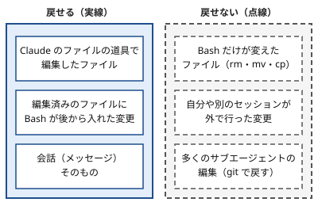

!!! abstract "要点"
    - **何ができるか**：送ったプロンプトごとの時点に、コード・会話・その両方を戻せ、途中から会話を要約もできる。
    - **強制力**：なし。戻す手段であり、操作を止める仕組みではない。戻せるのは Claude のファイル編集の道具が変えたファイルで、Bash だけが変えたファイルや外での変更は戻せない。
    - **いつ引くか**：試しにやらせて、駄目なら元に戻したいとき。巻き戻したのに一部のファイルが元に戻らないとき。
    - **前提**：<!-- link:begin input-symbols -->[入力の記号（/ ! @）と Esc](input-symbols.md)<!-- link:end -->

<!-- textlint-disable -->
別名：checkpoint・rewind・Esc を2回・/undo・/checkpoint・巻き戻し
<!-- textlint-enable -->

チェックポイントは、Claude Code が送ったプロンプトごとに、Claude のファイル編集を記録しておく仕組みである。`/rewind` はその記録を使って、コードと会話を以前の時点へ戻す入口になる。git の履歴の代わりではなく、セッションの中の素早いやり直しのための道具である。

## 使いどころ {#use-cases}

チェックポイントの使いどころは、結果が読めない試しを、安く始められるようにすることである。公式の文書も、リスクのあることを試させ、駄目なら巻き戻す使い方を挙げている（[Checkpointing](https://code.claude.com/docs/en/checkpointing)）。

防ぐ原因は、会話の「散らかっている」状態である。失敗した試みが会話に残ると、Claude はそれを読み続け、次の答えが引きずられる。巻き戻すと、失敗した試みの記録が会話ごと消えるので、Claude に見せるものがきれいに戻る。この辞典の原理でいう「見せる」を、後から整える手段である。訂正を重ねるより巻き戻すほうがよい理由は <!-- link:begin rewind-dont-correct#why -->[違うと返すより、巻き戻す・編集する › なぜ訂正より巻き戻しか](../context/rewind-dont-correct.md#why)<!-- link:end --> にある。

典型の場面は 3 つある。

- 実装の案を 2 つ試したい。1 つ目を試し、気に入らなければ戻して 2 つ目へ進む。
- 修正の指摘が 2 回続けて失敗した。3 回目の指摘を書かず、失敗の前の時点へ戻して、分かったことを入れた依頼を書き直す。
- 長いデバッグで会話が膨らんだ。途中から要約して、最初の指示を残したまま場所を空ける（次の「途中から要約する」の節）。

試しに任せる幅を広げる前に、戻らないものを先に知っておく。何が戻らないかは <!-- link:begin destructive-commands#not-recoverable -->[消されたくないもの（破壊的コマンド） › 巻き戻しで戻らないもの](../safety/destructive-commands.md#not-recoverable)<!-- link:end --> にもまとめてある。消されたものを取り戻す手順は <!-- link:begin deleted-something-important#recover -->[消してはいけないものを消された › まず戻す（復旧の手順）](../symptoms/deleted-something-important.md#recover)<!-- link:end --> にある。

試しの依頼は、変更をファイルの編集の道具に限ると戻しやすい。次の雛形がその一例である。

<!-- gen:begin snippet checkpoints-and-rewind/try-then-rewind -->
<!-- textlint-disable -->

??? example "雛形：試しにやらせて、駄目なら戻す依頼"

    ```markdown
    次の変更を試してほしい。ただし、これは駄目なら捨てる試しである。

    - 変更：<試したいこと>
    - 編集は、ファイルの編集の道具だけで行う。シェルのコマンドでファイルを作ったり、消したり、動かしたりしない（`rm`・`mv`・`cp`・`sed -i` など）
    - シェルで何かを変える必要が出たら、実行する前に、何をどのファイルに行うかを知らせて止まる
    - 終わったら、変えたファイルの一覧と、試して分かったことを短く報告する
    ```

    動作を確かめていない雛形。要る最低の版：Claude Code 2.0.0。

<!-- textlint-enable -->
<!-- gen:end snippet checkpoints-and-rewind/try-then-rewind -->

## 最小の使い方 {#how-to}

巻き戻しの入口は 2 つある。`/rewind` を実行するか、入力欄が空のときに `Esc` を 2 回押す。どちらも同じメニューが開く（`Esc` の使い方は <!-- link:begin input-symbols#esc -->[入力の記号（/ ! @）と Esc › Esc で止める・割り込む](input-symbols.md#esc)<!-- link:end --> を参照）。入力欄に文字があると、`Esc` の 2 回押しは入力を消すだけでメニューは開かない。消した文字は入力履歴に残るので、メニューを終えた後に `↑` で呼び戻せる。

メニューには、そのセッションで送ったプロンプトが並ぶ。戻りたい時点を選び、次の動作を選ぶ。

| 動作 | 戻るもの | 残るもの |
| --- | --- | --- |
| Restore code and conversation | コードと会話の両方 | なし |
| Restore conversation | 会話 | 今のコード |
| Restore code | コード | 今の会話 |
| Summarize from here | その時点より後の会話が要約になる | ファイルはそのまま |
| Summarize up to here | その時点より前の会話が要約になる | その後のメッセージとファイル |

- コードを戻す 2 つの動作は、選んだ時点より後にファイルの変更が記録されているときだけ出る。
- 会話を戻した後や「Summarize from here」の後は、選んだプロンプトの文が入力欄に戻る。そのまま、または直して送り直せる。
- 記録はセッションと一緒に保存されるので、セッションを再開した後でも `/rewind` が使える。`/clear` した後でも、同じ Claude Code のプロセスの間は、メニューの先頭の項目から直前のセッションへ戻れる。
- IDE の拡張にも似た機能がある。動作はこの辞典では未確認で、違いは <!-- link:begin using-ides#vs-cli -->IDE（VS Code・JetBrains）で使う › CLI との違い（準備中）<!-- link:end --> にまとめてある。

## 戻せるもの・戻せないもの {#what-is-restored}

戻せるのは、Claude のファイル編集の道具が変えたファイルである。逆に、Bash だけが変えたファイル、外での変更、多くのサブエージェントの編集は、記録に入らず戻らない。巻き戻したのに一部のファイルが元に戻らない症状の大半は、この線引きで説明がつく。



戻らないものを、場面ごとに並べる。

- **Bash だけが変えたファイル**：`rm`・`mv`・`cp` などで作られ、消され、動かされたファイルは、記録に入らない。Claude が先にファイルの編集の道具で触ったファイルなら、その後に Bash が入れた変更も戻る。この差が、戻るものと戻らないものの境目になる。
- **外での変更**：自分がエディタで直したファイルや、別のセッションの編集は、普通は記録されない。たまたま同じセッションが触ったファイルに当たると、その部分だけ巻き込まれることがある。
- **サブエージェントの編集**：サブエージェントは同じ編集の道具を使うが、その編集は普通、このセッションの記録に入らない。フォアグラウンドで動く `context: fork` のスキルは例外で、通常どおり戻る。それ以外は、Claude が会話の中で先に編集したファイルだけが戻り、ほかのファイルへの編集は残る。
- **リンクされたファイル**：シンボリックリンクやハードリンクのパスは戻されない。コードを戻したときに、飛ばした件数の警告が出る。飛ばされたファイルは今の内容のままなので、Claude に頼んで逆の編集をさせるか、自分で直す。
- **古くなった記録**：ファイルの控えには保存の数と期間があり、古い時点には戻れなくなる。戻れないと「No files were restored」の類の失敗になる。長く残したいときは設定 `cleanupPeriodDays` を調べる。

ほかに次の落とし穴がある。

- **作業の途中に送ったメッセージ**：Claude が動いている間に打ったメッセージは、「No code restore」と出て、自分の記録を持たないことがある。その後のファイル編集を戻すには、そのターンを始めたプロンプトを選んで、コードを戻す動作を使う。
- **終了すると戻る会話**：巻き戻した直後に、次のプロンプトを送らずに終了すると、巻き戻したメッセージは戻りうる。確実に消すには、巻き戻した後に 1 つプロンプトを送ってから終了する。戻したファイルは、巻き戻した状態のまま残る。
- **巻き戻しの確かめ**：巻き戻した後は、`git status` や `git diff` で、作業ツリーが期待どおりかを確かめる。戻らないものがある以上、メニューの動作が成功したことは、元の状態に戻ったことを意味しない。

## 途中から要約する {#summarize}

途中からの要約とは、会話の一部を要約に置き換えて、コンテキストの場所を空ける操作である。ファイルは変えず、元のメッセージはセッションの記録に残るので、Claude が必要なときに詳細を参照できる。

- **Summarize from here**：選んだ時点から後ろを要約する。長いデバッグの途中から先だけを縮め、最初の指示を残したいときに向く。
- **Summarize up to here**：選んだ時点より前を要約し、後ろのメッセージはそのまま残す。古い経緯を縮めて、直近のやり取りを正確に残したいときに向く。

要約の焦点は指示できる。「Summarize」の行を矢印で選び、「add context (optional)」の欄に、残したいことを書いてから `Enter` を押す。数字のキーで選ぶと、指示なしですぐ要約する。

要約は、同じセッションの中で場所を空ける操作で、狙いを絞った `/compact` に近い。

- `/compact` の焦点の指示：<!-- link:begin compact-and-auto-compact#focused-compact -->/compact と自動圧縮 › /compact に焦点を指示する（準備中）<!-- link:end -->
- 書き出して `/clear` する選び方：<!-- link:begin compact-and-auto-compact#compact-or-clear -->/compact と自動圧縮 › 圧縮か、書き出して /clear か（準備中）<!-- link:end -->
- 元のセッションを保ったまま別の方法を試すなら、要約ではなく分岐：<!-- link:begin resume-and-branch#branch -->セッションに名前を付けて再開・分岐する › 分岐して別案を試す（準備中）<!-- link:end -->

## git と組み合わせる {#with-git}

チェックポイントは、セッションの中の素早い取り消し用で、永続の履歴ではない。コミット・ブランチ・共同作業の履歴は git に持たせる。この 2 つは役割が違うので、重ねて使う。

- **試す前**：作業ツリーをコミットするか退避して、きれいな状態にしておく。きれいな状態の上で試すと、`git diff` が Claude の変更だけを映す。
- **試している最中**：すぐ取り消したいときはチェックポイントで戻す。Bash が絡んだ変更だけは、チェックポイントに頼らない。
- **試した後**：残したいものを小さな単位でコミットする。戻らなかったファイルは `git restore` や `git checkout` で戻す。

コミットを人が握るか任せるかは <!-- link:begin working-with-git#who-commits -->[git との付き合い方 › 誰がコミットするか](working-with-git.md#who-commits)<!-- link:end -->、変更を小さく区切る考え方は <!-- link:begin working-with-git#granularity -->[git との付き合い方 › どこで区切るか](working-with-git.md#granularity)<!-- link:end --> を参照。

!!! example "判断例：認証モジュールの書き換えを任せる"
    - **状況**：古い認証モジュールを、Claude に新しい書き方へ書き換えさせたい。結果が読めず、途中で方針を変えるかもしれない。
    - **迷う候補**：チェックポイントだけを頼りに、そのまま任せる。または、先に今の状態をコミットしてから任せる。
    - **選んだもの**：先にコミットしてから任せ、すぐ取り消したい分はチェックポイントで戻す。
    - **理由**：書き換えの途中で、Claude が Bash でファイルを動かす可能性は残る。その変更はチェックポイントでは戻らないが、コミットがあれば `git restore` で確実に戻せる。チェックポイントは速くて範囲が狭く、コミットは遅くて範囲が広い。そこで役割を分ける。

セッションの記録が残っていて、成果を取り戻したいときは <!-- link:begin recover-lost-work#order -->セッション記録から失った作業を取り戻す › 探す順（準備中）<!-- link:end --> の順で探す。

## 比べる相手 {#compare}

チェックポイントは、近い手段と範囲が違う。選び方の目安を表にする。

| 手段 | 戻せる範囲 | 向く場面 |
| --- | --- | --- |
| チェックポイントと `/rewind` | Claude の編集の道具が変えたファイルと、会話 | 試しをすぐ取り消す。失敗した試みを会話から外す |
| 要約（Summarize） | 会話の長さだけ（ファイルは変えない） | 会話が膨らんだので場所を空ける |
| 分岐（`/branch`） | 元のセッションを保ったまま別の道を進む | 元の会話を残して別案を試す（<!-- link:begin resume-and-branch#branch -->セッションに名前を付けて再開・分岐する › 分岐して別案を試す（準備中）<!-- link:end -->） |
| git | コミットした履歴すべて。Bash が変えたファイルも | 永続の履歴。共同作業。戻らないものの最後の守り |

関連する手順は次のページにある。

- セッションに名前を付けて再開する流れ：<!-- link:begin resume-and-branch#resume -->セッションに名前を付けて再開・分岐する › 再開する（準備中）<!-- link:end -->
- 失った作業をセッションの記録から探す手順：<!-- link:begin recover-lost-work#transcripts -->セッション記録から失った作業を取り戻す › トランスクリプトの場所と読み方（準備中）<!-- link:end -->

<!-- gen:begin references -->
<!-- textlint-disable -->

## 参考 {#references}

- [Checkpointing](https://code.claude.com/docs/en/checkpointing)：Anthropic・英語・確認日 2026-11-04
- [Best practices for Claude Code](https://code.claude.com/docs/en/best-practices)：Anthropic・英語・確認日 2026-11-04
- [Commands](https://code.claude.com/docs/en/commands)：Anthropic・英語・確認日 2026-11-04

<!-- textlint-enable -->
<!-- gen:end references -->

<!-- gen:begin page-links -->
<!-- textlint-disable -->

<div class="ca-page-links" markdown>

**前提**

- [入力の記号（/ ! @）と Esc](input-symbols.md)

**次に読む**

- [git との付き合い方](working-with-git.md)
- [消されたくないもの（破壊的コマンド）](../safety/destructive-commands.md)
- セッション記録から失った作業を取り戻す（準備中）

**関連**

- [違うと返すより、巻き戻す・編集する](../context/rewind-dont-correct.md)
- セッションに名前を付けて再開・分岐する（準備中）
- /compact と自動圧縮（準備中）
- [消してはいけないものを消された](../symptoms/deleted-something-important.md)
- IDE（VS Code・JetBrains）で使う（準備中）

</div>

<!-- textlint-enable -->
<!-- gen:end page-links -->
