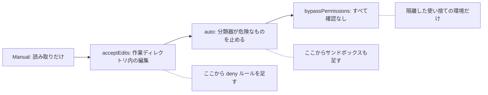

!!! abstract "要点"
    - **何ができるか**：権限モードごとに何が確認なしで進むかを知り、作業の危うさと見ていられる度合いに合わせて選べる。
    - **いつ引くか**：確認を減らしたいが、どのモードにすればよいか分からないとき。既定のモードで、何が確認なしで実行されるのか知りたいとき。
    - **強制力**：<!-- gen:begin feature enforcement -->鍵<!-- gen:end feature enforcement -->。確認の要否を決める基準は Claude の判断に関係なく効く。ただし auto モードの分類器の判断は鍵に数えない。特定の操作を確実に禁じるのは deny ルールである。
    - **前提**：<!-- link:begin agent-loop -->[エージェントループと tool use](../basics/agent-loop.md)<!-- link:end -->

<!-- textlint-disable -->
別名：権限モードの全体像・permission modes・Manual・acceptEdits・plan・auto・dontAsk・bypassPermissions・Shift+Tab でモードを切り替える・auto モード
<!-- textlint-enable -->

権限モードは、Claude Code がどの操作を確認なしで実行し、どの操作で確認を出すかを決める基準である。このページは、モードごとの違いと、既定の確かめ方と、選び方を扱う。

## モードごとに確認なしで進むもの {#modes}

権限モードは 6 つある。モードが作業の危うさに合っていないと、確認が多すぎて読まずに押すか、境界がないまま進んで取り返しのつかない操作が通る。次の表は、モードごとに確認なしで進むものと、向く場面を示す。

| モード | 確認なしで進むもの | 向く場面 |
| --- | --- | --- |
| Manual（設定の値は `default`） | 読み取りだけ。編集やコマンドの実行は確認が出る | 初めて触る環境。結果を 1 つずつ見たい作業 |
| `acceptEdits` | 作業ディレクトリ内のファイル編集と、mkdir・touch・mv・cp・sed・rm などのファイル操作のコマンド | 手元の変更を git の差分で後から見直せる作業 |
| plan mode | 調査と計画だけ。編集はブロックされる | 方針に迷う作業 |
| `auto` | 別の分類器のモデルが実行の前に審査し、危険と見たものだけ止める。ほかは確認なし | 長い作業を、見張らずに進めたいとき |
| `dontAsk` | 事前に許可したものだけ。許可していない操作はすべて拒否され、確認は出ない | CI など、答える人がいない実行 |
| `bypassPermissions` | すべて。確認も分類器もない | 隔離した使い捨ての環境だけ |

Manual は、以前は default モードと呼ばれていた。今の呼び方は <!-- name:begin default-to-manual-mode -->Manual（権限モード。設定の値は default のまま）<!-- name:end --> である。設定やフックや SDK では、値は `default` のままである。

次の図は、確認なしで進む範囲が広がる順にモードを並べ、どの段で何を足すかを示す。plan mode と `dontAsk` は、範囲を広げる軸の外にある。plan mode は実行そのものを止め、`dontAsk` は事前に許可したものへ範囲を絞る。



図の要点は 3 つである。右へ進むほど、確認なしで進む操作が増える。deny ルールは、どのモードでも先に評価される。bypassPermissions は、確認と分類器がないので、止める手段が deny ルールと環境の隔離だけになる。

確認なしの範囲を広げる前に、先に守りを置く。広げるほど、Claude が間違った操作をしたときに止める手段が、モードの外の仕組みだけになるからである。

- 触らせたくないファイルとコマンドは、<!-- link:begin permission-rules#evaluation-order -->[権限ルール（allow・ask・deny） › 評価の順番（deny → ask → allow）](../enforce/permission-rules.md#evaluation-order)<!-- link:end --> の deny ルールで止める。deny ルールは bypassPermissions を含むどのモードでも効く
- どのモードでも確認なしには書かせない場所は、<!-- link:begin protected-paths#protected -->消せない場所・触れない場所（protected paths） › 保護される場所と、モードごとの扱い（準備中）<!-- link:end --> で確かめる。止まる削除は <!-- link:begin protected-paths#critical-rm -->消せない場所・触れない場所（protected paths） › どのモードでも止まる削除（準備中）<!-- link:end --> で確かめる
- 子プロセスまで囲むなら、<!-- link:begin sandboxing#scope -->[サンドボックスで封じ込める › 囲えるもの・囲えないもの](../enforce/sandboxing.md#scope)<!-- link:end --> を重ねる
- auto モードを選ぶなら、<!-- link:begin what-auto-mode-stops#limits -->[auto モードは何を止め、何を止めないか › すり抜けと限界](../enforce/what-auto-mode-stops.md#limits)<!-- link:end --> で、分類器をすり抜けうる操作を先に知っておく
- bypassPermissions を使ってよい環境の条件は、<!-- link:begin where-bypass-is-ok#requirements -->bypassPermissions と無人の実行はどこで動かすか › 使い捨ての環境の条件（準備中）<!-- link:end --> にある。確認を減らすだけなら、bypassPermissions の前に auto モードとサンドボックスを使う

面ごとの既定の安全は <!-- link:begin default-safety-settings#by-stage -->[安全の早見表（面ごとの既定と、段階ごとに足すもの） › 段階ごとに足すもの](../safety/default-safety-settings.md#by-stage)<!-- link:end --> が正本である。

## 既定のモードと版 {#defaults}

起動したときのモードは、版・使い方・設定で変わってきた。対話のセッションの既定は、版が進む中で Manual から auto モードへ移った。そのため、古い記事の「最初は毎回確認が出る」は、手元の環境と合わないことがある。変わった時期・版・範囲と、今の既定は、<!-- link:begin outdated-advice-ledger#approve-everything-first -->[古くなった助言の台帳](../changes/outdated-advice-ledger.md#approve-everything-first)<!-- link:end --> の行が持つ。

手元の既定は、推測せずに次の順で確かめる。

1. 起動した直後の、画面の下の表示を見る。今のモードを示す表示が出る
2. 設定で `permissions.defaultMode` を決めているかを見る。決めていれば、そのモードで始まる。どの層の設定が読み込まれているかは <!-- link:begin settings-layers#verify -->設定ファイルの階層と優先順位 › 効いているかを確かめる（準備中）<!-- link:end --> の手順で確かめる
3. 決めていなければ、版ごとの既定で始まる。対話の端末と VS Code の拡張、`claude -p` と Agent SDK で既定が違う

`claude -p` と Agent SDK は、無人で動く。確認に答える人がいないので、承認の要る呼び出しは、allow ルール・フックなどで許していなければ拒否される。この扱いは版で変わってきた。詳しくは <!-- link:begin headless-basics#permissions -->非対話モード（claude -p）の基本 › 許可と権限モード（準備中）<!-- link:end --> にある。

VS Code の拡張の最初のモードも、版で変わってきた。公式の文書に基づく説明で、動作は試していない。IDE の拡張の動作は、このページでは「未確認」として扱う。

毎回確かめたいなら、設定で Manual に固定するか、起動時に `--permission-mode manual` を付ける。固定する設定の例は、雛形の節にある。

チームメイトを動かすときは、リードの権限モードをチームメイトが受け継ぐかを確かめてから任せる。受け継ぎ方に不具合があった版もある（<!-- link:begin agent-teams -->エージェントチーム（複数の Claude に分担させる）（準備中）<!-- link:end -->）。アプリには別の 2 択がある（<!-- link:begin permission-modes-in-the-app#modes -->アプリの権限モード（Auto と Manual）と安全 › Auto と Manual（準備中）<!-- link:end -->）。

## 切り替え方 {#switch}

=== "Claude Code"

    セッションの途中では、Shift+Tab を押すたびにモードが順に切り替わる。順に回るモードは、設定と版で変わる。auto モードと bypassPermissions は、使える状態にしていないと回らない。現在のモードは、画面の下の表示で確かめる。

    起動時には `--permission-mode <名前>` で決める。毎回同じモードで始めたいときは、設定の `permissions.defaultMode` に書く。plan mode には `/plan` でも入れる。

    `permissions.defaultMode` の `auto` と `bypassPermissions` は、プロジェクトと手元の設定では無効である。ユーザーか管理の設定に書く。層の違いは <!-- link:begin settings-layers#layers -->設定ファイルの階層と優先順位 › 層と優先順位（準備中）<!-- link:end --> にある。

    VS Code の拡張では、設定 `claudeCode.initialPermissionMode` で最初のモードを決める。この設定はユーザーの設定だけを読む。

## 選び方の判断例 {#examples}

モードは、次の順で決める。まず、任せる作業が取り返しのつく範囲かを見る。次に、見ていられる度合いを見る。最後に、必要な守りを足して、その守りで足りるモードを選ぶ。

!!! example "判断例：作業ブランチで、30 分ほど席を離れる"
    - **状況**：作業ブランチで機能を足す。テストを回しながら、30 分ほど席を離れる。
    - **迷う候補**：`acceptEdits` にして、テストのコマンドだけ allow ルールに足す。または `auto` にする。
    - **選んだもの**：`acceptEdits` に、テストのコマンドの allow ルールを足す。秘密のファイルは deny ルールで止める。
    - **理由**：どちらも筋は通る。`auto` は分類器の判断で、公式も「確認を減らすが安全を保証しない」と書く。範囲を自分で決めたいときは、allow ルールと deny ルールで範囲を読める形にするほうが、離席中に何が動くかを予測しやすい。見張る時間が取れない長い作業で、ルールを書く手間をかけたくないなら、`auto` とサンドボックスの組み合わせも選べる。

!!! example "判断例：やり方に迷う、複数ファイルの変更"
    - **状況**：複数のファイルにまたがる変更を頼みたい。進め方を自分でも決めきれていない。
    - **迷う候補**：いきなり `auto` で任せる。または plan mode で計画を出させてから実装に入る。
    - **選んだもの**：plan mode で計画を出させ、読んで直してから、実装のモードに切り替える。
    - **理由**：plan mode は編集を止めたまま調べさせるので、誤解を計画の段階で直せる。1 文で説明できる小さな差分なら、計画を省いてよい。使いどころは <!-- link:begin when-to-plan#when -->plan mode の使いどころ › 計画が効く作業、省いてよい作業（準備中）<!-- link:end --> にある。

!!! example "判断例：CI で Claude Code を動かす"
    - **状況**：CI で `claude -p` を動かす。確認に答える人はいない。
    - **迷う候補**：`bypassPermissions` にして、すべて通す。または `dontAsk` にして、必要な操作だけ allow ルールで許す。
    - **選んだもの**：`dontAsk` と、必要な操作の allow ルール。
    - **理由**：`dontAsk` は、許可していない操作を確認待ちにせず拒否するので、無人でも止まらず、範囲も広がらない。`bypassPermissions` は隔離した使い捨ての環境専用で、CI の実行環境がその条件を満たすかを先に確かめる（<!-- link:begin where-bypass-is-ok#why-isolate -->bypassPermissions と無人の実行はどこで動かすか › なぜ隔離した環境だけか（準備中）<!-- link:end -->）。

確認が多すぎる症状も、少なすぎる症状も、調整先は診断で決める。入口は <!-- link:begin wrong-amount-of-approvals#diagnosis -->[承認の確認が多すぎる・少なすぎる › 原因を安く確かめる順](../symptoms/wrong-amount-of-approvals.md#diagnosis)<!-- link:end --> である。確認が多いと読まずに承認する理由と、確認を減らす順番は <!-- link:begin approval-fatigue#reduce-prompts -->承認疲れ › 確認を減らす順番（準備中）<!-- link:end --> にある。

## 雛形 {#templates}

毎回確かめたいときに、起動したときのモードを Manual に固定する設定の例である。ユーザーの設定に置く。モードを緩める設定ではないが、安全に関わる設定なので、自分の環境で効いているかを確かめる。

<!-- gen:begin snippet permission-modes-overview/start-in-manual -->
<!-- textlint-disable -->

??? example "雛形：起動したときのモードを Manual（設定の値は default）に固定する設定"

    ```json
    {
      "permissions": {
        "defaultMode": "default"
      }
    }
    ```

    動作を確かめていない雛形。安全のための雛形なので、守りとして頼る前に、止めたい操作が自分の環境で止まるかを確かめる。

<!-- textlint-enable -->
<!-- gen:end snippet permission-modes-overview/start-in-manual -->

モードを緩める側の設定は、雛形として載せない。守りを先に置く必要があるからである。守りの雛形は <!-- link:begin permission-rules#templates -->[権限ルール（allow・ask・deny） › 雛形](../enforce/permission-rules.md#templates)<!-- link:end --> にある。

## 効かない場面・落とし穴 {#limits}

- モードは範囲の基準であり、特定の操作を禁じる鍵ではない。確実に止めたい操作は deny ルールで止める。auto モードの分類器の判断は決定論ではなく、会話で言った境界は、圧縮で消えると効かなくなりうる
- 子プロセスの中の処理は、モードと権限ルールのどちらでも止まらない。止めるのはサンドボックスである
- IDE で `acceptEdits` や auto モードを使うと、IDE が自動で実行する設定ファイルを Claude が書き換えうる。これは Bash の承認を迂回する道になりうるので、公式の文書は Manual を考えるよう書く。IDE の動作は未確認である
- 取り返しのつかない削除は、モードの選び方だけでは防げない。巻き戻しで戻らないものは <!-- link:begin destructive-commands#not-recoverable -->[消されたくないもの（破壊的コマンド） › 巻き戻しで戻らないもの](../safety/destructive-commands.md#not-recoverable)<!-- link:end --> で確かめる
- 確認を増やしすぎても安全にならない。読まずに承認する状態では、確認が安全の仕組みとして働かない

## 比べる相手 {#compare}

モードは、確認の要否の基準を決める。ほかの手段との分担は次のとおり。

| 決めたいこと | 先に使うもの | モードとの違い |
| --- | --- | --- |
| 特定のファイルと操作を禁じる | <!-- link:begin permission-rules -->[権限ルール（allow・ask・deny）](../enforce/permission-rules.md)<!-- link:end --> | deny ルールはモードを問わず先に評価される |
| 子プロセスまで含めて読み書きと通信を囲う | <!-- link:begin sandboxing -->[サンドボックスで封じ込める](../enforce/sandboxing.md)<!-- link:end --> | OS の層で止める。モードは Claude Code が見分ける呼び出しの確認の基準 |
| どのモードでも守りたい場所 | <!-- link:begin protected-paths -->消せない場所・触れない場所（protected paths）（準備中）<!-- link:end --> | 設定なしで保護される場所と、足りない境界を足す設定 |
| 無人の実行の許可 | <!-- link:begin headless-basics#permissions -->非対話モード（claude -p）の基本 › 許可と権限モード（準備中）<!-- link:end --> | 確認に答える人がいないので、許す道具を明示する |
| アプリでの確認の量 | <!-- link:begin permission-modes-in-the-app -->アプリの権限モード（Auto と Manual）と安全（準備中）<!-- link:end --> | アプリには Auto と Manual の 2 択がある |

確認を減らす手段を 1 つずつ足す順番は、<!-- link:begin approval-fatigue#keep-prompts -->承認疲れ › 残す確認を選ぶ（準備中）<!-- link:end --> で選ぶ。

## 古くなった助言 {#outdated}

権限モードの周りには、古い前提の助言が残っている。

- 「最初は毎回確認が出るので、承認していく」という前提の手順は、今は合わないことがある。起動した直後の表示でモードを確かめ、毎回確認が要るなら Manual に固定する。台帳の行は <!-- link:begin outdated-advice-ledger#approve-everything-first -->[古くなった助言の台帳](../changes/outdated-advice-ledger.md#approve-everything-first)<!-- link:end --> にある
- `--dangerously-skip-permissions` で確認をすべて外す運用は、置き換わった。ふだんは auto モードにしてサンドボックスを重ね、bypassPermissions は使い捨てのコンテナや VM の中だけで使う。台帳の行は <!-- link:begin outdated-advice-ledger#yolo-skip-permissions -->[古くなった助言の台帳](../changes/outdated-advice-ledger.md#yolo-skip-permissions)<!-- link:end --> にある

画面に出る名前の変更もある。auto モードが止めた操作を見直す `/permissions` のタブは、今は <!-- name:begin recently-denied-to-blocked -->Recently blocked（/permissions のタブ）<!-- name:end --> で、古い記事では Recently denied と書かれている。記事の画面と合わないときは、これである。

<!-- gen:begin references -->
<!-- textlint-disable -->

## 参考 {#references}

- [Choose a permission mode](https://code.claude.com/docs/en/permission-modes)：Anthropic・英語・確認日 2026-11-04
- [Configure permissions](https://code.claude.com/docs/en/permissions)：Anthropic・英語・確認日 2026-11-04
- [Configure the sandboxed Bash tool](https://code.claude.com/docs/en/sandboxing)：Anthropic・英語・確認日 2026-11-04
- [Best practices for Claude Code](https://code.claude.com/docs/en/best-practices)：Anthropic・英語・確認日 2026-11-04
- [Changelog](https://github.com/anthropics/claude-code/blob/main/CHANGELOG.md)：Anthropic・英語・確認日 2026-11-04
- [Claude Code changelog](https://code.claude.com/docs/en/changelog)：Anthropic・英語・確認日 2026-11-04
- [Auto mode is now the default in Claude Code for Pro, Max, Ultra, and Team plans](https://claude.com/resources/articles/auto-mode-default-in-claude-code)：Anthropic・英語・確認日 2026-11-04

<!-- textlint-enable -->
<!-- gen:end references -->

<!-- gen:begin page-links -->
<!-- textlint-disable -->

<div class="ca-page-links" markdown>

**前提**

- [エージェントループと tool use](../basics/agent-loop.md)

**次に読む**

- [権限ルール（allow・ask・deny）](../enforce/permission-rules.md)
- [auto モードは何を止め、何を止めないか](../enforce/what-auto-mode-stops.md)
- [安全の早見表（面ごとの既定と、段階ごとに足すもの）](../safety/default-safety-settings.md)
- plan mode の使いどころ（準備中）
- スマホから操作する（Remote Control）（準備中）
- 承認疲れ（準備中）

**関連**

- [サンドボックスで封じ込める](../enforce/sandboxing.md)
- bypassPermissions と無人の実行はどこで動かすか（準備中）
- 消せない場所・触れない場所（protected paths）（準備中）
- [消されたくないもの（破壊的コマンド）](../safety/destructive-commands.md)
- 設定ファイルの階層と優先順位（準備中）
- [承認の確認が多すぎる・少なすぎる](../symptoms/wrong-amount-of-approvals.md)
- アプリの権限モード（Auto と Manual）と安全（準備中）
- 非対話モード（claude -p）の基本 › 許可と権限モード（準備中）
- エージェントチーム（複数の Claude に分担させる）（準備中）

</div>

<!-- textlint-enable -->
<!-- gen:end page-links -->
