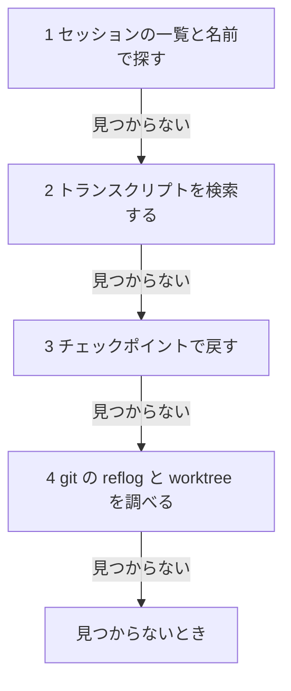

!!! abstract "要点"
    - **何ができるか**：見失った成果や途中のやり取りを、セッションの一覧・トランスクリプト・チェックポイント・git の順に探して取り戻せる。
    - **いつ引くか**：前日の成果がどのセッションにあったか分からないとき、異常終了したセッションの途中が見つからないとき、過去のやり取りを読み返したいとき。
    - **前提**：<!-- link:begin resume-and-branch -->[セッションに名前を付けて再開・分岐する](resume-and-branch.md)<!-- link:end -->・<!-- link:begin checkpoints-and-rewind -->[チェックポイントと /rewind（git との違い）](checkpoints-and-rewind.md)<!-- link:end -->

<!-- textlint-disable -->
別名：transcript から復元する・セッションのログを探す・昨日の作業が見つからない・~/.claude/projects
<!-- textlint-enable -->

セッション記録から失った作業を取り戻すとは、手元に残った記録を、安く確かめられる順に探して成果の所在をつかむことである。並列で作業したり、長い作業を Claude に任せたりすると、どのセッションが何をしたかを人が覚えていられなくなる。そのときの探し方をまとめる。

## 先に整える守り {#guards}

記録を探す前に、今の状態を壊さない用意と、秘密の扱いを決める。探すこと自体は読むだけの作業だが、見つけた内容を書き戻す段で、今の作業ツリーを上書きしやすいからである。

- **今の状態を先に残す**：未保存の変更があるなら、探す前にコミットかスタッシュで退避する。取り戻した内容を書き戻して、いまの変更と混ざるのを避けるためである。進め方は <!-- link:begin working-with-git#granularity -->[git との付き合い方 › どこで区切るか](working-with-git.md#granularity)<!-- link:end --> を使う。
- **探す役の Claude には読むだけにさせる**：トランスクリプトと作業ツリーは書き換えない、と最初に伝える。書き戻しは、見つけた内容を人が見てから頼む。
- **秘密を画面と返答に写さない**：手元の記録は平文で保存されるので、会話に貼った秘密もそこに残る。探した結果を画面に出すときは、中身ではなくファイルの名前に絞り、記録の中の秘密らしい文字列は引用させない。記録を人に見せたり送ったりするかどうかは、<!-- link:begin what-feedback-sends#before-sending -->[/feedback・トランスクリプトの共有で送られるもの › 送る前に決める](../safety/what-feedback-sends.md#before-sending)<!-- link:end --> を使う。秘密を会話に置かない設定は <!-- link:begin protecting-secrets#keep-out -->[秘密情報（.env・API キー）を守る › 秘密を作業ディレクトリと会話に置かない](../safety/protecting-secrets.md#keep-out)<!-- link:end --> に置いてある。
- **消された直後は、先にそちらを読む**：ファイルや履歴を消されたと分かっているなら、探す前に <!-- link:begin deleted-something-important#recover -->[消してはいけないものを消された › まず戻す（復旧の手順）](../symptoms/deleted-something-important.md#recover)<!-- link:end --> の手順で戻せる手段を確かめる。この辞典では、このページは成果の所在を探す手順に絞る。

## 探す順 {#order}

成果の所在は、安く確かめられるものから順に探す。1 つ目で見つかれば、そこで止める。図の要点は、記録の中身を読む手間が大きいほど後ろに回してある、ということである。



1. **セッションの一覧と名前**：`claude --resume` は一覧から選んで再開でき、`claude --continue` は直近のセッションを続ける。対話の中では `/resume` を使う。名前を付けてあれば（`/rename`）、一覧で名前から探せる。再開の手順は <!-- link:begin resume-and-branch#resume -->[セッションに名前を付けて再開・分岐する › 再開する](resume-and-branch.md#resume)<!-- link:end --> にある。分岐した会話は新しい ID の別のセッションなので、元のセッションと分岐先の両方を見る。分岐に使うコマンドは <!-- name:begin fork-renamed-branch -->/branch（今の /fork は、会話を新しい背景のセッションに写す別の機能）<!-- name:end --> である。
2. **トランスクリプトの検索**：一覧に見当たらないとき、または再開しても中身が足りないときは、保存された記録を直接探す。場所と読み方は次の節で書く。
3. **チェックポイント**：ファイルを Claude に書かせた作業なら、`/rewind` でコードを戻せることがある。ただし、Bash だけが変えたファイルや、外での変更は戻らない。戻せるものと戻せないものは <!-- link:begin checkpoints-and-rewind#what-is-restored -->[チェックポイントと /rewind（git との違い） › 戻せるもの・戻せないもの](checkpoints-and-rewind.md#what-is-restored)<!-- link:end --> にある。
4. **git の reflog と worktree**：コミットやスタッシュ、別の worktree に成果が残っていないかを調べる。`git reflog`・`git stash list`・`git branch -a`・`git worktree list` が入口になる。並列で作業した場合は、成果が別の worktree のブランチにあることが多い。worktree の扱いは <!-- link:begin parallel-with-worktrees#cleanup -->[git worktree で並列にする › 片付けと残すもの](../delegate/parallel-with-worktrees.md#cleanup)<!-- link:end --> に置いてある。

!!! example "判断例：異常終了したセッションの続きを探す"
    - **状況**：昨日、ターミナルが落ちてセッションが途中で終わった。どのファイルまで書いたか分からず、コミットもしていない。
    - **迷う候補**：一覧から再開してやり直させる。または、記録を検索して、終わる直前のやり取りを先に読む。
    - **選んだもの**：先に一覧から再開を試し、足りなければ記録を検索する。
    - **理由**：再開なら会話がそのまま戻り、続きの依頼もすぐ出せる。再開できないときや、終わる直前の記録が欠けているときに限り、記録のファイルを探す。作業ツリーに残った変更は `git status` で先に確かめておく。

## トランスクリプトの場所と読み方 {#transcripts}

トランスクリプトとは、会話の記録のことである。Claude Code は会話を `~/.claude/projects/` の下に JSONL（1 行に 1 件の記録を持つ形式）で保存する。セッションごとに 1 つのファイルになる。

読み方は 3 通りある。

- **対話の中で読む**：現在のセッションのトランスクリプトを、キー（<!-- fact:begin key-transcript-and-background -->未確認<!-- fact:end -->）で表示できる。過去のセッションを開いて読み返すときにも使う。
- **Claude に検索させる**：過去のトランスクリプトを検索させて、昨日の作業の内容を聞く使い方が実践者から報告されている（根拠：弱）。探す語、読むだけにする条件、秘密を引用させない条件を添えると、結果が安全で絞りやすい。依頼の雛形を次に置く。
- **自分で絞る**：語が出てくるファイルの名前だけを新しい順に並べる。記録の中身を画面に出さないので、貼られた秘密を写しにくい。

<!-- gen:begin snippet recover-lost-work/ask-search-transcripts -->
<!-- textlint-disable -->

??? example "雛形：過去のトランスクリプトを検索させる依頼"

    ```markdown
    昨日の作業の成果が、どのセッションにあったか分からなくなった。
    `~/.claude/projects/` のトランスクリプトを検索して、次の 3 つを調べてほしい。

    - 「<探す語。機能名・ファイル名・ブランチ名など>」が出てくるセッション（更新日時の新しい順に 5 件まで）
    - そのうち最も関係が深いセッションで、最後にやっていた作業と、終わっていなかったこと
    - そこで作られたり変えられたりしたファイルの一覧と、git に入っているかどうか

    条件:
    - 読むだけにする。トランスクリプトも作業ツリーも書き換えない
    - 記録に秘密（キー・トークン・パスワード）らしい文字列があっても、引用せず、あったことだけを知らせる
    - 見つけた内容が確かでないときは、推測で埋めず、確かでない箇所を分けて書く
    ```

    動作を確かめていない雛形。安全のための雛形なので、守りとして頼る前に、止めたい操作が自分の環境で止まるかを確かめる。要る最低の版：Claude Code 0.2.93。

<!-- textlint-enable -->
<!-- gen:end snippet recover-lost-work/ask-search-transcripts -->

<!-- gen:begin snippet recover-lost-work/find-transcripts -->
<!-- textlint-disable -->

??? example "雛形：トランスクリプトから語を探すスクリプト"

    ```bash
    #!/usr/bin/env bash
    # 手元のトランスクリプトから、語が出てくるファイルの名前だけを新しい順に並べる。
    # 読むだけで、何も書き換えない。中身は出さない（貼られた秘密を画面とログに写さないため）。
    # 使い方: ./find-transcripts.sh '探す語'
    set -u

    word="${1:?探す語を1つ渡す}"
    root="$HOME/.claude/projects"

    if [ ! -d "$root" ]; then
      echo "$root がない。このマシンでは Claude Code の記録が見つからない。"
      exit 1
    fi

    # -F は正規表現にしない指定、-l はファイル名だけを出す指定
    grep -rlF --include='*.jsonl' -- "$word" "$root" 2>/dev/null |
      while IFS= read -r f; do
        printf '%s\t%s\n' "$(date -r "$f" '+%Y-%m-%d %H:%M')" "$f"
      done | sort -r
    ```

    動作を確かめていない雛形。安全のための雛形なので、守りとして頼る前に、止めたい操作が自分の環境で止まるかを確かめる。要る最低の版：Claude Code 0.2.93。

<!-- textlint-enable -->
<!-- gen:end snippet recover-lost-work/find-transcripts -->

見つけた記録から作業を取り戻すときは、次の 3 点に気をつける。

- **記録は成果そのものではない**：ファイルを書かせたときの道具の呼び出しが残っていれば、そこから中身を読み直せることがある。ただし、全文が残っているとは限らない。Claude に書き戻させるときは、記録に残っていた部分と、推測で補った部分を分けて報告させる。
- **圧縮の前のやり取りは、見つかるか試す**：圧縮で会話が短くなった後に、元のやり取りを読み返したくなることがある。記録のファイルにそれがどこまで残るかは、この辞典では確かめていない。検索で見つからなければ、`/rewind` から会話を戻す手もある。
- **記録を書き換えない**：記録は読むだけにする。書き換えると、あとで何が起きたかを辿れなくなる。

## 残る期間と、残しておく工夫 {#retention}

手元のトランスクリプトは、無期限には残らない。Claude Code の手元の記録の保持期間は、<!-- fact:begin local-transcript-cleanup-days -->既定で 30 日（2026-11-05 時点）<!-- fact:end --> である。設定のキー `cleanupPeriodDays` で変えられる。チェックポイントの控えも別に消える期間があり、<!-- fact:begin checkpoint-retention-days -->約 30 日（2026-11-05 時点）<!-- fact:end --> である。期間を過ぎた記録は探せないので、探す前に、探したい作業が期間の内かを確かめる。

期間を延ばすと取り戻せる範囲は広がるが、平文の記録が手元に残る時間も延びる。延ばすかどうかは、秘密を会話に貼らない運用と合わせて決める。判断の枠は <!-- link:begin protecting-secrets#two-layers -->[秘密情報（.env・API キー）を守る › 権限ルールとサンドボックスの二重にする](../safety/protecting-secrets.md#two-layers)<!-- link:end --> にある。

記録が消える前に、成果の所在を別の形で残しておく。

- **小さく区切ってコミットする**：成果が git にあれば、記録に頼らず戻せる。区切り方は <!-- link:begin working-with-git#one-change-one-eval -->[git との付き合い方 › 1変更1評価1コミット](working-with-git.md#one-change-one-eval)<!-- link:end --> にある。
- **セッションに名前を付ける**：作業の単位ごとに名前を付けると、一覧から探せる。名前の付け方は <!-- link:begin resume-and-branch#naming -->[セッションに名前を付けて再開・分岐する › 名前の付け方](resume-and-branch.md#naming)<!-- link:end --> にある。
- **進捗をファイルに書かせる**：何をどこまでやったかを、記録とは別のファイルに持たせる。回し方は <!-- link:begin progress-files#cycle -->[進捗ファイルで、途中から再開できるようにする › 開始と更新の回し方](../context/progress-files.md#cycle)<!-- link:end --> にある。
- **会話を新しくする前に引き継ぎを書かせる**：作業の目的と状態を文書に残してから会話を切り替える。置き場所は <!-- link:begin handoff-documents#where -->[handoff 文書と document-and-clear › 置き場所（圧縮で消えない所）](../context/handoff-documents.md#where)<!-- link:end --> にある。
- **並列の作業は、作業ごとに worktree とブランチを分ける**：成果の所在がブランチの名前で分かる。使い方は <!-- link:begin parallel-with-worktrees#minimal -->[git worktree で並列にする › 最小の使い方](../delegate/parallel-with-worktrees.md#minimal)<!-- link:end --> にある。

!!! example "判断例：保持期間を延ばすか、成果を外に残すか"
    - **状況**：複数のセッションを並列で回していて、数日後に成果の所在を見失うことがある。会話には、ときどきテスト用のトークンを貼っている。
    - **迷う候補**：`cleanupPeriodDays` を延ばして、記録を長く残す。または、期間はそのままにして、コミットと進捗ファイルに成果を残す。
    - **選んだもの**：期間はそのままにして、コミットと進捗ファイルに残す。
    - **理由**：記録を長く残すほど、貼ったトークンも長く平文で残る。成果の所在は git と進捗ファイルで足りるので、記録を延ばす必要が小さい。

## 取り戻せたかの確かめ方 {#check}

取り戻した内容は、次の 4 つの順で確かめる。記録の中で見つかっただけで終わりにしない。

1. **所在の確認**：見つけたセッションが、探していた作業のものかを確かめる。最後のやり取りと、触れたファイルの名前が合っているかを見る。
2. **差分の確認**：書き戻した後に `git status` と `git diff` を見て、期待したファイルだけが変わっているかを確かめる。関係ないファイルが混ざっていたら、そこで止める。
3. **動作の確認**：テストや実行で、取り戻した内容が今の状態で動くかを確かめる。記録が古いと、その後に別の変更が入っていて合わないことがある。
4. **別の場所に残す**：動いたら、すぐコミットする。記録に頼る状態を残さない。

手順そのものの練習は、壊れても困らない試し用のセッションで済ませておく。目印の語を 1 つ言ってセッションを終え、上の雛形で、その語から見つかるかを試す。

## 見つからないとき {#when-it-fails}

どの段でも見つからないときは、原因を次のように切り分ける。

- **期間を過ぎて消えた**：手元の記録は期間を過ぎると消える。この場合は取り戻せないので、git・別のマシン・共有した場所に残っていないかを調べ、残っていなければ作り直す。作り直すときは、覚えている範囲を依頼に書き、前回の失敗点を先に伝える。再発を防ぐ工夫は、節「残る期間と、残しておく工夫」にある。
- **別のマシンや別のユーザーで作業していた**：記録は、作業したマシンの `~/.claude/projects/` にある。別のマシンなら、そちらで探す。
- **Bash だけで変えたファイルだった**：チェックポイントには残らない。コミットがなければ、記録から作り直すか、<!-- link:begin deleted-something-important#recover -->[消してはいけないものを消された › まず戻す（復旧の手順）](../symptoms/deleted-something-important.md#recover)<!-- link:end --> の手順に移る。
- **worktree を片付けた後だった**：worktree ごと消すと、コミットしていない変更も消える。ブランチやコミットが残っていないかを `git reflog` で確かめる。片付けの前に残すものは <!-- link:begin parallel-with-worktrees#cleanup -->[git worktree で並列にする › 片付けと残すもの](../delegate/parallel-with-worktrees.md#cleanup)<!-- link:end --> にある。
- **会話の途中で圧縮や `/clear` があった**：以前の会話に戻れるかは、節「探す順」の 3 段目（チェックポイント）で確かめる。戻せるものと戻せないものは <!-- link:begin checkpoints-and-rewind#what-is-restored -->[チェックポイントと /rewind（git との違い） › 戻せるもの・戻せないもの](checkpoints-and-rewind.md#what-is-restored)<!-- link:end --> にある。

この辞典で確かめていないこと（macOS・Windows での記録の保存場所、IDE 拡張での動作、圧縮の前のやり取りが記録にどこまで残るか）は、自分の環境で試し用のセッションを作って確かめる。

<!-- gen:begin references -->
<!-- textlint-disable -->

## 参考 {#references}

- [Manage sessions](https://code.claude.com/docs/en/sessions)：Anthropic・英語・確認日 2026-11-04
- [Commands](https://code.claude.com/docs/en/commands)：Anthropic・英語・確認日 2026-11-04
- [Checkpointing](https://code.claude.com/docs/en/checkpointing)：Anthropic・英語・確認日 2026-11-04
- [Data usage](https://code.claude.com/docs/en/data-usage)：Anthropic・英語・確認日 2026-11-04

<!-- textlint-enable -->
<!-- gen:end references -->

<!-- gen:begin page-links -->
<!-- textlint-disable -->

<div class="ca-page-links" markdown>

**前提**

- [セッションに名前を付けて再開・分岐する](resume-and-branch.md)
- [チェックポイントと /rewind（git との違い）](checkpoints-and-rewind.md)

**関連**

- [消してはいけないものを消された › まず戻す（復旧の手順）](../symptoms/deleted-something-important.md#recover)
- [秘密情報（.env・API キー）を守る](../safety/protecting-secrets.md)
- [/feedback・トランスクリプトの共有で送られるもの](../safety/what-feedback-sends.md)
- [git との付き合い方](working-with-git.md)
- [進捗ファイルで、途中から再開できるようにする](../context/progress-files.md)
- [handoff 文書と document-and-clear](../context/handoff-documents.md)
- [git worktree で並列にする](../delegate/parallel-with-worktrees.md)

</div>

<!-- textlint-enable -->
<!-- gen:end page-links -->
