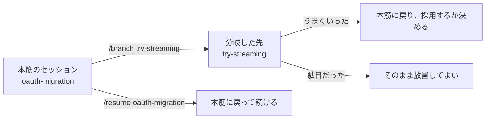

!!! abstract "要点"
    - **何ができるか**：セッションに名前を付けて、続きから再開したり、複製に分岐して別案を試したりできる。
    - **いつ引くか**：昨日の続きから始めたい、いまの会話を残して別案を試したい、長い作業を明日も続けたいとき。
    - **前提**：<!-- link:begin when-to-start-fresh -->[新しい会話を始めるタイミング](../context/when-to-start-fresh.md)<!-- link:end -->

<!-- textlint-disable -->
別名：セッションの再開・分岐・命名・--continue・/resume・/branch・/rename・--fork-session・--from-pr・セッションをブランチのように扱う
<!-- textlint-enable -->

セッションに名前を付けて再開・分岐する操作は、Claude Code が保存している会話を、名前で呼び戻して続け、必要なら複製して別の方向へ進める使い方である。会話は作業ごとに分け、戻る先を名前で見つけられるようにしておくと、本筋の会話が散らからない。この辞典は Claude Code を WSL・Linux の CLI で使う前提で書いており、デスクトップアプリや VS Code 拡張は、それぞれ別のセッション一覧を持つ（動作は未確認）。

## 使いどころ {#use-cases}

この機能が効くのは、1 つの会話に別々の話題が積もって、本筋が見えにくくなる場面である。原理は「見せる」で、防ぐ原因は「散らかっている」である。会話を作業ごとに分けて名前を付けると、いま見せたいものだけが文脈に残り、戻るときも探さずに済む。

- **翌日に続ける**：前日のセッションを呼び戻して、会話の履歴ごと続きから始める。
- **別案を試す**：いまの会話を複製して、元の会話に手を付けずに別の方向を試す。
- **話題を分ける**：関係のない作業は新しいセッションに分け、名前を付けて残す。いつ分けるかの判断は <!-- link:begin when-to-start-fresh#signals -->[新しい会話を始めるタイミング › 新しくする合図](../context/when-to-start-fresh.md#signals)<!-- link:end --> が持つ。

名前は、一覧で見分けるための札である。名前を付けても、会話の中身や守らせたい規則が変わるわけではない。

## 再開する {#resume}

セッションは作業の最中に保存され、終了した後や `/clear` の後でも呼び戻せる。入口は次の表のとおりである。

| 操作 | 何が起きるか |
| --- | --- |
| `claude --continue` | 現在のディレクトリで直近のセッションを開く |
| `claude --resume` | セッションの一覧（ピッカー）を開く |
| `claude --resume <名前>` | 名前のセッションを直接開く |
| `claude --from-pr <番号>` | そのプルリクエストに紐づくセッションに絞った一覧を開く |
| `/resume` | 動いているセッションの中から、別のセッションへ移る |

雛形は次のとおりである。名前の付け方と分岐の操作もまとめてある。

<!-- gen:begin snippet resume-and-branch/session-commands -->
<!-- textlint-disable -->

??? example "雛形：セッションの命名・再開・分岐のコマンド集"

    ```bash
    # 名前を付けて始める（名前は作業の目的が分かる短い語にする）
    claude -n oauth-migration

    # 翌日、同じディレクトリで直近のセッションを開く
    claude --continue

    # 一覧から選ぶ、または名前で直接開く
    claude --resume
    claude --resume oauth-migration

    # 元のセッションを残したまま、複製で再開する
    claude --continue --fork-session

    # 特定のプルリクエストに紐づくセッションを探す
    claude --from-pr 1234

    # セッションの中での操作
    #   /rename oauth-migration     いまのセッションに名前を付ける
    #   /resume oauth-migration     名前を指定して別のセッションへ移る
    #   /branch try-streaming       複製を作ってそちらへ移る
    #   /clear release-prep         いまのセッションに名前を付けて離れ、新しく始める
    ```

    動作を確かめていない雛形。要る最低の版：Claude Code 0.2.93。

<!-- textlint-enable -->
<!-- gen:end snippet resume-and-branch/session-commands -->

再開で戻るのは、会話の履歴、使っていたモデル、端末から再開したときの権限モードなどである。最初の起動で渡したフラグのうち、`--mcp-config`・`--settings`・`--plugin-dir`・`--add-dir` などは戻らないので、再開するときにもう一度渡す。`settings.json` のような設定ファイルは起動のたびに読み直されるので、渡し直しは要らない。

一覧には、現在の worktree のセッションが並ぶ。リポジトリの全 worktree に広げるには `Ctrl+W`、このマシンの全プロジェクトに広げるには `Ctrl+A` を押す。`claude -p` や Agent SDK で作ったセッションは、一覧と `--continue` の両方から外れる。セッション ID を `--resume` に渡せば開ける。

??? note "長い休みの後に「Resume this conversation?」と聞かれたとき"
    Pro・Max・Ultra のプランで、長い会話を長い休みの後やモデルを変えて再開すると、この確認が出ることがある。見積もりは、保存された会話だけが 5 時間の利用枠をどれだけ使うかの割合で表示される。

    次の作業が保存された会話を要するなら再開し、要らないなら新しい会話を選ぶ。新しい会話を選んでも、あとから `/resume` で戻れる。

!!! example "判断例：長い作業を明日も続けたい"
    - **状況**：認証の移行作業が 1 日では終わらず、明日の朝に続きを進めたい。会話はすでにかなり長い。
    - **迷う候補**：そのまま `claude --continue` で続ける。または、書き残す文書を作らせてから新しい会話で始める。
    - **選んだもの**：会話の履歴は残っていて足りるなら `--continue` で続ける。履歴が長く、試して駄目だったことが入り組んでいるなら、文書を作らせてから新しく始める。
    - **理由**：再開は履歴をそのまま戻す操作で、履歴に積もった古い前提も戻る。古い前提を持ち越さず、焦点の合った会話から始めたいときは、<!-- link:begin handoff-documents#four-items -->[handoff 文書と document-and-clear › 書かせる四項目](../context/handoff-documents.md#four-items)<!-- link:end --> の形で書き出すほうがよい。再開の手順は <!-- link:begin handoff-documents#resume -->[handoff 文書と document-and-clear › 新しい会話での再開の仕方](../context/handoff-documents.md#resume)<!-- link:end --> にある。

保存された記録は `~/.claude/projects/` の下に JSONL で置かれ、保持期間は <!-- fact:begin local-transcript-cleanup-days -->既定で 30 日（2026-11-05 時点）<!-- fact:end --> である（`cleanupPeriodDays` で変えられる）。期間を過ぎた記録は消えるので、何日も寝かせる作業は、書き残す文書も作っておく。記録から失った作業を探す順序は <!-- link:begin recover-lost-work#order -->セッション記録から失った作業を取り戻す › 探す順（準備中）<!-- link:end --> にある。

## 分岐して別案を試す {#branch}

分岐は、いまの会話の複製を作ってそちらへ移る操作で、元の会話はそのまま残る。本筋の道を失わずに別の方向を試すのに使う。セッションの中では `/branch` に任意の名前を付けて実行する。名前を省くと、会話の最初の依頼から名前が付く。端末からは `--continue` か `--resume` に `--fork-session` を足す。



図の要点は、分岐した先と本筋が別のセッションとして並び、どちらへも名前で戻れることである。git のブランチになぞらえると、分かれた先は互いに干渉せず、使い終えたら放置してよい。

分岐の確認には、新しいセッションと元のセッションの 2 つの ID が出る。元のセッションは `/resume <元の名前>` か ID の指定で戻れる。分岐した先には、分岐の時点までの会話の履歴が写される。「このセッションで許可」にした権限の承認は、`/branch` では同じプロセスの中なので引き継がれる。`--fork-session` で別のプロセスとして始めたときは、承認し直す。

分岐した先に渡す依頼の例は次のとおりである。`/branch` を実行した後の最初の依頼として出す。

<!-- gen:begin snippet resume-and-branch/branch-request -->
<!-- textlint-disable -->

??? example "雛形：分岐した先で別案を試す依頼"

    ```markdown
    ここまでの調査と決めたことは引き継いだうえで、{案の名前} の方向で実装を試してほしい。
    - 変えてよい範囲：{ファイルやディレクトリ}
    - 試す前に、いまの変更を {コミットの方法} で退避する
    - 終わったら、うまくいった点・駄目だった点・本筋の案と比べた差を 5 行以内でまとめる
    ```

    動作を確かめていない雛形。要る最低の版：Claude Code 0.2.93。

<!-- textlint-enable -->
<!-- gen:end snippet resume-and-branch/branch-request -->

!!! example "判断例：案 A で進めたが、案 B も試したい"
    - **状況**：ストリーミングなしで実装を進めていたところ、途中からストリーミング版のほうが良さそうに思えてきた。
    - **迷う候補**：`/branch` で分岐して案 B を試す。または、案 A の途中まで巻き戻して案 B に切り替える。
    - **選んだもの**：案 A を捨てる気がなく、比べてから決めたいなら `/branch`。案 A に見切りを付けたなら巻き戻す。
    - **理由**：分岐は両方の会話を残すので比べられる。巻き戻しは案 A の続きの会話を捨てるので、本筋が散らからない代わりに、後で 2 案を並べて比べることはできない。巻き戻しの範囲と限界は <!-- link:begin checkpoints-and-rewind#what-is-restored -->[チェックポイントと /rewind（git との違い） › 戻せるもの・戻せないもの](checkpoints-and-rewind.md#what-is-restored)<!-- link:end --> にある。

## 名前の付け方 {#naming}

名前は、セッションを一覧で見つけ、名前で直接再開するための札である。公式の文書も、`oauth-migration` のような名前を付けて、ブランチのように扱うことを勧めている（[Best practices](https://code.claude.com/docs/en/best-practices)）。複数の作業を並べるときに特に効く。

名前を付ける方法は次のとおりである。

- 起動のとき：`claude -n auth-refactor`
- セッションの中：`/rename auth-refactor`
- 一覧の中：セッションを選んで `Ctrl+R`
- `/clear` のとき：`/clear release-prep` のように名前を渡すと、離れるほうのセッションに名前が付き、新しいセッションは名前なしで始まる。無関係な作業の間で会話を新しくするときに、戻る先を残せる。

名前を付けなかったセッションは、最初の依頼から作られた題で一覧に並び、その題からも再開できる。ただし題は作業の目的を表すとは限らず、似た題が増えると見分けにくい。

名前の付け方の指針は次のとおりである。

- **作業の目的を書く**：`session2` や日付ではなく、`oauth-migration` のように何の作業かが読める語にする。
- **分岐には案の名前を付ける**：`try-streaming` のように、本筋と見分けられる語にする。
- **ブランチ名と揃える**：git のブランチ名、セッション名、作業の記録の名前を揃えると、成果の所在を見失いにくい（根拠：弱。実践者の勧め）。git での区切り方は <!-- link:begin working-with-git#granularity -->[git との付き合い方 › どこで区切るか](working-with-git.md#granularity)<!-- link:end --> が持つ。
- **同じ名前を使い回さない**：同じ名前が複数あると、名前を指定した再開でも一覧が開く（名前が検索語に入った状態で開く）。

## 効かない場面・落とし穴 {#pitfalls}

- **分岐が分けるのは会話であって、ファイルではない**：`/branch` は会話の記録を複製する操作である。作業ツリーのファイルを分ける仕組みとは書かれていないので、本筋と分岐した先が同じファイルを編集すると、互いの変更が混ざると読むのが安全である（この辞典の読み）。ファイルまで分けたいときは <!-- link:begin parallel-with-worktrees#when -->[git worktree で並列にする › 使いどころ](../delegate/parallel-with-worktrees.md#when)<!-- link:end --> を使い、試す前にコミットで退避する。
- **同じセッションを 2 つの端末で開かない**：分岐せずに同じセッションを 2 つの端末で再開すると、両方のメッセージが 1 つの記録に混ざる。並べたいなら、片方を `--fork-session` で複製する。
- **再開は古い前提も戻す**：履歴ごと戻るので、前日の誤解や撤回した方針も残る。話題が変わったなら、再開せず新しく始める（<!-- link:begin when-to-start-fresh#signals -->[新しい会話を始めるタイミング › 新しくする合図](../context/when-to-start-fresh.md#signals)<!-- link:end -->）。
- **再開で戻らない設定がある**：最初の起動で渡したフラグの一部は戻らない。再開の手順書に、渡し直すフラグも書いておく。
- **別の面のセッションは別の一覧**：デスクトップアプリ、claude.ai/code、VS Code 拡張は、それぞれ自分の一覧を持つ。この辞典は CLI を基準にし、ほかの面の動作は未確認である。
- **記録は消える**：保持期間を過ぎると、再開できなくなる。大事な状態は、会話の外の文書やコミットにも残す。

## 比べる相手 {#compare}

- **チェックポイントと `/rewind`**：同じセッションの中で、過去の時点に戻る。分岐は、会話を残したまま別の道を作る。使い分けは <!-- link:begin checkpoints-and-rewind#compare -->[チェックポイントと /rewind（git との違い） › 比べる相手](checkpoints-and-rewind.md#compare)<!-- link:end --> にある。
- **handoff 文書**：会話を捨てて、書き出した文書から新しく始める。履歴を持ち越したくない長い作業に向く（<!-- link:begin handoff-documents#vs-compact -->[handoff 文書と document-and-clear › /compact との使い分け](../context/handoff-documents.md#vs-compact)<!-- link:end -->）。
- **git のブランチと worktree**：コードを分ける。会話の分岐とは別の層なので、組み合わせて使う（<!-- link:begin parallel-with-worktrees#compare -->[git worktree で並列にする › 比べる相手](../delegate/parallel-with-worktrees.md#compare)<!-- link:end -->）。
- **背景セッション**：見張らない独立した作業を並行して走らせる（<!-- link:begin agent-view-and-background#what-fits -->[agent view と背景セッション › 向く作業と向かない作業](../delegate/agent-view-and-background.md#what-fits)<!-- link:end -->）。
- **クラウドセッション**：手元を閉じても続ける（<!-- link:begin cloud-sessions-and-teleport#what-to-send -->[クラウドセッションと teleport › クラウドに送ってよい作業](cloud-sessions-and-teleport.md#what-to-send)<!-- link:end -->）。

## 古くなった助言 {#outdated}

「`/fork` で会話を分岐する」という助言は古い。会話の分岐のコマンドは、<!-- name:begin fork-renamed-branch -->/branch（今の /fork は、会話を新しい背景のセッションに写す別の機能）<!-- name:end --> である。記事や手順書の `/fork` が会話の分岐を指すなら、`/branch` に読み替える。今の `/fork` で写したセッションは agent view に並ぶ（<!-- link:begin agent-view-and-background -->[agent view と背景セッション](../delegate/agent-view-and-background.md)<!-- link:end -->）。

<!-- link:begin outdated-advice-ledger#fork-to-branch -->[古くなった助言の台帳](../changes/outdated-advice-ledger.md#fork-to-branch)<!-- link:end -->

<!-- gen:begin references -->
<!-- textlint-disable -->

## 参考 {#references}

- [Manage sessions](https://code.claude.com/docs/en/sessions)：Anthropic・英語・確認日 2026-11-04
- [Commands](https://code.claude.com/docs/en/commands)：Anthropic・英語・確認日 2026-11-04
- [Data usage](https://code.claude.com/docs/en/data-usage)：Anthropic・英語・確認日 2026-11-04
- [Best practices for Claude Code](https://code.claude.com/docs/en/best-practices)：Anthropic・英語・確認日 2026-11-04
- [Changelog](https://github.com/anthropics/claude-code/blob/main/CHANGELOG.md)：Anthropic・英語・確認日 2026-11-04
- [Claude Code changelog](https://code.claude.com/docs/en/changelog)：Anthropic・英語・確認日 2026-11-04

<!-- textlint-enable -->
<!-- gen:end references -->

<!-- gen:begin page-links -->
<!-- textlint-disable -->

<div class="ca-page-links" markdown>

**前提**

- [新しい会話を始めるタイミング](../context/when-to-start-fresh.md)

**次に読む**

- セッション記録から失った作業を取り戻す（準備中）

**関連**

- [handoff 文書と document-and-clear](../context/handoff-documents.md)
- [チェックポイントと /rewind（git との違い）](checkpoints-and-rewind.md)
- [git との付き合い方](working-with-git.md)
- [git worktree で並列にする](../delegate/parallel-with-worktrees.md)
- [agent view と背景セッション](../delegate/agent-view-and-background.md)
- [クラウドセッションと teleport](cloud-sessions-and-teleport.md)

</div>

<!-- textlint-enable -->
<!-- gen:end page-links -->
