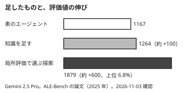

!!! abstract "要点"
    - **何が分かるか**：AI は一部の大会で人の最上位に並んだが、全形式ではない。勝ち方は大量の試行と局所評価による選別で、人の寄与は枠と評価に残る。
    - **いつ引くか**：AI が大会で優勝したと聞いて、自分の大会でも同じことができるか考えているとき。AI がどこまで勝てるのかを知りたいとき。「考察は人にしかできない」と思って AI をほとんど使っていないとき。
    - **前提**：なし

<!-- textlint-disable -->
別名：AI の大会の成績・AI はコンテストで勝てるか
<!-- textlint-enable -->

AI はコンテストでどこまで来たかを、確認日付きで整理するページである。成績の一覧は月単位で古くなるので、成績そのものより、そこから取り出せる構造を本体にする。取り出すのは、勝ち方・届かなかった場面・人の寄与・規則の中で持ち込めるものの 4 つである。成績がどの速さで古くなるかは、<!-- link:begin dating-information#layers -->[いつの情報かを見分ける › 古くなる速さの三つの層](../changes/dating-information.md#layers)<!-- link:end --> で分かる。

## 確認日付きの成績 {#dated-results}

AI の大会の成績のうち、出典を確かめたものを日付付きで並べる。調査資料での確認日は 2026-11-03 から 2026-11-05 である。大会の成績は報道と企業の発表が中心で、主催者の公式の順位表で確かめきれていないものがある。根拠の強さは各行の印で示す。

| 大会 | 時期 | 何が起きたか |
| --- | --- | --- |
| AtCoder Heuristic Contest 058（AHC058。AHC は AtCoder の最適化系コンテストで、これは 4 時間の短期戦） | 2025-12-14 | Sakana AI の ALE-Agent が人間の参加者を抑えて 1 位になった。運営の許可を得て、人と同じ規則で出た。AI が AHC で優勝した最初の例とされる（根拠：中。企業の一次の報告） |
| AtCoder World Tour Finals 2026 Heuristic（AWTF 2026 Heuristic） | 2026-07-07〜08 | 決勝は 12 名。AI との対戦はエキシビションで、OpenAI は順位表に載っていない。OpenAI が人の出場者を大きく上回ったと報じられた。運営は人に有利な問題を選んだとも報じられた（根拠：弱。二次の報道） |
| ICPC World Finals 2025 | 2025-09-17 発表 | Google DeepMind が、Gemini が 12 問中 10 問を解いた（金メダル相当）と発表した。ICPC が確認したのは、提出した解が完全で受理されたことまでである。DeepMind のシステム・手順・モデルの検証には及ばない（根拠：中。企業の一次の報告） |
| 公開 CTF（PicoCTF 2025、PlaidCTF、DEF CON CTF 予選） | 2025 年 | Anthropic が Claude を出した結果。PicoCTF 2025 では上位 3% に入った。PlaidCTF と DEF CON CTF 予選では 0 問だった（根拠：中。企業の一次の報告。Claude のモデルと世代は報告で確かめる） |

- 表の外の記録として、ALE-Bench（AtCoder 型の長期最適化問題 40 問の評価の基盤）の論文が 2025 年に出ている。この結果は次の節で扱う
- 載せていない成績（ほかの大会での OpenAI の問題数、IOI の順位相当など）は、一次資料を確かめていないので載せない
- AWTF 2026 Heuristic で人が負けた、という読み方はしない。決勝の 12 名は人の出場者で、OpenAI の対戦は別枠のエキシビションである。出場していなかった競技者が観戦者として X に書いた言葉も、出場者の言葉ではない

## 勝ち方の構造（大量の試行と局所評価による選別） {#how-ai-wins}

AI の勝ち方は、1 回の賢い解答ではなく、候補を大量に作って局所評価で選ぶ反復である。AHC058 の ALE-Agent は、2 つのモデルを合わせて数千回呼び出した（根拠：中。企業の一次の報告）。呼び出しの数がそのまま、試す候補の数になる。

この構造を分けて測ったのが、ALE-Bench の論文のアブレーション（要素を 1 つずつ足して効きを見る実験）である。Gemini 2.5 Pro で、素のエージェントの評価値は 1167。知識を注入すると 1264 で、約 100 の伸びにとどまる。選んだ親ごとに 30 個の子を作り、固定の 50 ケースで局所評価して選ぶ探索を足すと 1879（上位 6.8%）で、約 600 伸びた（根拠：強。論文本文。付録 B.2 に探索の細部がある）。

図の読み方は 1 つで、知識を足す（見せる）より評価のループを回す（確かめる）ほうが効いた、ということである。これは原理「確かめる」のコンテスト側からの裏づけにあたる。AI は評価器が定める問題を、置かれたループの速さで解く。評価器が現実とずれていれば、そのずれも同じ速さで増える。この性質は <!-- link:begin verifier-defines-problem#loops-amplify -->[検証器が問題を定義する（Claude は置かれたループを何でも加速する） › ループは何でも速める](../eval/verifier-defines-problem.md#loops-amplify)<!-- link:end --> で扱っている。

読むときの注意が 2 つある。

- 独立した 150 回の一発生成との比較は、6 問だけで行われた。全問の結論としては読まない
- 数値は Gemini 2.5 Pro と 2025 年の論文の固定の記録である。今のモデルの強さの目安にはしない

## 届かなかった場面 {#where-ai-falls-short}

「AI はほぼ全形式でトップに並んだ」とは言えない。人の最上位に並ぶか上回った記録は、確かめた範囲で AHC058 と AWTF 2026 Heuristic のエキシビションにある。それ以外の場面では、届かなかった例を並べるほうが実態に近い。

- **難しい CTF**：Anthropic が Claude を公開 CTF に出した報告では、PlaidCTF と DEF CON CTF 予選で 0 問だった。最も難しい課題では、最上位の人のチームに及ばなかった（根拠：中。企業の一次の報告）
- **問題ごとのばらつき**：ALE-Bench の論文では、平均が高くても問題によって崩れる。同じ平均レーティング帯の人が 56.2% の問題で 1600 以上を出せるのに対し、o4-mini-high は 32.5% にとどまった。短期戦の平均 1677 に対し、長期戦は 1307 だった（根拠：強。論文本文。o4-mini-high と 2025 年の論文の結果）
- **対戦型と数か月のチーム戦**：確かめた範囲に、直接のデータがない。隣接する形式からの類推になるので、断定しない（類推）

形式によって AI の効き方が違う理由は、<!-- link:begin format-cheatsheet#why-formats-differ -->[コンテストの形式別の早見表（AI の効き方と人が握るところ） › 形式で効き方が違う理由（五つの軸）](format-cheatsheet.md#why-formats-differ)<!-- link:end --> の 5 つの軸で整理されている。自分の大会の形式で AI が効くかは、優勝の記事ではなく、その軸に照らして見る。

## 人の寄与が残ったところ {#human-contributions}

AI が勝った場面でも、人の寄与が消えたわけではない。残っているのは、枠と評価を作る部分である。これは原理「握る」にあたる。

- **ICFP Programming Contest 2025 の 1 位（Team Unagi）**：人が全体戦略、手書きの SAT エンコーディング、テスト基盤を作った。ShinkaEvolve（Sakana AI の進化的探索の道具）は、その枠の中だけで、320 試行・約 60 ドルのソルバの進化を担った。人が枠と評価を作り、AI が量を回す分業である（根拠：中。企業の一次の報告）
- **AHC058 の作問者の見立て**：貪欲法に必要と想定した実験的な洞察は、エージェントのログに見られなかった。貪欲部分の考察の精度は人のほうが上だった、とも述べている（根拠：中。作問者の発言）

「考察は人にしかできない」とは言えない。AWTF 2026 Heuristic では、AI が人の出場者を大きく上回ったと報じられている（根拠：弱。二次の報道）。問うべきは、案の出どころではなく、誰がどの評価で採ったかである。この分け方は <!-- link:begin what-not-to-delegate#who-adopted -->[任せないもの（評価・採否・撤退・中核の理解） › 案の出どころより、誰がどの評価で採ったか](../delegate/what-not-to-delegate.md#who-adopted)<!-- link:end --> にある。逆に、考察を AI に任せきりにして評価を自分で握らない使い方も、この節の事例からは支持されない。人が評価と採否を握り、案の量は AI に回させる。

AI の案は、同じ道具を使う人にも出る案になりやすい。差をつけたい場面の扱いは、<!-- link:begin ai-ideas-are-everyones#when-difference-matters -->[AI の案は「みんなの案」（均質化） › 差が要る場面と、底上げで足りる場面](../judgment/ai-ideas-are-everyones.md#when-difference-matters)<!-- link:end --> で扱っている。

## 規則の中で持ち込めるもの {#what-you-can-reuse}

規則の範囲で人が再現できるのは、物量ではなく構造である。具体的には、評価環境の上でフィードバック付きの反復を回すことで、持ち込めるのは人が回す局所評価のループである。

- **評価器を先に作る**：愚直解との比較、公式とスコアが一致するテスタなど、形式ごとの最初の成果物は評価器である。形式別の中身は <!-- link:begin evaluators-by-format#evaluator-first -->[形式別の評価器（テスタ・ベンチマーカー・CV・flag・対戦場） › どの形式でも、最初の成果物は評価器](evaluators-by-format.md#evaluator-first)<!-- link:end --> にある
- **AI のループ自体を禁じる大会では、人が回す**：AI に候補を作らせて選ばせるループは、そのまま持ち込めない。人が書いたテスタで、人が候補を比べる形に落とす。どの大会が禁止・部門分け・許可と開示のどれかは、<!-- link:begin competition-rules#rules-by-type -->[大会の規則の早見（禁止・部門分け・許可と開示） › 類型ごとの大会（確認日付き）](competition-rules.md#rules-by-type)<!-- link:end --> で版と確認日付きで引く
- **AI 単独の優勝は、真似る方法ではない**：1 位になった事例は、構造の例として読む。同じ規模で呼び出す方法は、規則の中でも手元の予算の中でも再現しない

!!! example "判断例：短期のヒューリスティック大会に出る前の準備"
    - **状況**：AI が AHC で優勝した記事を読んだ。次に出る短期の大会で AI をどう使うか決めたい。規則は、その大会の公式で読んである。
    - **迷う候補**：A は方針を自分で考え、Claude には実装だけを頼む。B は先に公式とスコアが一致するテスタを立て、Claude には候補の生成と比較を任せ、採否は自分で決める。
    - **選んだもの**：B。ただし、規則が AI の利用を禁じる部門なら、AI は練習にだけ使う。
    - **理由**：優勝の事例が示したのは、方針を誰が考えたかの効きではなく、局所評価で選ぶ反復の効きである。A は評価の手段がなく、案の数が人の手の速さで頭打ちになる。B は優勝の構造を、人が回せる量に縮めて持ち込む形である。A が悪いわけではなく、テスタを立てる時間が取れないときは A でも筋が通る。

評価を自分で握り、AI に回させる輪の作り方は、<!-- link:begin agent-loop#close-the-loop -->[エージェントループと tool use › 合否を返すものを渡してループを閉じる](../basics/agent-loop.md#close-the-loop)<!-- link:end --> にある。

<!-- gen:begin references -->
<!-- textlint-disable -->

## 参考 {#references}

- [Sakana AI Agent Wins AtCoder Heuristic Contest (First AI to Place 1st)](https://sakana.ai/ahc058/)：Sakana AI・英語・確認日 2026-11-04
- [Towards Automating Long-Horizon Algorithm Engineering for Hard Optimization Problems](https://sakana.ai/ale-bench/)：Sakana AI・英語・確認日 2026-11-04
- [ALE-Bench: A Benchmark for Long-Horizon Objective-Driven Algorithm Engineering](https://arxiv.org/abs/2506.09050)：arXiv（Imajuku, Yuki ほか）・英語・確認日 2026-11-04
- [Claude is competitive with humans in (some) cyber competitions](https://www.anthropic.com/research/cyber-competitions)：Anthropic・英語・確認日 2026-11-04
- [An OpenAI model crushed top human programmers at a world coding competition](https://www.understandingai.org/p/an-openai-model-crushed-top-human)：Understanding AI・英語・確認日 2026-11-04
- [After Finishing 2nd Last Year, OpenAI Is Dominating The AtCoder Coding Competition 2026](https://officechai.com/ai/after-finishing-2nd-last-year-openai-is-dominating-the-atcoder-coding-competition-2026/)：OfficeChai・英語・確認日 2026-11-04
- [ShinkaEvolve in Action: How a Human-AI Partnership Conquered a Coding Challenge](https://sakana.ai/icfp-2025/)：Sakana AI・英語・確認日 2026-11-04
- [Gemini achieves gold-medal level at the International Collegiate Programming Contest World Finals](https://deepmind.google/blog/gemini-achieves-gold-medal-level-at-the-international-collegiate-programming-contest-world-finals/)：Google DeepMind・英語・確認日 2026-11-05

<!-- textlint-enable -->
<!-- gen:end references -->

<!-- gen:begin page-links -->
<!-- textlint-disable -->

**前提**

- なし

**関連**

- [コンテストの形式別の早見表（AI の効き方と人が握るところ）](format-cheatsheet.md)
- [形式別の評価器（テスタ・ベンチマーカー・CV・flag・対戦場）](evaluators-by-format.md)
- [検証器が問題を定義する（Claude は置かれたループを何でも加速する）](../eval/verifier-defines-problem.md)
- [大会の規則の早見（禁止・部門分け・許可と開示）](competition-rules.md)
- [任せないもの（評価・採否・撤退・中核の理解）](../delegate/what-not-to-delegate.md)
- [AI の案は「みんなの案」（均質化）](../judgment/ai-ideas-are-everyones.md)
- [エージェントループと tool use](../basics/agent-loop.md)
- [いつの情報かを見分ける](../changes/dating-information.md)

<!-- textlint-enable -->
<!-- gen:end page-links -->
