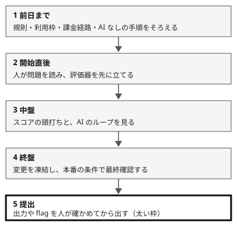

!!! abstract "要点"
    - **何ができるか**：前日から提出までの各段で、何を確かめ、何を人が握るかを順に進め、AI が止まっても提出できる状態を保てる。
    - **いつ引くか**：AI を使ってよい大会の本番に出る。終了間際の変更で、提出したものが壊れていた。大会の途中で、AI の利用上限や障害に当たらないか不安である。
    - **前提**：<!-- link:begin competition-rules -->[大会の規則の早見（禁止・部門分け・許可と開示）](competition-rules.md)<!-- link:end -->、<!-- link:begin evaluators-by-format -->[形式別の評価器（テスタ・ベンチマーカー・CV・flag・対戦場）](evaluators-by-format.md)<!-- link:end -->

<!-- textlint-disable -->
別名：コンテスト当日の進め方・本番での AI の使い方
<!-- textlint-enable -->

本番の運用は、AI を使ってよい大会の当日を、前日・開始直後・中盤・終盤・提出の 5 段に分けて進める手順である。本番で効くのは、AI の性能そのものより、規則の確認と準備、序盤の速さ、AI が止まっても続けられること、終盤の保守性である。大会中に AI の上限や障害に当たった参加記は見つかっておらず、このページは、個別の大会の事例と隣接分野の事後報告からの推論である（推論）。AI の利用を禁じる部門や大会では、AI に頼む部分は使えないが、人が握る段と AI なしで続ける備えはそのまま使える。



上の図の 5 段が、このページの手順の順である。各段の終わりに、何で終わったかの確かめを置く。

## 先に整える守り {#guards}

本番の運用で先に整える守りは、確かめる手段、縛る手段、人が握る判断の 3 つである。本番では AI を並べて任せ、途中で舵を取る。任せる幅が広いので、見合う守りを手順より先に決める。

- **確かめる**：開始直後に評価器（点や正しさを、提出の前に自分で測る道具）を立て、AI の「できた」でなく評価器の結果と人の目で判断する。形式ごとの評価器は <!-- link:begin evaluators-by-format#evaluator-first -->[形式別の評価器（テスタ・ベンチマーカー・CV・flag・対戦場） › どの形式でも、最初の成果物は評価器](evaluators-by-format.md#evaluator-first)<!-- link:end --> にある。確かめを任せる幅の選び方は <!-- link:begin verification-ladder#choose-step -->[検証の階段 › 任せる幅に合わせて段を選ぶ](../verify/verification-ladder.md#choose-step)<!-- link:end --> で引く。
- **縛る**：終盤の編集の禁止は、CLAUDE.md の「お願い」でなく、権限ルールの deny で止める。CLAUDE.md には規約の要旨と、相談する基準だけを書く。止め方は <!-- link:begin freeze-eval-assets#how-to-freeze -->[評価資産を凍結し、触れる範囲を絞る › 設定で止める（権限ルール・サンドボックス・ファイルの権限）](../enforce/freeze-eval-assets.md#how-to-freeze)<!-- link:end --> にある。deny ルールだけでは子プロセスを止められないので、効き方と限界は <!-- link:begin permission-rules#child-processes -->[権限ルール（allow・ask・deny） › 子プロセスには効かない](../enforce/permission-rules.md#child-processes)<!-- link:end --> で確かめる。
- **人が握る**：規則の境界と、方針を捨てる判断は、人が持つ。前者は <!-- link:begin competition-rules#hold-the-boundary -->[大会の規則の早見（禁止・部門分け・許可と開示） › 規則の境界を人が握る](competition-rules.md#hold-the-boundary)<!-- link:end -->、後者は <!-- link:begin decide-when-to-quit#what-you-hold -->[やめどきを先に決める（撤退基準を着手前に書き、実装者以外が判定する） › 人が握るもの](../judgment/decide-when-to-quit.md#what-you-hold)<!-- link:end --> を見る。

この 3 つが効かないと、終盤の「あと少し直せば」が積み重なり、直前の変更で提出物が壊れる。守りはどれも、前日までに用意できる。

## 前日までに {#day-before}

前日までにするのは、規則を読み、環境と利用枠をそろえ、AI なしで続ける手順を書いておくことである。本番の最中は判断に使える時間が少ないので、決められることは前日に決める。

1. 規則・部門・当日マニュアルを、主催者の一次資料で読む。大会ごとの類型と確認日は <!-- link:begin competition-rules#rules-by-type -->[大会の規則の早見（禁止・部門分け・許可と開示） › 類型ごとの大会（確認日付き）](competition-rules.md#rules-by-type)<!-- link:end -->、版が未確認の大会で出る前にすることは <!-- link:begin competition-rules#unverified-versions -->[大会の規則の早見（禁止・部門分け・許可と開示） › 大会ごとの規則のページと、出る前に確かめること](competition-rules.md#unverified-versions)<!-- link:end --> にある。事前の環境確認や当日マニュアルが規則に関わる大会もある（例：ISUCON2026 のレギュレーション。一次資料は出典を見る）。条文はこのページで要約しない。読んだ日付を残す。
2. CLAUDE.md に、規約の要旨と禁止事項を書く。これはお願いなので、破られて困るものは縛る手段（deny ルール）に回す。
3. 実行環境と提出環境を確かめる。再起動した後に動くか、通信が要るか、時間制限は何かを見る。
4. 利用枠と課金の経路を確かめる。プランと API キーのどちらで課金されるかは <!-- link:begin check-billing-path#check-current-path -->[課金の経路を確かめる（API キーとサブスクリプション） › 今の経路を確かめる](../cost/check-billing-path.md#check-current-path)<!-- link:end -->、枠を早く使う要因は <!-- link:begin what-uses-up-limits#find-what-uses-it -->[上限を早く使う要因 › /usage の内訳の読み方（自分の場合を確かめる）](../cost/what-uses-up-limits.md#find-what-uses-it)<!-- link:end --> で確かめる。並列で回す量を前日に決める。
5. オフラインで使える資料（印刷物、ライブラリ、愚直解のひな形）をそろえる。
6. AI なしで続ける作業の一覧を書く。中身は <!-- link:begin when-ai-is-unavailable#minimum-without-ai -->[AI が使えないときの備え（障害・上限） › AI なしで最低限を進められる状態](../cost/when-ai-is-unavailable.md#minimum-without-ai)<!-- link:end --> を見て、このページの「AI が止まっても続けられる備え」の節に合わせる。
7. 競技中の衛生を決める。リポジトリは private にし、共有リンクを無効にし、公開ページへ出力しない。問題文や資料に AI 向けの指示が仕込まれていた場合は <!-- link:begin instructions-hidden-in-materials#check-rules -->[課題資料・問題文に仕込まれた指示 › 規則を先に確かめる](../safety/instructions-hidden-in-materials.md#check-rules)<!-- link:end --> に従う。アカウントの学習利用の設定は、規則と照らして確かめる（類推）。
8. 凍結の時刻と、方針を捨てる基準を決める。基準は着手の前に書く（<!-- link:begin decide-when-to-quit#write-criteria-first -->[やめどきを先に決める（撤退基準を着手前に書き、実装者以外が判定する） › 基準を着手前に書く](../judgment/decide-when-to-quit.md#write-criteria-first)<!-- link:end -->）。

次の雛形は、前日に埋めてチームで共有する手順表である。

<!-- gen:begin snippet competition-day-operations/day-runbook -->
<!-- textlint-disable -->

??? example "雛形：本番の手順表（前日・開始直後・中盤・終盤・提出）"

    ```markdown
    本番の手順表（チームの共有メモに置く。空欄は前日までに埋める）

    | 段 | 確かめること | AI に頼むこと | 終わりの確かめ |
    | --- | --- | --- | --- |
    | 前日まで | 規則・部門・当日マニュアルを一次資料で読んだ日：（日付）／利用枠の残り：（確認日）／課金の経路：（確認日） | AI なしで続ける作業の一覧の下書き | 一覧が埋まり、チーム全員が読んだ |
    | 開始直後 | 問題を読んだのは人（担当：　）／評価器の種類：（テスタ・ベンチ・CV・flag など） | ひな形・パーサ・可視化の下書きを並列で | 評価器が既知の入力で期待値と合い、単純な版が 1 つ提出済み |
    | 中盤 | スコアを見る間隔：（自分で決めた間隔）／直近の変更と評価器の結果 | 仮説ごとの小さな実験 | 次に見る時刻が決まり、頭打ちなら方針を見直す人が決まっている |
    | 終盤 | 凍結する時刻：（日時）／良い版のタグ：（名前） | 凍結後は頼まない（頼むなら差分を人が読む） | タグの版から提出物を作り直し、本番の条件で動いた |
    | 提出 | 出力や flag を人が確かめた／誤答の扱いを規則で確かめた | 確かめ方の候補を挙げさせる（判定は人） | 提出後の画面の結果が、提出した版の印と合った |

    AI が止まったとき：（切り替え先と、続ける人の名前）
    ```

    動作を確かめていない雛形。

<!-- textlint-enable -->
<!-- gen:end snippet competition-day-operations/day-runbook -->

**終わりの確かめ**：手順表の空欄がすべて埋まり、チーム全員が読んだ。規則を読んだ日付が残っている。

## 開始直後：人が読み、評価器を先に {#opening}

開始直後の最初の作業は、人が問題を読み、評価器を先に立てることである。「最初の成果物は評価器」を本番に当てはめた形で、評価器がない状態で版を重ねると、どの変更が効いたのかを後から判断できない。

1. 人が問題文を読む。読み違いは、評価器の設計に混ざって後まで残る。
2. 形式に合う評価器を立てる。短時間のアルゴリズムは愚直解との比較（<!-- link:begin evaluators-by-format#stress-test -->[形式別の評価器（テスタ・ベンチマーカー・CV・flag・対戦場） › 短時間のアルゴリズム：愚直解との比較](evaluators-by-format.md#stress-test)<!-- link:end -->）、ヒューリスティックは公式のスコアと一致するテスタ（<!-- link:begin evaluators-by-format#tester -->[形式別の評価器（テスタ・ベンチマーカー・CV・flag・対戦場） › ヒューリスティック：公式とスコアが一致するテスタ](evaluators-by-format.md#tester)<!-- link:end -->）、CTF は提出の前の flag の検証（<!-- link:begin evaluators-by-format#flag -->[形式別の評価器（テスタ・ベンチマーカー・CV・flag・対戦場） › CTF：提出の前の flag の検証](evaluators-by-format.md#flag)<!-- link:end -->）を見る。機械の評価器がない大会は <!-- link:begin evaluators-by-format#no-mechanical-evaluator -->[形式別の評価器（テスタ・ベンチマーカー・CV・flag・対戦場） › ハッカソン：機械の評価器がないとき](evaluators-by-format.md#no-mechanical-evaluator)<!-- link:end --> を見る。
3. AI には、定番の初手（ひな形、パーサ、インデックス、可視化）を並列で作らせる。
4. 早めに単純な版を提出し、採点の流れを一度通す。

序盤の速さは AI の強みで、開始の遅れは順位に響く。Anthropic は、HackTheBox の CTF（2025 年 3 月）で Claude の参加が 32 分遅れたと報告している。定刻なら 161 チーム中 22 位、AI 8 チーム中 1 位だったと推定している（根拠：弱。ベンダー自身の反実仮想の推定で、CTF の 1 例）。

次の雛形は、最初の依頼で評価器を先に出させる例である。指示はお願いなので、解法が先に出ることがある。そのときは依頼を出し直さず、評価器の設計を人が先に書く。

<!-- gen:begin snippet competition-day-operations/opening-request -->
<!-- textlint-disable -->

??? example "雛形：開始直後に評価器を先に立てさせる依頼"

    ```markdown
    この大会は AI の利用を許す部門で出ています。開始直後の最初の作業は、解法を出すことではなく、評価器を立てることです。

    - 問題文は私が読みます。あなたは、評価器の設計案を先に出してください（何を入力にし、何を点や合否として返すか）
    - 公式の採点と食い違いそうな点（丸め・制限・入力の形式）を、設計案の中に挙げてください
    - 評価器ができたら、ひな形・パーサ・可視化など定番の初手を、私の指示した分だけ作ってください
    - 最初は単純な版でよいので、評価器で点を測れる状態にしてください。提出するかどうかは私が決めます
    - 解法を変えるときは、変更前後の評価器の結果を並べて見せてください

    問題文または URL：（貼る）
    形式：（アルゴリズム・ヒューリスティック・性能改善・CTF など）
    使ってよい道具と制限：（大会の規則から転記する）
    ```

    動作を確かめていない雛形。

<!-- textlint-enable -->
<!-- gen:end snippet competition-day-operations/opening-request -->

**終わりの確かめ**：評価器が、既知の入力で期待値（公式の例や愚直解）と合う。単純な版が 1 つ提出され、採点結果が見えている。

## 中盤：頭打ちとループを見る {#midgame}

中盤は、一定の間隔でスコアの推移を見て、頭打ちを判断する段である。間隔は前日に自分たちで決める。AI が同じ確認を繰り返していたら、人が仮説を入れ直すか、新しい会話に切り替える。

- 頭打ちは、方針を疑う合図である。続けるか捨てるかの見方は <!-- link:begin decide-when-to-quit#plateau -->[やめどきを先に決める（撤退基準を着手前に書き、実装者以外が判定する） › 頭打ちは方針を疑う合図](../judgment/decide-when-to-quit.md#plateau)<!-- link:end -->、変えすぎの失敗は <!-- link:begin decide-when-to-quit#dont-switch-too-often -->[やめどきを先に決める（撤退基準を着手前に書き、実装者以外が判定する） › 変えすぎも失敗](../judgment/decide-when-to-quit.md#dont-switch-too-often)<!-- link:end --> にある。
- AI が同じ失敗や同じ確認を繰り返すときは、原因を安く確かめる順に進める。<!-- link:begin going-in-circles#diagnosis -->[同じ失敗を繰り返す（堂々巡り） › 原因を安く確かめる順](../symptoms/going-in-circles.md#diagnosis)<!-- link:end -->、<!-- link:begin stuck-in-a-check-loop#diagnosis -->[同じ確認のループにはまる › 原因を安く確かめる順](../symptoms/stuck-in-a-check-loop.md#diagnosis)<!-- link:end --> を見る。
- 新しい会話に移す合図と、移す前に残すものは <!-- link:begin when-to-start-fresh#signals -->[新しい会話を始めるタイミング › 新しくする合図](../context/when-to-start-fresh.md#signals)<!-- link:end -->、<!-- link:begin when-to-start-fresh#before-clearing -->[新しい会話を始めるタイミング › 新しくする前に残すもの](../context/when-to-start-fresh.md#before-clearing)<!-- link:end --> にある。新しくしても、利用枠の上限は戻らない（<!-- link:begin when-to-start-fresh#what-does-not-reset -->[新しい会話を始めるタイミング › 新しくしても戻らないもの（上限・記憶）](../context/when-to-start-fresh.md#what-does-not-reset)<!-- link:end -->）。

ISUCON の自律エージェントを試した報告では、3〜4 時間たった頃に、ベンチとスコアの確認のループに 1 時間以上はまった。報告者は、手法の知識や検索を与えて、新しい仮説を入れることを提案している（根拠：弱。単独の報告）。

!!! example "判断例：スコアが動かなくなったとき"
    - **状況**：評価器のスコアがしばらく動かない。AI は同じ種類の微調整を提案し続けている。
    - **迷う候補**：このまま微調整を続ける。方針ごと切り替える。
    - **選んだもの**：人が最近の変更と評価器の結果を並べて読み、微調整の余地が残るかを判断する。残らないなら、新しい仮説を人が 1 つ書いて、新しい会話で試す。
    - **理由**：頭打ちの原因が方針にあるなら、微調整を重ねても動かない。一方、切り替えすぎも失敗なので、変更ごとの結果を残して比べられる状態にしておく。

**終わりの確かめ**：次にスコアを見る時刻が決まっている。直近の変更ごとに、評価器の結果が残っている。

## 終盤：凍結と最終確認 {#endgame}

終盤は、変更を凍結し、既知の良い版にタグを付け、本番の条件で最終確認する段である。前日に決めた時刻からは、新しい変更を入れない。

1. 凍結の時刻に、いちばん良い版にタグを付ける。以後の提出物は、このタグの版から作る。
2. 本番の条件で最終確認する。再起動、提出環境、時間制限、通信を含めて、提出物が動くかを見る。
3. 直前のエージェントによる編集は禁止するか、差分を人が読む。禁止は deny ルールで止める（<!-- link:begin freeze-eval-assets#how-to-freeze -->[評価資産を凍結し、触れる範囲を絞る › 設定で止める（権限ルール・サンドボックス・ファイルの権限）](../enforce/freeze-eval-assets.md#how-to-freeze)<!-- link:end -->）。凍結が効いているかの確かめは <!-- link:begin freeze-eval-assets#check -->[評価資産を凍結し、触れる範囲を絞る › 凍結が効いているかを確かめる](../enforce/freeze-eval-assets.md#check)<!-- link:end --> にある。
4. 対戦型の大会では、旧版を保存しておき、新版と対戦させてから採用する。悪ければロールバックする。採否の決め方は <!-- link:begin long-team-competitions#adoption -->チーム戦の運用（長期・対戦型）<!-- link:end --> を見る。

終盤の失敗は、事後報告に繰り返し出る。予選の直前に入れた危うい変更が残った。版の更新で必要なコードを誤って消した。最後の調整で、味方に依存する処理を壊した。こうした報告がある（根拠：中。Battlecode の参加チームの複数の事後報告。AI 以前の対戦型で、AI を使う本番へは類推）。別の報告は、締切の直前に未テストのボットを上げてはいけないと書いている。

数か月に及ぶチーム戦では、凍結の時期も早く、リハーサルも複数回になる。そちらは <!-- link:begin long-team-competitions#freeze-and-rehearse -->チーム戦の運用（長期・対戦型）<!-- link:end --> に任せる。本番の 1 か月前などの数字は、出典のない例として扱う。

!!! example "判断例：凍結の後に AI が改善を提案したとき"
    - **状況**：凍結の時刻を過ぎた後、AI が「ここを直せば、もう少し伸びる」と提案した。終了までまだ時間がある。
    - **迷う候補**：凍結を守る。評価器で確かめて、差分を読んでから入れる。
    - **選んだもの**：凍結を守る。入れるなら別の枝で作り、評価器で旧版より良いことと、本番の条件で動くことを確かめ、人が差分を読み終えてからにする。
    - **理由**：終盤の変更は、直した部分の外を壊しても気づく時間が残らない。確かめがそろわないなら、タグの版のまま出すほうが損は小さい。

**終わりの確かめ**：タグの版から提出物を作り直せる。本番の条件での実行結果を、人が見た。

## 提出：人が確かめる {#submission}

提出は、出力や flag を人が確かめてから行う段である。AI の「通るはず」は、確かめの代わりにならない。

1. 提出物が、タグを付けた版から作られたものと同じかを見る。
2. 出力や flag を人が確かめる。flag は <!-- link:begin evaluators-by-format#flag -->[形式別の評価器（テスタ・ベンチマーカー・CV・flag・対戦場） › CTF：提出の前の flag の検証](evaluators-by-format.md#flag)<!-- link:end --> の手順で、提出の前に検証する。
3. 誤答のペナルティと、提出の回数や形式の制限を、規則で確かめる。値は大会ごとに違うので、このページでは書かない。
4. 提出した後、画面に出た結果を人が見る。

AI に確かめを頼むときも、「念のため確認して」と書き足すより、確かめる手段を渡す。手段の段の選び方は <!-- link:begin verification-ladder#verbal-checks -->[検証の階段 › 「念のため確認して」と書き足すより、確かめる手段を渡す](../verify/verification-ladder.md#verbal-checks)<!-- link:end --> にある。

**終わりの確かめ**：提出後の画面の結果が、提出した版の印と合っている。

## AI が止まっても続けられる備え {#fallback}

AI が止まっても提出できる状態を保つのは、本番の運用の保険である。保険として有効だが、最も安いと言い切る比較の根拠はない（推論）。同じ準備は、AI を禁じる大会に向けた準備と重なる。

AI が止まるのは、障害、上限、規則の 3 つの場合がある。種類の分け方は <!-- link:begin when-ai-is-unavailable#kinds -->[AI が使えないときの備え（障害・上限） › 止まり方の種類（障害・上限・規則）](../cost/when-ai-is-unavailable.md#kinds)<!-- link:end --> にある。障害の日付と長さは、このページでは確かめていないので、事例として書かない。

- **最低限の状態**：評価器が AI なしで回る。単純な版が提出済みである。AI なしで続ける作業の一覧が手元にある。中身は <!-- link:begin when-ai-is-unavailable#minimum-without-ai -->[AI が使えないときの備え（障害・上限） › AI なしで最低限を進められる状態](../cost/when-ai-is-unavailable.md#minimum-without-ai)<!-- link:end --> を見る。
- **切り替え先**：止まったときに誰が何を続けるかを、前日に決める。候補は <!-- link:begin when-ai-is-unavailable#fallbacks -->[AI が使えないときの備え（障害・上限） › 止まったときの切り替え先](../cost/when-ai-is-unavailable.md#fallbacks)<!-- link:end --> にある。
- **上限の見通し**：枠を早く使う並列の作業は、本番で絞る。上限の仕組みは <!-- link:begin what-uses-up-limits#causes -->[上限を早く使う要因 › 枠を早く減らす原因](../cost/what-uses-up-limits.md#causes)<!-- link:end --> と出典の公式文書を見る。
- **自力の確かめ**：AI なしで続ける力は、練習の間に本番の条件で確かめる。やり方は <!-- link:begin practice-vs-contest-day#test-under-contest-conditions -->[練習と本番の使い分け（AI を禁じる大会に向けた練習を含む） › 本番の条件で自力を確かめる](practice-vs-contest-day.md#test-under-contest-conditions)<!-- link:end --> にある。

**終わりの確かめ**：AI が止まったと仮定して、手順表の行だけで作業を続けられる。続ける人と切り替え先が決まっている。

## 全体の確かめ方 {#overall-check}

本番の運用が整っているかは、本番の前に次の 5 つで確かめる。模擬本番そのものは、このページでは演習にしない。

- 規則を読んだ日付と、一次資料の所在が残っている。
- 評価器を、開始直後に立てる手順が決まっている。
- 凍結の時刻と、凍結の止め方（deny ルール）が決まっている。
- AI が止まったときに続ける人と作業が決まっている。
- 提出の前に、人が確かめる項目の一覧がある。

どれかが空なら、その段の「終わりの確かめ」を先に埋める。形式ごとの AI の効き方と人が握る所は <!-- link:begin format-cheatsheet -->[コンテストの形式別の早見表（AI の効き方と人が握るところ）](format-cheatsheet.md)<!-- link:end --> の表で引ける。

## 失敗したとき {#when-it-fails}

本番で起きた失敗は、症状から次のページへ振り分ける。

| 見るページ | 起きたこと |
| --- | --- |
| <!-- link:begin going-in-circles -->[同じ失敗を繰り返す（堂々巡り）](../symptoms/going-in-circles.md)<!-- link:end --> | AI が同じ失敗を何度も繰り返す |
| <!-- link:begin stuck-in-a-check-loop -->[同じ確認のループにはまる](../symptoms/stuck-in-a-check-loop.md)<!-- link:end --> | 実行と確認を繰り返すだけで進まない |
| <!-- link:begin when-ai-is-unavailable#fallbacks -->[AI が使えないときの備え（障害・上限） › 止まったときの切り替え先](../cost/when-ai-is-unavailable.md#fallbacks)<!-- link:end --> | AI が止まった、利用上限に当たった |
| <!-- link:begin freeze-eval-assets#when-it-fails -->[評価資産を凍結し、触れる範囲を絞る › 失敗したとき](../enforce/freeze-eval-assets.md#when-it-fails)<!-- link:end --> | 凍結したはずの所が書き換わっていた |

提出したものが壊れていたときは、タグを付けた良い版へ戻して作り直す。戻せる版がなければ、次の本番の前に、凍結とタグの手順をこのページの終盤の節に沿って見直す。

<!-- gen:begin page-links -->
<!-- textlint-disable -->

<div class="ca-page-links" markdown>

**前提**

- [大会の規則の早見（禁止・部門分け・許可と開示）](competition-rules.md)
- [形式別の評価器（テスタ・ベンチマーカー・CV・flag・対戦場）](evaluators-by-format.md)

**関連**

- [AI が使えないときの備え（障害・上限）](../cost/when-ai-is-unavailable.md)
- [課金の経路を確かめる（API キーとサブスクリプション）](../cost/check-billing-path.md)
- [権限ルール（allow・ask・deny）](../enforce/permission-rules.md)
- [評価資産を凍結し、触れる範囲を絞る](../enforce/freeze-eval-assets.md)
- [課題資料・問題文に仕込まれた指示](../safety/instructions-hidden-in-materials.md)
- [同じ失敗を繰り返す（堂々巡り）](../symptoms/going-in-circles.md)
- [同じ確認のループにはまる](../symptoms/stuck-in-a-check-loop.md)
- [新しい会話を始めるタイミング](../context/when-to-start-fresh.md)
- [やめどきを先に決める（撤退基準を着手前に書き、実装者以外が判定する）](../judgment/decide-when-to-quit.md)
- [練習と本番の使い分け（AI を禁じる大会に向けた練習を含む）](practice-vs-contest-day.md)
- [コンテストの形式別の早見表（AI の効き方と人が握るところ）](format-cheatsheet.md)
- [上限を早く使う要因](../cost/what-uses-up-limits.md)
- [検証の階段](../verify/verification-ladder.md)

</div>

<!-- textlint-enable -->
<!-- gen:end page-links -->

<!-- gen:begin references -->
<!-- textlint-disable -->

## 参考 {#references}

- [Claude is competitive with humans in (some) cyber competitions](https://www.anthropic.com/research/cyber-competitions)：Anthropic・英語・確認日 2026-11-04
- [The Kragle - Battlecode 25 Postmortem](https://battlecode.org/assets/files/postmortem-2025-the-kragle.pdf)：Battlecode（MIT）の参加チームの振り返り・英語・確認日 2026-11-04
- [Battlecode 2026 Postmortem（Lorem Ipsum）](https://battlecode.org/assets/files/postmortem-2026-lorem-ipsum.pdf)：Battlecode（MIT）の参加チームの振り返り・英語・確認日 2026-11-04
- [Azure SRE エージェントは ISUCON で戦えるか？パフォーマンスチューニングに挑戦してみた](https://zenn.dev/microsoft/articles/78e01f5932c025)：Zenn（microsoft）・確認日 2026-11-04
- [ISUCON2026 レギュレーション](https://isucon.net/archives/59966826.html)：ISUCON 運営・確認日 2026-11-04
- [Configure permissions](https://code.claude.com/docs/en/permissions)：Anthropic・英語・確認日 2026-11-04
- [How do usage and length limits work?](https://support.claude.com/en/articles/11647753-how-do-usage-and-length-limits-work)：Anthropic・英語・確認日 2026-11-04

<!-- textlint-enable -->
<!-- gen:end references -->
