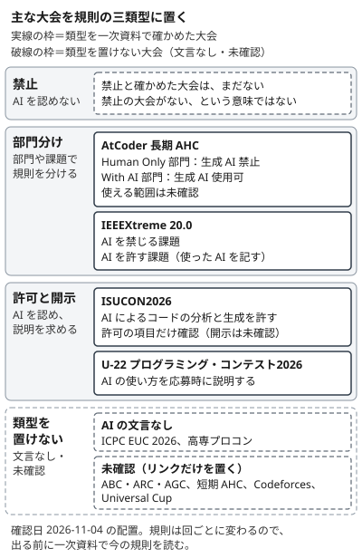

!!! abstract "要点"
    - **何が分かるか**：主な大会の AI の規則が、禁止・部門分け・許可と開示のどれに当たるかと、版・確認日・一次資料の所在が分かる。確認日の時点で、AtCoder の ABC・ARC・AGC（Beginner・Regular・Grand Contest）と短期 AHC（Heuristic Contest）、Codeforces は、類型と版が「未確認」である。出る前に、規則のページで今の規則を読む。そのリンクと手順は、[大会ごとの規則のページと、出る前に確かめること](#unverified-versions)の節にある。
    - **いつ引くか**：出る大会で、AI をどこまで使ってよいか確かめたいとき。大会の AI のルールが前と変わっていて、どれが最新か分からないとき。
    - **前提**：<!-- link:begin checking-ai-rules -->学校・組織・コンテストの規則（類型と確認表）（準備中）<!-- link:end -->

<!-- textlint-disable -->
別名：コンテストの AI ルール・大会の生成 AI の利用規則
<!-- textlint-enable -->

大会の規則の早見は、主な大会の AI の規則の類型・版・確認日を引く表と、各大会の規則のページの一覧である。類型が分かれる理由と、規則に文言がないときの考え方は、前提の<!-- link:begin checking-ai-rules -->学校・組織・コンテストの規則（類型と確認表）（準備中）<!-- link:end -->にあり、ここは個別の大会に絞る。条文は要約せず、表の値は確認日の時点のものとして読む。

## 類型ごとの大会（確認日付き） {#rules-by-type}

この節は、主な大会を規則の三類型の上に置き、類型・版・確認日を 1 つの表で引けるようにする。三類型は次のとおりである。

- **禁止**：AI の利用を認めない。
- **部門分け**：AI を使える部門（課題）と、使えない部門（課題）に分ける。
- **許可と開示**：AI の利用を認め、使い方の説明を求める。開示のしかたは<!-- link:begin disclosure-and-provenance -->AI 利用の開示と出所の記録（準備中）<!-- link:end -->にある。

図の実線の枠は、類型を一次資料で確かめた大会である。破線の枠は、類型を置けない大会で、規則に AI の文言を見つけていない大会（AI の文言なし）と、類型を確かめていない大会（未確認）に分かれる。

図の「禁止」の欄が空なのは、禁止と確かめた大会がまだないからで、禁止の大会がないという意味ではない。破線の枠の大会は、禁止とも許可とも読まない。

表の読み方は次のとおりである。

- **回**：表の各行は、行の名前の回の規則である。終わった回も含むので、次の回に出るときは、その回の規則を別に確かめる。
- **類型**：禁止・部門分け・許可と開示のどれか。「AI の文言なし」は、規則を読んで AI の文言を見つけていないこと、「未確認」は、そのセルの値を一次資料で確かめていないことを表す。
- **版・日付**：規則の版の名前か、規則や告知を公開した日である。
- **確認日**：この教材が一次資料を読んだ日で、表の下に書く。

<!-- gen:begin fact-table contest-ai-rules -->
<!-- textlint-disable -->

| 大会 | 類型 | 版・日付 |
| --- | --- | --- |
| AtCoder 長期 AHC（Heuristic Contest） | 部門分け（Human Only 部門は生成 AI 禁止、With AI 部門は生成 AI 使用可。使える範囲は未確認） | 2026-10-21 の告知（今後数回の長期 AHC を 2 部門制で開くという内容。規則の版は未確認） |
| IEEEXtreme 20.0 | 部門分け（AI を許す課題と禁じる課題に分ける。許す課題は、使った AI の記載を求める） | 20.0 の規則（開催済みの回） |
| ISUCON2026 | 許可と開示（確認したのは許可の項目だけ。コードの分析と生成を、許される作業に挙げる。開示の求めは未確認） | 2026-07-28 公開のレギュレーション（開催済みの回。ソフトウェア事項は当日マニュアルが優先するが、そのマニュアルは未確認） |
| U-22 プログラミング・コンテスト2026 | 許可と開示（AI を使った場合は、どこにどう使ったかを応募時に説明する） | 2026-07-01 のプレスリリース（募集要項は未確認） |
| ICPC EUC 2026（Europe Championship） | AI の文言なし（代わりに、機器を主催者の 1 台のコンピュータに限り、持ち込みと通信を制限する） | 2025-12-02 更新の表記（開催済みの回。規則の末尾の更新日で、ページのフッターの 2026-03-04 は規則の更新日とは限らない） |
| 高専プロコン 第37回（全国高等専門学校プログラミングコンテスト） | AI の文言なし（トップページの募集要項に AI の記述がなく、行動規範の熟読を求める） | 第37回（2026）のトップページ（行動規範と応募要領は未確認） |
| Universal Cup 第4回準決勝 | 未確認（告知は、決勝進出を望むチームに画面と映像の録画を求める。AI の公正な利用の規則は続けて適用される） | 2026-08-26 の告知（開催済みの回。規則の PDF は未確認） |
| AtCoder ABC・ARC・AGC（Beginner・Regular・Grand Contest） | 未確認 | 未確認（過去の変更の告知は、ABC と ARC が 2024-11-15、ABC426 から適用の変更が 2025-10-04。告知の中身は未確認） |
| AtCoder 短期 AHC（Heuristic Contest） | 未確認 | 未確認 |
| Codeforces | 未確認 | 未確認 |

確認日 2026-11-04。

出典（行ごと）：

- AtCoder 長期 AHC（Heuristic Contest）：[AtCoder 公式 X：今後の長期AHCの開催形式について（2026-10-21）](https://x.com/atcoder/status/2112818192007754017)
- IEEEXtreme 20.0：[IEEEXtreme Rules（IEEEXtreme 20.0 の AI-Permitted and AI-Prohibited Tasks の節を含む）](https://ieeextreme.org/rules/)
- ISUCON2026：[ISUCON2026 レギュレーション](https://isucon.net/archives/59966826.html)
- U-22 プログラミング・コンテスト2026：[U-22プログラミング・コンテスト2026 応募受付開始！締切は8月31日](https://prtimes.jp/main/html/rd/p/000000251.000013310.html)
- ICPC EUC 2026（Europe Championship）：[ICPC Europe Championship 2026 — Official Rules](https://euc.icpc.global/home-2026/rules/)
- 高専プロコン 第37回（全国高等専門学校プログラミングコンテスト）：[第37回全国高等専門学校プログラミングコンテスト 香川（高松）大会（トップページ）](https://www.procon.gr.jp/)
- Universal Cup 第4回準決勝：[The 4th Universal Cup Semifinals](https://contest.ucup.ac/blog/qingyu/blog/4263)
- AtCoder ABC・ARC・AGC（Beginner・Regular・Grand Contest）：[AtCoder 公式 X：生成AIの技術向上に伴うABCおよびARCにおけるルール変更について（2024-11-15）](https://x.com/atcoder/status/1857413796391981490)、[AtCoder 公式 X：生成AI対策ルールの変更の告知（ABC426 から適用。2025-10-04）](https://x.com/atcoder/status/1974339453234917615)

そのほかの出典：[AtCoder 公式 X：長期AHC生成AI利用ルール検証コンテスト開催のお知らせ（2026-10-15）](https://x.com/atcoder/status/2110637070117224505)、[AtCoder 公式 X：AHC074 の開催のお知らせ（2026-10-30）](https://x.com/atcoder/status/2116092762827509984)。

<!-- textlint-enable -->
<!-- gen:end fact-table contest-ai-rules -->

表にない形式の大会（CTF・データ分析・ハッカソンなど）は、一次資料で確かめた規則がまだない。出る前に確かめる手順は、表にない大会にも使える。形式ごとの傾向は<!-- link:begin format-cheatsheet -->コンテストの形式別の早見表（AI の効き方と人が握るところ）（準備中）<!-- link:end -->にある。各大会の規則のページは、[大会ごとの規則のページと、出る前に確かめること](#unverified-versions)の節に並べた。

## 大会ごとの規則のページと、出る前に確かめること {#unverified-versions}

この節は、大会ごとの規則のページと、出る前に確かめることを示す。この教材は、AtCoder と Codeforces の規則のページを開いておらず、中身と版を確かめていない。表では「未確認」と書き、規則のページへのリンクだけを置いた。どの大会も、出る前に規則のページを自分で開いて読む。

大会ごとの規則のページは次のとおりである。AtCoder のリンクは、第三者の記録から写したもので、この教材では開いていない。リンクが開けないときや、内容が違うときは、各大会の公式サイトから規則のページを探す。

- AtCoder の ABC・ARC・AGC（Beginner・Regular・Grand Contest）：[生成 AI の規則](https://info.atcoder.jp/entry/llm-rules-ja)。類型・版・中身を、この記事で確かめる。
- AtCoder の短期 AHC（Heuristic Contest）：[生成 AI の規則の記事](https://atcoder.jp/posts/short-ahc-llm-rules-ja)。開始回・版・例外の範囲を、この記事で確かめる。
- AtCoder の長期 AHC（Heuristic Contest）：[部門分けの告知](https://atcoder.jp/posts/long-ahc-divisions-2026)と[規則](https://info.atcoder.jp/entry/long-ahc-llm-rules-ja)。版と各部門の範囲を、規則で確かめる。
- Codeforces：[サイト](https://codeforces.com/)のブログで規則の記事を探し、類型・版・中身を確かめる。この教材は、記事の所在も確かめていない。
- Universal Cup 第 4 回準決勝：[告知](https://contest.ucup.ac/blog/qingyu/blog/4263)と、告知がリンクする[規則の PDF](https://qoj.ac/files/Qingyu/The%204th%20Universal%20Cup%20Semifinals%20Rules%20v1.0.pdf)（この教材は開いていない）。PDF で、AI の扱いを確かめる。
- ISUCON2026：[レギュレーション](https://isucon.net/archives/59966826.html)と、2026 年の回の当日マニュアル。マニュアルは、公開の場所を確かめていないので、運営のサイトで探し、AI の扱いを確かめる。
- IEEEXtreme 20.0：[規則（AI-Permitted and AI-Prohibited Tasks の節）](https://ieeextreme.org/rules/)。課題ごとの AI の扱いを、この節で確かめる。
- ICPC EUC 2026（Europe Championship）：[規則](https://euc.icpc.global/home-2026/rules/)。AI の文言がないので、機器と通信の制限を確かめる。
- U-22 プログラミング・コンテスト 2026：[応募受付開始のプレスリリース](https://prtimes.jp/main/html/rd/p/000000251.000013310.html)。この教材が確かめたのはプレスリリースだけなので、募集要項で、AI の使い方の説明の求め方を確かめる。
- 高専プロコン（全国高等専門学校プログラミングコンテスト）第 37 回：[公式サイト](https://www.procon.gr.jp/)。この教材は、行動規範と応募要領の PDF を開いていないので、PDF で AI の扱いを確かめる。

AtCoder の規則の細部と、練習の進め方は、競技プログラミングの教材 kyopro-atlas の [AtCoder の仕組み（生成 AI のルール）](https://yuukougun.github.io/kyopro-atlas/start/atcoder-system/#ai-rules) に任せる。そこに書かれた版も、規則のページで照らす。

出る前にすることは、次のとおりである。

1. 出る大会の規則のページを自分で開き、規則の版の名前と公開日、自分が読んだ日を控える。控えた日が、後で規則の改定を見分ける手がかりになる。見分け方は<!-- link:begin dating-information -->いつの情報かを見分ける（準備中）<!-- link:end -->にある。
2. 部門・課題・回で規則が分かれていないかを見る。告知に「ある回から適用する」と書く大会がある（表の ABC・ARC・AGC の行）。
3. 規則の案を試す試験コンテストの規則と、確定した規則を取り違えない。長期 AHC は、案を試す試験コンテストの後に、2 部門制を告知した。案を書いた記事や感想を、今の規則として読まない。
4. 規則が指す文書も読む。当日に公開する文書を事前の規則より優先する、と書く大会がある（表の ISUCON2026 の行）。
5. AI の文言を見つけられない規則がある（表の ICPC EUC 2026 と高専プロコンの行）。文言がないことは、使ってよいという意味ではない。考え方は<!-- link:begin checking-ai-rules#when-unclear -->学校・組織・コンテストの規則（類型と確認表） › 文言がないとき・分からないとき（準備中）<!-- link:end -->にある。
6. 「過去問の練習には規則が適用されない」という説明を見かけることがあるが、この教材では確かめていない（未確認）。練習でも、規則のページで適用の範囲を確かめる。練習と本番の使い分けは<!-- link:begin practice-vs-contest-day -->練習と本番の使い分け（AI を禁じる大会に向けた練習を含む）（準備中）<!-- link:end -->に任せる。

## 規則の境界を人が握る {#hold-the-boundary}

この節は、大会の規則を確かめることが、原理「握る」と Claude 側の原因「境界がない」にどう結び付くかを示す。

原理「握る」は、何を良しとし、何を採り、何をやめるかを人が持ち続けることである。大会で AI をどこまで使うかは、規則を読んで人が決める。Claude の答えだけで決めない。

Claude 側の原因「境界がない」は、使ってよい範囲を渡されていないために、範囲の内側の頼みと外へ出る頼みを区別する手がかりがないことである。Claude は、学習データの日付より後に改定された規則を、検索で調べさせるか資料を添付しない限り、知らないことがある。

そこで、規則を読んだ人が、使ってよい範囲を決めて、頼みに書いて渡す。たとえば、出る部門と規則で許される用途を頼みの冒頭に書き、「それを越える頼みは実行する前に知らせてほしい」と添える。

規則を確かめた後の進め方は、持ち主のページに任せる。練習で AI に頼むことは<!-- link:begin practice-vs-contest-day -->練習と本番の使い分け（AI を禁じる大会に向けた練習を含む）（準備中）<!-- link:end -->に任せる。本番の運用は<!-- link:begin competition-day-operations -->本番の運用（開始直後に評価器・終盤は凍結・AI なしでも提出できる状態）（準備中）<!-- link:end -->に任せる。

<!-- gen:begin references -->
<!-- textlint-disable -->

## 参考 {#references}

- [AtCoder 公式 X：長期AHC生成AI利用ルール検証コンテスト開催のお知らせ（2026-10-15）](https://x.com/atcoder/status/2110637070117224505)：AtCoder・確認日 2026-11-04
- [AtCoder 公式 X：今後の長期AHCの開催形式について（2026-10-21）](https://x.com/atcoder/status/2112818192007754017)：AtCoder・確認日 2026-11-04
- [AtCoder 公式 X：AHC074 の開催のお知らせ（2026-10-30）](https://x.com/atcoder/status/2116092762827509984)：AtCoder・確認日 2026-11-04
- [AtCoder 公式 X：生成AIの技術向上に伴うABCおよびARCにおけるルール変更について（2024-11-15）](https://x.com/atcoder/status/1857413796391981490)：AtCoder・確認日 2026-11-04
- [AtCoder 公式 X：生成AI対策ルールの変更の告知（ABC426 から適用。2025-10-04）](https://x.com/atcoder/status/1974339453234917615)：AtCoder・確認日 2026-11-04
- [IEEEXtreme Rules（IEEEXtreme 20.0 の AI-Permitted and AI-Prohibited Tasks の節を含む）](https://ieeextreme.org/rules/)：IEEE（IEEEXtreme）・英語・確認日 2026-11-04
- [ISUCON2026 レギュレーション](https://isucon.net/archives/59966826.html)：ISUCON 運営・確認日 2026-11-04
- [U-22プログラミング・コンテスト2026 応募受付開始！締切は8月31日](https://prtimes.jp/main/html/rd/p/000000251.000013310.html)：PR TIMES・確認日 2026-11-04
- [The 4th Universal Cup Semifinals](https://contest.ucup.ac/blog/qingyu/blog/4263)：Universal Cup・英語・確認日 2026-11-04
- [ICPC Europe Championship 2026 — Official Rules](https://euc.icpc.global/home-2026/rules/)：ICPC Foundation（ICPC Europe）・英語・確認日 2026-11-04
- [第37回全国高等専門学校プログラミングコンテスト 香川（高松）大会（トップページ）](https://www.procon.gr.jp/)：全国高等専門学校プログラミングコンテスト・確認日 2026-11-04

<!-- textlint-enable -->
<!-- gen:end references -->

<!-- gen:begin page-links -->
<!-- textlint-disable -->

**前提**

- 学校・組織・コンテストの規則（類型と確認表）（準備中）

**次に読む**

- 練習と本番の使い分け（AI を禁じる大会に向けた練習を含む）（準備中）
- 本番の運用（開始直後に評価器・終盤は凍結・AI なしでも提出できる状態）（準備中）

**関連**

- コンテストの形式別の早見表（AI の効き方と人が握るところ）（準備中）
- AI 利用の開示と出所の記録（準備中）
- 課題資料・問題文に仕込まれた指示（準備中）
- 預かったデータ・規約付きのデータを AI に渡してよいか（準備中）
- いつの情報かを見分ける（準備中）
- AI はコンテストでどこまで来たか（確認日付き）（準備中）

<!-- textlint-enable -->
<!-- gen:end page-links -->
