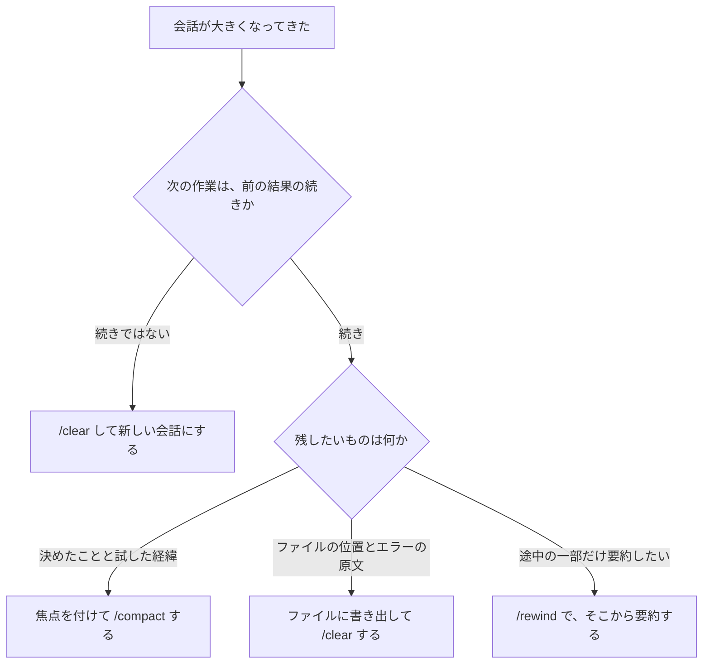

!!! abstract "要点"
    - **何ができるか**：残す焦点を付けた `/compact` で会話を要約させ、自動圧縮と放置後の圧縮で消えうるものを見越して備えられる。
    - **いつ引くか**：長い作業を同じセッションのまま続けたいとき。席を外して戻ったら会話が要約されていたとき。自動圧縮のタイミングを変えるか迷うとき。
    - **強制力**：<!-- gen:begin feature compaction/enforcement -->なし<!-- gen:end feature compaction/enforcement -->。圧縮は止める仕組みではなく、要約に何が残るかは保証されない。圧縮の方針を CLAUDE.md に書いても、それはお願いである。例外を許さない規則は、圧縮に頼らず鍵へ移す。
    - **前提**：<!-- link:begin what-survives-compaction -->[圧縮（compaction）で何が残り、何が消えるか](../basics/what-survives-compaction.md)<!-- link:end -->

<!-- textlint-disable -->
別名：コンテキスト圧縮・自動圧縮・auto-compact・idle compaction・/autocompact・休憩と cache 切れ・1M 時代の圧縮設定
<!-- textlint-enable -->

`/compact` と自動圧縮は、Claude Code が会話の履歴を要約に置き換えて、同じセッションで作業を続けられるようにする仕組みである。広い机の上の資料を、議事録だけ残して片付けるようなもので、議事録に何を書くかを指示できる。散らかった文脈を整える手段の 1 つで、残すものを要約の側に見せておく（見せる）ことで、長い作業の質を保つ。

## /compact に焦点を指示する {#focused-compact}

`/compact` は、ここまでの会話を要約して空きを作るコマンドである。後ろに指示を足すと、その指示を要約の焦点にできる。何を残すかを Claude の判断だけに任せると、決めたことの理由やファイルの位置が落ちやすい。そこで、次に要るものを名指しして残させる。

=== "アプリ"

    アプリには、会話を手で畳む操作をこの辞典は確認していない（未確認）。長い会話が上限に近づいたときの自動の要約と、残るものは <!-- link:begin long-chat-limits#auto-management -->長い会話の自動のコンテキスト管理と長さの上限 › 上限が近づくと何が起きるか（準備中）<!-- link:end --> にある。

=== "Claude Code"

    `/compact` の後ろに焦点を書く。例は `/compact keep the API changes and the test commands` のように、残したいものを並べる形である。CLAUDE.md に `Compact instructions` の節を書いて、圧縮の方針を決めておくこともできる。手で打つ `/compact` にも、自動圧縮にも、その方針が使われる。

残す焦点に選ぶものは、次の 3 つに絞る。

- **決めたことと理由**：要約で理由が落ちると、次のターンで同じ議論をやり直す。
- **試して駄目だった方法**：残さないと、同じ失敗をもう一度試す。
- **ファイルの位置とエラーの文**：ファイルパス・エラーメッセージ・行番号は、要約で変わることがあるという報告がある（根拠：弱。ベンダーの記事）。原文が要る場面では、要約に頼らず、ファイルに書き出す。

<!-- gen:begin snippet compact-and-auto-compact/focused-compact -->
<!-- textlint-disable -->

??? example "雛形：残す焦点を指示した /compact と、CLAUDE.md に書く圧縮の方針"

    ```markdown
    # 1. 手で畳むとき、残す焦点を付けて打つ
    /compact 決めたことと理由、試して駄目だった方法、変えたファイルの一覧、テストの実行コマンドを残す

    # 2. 自動圧縮でも同じ方針が効くよう、CLAUDE.md に書く
    ## Compact instructions

    圧縮で要約するときは、次を必ず残す。

    - 変えたファイルの一覧
    - テストと検査の実行コマンド
    - 決めたことと、その理由
    - 試して駄目だった方法と、駄目だった理由
    - 次にやること
    ```

    動作を確かめていない雛形。要る最低の版：Claude Code 0.2.47。

<!-- textlint-enable -->
<!-- gen:end snippet compact-and-auto-compact/focused-compact -->

焦点を付けても、要約に何が入るかは保証されない。要約を読んで、残したいものが入っているかを確かめる。入っていなければ、そのまま進めず、次の節の書き出しに切り替える。

何が圧縮の後も効き、何が消えるかは <!-- link:begin what-survives-compaction#what-happens -->[圧縮（compaction）で何が残り、何が消えるか › 何が起きるか](../basics/what-survives-compaction.md#what-happens)<!-- link:end --> にまとまっている。このページでは繰り返さない。

## 自動圧縮で起きること {#auto-compact}

自動圧縮は、コンテキストが上限に近づいたときに、Claude Code が自分で圧縮を始める仕組みである。公式の説明では、まず古いツールの出力を消し、それでも足りなければ会話を要約する。手で `/compact` を打つ必要はないが、焦点を付ける機会もない。自動圧縮の要約に残るものは、CLAUDE.md の方針と会話の中身で決まる。

起きることを 3 つ押さえる。

- **作業は途切れない**：会話の履歴は要約に置き換わるだけで、セッションは続く。バックグラウンドのコマンドとサブエージェントも動き続ける。
- **圧縮の後の挙動は、何が残るかで決まる**：CLAUDE.md は読み直される。会話の中だけで伝えた指示は要約に溶けうる。圧縮の後に約束が守られないときは <!-- link:begin forgot-after-compaction#diagnosis -->[圧縮の後に約束を忘れた › 原因を安く確かめる順](../symptoms/forgot-after-compaction.md#diagnosis)<!-- link:end --> で原因を切り分ける。
- **巨大なファイルで圧縮が繰り返されると、止まる**：公式は、圧縮が繰り返すのを自動で止め、エラーを出すと説明する。止まったら、読んだファイルを減らすか、書き出して新しい会話にする。

自動圧縮の発動の割合は、ベンダーの記事に数字があるが、公式の文書では確かめていない。この辞典は、割合を判断の根拠にしない。圧縮が起きる時期は、`/context` で使用量を見て自分で見積もる。見方は <!-- link:begin inspect-context#reading -->[/context で中身を見る › 内訳の読み方](inspect-context.md#reading)<!-- link:end --> にある。

## 席を外すとき（idle compaction と cache 切れ） {#idle-compaction}

idle compaction は、大きな会話を長く放置したときに、Claude Code が自動で要約する仕組みである。放置した後の最初の 1 手で、会話の全体を読み直す費用を減らす狙いがある。

背景にあるのは、<!-- link:begin why-prompt-caching -->プロンプトキャッシング（先頭が変わらないことの価値）（準備中）<!-- link:end --> である。会話の先頭が変わらなければ読み直しは安く済むが、キャッシュは時間が経つと切れる。切れた後に戻ると、最初の 1 手で会話の全体を、キャッシュなしで読み直す。idle compaction は、そのキャッシュが切れる前に、会話を要約しておく。

この仕組みの条件は、会話の大きさ・放置の時間・入った版で決まる。どれも変わりやすい。押さえておくことは次の 4 つである。

- **対象は大きな会話だけ**：小さな会話は、要約されない（大きさの目安：<!-- fact:begin idle-compaction-min-tokens -->未確認<!-- fact:end -->）。
- **放置の時間**：要約が働くまでの放置は、<!-- fact:begin idle-compaction-wait -->未確認<!-- fact:end -->である。
- **動く面**：端末と、VS Code と Desktop の Code タブで動く（端末で既定になった版：<!-- fact:begin idle-compaction-terminal-version -->未確認<!-- fact:end -->、VS Code と Desktop の Code タブに広がった版：<!-- fact:begin idle-compaction-ide-version -->未確認<!-- fact:end -->）。それ以外の面と、ほかの OS の動作は未確認である。
- **止められる**：設定の `idleCompaction` を `false` にするか、`/config` の行で止める。止めると、要約されない代わりに、戻った最初の 1 手が全体の読み直しになる。

備えは、席を外す前に自分で畳むことである。実務家の記事にも「離席の前に畳む」という声がある（根拠：弱）。焦点を付けた `/compact` なら、残すものを自分で決められる。作業が重いときは、書き出してから離れる。

!!! example "判断例：昼休みの前に、大きな会話をどうするか"
    - **状況**：午前中から同じセッションで実装を進め、会話が大きくなっている。これから 1 時間ほど席を外し、午後も続きをやる。
    - **迷う候補**：何もせず離れて idle compaction に任せる。焦点を付けた `/compact` を打って離れる。
    - **選んだもの**：焦点を付けた `/compact` を打って離れる。
    - **理由**：任せると、戻ったときの要約は自分が選んだものではなく、残したいテストの実行コマンドが落ちるかもしれない。離れる前なら、要約を読んで確かめ、足りなければ書き出しに切り替えられる。

席を外している間も、長い会話は使用量に響く。その理由は <!-- link:begin what-uses-up-limits#long-sessions -->[上限を早く使う要因 › 長いセッションで増える理由](../cost/what-uses-up-limits.md#long-sessions)<!-- link:end --> にある。

## 圧縮か、書き出して /clear か {#compact-or-clear}

長い作業の続け方には 2 つの立場がある。焦点を指定して `/compact` する立場と、書き出してから `/clear` する立場である。

- **公式の立場**：関係のない作業の間は `/clear` を勧める。同じ作業を続けるなら、`/compact` に焦点を付ける。
- **実践者の幅**：`/compact` を使う派と、引き継ぎ文書を書いて `/clear` する派に分かれる（根拠：中。複数の実務家が書いているが測定はない）。後者の理由は、要約では細部が消え、書き出した文書なら残すものを自分で制御できる、である。
- **この辞典の推奨**：要約で失いたくない作業は、書き出してから `/clear` する。失っても取り戻せる作業は、焦点を付けた `/compact` で続ける。

分かれ目は、残したいものと、次の作業が前の結果にどれだけ近いかである。



図の要点は次のとおりである。次の作業が前の結果の続きでなければ、圧縮せず `/clear` する。続きなら、残したいものが決めごとなら `/compact`、原文が要るなら書き出し、と分かれる。

- **書き出して /clear**：手順は <!-- link:begin handoff-documents#vs-compact -->[handoff 文書と document-and-clear › /compact との使い分け](handoff-documents.md#vs-compact)<!-- link:end --> にある。置き場所は圧縮で消えない所にする。
- **途中から要約**：`/rewind` の「ここから要約」で、会話の一部だけを要約できる。使い方は <!-- link:begin checkpoints-and-rewind#summarize -->[チェックポイントと /rewind（git との違い） › 途中から要約する](../cli/checkpoints-and-rewind.md#summarize)<!-- link:end --> にある。
- **新しくする合図**：話題が変わったときと、訂正を重ねても直らないときは、圧縮より新しい会話が先である。判断は <!-- link:begin when-to-start-fresh#signals -->[新しい会話を始めるタイミング › 新しくする合図](when-to-start-fresh.md#signals)<!-- link:end --> にある。

!!! example "判断例：移行の作業を続けるか、書き出すか"
    - **状況**：データ移行の作業が長くなった。決めたことと、試して駄目だった方法がたまり、エラーの原文を何度も参照している。
    - **迷う候補**：決めたことと試した経緯を焦点にして `/compact` する。状態を文書に書き出して `/clear` する。
    - **選んだもの**：書き出して `/clear` する。
    - **理由**：エラーの原文と行番号は、要約で変わることがある。決めたことだけなら `/compact` でも足りるが、この作業は原文が要る。

## 圧縮の設定 {#settings}

圧縮の設定は、自動圧縮がいつ働くかと、要約の方針を決める仕組みである。窓と idle compaction の設定は、動きそのものを変える鍵に近い。一方、圧縮の方針はお願いである。どの設定も、要約に何が残るかを保証しない。

- **自動圧縮の窓**：`/autocompact` で、コンテキストがどれだけ埋まったら自動圧縮するかを決める。数値を渡すか、`auto` でモデルに合わせた既定に戻す。値は利用者の設定へ保存され、いまのセッションにも反映される。設定のキーは `autoCompactWindow` である。指定できる範囲は <!-- fact:begin auto-compact-window-range -->100,000 から 1,000,000 トークンで、Claude Code 2.1.288 以降（2026-11-05 時点）<!-- fact:end --> である。
- **idle compaction**：設定の `idleCompaction` か、`/config` の行で止める。止めた場合の代わりは、前の節に書いた。
- **圧縮の方針**：CLAUDE.md の `Compact instructions` の節。お願いなので、守らせたい規則は鍵に置く（<!-- link:begin when-to-lock#spoken-rules-fade -->[お願いを鍵に移す判断 › 会話で言った禁止は圧縮で消える](../enforce/when-to-lock.md#spoken-rules-fade)<!-- link:end -->）。

窓を縮めて早く畳むべきかは、割れている論点である。

- **公式の立場**：窓には既定があり、モデルに合わせて調整されている。1M の窓が既定になって、溢れる心配は減った。
- **実践者の幅**：使用率の半分で畳む、決まったトークン数で畳む、窓を縮める、と記事ごとに目安がばらつく。測定したデータは見つからない（根拠：弱。経験則）。
- **この辞典の推奨**：まず既定のままにする。圧縮の後に困ったことが続いたときだけ、`/context` で使用量を見て、困った時点から逆算して動かす。目安を数字で決めて、全員に当てはめない。

窓が広くなった今の考え方は <!-- link:begin large-context-window -->広いコンテキストウィンドウとの付き合い方（準備中）<!-- link:end --> にある。

## 効かない場面・落とし穴 {#pitfalls}

- **焦点を付けても、全部は残らない**：要約は元の会話より必ず小さい。項目を増やしすぎると、焦点の意味が薄れる。
- **約束は圧縮で消えうる**：会話の中だけで伝えた規則は、要約に溶けうる。残したい規則は、読み直される場所に置く。置き場所は <!-- link:begin promises-after-compaction#where-to-put -->[圧縮で消えない場所に約束を置く › 約束の種類ごとの置き場所](promises-after-compaction.md#where-to-put)<!-- link:end --> にある。
- **要約が最初の依頼の細部を落とす**：圧縮を重ねるうちに、最初に頼んだ目的や完了の条件が薄れることがある。長い作業の目的と完了の条件は、会話ではなくファイルに書き、再開のたびに読ませる。
- **idle compaction は、気づかないうちに起きる**：席を外した後に戻ると、要約から再開になる。これで困るなら、前の節の備えをする。
- **自動圧縮の後の不具合**：圧縮の直後に、約束を守らなくなったり会話が続かなくなったりしたときは、<!-- link:begin forgot-after-compaction#diagnosis -->[圧縮の後に約束を忘れた › 原因を安く確かめる順](../symptoms/forgot-after-compaction.md#diagnosis)<!-- link:end --> で切り分ける。

## 古くなった助言 {#outdated}

「200K を前提に、コンテキストを最優先で節約する」という助言は、今は条件付きである。窓が広がって溢れることはまれになったが、関係のない作業の間の `/clear` は今も勧められる。放置した大きな会話は、idle compaction で要約される。台帳の行は <!-- link:begin outdated-advice-ledger#save-context-for-200k -->[古くなった助言の台帳](../changes/outdated-advice-ledger.md#save-context-for-200k)<!-- link:end --> にある。

自分の CLAUDE.md や手順書に、窓を節約するための決まり（毎回要約させる、ファイルを読ませない、など）が残っていないか探す。今の窓の使い方は `/context` で見る。

<!-- gen:begin references -->
<!-- textlint-disable -->

## 参考 {#references}

- [Explore the context window](https://code.claude.com/docs/en/context-window)：Anthropic・英語・確認日 2026-11-04
- [How Claude Code works](https://code.claude.com/docs/en/how-claude-code-works)：Anthropic・英語・確認日 2026-11-04
- [Commands](https://code.claude.com/docs/en/commands)：Anthropic・英語・確認日 2026-11-04
- [Changelog](https://github.com/anthropics/claude-code/blob/main/CHANGELOG.md)：Anthropic・英語・確認日 2026-11-04
- [Manage costs effectively](https://code.claude.com/docs/en/costs)：Anthropic・英語・確認日 2026-11-04
- [Best practices for Claude Code](https://code.claude.com/docs/en/best-practices)：Anthropic・英語・確認日 2026-11-04
- [All settings](https://code.claude.com/docs/en/settings-reference)：Anthropic・英語・確認日 2026-11-04
- [Model configuration](https://code.claude.com/docs/en/model-config)：Anthropic・英語・確認日 2026-11-04

<!-- textlint-enable -->
<!-- gen:end references -->

<!-- gen:begin page-links -->
<!-- textlint-disable -->

<div class="ca-page-links" markdown>

**前提**

- [圧縮（compaction）で何が残り、何が消えるか](../basics/what-survives-compaction.md)

**関連**

- [圧縮で消えない場所に約束を置く](promises-after-compaction.md)
- [handoff 文書と document-and-clear](handoff-documents.md)
- [新しい会話を始めるタイミング](when-to-start-fresh.md)
- [チェックポイントと /rewind（git との違い） › 途中から要約する](../cli/checkpoints-and-rewind.md#summarize)
- [/context で中身を見る](inspect-context.md)
- [圧縮の後に約束を忘れた](../symptoms/forgot-after-compaction.md)
- [お願いを鍵に移す判断 › 会話で言った禁止は圧縮で消える](../enforce/when-to-lock.md#spoken-rules-fade)
- 長い会話の自動のコンテキスト管理と長さの上限（準備中）
- 広いコンテキストウィンドウとの付き合い方（準備中）
- プロンプトキャッシング（先頭が変わらないことの価値）（準備中）
- [上限を早く使う要因](../cost/what-uses-up-limits.md)
- [日本語で返し続けさせる](../japanese/keep-replies-in-japanese.md)

</div>

<!-- textlint-enable -->
<!-- gen:end page-links -->
