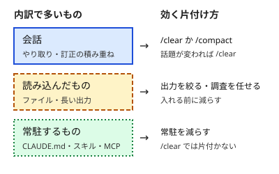

!!! abstract "要点"
    - **何ができるか**：`/context` の内訳から、会話・読み込んだもの・常駐するもののどれが場所を取っているかを見分け、片付け方を選べる。
    - **いつ引くか**：何がコンテキストを占めているか知りたいとき。拡張を足した後に、起動直後の重さを確かめたいとき。
    - **強制力**：<!-- gen:begin feature enforcement -->なし<!-- gen:end feature enforcement -->。現在の使用量を見せるだけで、何も止めず、何も変えない。
    - **前提**：<!-- link:begin attention-budget -->[コンテキストウィンドウと注意の予算](../basics/attention-budget.md)<!-- link:end -->

<!-- textlint-disable -->
別名：/context・コンテキストの内訳・何がコンテキストを占めているか・起動直後の基準値
<!-- textlint-enable -->

`/context` は、Claude Code が会話中にいまの使用量を色分けの格子で見せるコマンドである。遅い、高い、言うことを聞かないといった理由を推測で探す前に、まず何が場所を取っているかを測るために使う。

## 内訳の読み方 {#reading}

`/context` の内訳は、コンテキストを占めているものをカテゴリごとに分けた使用量である。公式の説明では、重いツール、メモリの膨らみ、容量の警告に対する改善の提案も付く。カテゴリの名前と並びは版で変わりうるので、画面に出た名前のままで読み、このページでは次の 3 つの区分に寄せて考える。

| 区分 | 入っているもの | 増え方 |
| --- | --- | --- |
| 会話 | 自分の依頼、Claude の返答、訂正のやり取り | 話すほど増える |
| 読み込んだもの | 読ませたファイル、コマンドやテストの出力 | 読ませるたびに増える |
| 常駐するもの | CLAUDE.md、自動メモリ、MCP のツール名、スキルの説明、システムプロンプト | 入力する前から入っている |

常駐する側のうち、公式が「何も入力する前に読み込まれる」と書くのは、CLAUDE.md、自動メモリ、MCP のツール名、スキルの説明である。出力スタイルや `--append-system-prompt` で足した文も、ここに加わる。

読み方のコツは 3 つある。

- **合計より、どの区分が大きいかを見る**。同じ合計でも、会話が大きいのと常駐が大きいのとでは、効く片付け方が違う。
- **画面が全画面表示のときは、項目ごとの内訳が折りたたまれる**。全項目を見たいときは `/context all` と打つ。公式の一覧にこの引数の記載がある。
- **改善の提案は、内訳と読み合わせる**。提案は「その環境で重いもの」を指す手がかりで、従うかどうかは自分で決める。

動く図で埋まり方を追いたいときは、公式の [Explore the context window](https://code.claude.com/docs/en/context-window) が、起動から圧縮までを代表的な値で再生してくれる。自分のセッションの実際の値は、`/context` で見る。

Claude Code は WSL・Linux の CLI を基準に書いている。ほかの OS や IDE 拡張で、画面の出方が同じかどうかは未確認である。

## 起動直後の基準値 {#baseline}

起動直後の基準値は、新しいセッションを開いて何も入力する前に `/context` の値を控えたものである。拡張を足した後に重くなった気がするとき、この控えがあると、増えた分を数字で言える。

実践者の記事は、新しいセッションで `/context all` を実行して起動時の土台を見る手を勧めている（根拠：弱。複数の実務家の紹介で、効果を測った研究ではない）。控え方の手順は次のとおりである。

1. 作業フォルダを決め、新しいセッションを開く。
2. 何も入力せずに `/context all` を実行し、日付・版・モデルと、内訳の項目ごとのトークン数を写す。
3. 拡張（MCP サーバー、スキル、CLAUDE.md の追記など）を足す。
4. 同じフォルダ・同じモデルの新しいセッションで、もう一度取る。
5. 項目ごとに差を見る。差の出た項目が、足したものの費用である。

比べるときは、割合より、トークン数のほうが扱いやすい。窓の大きさはモデルと面で違い、同じ分だけ増えても割合は変わるからである（推論・実践例なし）。控えるのは自分の環境の値で、この辞典は具体的な数字を載せない。

<!-- gen:begin snippet inspect-context/baseline-note -->
<!-- textlint-disable -->

??? example "雛形：起動直後の基準値を控えるメモ"

    ```markdown
    # /context の基準値（起動直後）

    - 取った日：
    - Claude Code の版：
    - モデル：
    - 作業フォルダ：
    - 取り方：新しいセッションで、何も入力せずに `/context all` を実行した

    | 内訳の項目（画面に出た名前のまま） | トークン数 |
    | --- | --- |
    |  |  |
    |  |  |
    |  |  |

    - 全体の使用量：
    - この後に足したもの（拡張・CLAUDE.md の追記など）：
    - 足した後の値（同じ取り方で）：
    ```

    動作を確かめていない雛形。

<!-- textlint-enable -->
<!-- gen:end snippet inspect-context/baseline-note -->

!!! example "判断例：MCP サーバーを足した後に重く感じる"
    - **状況**：MCP サーバーを 1 つ足してから、どの作業も重い気がする。足す前の控えはある。
    - **迷う候補**：体感を手がかりに、そのサーバーをすぐ外す（外せば確かに軽くなるかもしれない）。または、新しいセッションで取り直し、差を見てから決める（外す判断が少し遅れる）。
    - **選んだもの**：同じフォルダ・同じモデルで新しいセッションを開き、何も入力せずに `/context all` を取り直した。
    - **理由**：差が小さければ、重さの原因は別にある。差が大きければ、そのサーバーを外すか、使う場面を絞るかを、数字で決められる。体感との食い違いは、<!-- link:begin felt-vs-measured#why -->[体感と実測 › なぜ体感はずれるか](../eval/felt-vs-measured.md#why)<!-- link:end --> が扱っている。

## どの片付け方を選ぶか {#what-to-do}

片付け方は、内訳で一番大きい区分に合わせて選ぶ。区分が違うと、効く手も違うからである。



- **会話が大きい**：話題が変わったなら `/clear` で新しい会話にする。同じ作業を続けるなら、焦点を指示して `/compact` で要約する。
  - 焦点の指示：<!-- link:begin compact-and-auto-compact#focused-compact -->/compact と自動圧縮 › /compact に焦点を指示する（準備中）<!-- link:end -->
  - 書き出してから `/clear` する選び方：<!-- link:begin compact-and-auto-compact#compact-or-clear -->/compact と自動圧縮 › 圧縮か、書き出して /clear か（準備中）<!-- link:end -->
- **読み込んだものが大きい**：入れる前に減らす。
  - 長い出力を絞る手：<!-- link:begin choose-what-to-read#trim-output -->[@参照と、何を読ませるかの絞り込み › 出力を絞る](choose-what-to-read.md#trim-output)<!-- link:end -->
  - 出力の多い調査を別の文脈に任せる手：<!-- link:begin research-in-subagents#when -->出力の多い調査はサブエージェントに任せて要約だけ受け取る › 任せてよい調査、本筋で読むべきもの（準備中）<!-- link:end -->
- **常駐するものが大きい**：使っていないものを外す。
  - 常駐と、使うときだけ読むものの違い：<!-- link:begin always-on-costs#resident-vs-on-demand -->[常駐するもののコスト（CLAUDE.md・MCP・スキル） › 常駐するものと、使うときだけ読むもの](always-on-costs.md#resident-vs-on-demand)<!-- link:end -->
  - 外す順：<!-- link:begin always-on-costs#reduce -->[常駐するもののコスト（CLAUDE.md・MCP・スキル） › 減らす順](always-on-costs.md#reduce)<!-- link:end -->
  - 棚卸しの進め方：<!-- link:begin pruning-extensions#measure -->拡張の棚卸しと剪定 › 測る（準備中）<!-- link:end -->

常駐するものは、`/clear` でも `/compact` でも小さくならない。公式によると、圧縮のあとも CLAUDE.md や自動メモリなどは入れ直される。したがって、常駐が大きいときに会話の側だけを片付けても、内訳はあまり変わらない。

!!! example "判断例：会話は短いのに内訳が重い"
    - **状況**：新しい会話を始めて数回やり取りしただけなのに、`/context` では全体の使用量が大きい。
    - **迷う候補**：`/compact` で要約する。または、常駐するものを見直す。
    - **選んだもの**：常駐するものを見直した。
    - **理由**：会話の区分が小さいので、要約しても減る量が少ない。大きいのは起動時から入っているものなので、外すか絞るほうが効く。

## この道具で分からないこと {#limits}

`/context` が見せるのは使用量であり、その中身が必要かどうかの判断はしてくれない。落とし穴は 3 つある。

- **大きいことは悪いことではない**。毎回役に立っている CLAUDE.md が大きくても、それは必要な費用かもしれない。切る基準は次にある。
  - 切る基準：<!-- link:begin pruning-extensions#criteria -->拡張の棚卸しと剪定 › 切る基準（準備中）<!-- link:end -->
- **空きがあっても、注意が保たれるとは限らない**。窓に入ることと、中身をよく使えることは別である。理由は <!-- link:begin attention-budget -->[コンテキストウィンドウと注意の予算](../basics/attention-budget.md)<!-- link:end --> が扱う。
- **上限の消費は別の道具で見る**。`/context` は文脈の中身を見る道具である。利用枠の使われ方は `/usage` で見る。
  - 道具の使い分け：<!-- link:begin usage-context-statusline#instruments -->/usage・/context・ステータスラインで状態を見る › 三つの道具で見えるもの（準備中）<!-- link:end -->
  - `/usage` の内訳の読み方：<!-- link:begin what-uses-up-limits#find-what-uses-it -->[上限を早く使う要因 › /usage の内訳の読み方（自分の場合を確かめる）](../cost/what-uses-up-limits.md#find-what-uses-it)<!-- link:end -->

長い作業の途中で気づきたいときは、ステータスラインに出す手がある（<!-- link:begin usage-context-statusline#statusline -->/usage・/context・ステータスラインで状態を見る › ステータスラインに出すもの（準備中）<!-- link:end -->）。

<!-- gen:begin references -->
<!-- textlint-disable -->

## 参考 {#references}

- [Explore the context window](https://code.claude.com/docs/en/context-window)：Anthropic・英語・確認日 2026-11-04
- [Commands](https://code.claude.com/docs/en/commands)：Anthropic・英語・確認日 2026-11-04
- [How Claude Code works](https://code.claude.com/docs/en/how-claude-code-works)：Anthropic・英語・確認日 2026-11-04
- [Best practices for Claude Code](https://code.claude.com/docs/en/best-practices)：Anthropic・英語・確認日 2026-11-04

<!-- textlint-enable -->
<!-- gen:end references -->

<!-- gen:begin page-links -->
<!-- textlint-disable -->

<div class="ca-page-links" markdown>

**前提**

- [コンテキストウィンドウと注意の予算](../basics/attention-budget.md)

**関連**

- /usage・/context・ステータスラインで状態を見る（準備中）
- [常駐するもののコスト（CLAUDE.md・MCP・スキル）](always-on-costs.md)
- [@参照と、何を読ませるかの絞り込み](choose-what-to-read.md)
- /compact と自動圧縮（準備中）
- 出力の多い調査はサブエージェントに任せて要約だけ受け取る（準備中）
- 拡張の棚卸しと剪定（準備中）
- [体感と実測](../eval/felt-vs-measured.md)
- [上限を早く使う要因 › /usage の内訳の読み方（自分の場合を確かめる）](../cost/what-uses-up-limits.md#find-what-uses-it)

</div>

<!-- textlint-enable -->
<!-- gen:end page-links -->
