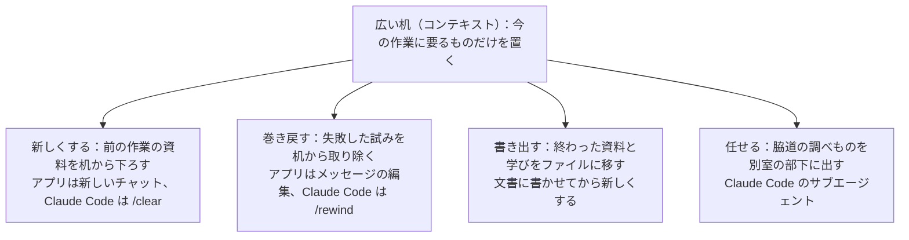

!!! abstract "要点"
    - **何が分かるか**：会話を新しくする・巻き戻す・書き出す・別の文脈に任せる、の 4 つで文脈を今の作業に絞れると分かる。
    - **いつ引くか**：コンテキストの整え方を一通り知りたい。窓が広くなった今も片付ける意味があるのか迷う。claude.ai で 1 つの長い会話を使い続けている。
    - **前提**：<!-- link:begin rereads-whole-history -->[毎ターン全履歴を読み直す](../basics/rereads-whole-history.md)<!-- link:end -->・<!-- link:begin context-rot -->[context rot と紛らわしい情報](../basics/context-rot.md)<!-- link:end -->

<!-- textlint-disable -->
別名：コンテキスト管理・context engineering・コンテキストエンジニアリング・文脈の整理・アプリでの文脈管理
<!-- textlint-enable -->

机を整えるとは、Claude が毎回読み直す会話の中身を、今の作業に要るものだけにしておくことである。目的は、文脈が溢れるのを防ぐ節約ではない。焦点の合った文脈のほうが、答えがよく、費用も下がるからである。

## 四つの動作 {#four-actions}

文脈を整える動作は、新しくする・巻き戻す・書き出す・任せるの 4 つにまとまる。Claude にとってコンテキストは広い机にあたる。机に置いたものを毎回すべて見て答えるので、置くものを選ぶほど答えが安定する。

図の要点は、4 つとも「机から何かを下ろす」動作だということである。新しくするのは机ごと片付ける動作で、巻き戻すのは一部だけを取り除く動作になる。書き出すのは、下ろす前に残したいものをファイルへ移す動作である。任せるのは、最初から別の机で行う動作になる。

動作と面ごとの手段は次のとおりである。細かい手順は、それぞれの持ち主のページにある。

=== "アプリ"

    - **新しくする**：新しいチャットを始める。話題が変わったときや、訂正を重ねても直らないときの分かれ目は <!-- link:begin when-to-start-fresh#signals -->[新しい会話を始めるタイミング › 新しくする合図](when-to-start-fresh.md#signals)<!-- link:end --> にある。
    - **巻き戻す**：前のメッセージを編集して送り直す。訂正を重ねるより、間違った試みを会話に残さない形になる。戻し方は <!-- link:begin rewind-dont-correct#how -->[違うと返すより、巻き戻す・編集する › 面ごとの戻し方](rewind-dont-correct.md#how)<!-- link:end --> にある。
    - **書き出す**：要点を文書に書かせてから、新しいチャットでその文書から再開する。再開の仕方は <!-- link:begin handoff-documents#resume -->[handoff 文書と document-and-clear › 新しい会話での再開の仕方](handoff-documents.md#resume)<!-- link:end --> にある。同じ資料と指示で繰り返す作業は、プロジェクトに入れる単位で整える。
    - **任せる**：アプリに専用の手段があるかは、この辞典では確かめていない。別のチャットで調べて結論だけを本筋に持ち帰る手作業の形が考えられる（推論・実践例なし）。

=== "Claude Code"

    - **新しくする**：`/clear` で空の文脈から始める。前の会話は `/resume` で戻れる。関係のない作業へ移るときに使うよう、公式は勧める。
    - **巻き戻す**：`/rewind`（Esc を 2 回押す形でも開く）で前の時点へ戻す。何が消えるかは <!-- link:begin rewind-dont-correct#what-is-lost -->[違うと返すより、巻き戻す・編集する › 巻き戻すと消えるもの](rewind-dont-correct.md#what-is-lost)<!-- link:end --> が持つ。
    - **書き出す**：目的と今の状態と次の一手をファイルに書かせてから `/clear` する。要約で失いたくない作業向けで、`/compact` との使い分けは <!-- link:begin compact-and-auto-compact#compact-or-clear -->[/compact と自動圧縮 › 圧縮か、書き出して /clear か](compact-and-auto-compact.md#compact-or-clear)<!-- link:end --> にある。
    - **任せる**：ログや多数のファイルを読む調査をサブエージェントに出し、結論だけを受け取る。任せてよい調査の条件は <!-- link:begin research-in-subagents#when -->[出力の多い調査はサブエージェントに任せて要約だけ受け取る › 任せてよい調査、本筋で読むべきもの](research-in-subagents.md#when)<!-- link:end --> にある。

4 つのうち「任せる」だけは、目的が違う。コンテキストを守るためではなく、うるさい出力を本筋から離す、作業を並べる、独立した目でレビューさせるために使う。どれもトークンが余分にかかる。

## 溢れの心配から、質と費用へ {#why-now}

整頓の意味は、かつての「溢れさせないための節約」から、今は「質と費用のための整頓」に変わった。コンテキストウィンドウ（窓）が小さかったころは、長い作業でコンテキストが埋まりやすく、片付けは溢れを防ぐ手段だった。

公式の Best practices は、2026 年 10 月下旬の改稿で、「コンテキストを最優先で節約する」を「もうやめてよい」助言の表に入れた。理由は、現行モデルの多くが広い窓を持ち、圧縮も自動なので、溢れることがまれになったからである。同じ表に、コンテキストを守るためにサブエージェントを使う助言も入っている。

一方で、関係のない作業の間の `/clear` は、答えの質と費用のために今も勧められている。焦点の合った文脈は、答えの質と費用の両方を改善する。やめてよい節約と、続ける片付けの切り分けは <!-- link:begin large-context-window#what-to-stop -->[広いコンテキストウィンドウとの付き合い方 › やめてよいこと](../models/large-context-window.md#what-to-stop)<!-- link:end --> と <!-- link:begin large-context-window#what-to-keep -->[広いコンテキストウィンドウとの付き合い方 › 続けること](../models/large-context-window.md#what-to-keep)<!-- link:end --> にある。

古い助言を台帳で引ける。窓の節約を最優先にする助言は <!-- link:begin outdated-advice-ledger#save-context-for-200k -->[古くなった助言の台帳](../changes/outdated-advice-ledger.md#save-context-for-200k)<!-- link:end --> に、守るためだけにサブエージェントへ任せる助言は <!-- link:begin outdated-advice-ledger#subagents-to-save-context -->[古くなった助言の台帳](../changes/outdated-advice-ledger.md#subagents-to-save-context)<!-- link:end --> にある。窓が埋まるほど性能が落ちる、という説明は改稿前の版のものである。2026 年 10 月下旬より前の記事や手順書にあれば、現行の説明に読み替える。

大きな会話を長く放置すると、プロンプトキャッシュが切れる前に要約されることがある。席を外すときの備えは <!-- link:begin compact-and-auto-compact#idle-compaction -->[/compact と自動圧縮 › 席を外すとき（idle compaction と cache 切れ）](compact-and-auto-compact.md#idle-compaction)<!-- link:end --> にある。

## 何に効くか（見せる・散らかっている） {#effect}

この整頓が効くのは、原理「見せる」と、Claude 側の原因「散らかっている」である。

原理「見せる」は、Claude が見えている情報だけで答える、という考え方である。何を見せるかには、何を見せないかも含まれる。前の話題の資料や失敗した試みが机に残ると、それも見せていることになる。窓に入ることと中身をよく使えることは別で、関係のない情報が増えるほど大事な情報への注意が薄くなる。この仕組みは <!-- link:begin attention-budget#effects -->[コンテキストウィンドウと注意の予算 › 何に効くか：見せることと、散らかっていること](../basics/attention-budget.md#effects)<!-- link:end --> が持つ。原理全体の中の位置は <!-- link:begin four-principles#show -->[四つの原理と比例則（見せる・確かめる・縛る・握る） › 見せる](../start/four-principles.md#show)<!-- link:end --> にある。

原因「散らかっている」は、似ているが違う情報や、失敗した試みが会話に残って、答えを引きずる状態である。似た情報が混ざるほど質が下がりやすい理由は、前提の <!-- link:begin context-rot -->[context rot と紛らわしい情報](../basics/context-rot.md)<!-- link:end --> にある。4 つの動作は、この散らかりを減らす。

- 新しくする：話題の違う資料を丸ごと下ろす。
- 巻き戻す：失敗した試みだけを下ろす。
- 書き出す：下ろしても学びが消えないようにする。
- 任せる：うるさい出力を最初から別の机に置く。

どの動作が合うかは、机の中身を見て決める。何が場所を取っているかの見分け方は <!-- link:begin inspect-context#what-to-do -->[/context で中身を見る › どの片付け方を選ぶか](inspect-context.md#what-to-do)<!-- link:end --> にある。毎回乗る常駐物が大きいときは、会話の片付けでは減らない。その場合は <!-- link:begin always-on-costs#reduce -->[常駐するもののコスト（CLAUDE.md・MCP・スキル） › 減らす順](always-on-costs.md#reduce)<!-- link:end --> を見る。節約の中での順番は <!-- link:begin saving-priorities#order -->[節約の優先順位（手戻りを減らすのが先） › 優先順位](../cost/saving-priorities.md#order)<!-- link:end --> にある。

## アプリでの整え方 {#in-the-app}

アプリで文脈を整える手段は、新しいチャット・メッセージの編集・プロジェクト・メモリの 4 つである。アプリには `/clear` や `/rewind` がないので、4 つの動作は次のように置き換える。新しいチャットが「新しくする」、メッセージの編集が「巻き戻す」にあたる。プロジェクトとメモリは、前提を持ち越す側の手段である。

- 新しいチャット：話題が変わったら新しくする。1 つの長い会話を使い続けると、前の話題の資料や書き損じが次の答えに混ざりやすい。
- メッセージの編集：期待と違う返答は、訂正を返すより、前のメッセージを直して送り直す。
- プロジェクト：同じ資料と指示で繰り返す作業を、1 つに 1 つの目的で切って入れる。切り方は <!-- link:begin using-projects#scope -->[プロジェクトの使いどころ › プロジェクトを切る単位（1つに1つの目的）](../app/using-projects.md#scope)<!-- link:end --> にある。
- メモリ：新しいチャットでも前提を引き継げるが、会話の整頓の代わりにはならない。会話を消してもメモリは残る。範囲と止め方は <!-- link:begin how-memory-works#deleted-chats -->[アプリのメモリ（仕組み・範囲・消し方と止め方） › 会話を消しても残るもの](../app/how-memory-works.md#deleted-chats)<!-- link:end --> にある。

アプリには、会話が長くなったときの自動の管理もある。コードの実行が有効なとき、上限に近づくと前の発言が要約されて会話が続く。全履歴は残り、参照できる（出典：Help Center）。要約が起きる長い会話は、利用上限を多く使いやすい。自動で何が残り、何が消えうるかは <!-- link:begin long-chat-limits#auto-management -->[長い会話の自動のコンテキスト管理と長さの上限 › 上限が近づくと何が起きるか](../app/long-chat-limits.md#auto-management)<!-- link:end --> にある。長さの上限に当たったときの対処は <!-- link:begin long-chat-limits#at-the-limit -->[長い会話の自動のコンテキスト管理と長さの上限 › 長さの上限に当たったとき](../app/long-chat-limits.md#at-the-limit)<!-- link:end --> にある。

繰り返す前提や形式の指定は、会話の中で言い直さず、置き場所を決めて置く。選び方は <!-- link:begin where-to-put-instructions#how-to-choose -->[アプリの指示の置き場所（Claude への指示・プロジェクト・メモリ・スキル） › どこに置くかの選び方](../app/where-to-put-instructions.md#how-to-choose)<!-- link:end --> にある。Claude Code の `/compact` や `/context` のような手段は、アプリにはない。そちらは Claude Code のタブと、各ページの持ち主を見る。

## どれを使うかの判断例 {#examples}

!!! example "判断例：claude.ai で長い会話を使い続けているとき"
    - **状況**：同じチャットで、先週は資料の要約、今日は別の案件のメール文面を頼んでいる。会話はずいぶん長くなった。
    - **迷う候補**：このチャットで続ける。新しいチャットを始める。
    - **選んだもの**：新しいチャットを始め、前の案件の決定事項だけを数行持ち込む。
    - **理由**：メール文面に要るのは、今回の案件の情報である。先週の資料は要らず、残すと紛らわしい情報になる。窓が広いので溢れる心配は小さい。それでも、焦点の合った文脈のほうが答えの質は上がる。続きの作業なら、続けても筋が通る。

!!! example "判断例：大量のログを読む調査を頼むとき"
    - **状況**：Claude Code で、失敗するテストの原因を探している。調べるログは非常に長く、読むと本筋の会話に大量の出力が入る。
    - **迷う候補**：本筋の会話でそのまま読ませる。サブエージェントに調べさせ、結論と根拠の場所だけを戻させる。
    - **選んだもの**：サブエージェントに調べさせる。
    - **理由**：出力が多く、本筋から独立した調査だからである。本筋にはログの全文ではなく結論だけが戻る。ただし任せるとトークンが余分にかかる。出力が少ない調査や、本筋と切り離せない調査は、本筋で読んだほうが速く安い。

!!! example "判断例：長い作業を一度閉じて続きは明日にするとき"
    - **状況**：Claude Code で、調査と設計の議論を重ねた長い会話がある。明日、この続きで実装に入る。途中で決めた制約が多い。
    - **迷う候補**：`/compact` で焦点を指示して要約させ、続ける。目的・今の状態・試して駄目だったこと・次の一手をファイルに書かせ、`/clear` して再開する。
    - **選んだもの**：ファイルに書かせてから `/clear` して再開する。
    - **理由**：要約は何かを失う。決めた制約は消えると困るので、消えない場所に置く。会話が短く、失って困るものが少ないなら、`/compact` でも筋が通る。書かせる項目は <!-- link:begin handoff-documents#four-items -->[handoff 文書と document-and-clear › 書かせる四項目](handoff-documents.md#four-items)<!-- link:end --> にある。

## よくある誤解と意見の幅 {#misconceptions}

- 「溢れないなら整えなくてよい」：溢れは減ったが、関係のない文脈が答えの質と費用を下げる点は変わらない。整える理由が、溢れの回避から、質と費用に変わっただけである。
- 「コンテキストは埋まるほど性能が落ちるから、とにかく節約する」：改稿前の Best practices の説明である。現行は、窓の節約を最優先にしなくてよいとしている。ただし、散らかった文脈を残してよいという意味ではない。
- 「サブエージェントはコンテキストを守る手段だ」：守るためだけには使わない。サブエージェントは自分のリクエストを送るので、同じ使用量の枠を消費する。本筋が持っていた文脈を集め直して、かえって遅くなることもある。向くのは、並列の作業、うるさい出力の隔離、独立したレビューである。費用の見方は <!-- link:begin research-in-subagents#cost -->[出力の多い調査はサブエージェントに任せて要約だけ受け取る › 費用と使いすぎ](research-in-subagents.md#cost)<!-- link:end --> にある。
- 「整えれば上限も戻る」：新しい会話にしても、利用上限やメモリは戻らない。新しくしても戻らないものは <!-- link:begin when-to-start-fresh#what-does-not-reset -->[新しい会話を始めるタイミング › 新しくしても戻らないもの（上限・記憶）](when-to-start-fresh.md#what-does-not-reset)<!-- link:end --> にある。

`/compact` で続けるか、書き出して `/clear` するかは、意見が割れている。次の三段で整理する。

- 公式の立場：焦点を指示した `/compact` を用意し、自動圧縮でも続けられる。圧縮で何が残るかは仕組みごとに違い、公式の文書の表が正である。
- 実践者の幅：`/compact` に頼る人と、書き出して `/clear` する人がいる（根拠：弱。単独の経験談の集まり）。
- この辞典の推奨：要約の損失が気になる作業では、書き出してから `/clear` する。損失が気にならない短い作業は、`/compact` でよい。

<!-- gen:begin references -->
<!-- textlint-disable -->

## 参考 {#references}

- [Best practices for Claude Code](https://code.claude.com/docs/en/best-practices)：Anthropic・英語・確認日 2026-11-04
- [Commands](https://code.claude.com/docs/en/commands)：Anthropic・英語・確認日 2026-11-04
- [Explore the context window](https://code.claude.com/docs/en/context-window)：Anthropic・英語・確認日 2026-11-04
- [How Claude Code works](https://code.claude.com/docs/en/how-claude-code-works)：Anthropic・英語・確認日 2026-11-04
- [Create custom subagents](https://code.claude.com/docs/en/sub-agents)：Anthropic・英語・確認日 2026-11-04
- [How large is the context window on paid Claude plans?](https://support.claude.com/en/articles/8606394-how-large-is-the-context-window-on-paid-claude-plans)：Anthropic・英語・確認日 2026-11-04
- [How do usage and length limits work?](https://support.claude.com/en/articles/11647753-how-do-usage-and-length-limits-work)：Anthropic・英語・確認日 2026-11-04

<!-- textlint-enable -->
<!-- gen:end references -->

<!-- gen:begin page-links -->
<!-- textlint-disable -->

**前提**

- [毎ターン全履歴を読み直す](../basics/rereads-whole-history.md)
- [context rot と紛らわしい情報](../basics/context-rot.md)

**次に読む**

- [本筋を汚さずに聞く（/btw）](side-questions-btw.md)

**関連**

- [新しい会話を始めるタイミング](when-to-start-fresh.md)
- [違うと返すより、巻き戻す・編集する](rewind-dont-correct.md)
- [/compact と自動圧縮](compact-and-auto-compact.md)
- [handoff 文書と document-and-clear](handoff-documents.md)
- [出力の多い調査はサブエージェントに任せて要約だけ受け取る](research-in-subagents.md)
- [/context で中身を見る](inspect-context.md)
- [常駐するもののコスト（CLAUDE.md・MCP・スキル）](always-on-costs.md)
- [長い会話の自動のコンテキスト管理と長さの上限](../app/long-chat-limits.md)
- [プロジェクトの使いどころ](../app/using-projects.md)
- [アプリのメモリ（仕組み・範囲・消し方と止め方）](../app/how-memory-works.md)
- [アプリの指示の置き場所（Claude への指示・プロジェクト・メモリ・スキル）](../app/where-to-put-instructions.md)
- [コンテキストウィンドウと注意の予算](../basics/attention-budget.md)
- [広いコンテキストウィンドウとの付き合い方](../models/large-context-window.md)
- [節約の優先順位（手戻りを減らすのが先）](../cost/saving-priorities.md)
- [四つの原理と比例則（見せる・確かめる・縛る・握る）](../start/four-principles.md)

<!-- textlint-enable -->
<!-- gen:end page-links -->
