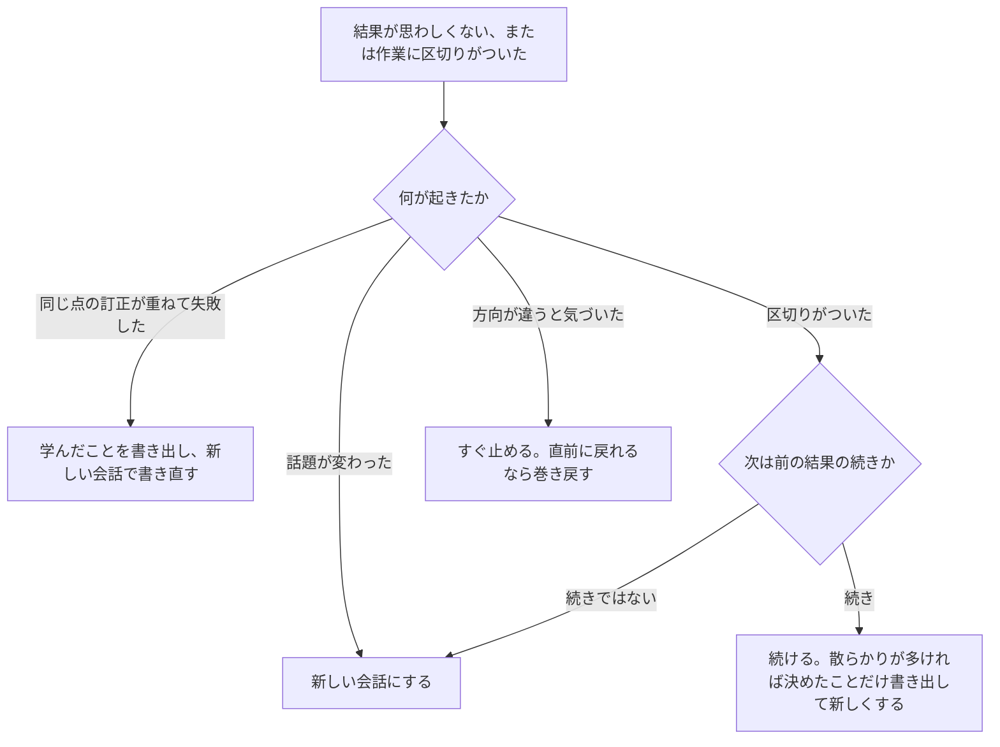

!!! abstract "要点"
    - **何が分かるか**：話題が変わったとき、訂正を重ねても直らないときが、新しい会話にする分かれ目だと分かる。
    - **いつ引くか**：話題を変えたのに前の話に引きずられる。長い作業に区切りがついた。いつ新しくすべきか知りたい。
    - **前提**：<!-- link:begin rereads-whole-history -->[毎ターン全履歴を読み直す](../basics/rereads-whole-history.md)<!-- link:end -->・<!-- link:begin context-rot -->[context rot と紛らわしい情報](../basics/context-rot.md)<!-- link:end -->

<!-- textlint-disable -->
別名：/clear のタイミング・いつ /clear するか・会話をリセットする・新しいチャットにする
<!-- textlint-enable -->

新しい会話を始めるタイミングは、Claude との会話を続けるか、空の文脈で始め直すかの分かれ目である。新しくする理由は、文脈の溢れを避けるためではない。目の前の作業に絞った文脈のほうが、答えがよく、費用も下がるからである。

## 新しくする合図 {#signals}

新しい会話にする合図は 4 つある。話題が変わった。同じ点の訂正が重ねて失敗した。作業に区切りがつき、次が前の結果の続きではない。方向が違うと気づいた。方向が違うときだけは、新しくするより先に巻き戻しを考える。



図の要点は次のとおりである。起きたことを 4 つに分けると、行き先は「新しくする」「書き出して新しくする」「続ける」「巻き戻す」のどれかに決まる。迷うのは区切りがついたときで、次の作業が前の結果を直接使うかどうかで分ける。

公式の Best practices は、関係のない作業の間で `/clear` するよう勧める。費用はかからず、焦点の合った文脈のほうが答えもよく、コストも下がるからである。訂正については、同じ点の訂正が重ねて失敗したら、さらに訂正を重ねない。`/clear` して、学んだことを織り込んだ依頼を 1 つ書き直すよう勧める。失敗した試行が残った会話を Claude が読み続けるだけになりやすいためである。回数の目安は、公式によれば同じ点の訂正が<!-- fact:begin clear-after-failed-corrections -->2 回（2026-11-03 時点）<!-- fact:end -->失敗したときである。最初の様子を見て、ずれていたらすぐ止めることも、同じ文書が勧める。

ターン数で決める目安もある。チャットでは一定のターン数を超えると雑になる、と書く実践者がいる。だが単独の経験談（根拠：弱）なので、この辞典は数を基準にせず、上の合図で決める。本文で数を使うなら経験則と断る。

!!! example "判断例：訂正が失敗した後で続けるか"
    - **状況**：認証まわりの修正で、同じ点を 2 回直させたが、まだ直らない。会話は長くなったが、あと少しで直りそうに感じる。
    - **迷う候補**：3 回目の訂正を書いて続ける。学んだことを織り込んだ依頼を、新しい会話で書き直す。
    - **選んだもの**：新しい会話で書き直す。
    - **理由**：続ける会話には、失敗した 2 回分の試行が残っている。3 回目の訂正は、その跡を読み直させるだけになりやすい。「あと少し」と感じて手放せないのは、人の側の落とし穴「やめられない」の形である。分かったこと（症状、原因の見当、直ったと言える条件）は手元に持っていける。

!!! example "判断例：区切りがついた後で続けるか"
    - **状況**：長い機能開発で、設計の議論と試行錯誤が 1 つの会話に溜まった。実装が一区切りし、次は同じ機能へのテスト追加である。
    - **迷う候補**：そのまま続ける。決めたことを数行書き出して、新しい会話で始める。
    - **選んだもの**：決めたことを書き出して、新しい会話で始める。
    - **理由**：テスト追加に要るのは、決まった設計と今のコードである。議論の途中の案や却下した方法は要らず、残すと紛らわしい情報になる。会話がまだ短く、散らかっていないなら、続けても筋が通る。

方向が違うと気づいたときの戻し方は、<!-- link:begin rewind-dont-correct#how -->[違うと返すより、巻き戻す・編集する › 面ごとの戻し方](rewind-dont-correct.md#how)<!-- link:end --> にある。巻き戻すと消えるものは <!-- link:begin rewind-dont-correct#what-is-lost -->[違うと返すより、巻き戻す・編集する › 巻き戻すと消えるもの](rewind-dont-correct.md#what-is-lost)<!-- link:end --> が持つ。同じ失敗が続く症状の切り分けは <!-- link:begin going-in-circles#diagnosis -->[同じ失敗を繰り返す（堂々巡り） › 原因を安く確かめる順](../symptoms/going-in-circles.md#diagnosis)<!-- link:end --> にある。

## なぜ新しくすると答えがよくなるか {#why}

長い会話では、前の話題の資料や書き損じが残ったまま、次の依頼が処理される。たとえば、ログイン処理の修正に半日使った会話で、続けて文書の翻訳を頼む。その結果、翻訳にログイン処理の用語や前提が混ざることがある。

理由は 2 つの仕組みの組み合わせである。1 つ目は、Claude が毎回、会話の最初からすべてを読み直して返事をすること。受験者が、毎回、会話の全部を読み直してから答える姿に近い。読み直す量は、会話が伸びるほど増える。仕組みは <!-- link:begin rereads-whole-history -->[毎ターン全履歴を読み直す](../basics/rereads-whole-history.md)<!-- link:end --> が持つ。

2 つ目は、読み直す中身が増えるほど、答えの質が下がりやすいことである。Chroma の 2025 年の報告は、Claude Opus 4 と Sonnet 4 を含む 18 モデルを調べた。単純な課題でも入力が長いほど成績が下がり、似ているが違う情報が 1 つ混ざるだけでも下がった（根拠：中。旧世代のモデルの結果で、今の Claude の傾向とは言い切れない）。関連する部分だけを渡した場合のほうが、全履歴を渡した場合より成績が高かった。仕組みの説明は <!-- link:begin context-rot -->[context rot と紛らわしい情報](../basics/context-rot.md)<!-- link:end --> にあり、中ほどの情報が使われにくい傾向は <!-- link:begin context-rot#lost-in-the-middle -->[context rot と紛らわしい情報 › 中ほどの情報は使われにくいか（lost in the middle）](../basics/context-rot.md#lost-in-the-middle)<!-- link:end --> にある。

この研究は、入力の長さと紛らわしい情報の影響を示すもので、「話題が変わったら新しくする」とまでは言っていない。そこへの読み替えは推論である。ただし公式が関係のない作業の間の `/clear` を勧めており、方向は一致している。

広い机の比喩で言えば、会話は机の上の資料である。話題が変わっても前の資料を置いたままだと、探すのに手間がかかり、取り違えも起きる。新しい会話は、机を片付けて、今の作業の資料だけを置き直すことに当たる。机を整える 4 つの動作の全体は <!-- link:begin tidy-the-desk#four-actions -->[机を整える：新鮮さ・巻き戻し・書き出し・委任 › 四つの動作](tidy-the-desk.md#four-actions)<!-- link:end --> にある。

## 何に効くか（見せる・散らかっている・やめられない） {#what-it-prevents}

新しい会話は、原理「見せる」の「余計なものは片付ける」側に当たる。Claude には見せたものしか分からず、見せすぎても劣化する。新しくすることは、必要なものだけを見せ直す手段である。

防ぐ失敗の原因は「散らかっている」である。情報が多すぎる、または失敗の残骸が残っている状態を指す。症状には、前提を忘れる、堂々巡りになる、前の話に引きずられる、がある。症状側の見分け方は <!-- link:begin forgets-in-long-chats#diagnosis -->[長い会話で前提を忘れる・雑になる › 原因を安く確かめる順](../symptoms/forgets-in-long-chats.md#diagnosis)<!-- link:end --> と <!-- link:begin going-in-circles#diagnosis -->[同じ失敗を繰り返す（堂々巡り） › 原因を安く確かめる順](../symptoms/going-in-circles.md#diagnosis)<!-- link:end --> にある。

人の側の落とし穴は「やめられない」である。ここまで積み上げた会話を捨てるのが惜しく、伸びた会話を手放せない形をとる。たとえば、同じ点を 2 回直させても直らないのに、「あと少し」と感じて 3 回目の訂正を書き続ける形である。捨てるのが惜しいときは、会話を捨てるのではなく、分かったことだけを持ち出すと考える。持ち出し方は「新しくする前に残すもの」の節にある。

## 新しくする前に残すもの {#before-clearing}

新しくする前に残すものは、会話の経緯ではなく、次の作業に要る結論である。残す候補は 4 つある。目的と完了の条件、決まったことと今の状態、試して駄目だったこと、次の一手である。駄目だった方法は、経緯ではなく結論だけを書く。こうすれば、失敗の跡は持ち込まずに、同じ道を繰り返さずに済む。

短い作業なら、新しい会話の最初の依頼に、これらを直接書けば足りる。

<!-- gen:begin snippet when-to-start-fresh/restart-request -->
<!-- textlint-disable -->

??? example "雛形：新しい会話の最初に貼る、引き継ぎの依頼"

    ```markdown
    前の会話で決まったことを引き継いで、`<機能名>` にテストを足したい。

    - 目的と完了の条件：`<コマンド>` が通り、`<機能名>` の新しい分岐がテストで押さえられていること。
    - 決まったこと：`<採用した設計を 1〜2 文で。理由も添える>`
    - 試して駄目だったこと：`<却下した方法を結論だけ。経緯は書かない>`
    - 今の状態：変更済みのファイルは `<ファイル名>`。まだ触っていないのは `<ファイル名>`。
    - 最初にしてほしいこと：関係するファイルを読み、進め方を 3 行で書いてから着手する。
    ```

    動作を確かめていない雛形。

<!-- textlint-enable -->
<!-- gen:end snippet when-to-start-fresh/restart-request -->

作業が長い、または何度も再開するなら、Claude に文書を書かせてから新しくする。書かせる 4 項目は <!-- link:begin handoff-documents#four-items -->[handoff 文書と document-and-clear › 書かせる四項目](handoff-documents.md#four-items)<!-- link:end --> に、置く場所は <!-- link:begin handoff-documents#where -->[handoff 文書と document-and-clear › 置き場所（圧縮で消えない所）](handoff-documents.md#where)<!-- link:end --> にある。要約で足りるか、書き出してから新しくするかの分かれ目は <!-- link:begin compact-and-auto-compact#compact-or-clear -->[/compact と自動圧縮 › 圧縮か、書き出して /clear か](compact-and-auto-compact.md#compact-or-clear)<!-- link:end --> が持つ。出力を良くするために新しくする場合は、前回の結果を見せて直させる進め方と両立する。両立のさせ方は <!-- link:begin build-on-results#with-clear -->[やり直させるより、結果を踏まえて直させる › /clear・巻き戻しとの両立](build-on-results.md#with-clear)<!-- link:end --> にある。

面ごとの始め方は次のとおりである。

=== "アプリ"

    新しいチャットを始め、最初の発言に残したいことを書く。同じ資料と指示で繰り返す作業なら、毎回貼らずにプロジェクトに入れる。切る単位は <!-- link:begin using-projects#scope -->[プロジェクトの使いどころ › プロジェクトを切る単位（1つに1つの目的）](../app/using-projects.md#scope)<!-- link:end --> にある。

=== "Claude Code"

    `/clear` で空の文脈から始める。前の会話は `/resume` で戻れる。後で戻る予定があるなら、`/clear oauth-migration` のように名前を付けておくと探しやすい。名前の付け方は <!-- link:begin resume-and-branch#naming -->[セッションに名前を付けて再開・分岐する › 名前の付け方](../cli/resume-and-branch.md#naming)<!-- link:end --> にある。

## 新しくしても戻らないもの（上限・記憶） {#what-does-not-reset}

新しい会話にしても戻らないものが 2 つある。1 つは、使った利用上限である。`/clear` が小さくするのは文脈であり、アカウント単位の利用枠は戻らない（根拠：弱。実践者の報告）。アプリと Claude Code は同じ枠を分け合う。枠の仕組みは <!-- link:begin how-usage-limits-work#shared-limit -->[利用上限の仕組み（面をまたいで共有する枠） › 面をまたいで一つの枠](../cost/how-usage-limits-work.md#shared-limit)<!-- link:end --> が持つ。会話を片付けて節約になるのは、これから先の読み直しの量であって、使い終えた分ではない。

もう 1 つは、会話の外に置いたものが残る一方で、会話の中だけにあったものは消える、という区別である。次の表のとおりに考える。

| 置いた場所 | 新しい会話で |
| --- | --- |
| 会話の中だけで伝えた指示や前提 | 消える。残したいなら依頼に書き直す |
| ファイルの変更、コミット | 残る。会話だけが空になる |
| CLAUDE.md やプロジェクトの指示に書いたもの | 新しい会話でも読み込まれる |
| 書き出した引き継ぎの文書 | 残る。新しい会話で読ませる |

アプリの記憶の機能など、面ごとの個別の挙動はこの辞典では確かめていない（未確認）。例外を許さない約束は、会話に頼らず、設定かファイルに置く。

## よくある誤解 {#misconceptions}

「文脈が溢れる前に新しくしないといけない」は、古くなった助言である。かつては窓が狭く、長い作業ですぐ埋まるので、節約を最優先に勧められた。今は多くのモデルの窓が広く、圧縮も自動で、溢れることはまれになった。関係のない作業に移るときの `/clear` は、答えの質とコストのために今も勧められる。台帳の行は <!-- link:begin outdated-advice-ledger#save-context-for-200k -->[古くなった助言の台帳](../changes/outdated-advice-ledger.md#save-context-for-200k)<!-- link:end --> にある。

「新しくすると、せっかくの積み上げを失う」も誤解になりやすい。失うのは会話の経緯で、結論ではない。結論は書き出せば持ち越せ、Claude Code なら前の会話に `/resume` で戻れる。

「ターン数が増えたら必ず新しくする」も誤りである。ターン数の目安は、単独の実践者の経験則にすぎない。新しくするかどうかは、話題が変わったか、失敗の跡が残っているかで決める。続きの作業で、会話が散らかっていないなら、続けてよい。

<!-- gen:begin references -->
<!-- textlint-disable -->

## 参考 {#references}

- [Best practices for Claude Code](https://code.claude.com/docs/en/best-practices)：Anthropic・英語・確認日 2026-11-04
- [Commands](https://code.claude.com/docs/en/commands)：Anthropic・英語・確認日 2026-11-04
- [Context Rot: How Increasing Input Tokens Impacts LLM Performance](https://www.trychroma.com/research/context-rot)：Chroma・英語・確認日 2026-11-04
- [27 Claude tips after 1,800 hours.](https://ruben.substack.com/p/1800-hours-of-claude)：Ruben Hassid・英語・確認日 2026-11-04

<!-- textlint-enable -->
<!-- gen:end references -->

<!-- gen:begin page-links -->
<!-- textlint-disable -->

<div class="ca-page-links" markdown>

**前提**

- [毎ターン全履歴を読み直す](../basics/rereads-whole-history.md)
- [context rot と紛らわしい情報](../basics/context-rot.md)

**次に読む**

- [handoff 文書と document-and-clear](handoff-documents.md)
- [セッションに名前を付けて再開・分岐する](../cli/resume-and-branch.md)

**関連**

- [机を整える：新鮮さ・巻き戻し・書き出し・委任](tidy-the-desk.md)
- [違うと返すより、巻き戻す・編集する](rewind-dont-correct.md)
- [/compact と自動圧縮](compact-and-auto-compact.md)
- [やり直させるより、結果を踏まえて直させる](build-on-results.md)
- [長い会話で前提を忘れる・雑になる](../symptoms/forgets-in-long-chats.md)
- [同じ失敗を繰り返す（堂々巡り）](../symptoms/going-in-circles.md)
- [利用上限の仕組み（面をまたいで共有する枠）](../cost/how-usage-limits-work.md)
- [プロジェクトの使いどころ](../app/using-projects.md)

</div>

<!-- textlint-enable -->
<!-- gen:end page-links -->
