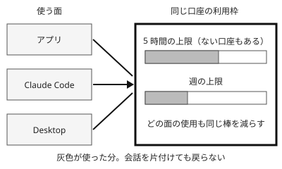

!!! abstract "要点"
    - **何が分かるか**：アプリ・Claude Code・Desktop は同じ口座の利用枠を分け合う。会話を片付けても、使った分は戻らない。
    - **いつ引くか**：/clear すれば上限が戻るのか、上限がいつ戻るのかを知りたいとき。アプリをたくさん使った日に Claude Code でも早く当たるとき。
    - **前提**：なし

<!-- textlint-disable -->
別名：usage limits・利用制限・使用制限・five-hour limit・weekly limit・session limit
<!-- textlint-enable -->

利用上限は、有料プランの口座に付く、使える量の枠である。面ごとに別々の枠があるのではなく、口座に 1 つの枠があり、どの面で使っても同じ残りが減る。

## 面をまたいで一つの枠 {#shared-limit}

利用上限は、アプリ・Claude Code・Desktop のどれで使っても、同じ口座の同じ枠から引かれる（[How do usage and length limits work?](https://support.claude.com/en/articles/11647753-how-do-usage-and-length-limits-work)）。枠が付くのは面ではなく口座だからである。

たとえば、午前にアプリで長い調べものをした日は、午後に Claude Code を開いた時点で、枠はすでに減っている。Claude Code でほとんど作業していなくても、早く上限に当たることがある。

この共有は、サブスクリプション（プランの利用枠）の話である。API キーで呼ぶときの rate limits はプランの利用枠とは別の仕組みなので、<!-- link:begin rate-limits-and-errors#limit-types -->[rate limits とエラー（混雑と再試行） › 上限の種類と、今の値の確かめ方](../api/rate-limits-and-errors.md#limit-types)<!-- link:end --> を見る。

## 枠の種類と戻る時刻（プランごとの表） {#limit-types}

有料プランの利用枠は、戻り方の違う 2 種類の上限でできている。この節の内容は 2026-11-04 に Help Center で確かめた。

- **5 時間の上限**：<!-- name:begin session-limit-to-5-hour-limit -->5-hour limit（5 時間の上限）<!-- name:end --> と呼ぶ。使った分が 5 時間ごとに戻る。Claude Code は、以前は session limit と呼んでいた。
- **週の上限**：週に 1 回戻る。戻る時刻は口座ごとに決まっていて、全員が同じ曜日と時刻に戻るわけではない（[What is the Max plan?](https://support.claude.com/en/articles/11049741-what-is-the-max-plan)）。

2 種類とも、面をまたいで共有される。どちらかが尽きれば、その口座はその面でも使えなくなる。

プランによって、この 2 種類の持ち方と倍率が違う。

<!-- gen:begin fact-table usage-limit-types-by-plan -->
<!-- textlint-disable -->

| プラン | 5 時間の上限 | 週の上限 | 最上位のモデルの別の週の上限 |
| --- | --- | --- | --- |
| Pro | あり | あり（基準） | —（確かめていない） |
| Max | あり（Pro の 5 倍） | Pro の 5 倍 | あり |
| Ultra | 確認済みの口座にはない（確認前は一時的な上限） | Pro の 10 倍 | あり |
| Team | —（束の材料に席ごとの値がない） | — | — |
| Enterprise（使用量に基づく） | なし | なし | — |

確認日 2026-11-04。出典：[What is the Ultra plan?](https://support.claude.com/en/articles/17728952-what-is-the-ultra-plan)、[What is the Max plan?](https://support.claude.com/en/articles/11049741-what-is-the-max-plan)、[What is the Pro plan?](https://support.claude.com/en/articles/8325606-what-is-the-pro-plan)、[What is the Team plan?](https://support.claude.com/en/articles/9266767-what-is-the-team-plan)、[What is the Enterprise plan?](https://support.claude.com/en/articles/9797531-what-is-the-enterprise-plan)、[Plans & pricing](https://claude.com/pricing)。

<!-- textlint-enable -->
<!-- gen:end fact-table usage-limit-types-by-plan -->

- 個人向けの Pro と Max は、5 時間の上限と週の上限の 2 段を持つ。
- <!-- name:begin max-20x-to-ultra -->Ultra<!-- name:end --> は、確認が済んだ口座には 5 時間の上限がなく、週の上限だけである（[What is the Ultra plan?](https://support.claude.com/en/articles/17728952-what-is-the-ultra-plan)）。確認は口座と支払いの履歴などから自動で行われ、済むまでは一時的な上限がかかる。
- Max と Ultra には、最上位のモデル向けに別の週の上限がある。引かれ方は <!-- link:begin before-using-top-model#which-limit -->[最上位のモデルを使う前に › どの枠から引かれるか（プランごとの表）](before-using-top-model.md#which-limit)<!-- link:end --> で確かめる。
- 使用量に基づく Enterprise には、プランの上限がない。使った分は API の料金で払う。

倍率や料金を含むプランごとの表は <!-- link:begin choosing-a-plan#plan-table -->[プランの選び方 › プランの表（確認日つき）](choosing-a-plan.md#plan-table)<!-- link:end --> にある。自分の口座に 5 時間の上限があるかは、アプリの Settings > Usage で分かる（見る場所は、続く節「残りを見る場所」にある）。

「有料プランなら 5 時間待つしかない」という古い助言は、Ultra の確認済みの口座には当てはまらない。上限に当たったときの手も増えた（<!-- link:begin outdated-advice-ledger#wait-out-5-hour-limit -->[古くなった助言の台帳](../changes/outdated-advice-ledger.md#wait-out-5-hour-limit)<!-- link:end -->）。

## 残りを見る場所 {#where-to-check}

残りは、面ごとに見る場所が違う。どの面で見ても、見えるのは同じ口座の枠である。

=== "アプリ"

    Settings > Usage に、枠ごとの進捗バーが出る。Current session の棒がなければ、5 時間の上限がない口座（確認済みの Ultra）である。

=== "Claude Code"

    `/usage` で上限の使われ方を見る。ステータスラインに出しておけば、長い作業の途中でも気づける。見方は <!-- link:begin usage-context-statusline#statusline -->[/usage・/context・ステータスラインで状態を見る › ステータスラインに出すもの](../cli/usage-context-statusline.md#statusline)<!-- link:end --> にある。

何が枠を減らしているかを調べるときは、<!-- link:begin what-uses-up-limits#find-what-uses-it -->[上限を早く使う要因 › /usage の内訳の読み方（自分の場合を確かめる）](what-uses-up-limits.md#find-what-uses-it)<!-- link:end --> に進む。減りが速いと感じるときに、何から確かめるかは <!-- link:begin hits-limits-quickly#diagnosis -->[すぐ上限に当たる › 原因を安く確かめる順](../symptoms/hits-limits-quickly.md#diagnosis)<!-- link:end --> にある。

## 上限に当たったとき {#when-you-hit-the-limit}

上限に当たったときの手は 3 つある。待つこと、枠を足すこと、Claude Code に待ちを任せることである。

**待つ**。5 時間の上限は 5 時間ごとに、週の上限は口座ごとの決まった時刻に戻る。待つ間にも進められる仕事を先に決めておくと、止まる時間が無駄にならない。決め方は <!-- link:begin when-ai-is-unavailable#minimum-without-ai -->[AI が使えないときの備え（障害・上限） › AI なしで最低限を進められる状態](when-ai-is-unavailable.md#minimum-without-ai)<!-- link:end --> にある。

**枠を足す**。usage credits を有効にすると、プランの上限を使い切った後も従量課金で続けられる（[Manage usage credits for paid Claude plans](https://support.claude.com/en/articles/12429409-manage-usage-credits-for-paid-claude-plans)）。思わぬ請求を防ぐため、月の上限額と通知を先に決める。手順は <!-- link:begin usage-credits-basics#how-it-works -->[usage credits（上限を超えた分の従量課金） › 切り替わる仕組み](usage-credits-basics.md#how-it-works)<!-- link:end --> にある。プランを上げる手もあり、上げると新しい上限はすぐに適用される。比べ方は <!-- link:begin choosing-a-plan#what-to-compare -->[プランの選び方 › 比べる観点](choosing-a-plan.md#what-to-compare)<!-- link:end --> にある。

**Claude Code に待ちを任せる**。Claude Code には、上限で止まった作業を自動で続ける機能がある。claude.ai の上限で止まった作業を、開いたままのセッションで待ち、上限が戻った後に自分で続ける。設定は `autoContinueAtUsageLimit` で、claude.ai のサブスクリプションで入った対話のセッションでは、既定で有効である。成熟度は <!-- gen:begin feature auto-continue/maturity -->GA<!-- gen:end feature auto-continue/maturity --> で、入った版は <!-- gen:begin feature auto-continue/since -->2.1.234（2026-08-17）<!-- gen:end feature auto-continue/since --> である（[Interactive mode](https://code.claude.com/docs/en/interactive-mode)、[All settings](https://code.claude.com/docs/en/settings-reference)）。

任せる幅が広がる機能なので、守りを先に確かめる。

- 続けた作業でも、許可の確認は出る。確認なしで進むことはない。
- 続ける回数の上限は、<!-- fact:begin auto-continue-max-times -->3 回まで（2026-11-05 時点）<!-- fact:end -->。上限を超えると止まる。
- 背景のセッション、`-p`、API キーと事業者の認証では使えない。

もう 1 つ、Claude Code には Wrap-Up Allowance がある（使うには <!-- fact:begin wrap-up-allowance-min-version -->Claude Code 2.1.277 以上（2026-11-04 時点）<!-- fact:end --> が要る）。応答の途中で 5 時間の上限に達したとき、区切りまで少しだけ続ける仕組みで、画面に「Usage limit reached · wrapping up」と出る（[Claude Code Wrap-Up Allowance](https://support.claude.com/en/articles/17040437-claude-code-wrap-up-allowance)）。続けられる量には上限があり、回数はプランで違う（下の表）。使った分は週の上限に数える。API キーや Bedrock・Vertex AI などでは効かず、アプリのチャットにもない。段階的に展開中で、口座や組織によってはまだ効かない。

<!-- gen:begin fact-table wrap-up-allowance-frequency -->
<!-- textlint-disable -->

| プラン | 使える頻度 |
| --- | --- |
| Pro | 週に 1 回まで |
| Max・確認前の Ultra・Team の Premium の席 | 5 時間の上限に当たるたび |

確認日 2026-11-04。出典：[Claude Code Wrap-Up Allowance](https://support.claude.com/en/articles/17040437-claude-code-wrap-up-allowance)、[Use Claude Code with your Pro, Max, or Ultra plan](https://support.claude.com/en/articles/11145838-use-claude-code-with-your-pro-max-or-ultra-plan)。

<!-- textlint-enable -->
<!-- gen:end fact-table wrap-up-allowance-frequency -->

!!! example "判断例：午前の作業の途中で 5 時間の上限に当たった"
    - **状況**：Claude Code で実装を進めていて、5 時間の上限に当たった。今日の夕方までに仕上げたい。
    - **迷う候補**：戻るまで待つ。usage credits を有効にして、すぐ続ける。
    - **選んだもの**：戻る時刻まで待つ。期限が今日中に迫り、月の上限額を決めてあるときだけ usage credits を使う。
    - **理由**：待つのは費用がかからず、戻る時刻も決まっているからである。従量課金は思わぬ請求になりうるので、上限額を先に決めておくことが条件になる。

## どの原因に関わるか {#cause}

このページの仕組みは、6 つの原因（<!-- link:begin six-causes -->[失敗の二つの軸と診断の入口](../start/six-causes.md)<!-- link:end -->）のうち「合っていない」に関わる。枠の種類と大きさ、使う面の組み合わせが、自分の使い方に合っていないと、上限に早く当たる。

直す順は、先に使い方を見直し、それでも足りないときに枠を足すことである。使い方の見直しは <!-- link:begin saving-priorities#order -->[節約の優先順位（手戻りを減らすのが先） › 優先順位](saving-priorities.md#order)<!-- link:end --> にある。枠そのものを選び直すなら、プランと usage credits が候補になる。

## よくある誤解 {#misconceptions}

- **/clear で上限が戻る**：戻らない。/clear は会話の文脈を空にするだけで、口座の枠から引かれた分には触れない。上限が戻るのは、戻る時刻が来たときか、枠を足したときだけである。それでも、関係のない作業の間で区切ると、以降の送り直しが軽くなる。区切る合図は <!-- link:begin when-to-start-fresh#signals -->[新しい会話を始めるタイミング › 新しくする合図](../context/when-to-start-fresh.md#signals)<!-- link:end -->、戻らないものの一覧は <!-- link:begin when-to-start-fresh#what-does-not-reset -->[新しい会話を始めるタイミング › 新しくしても戻らないもの（上限・記憶）](../context/when-to-start-fresh.md#what-does-not-reset)<!-- link:end --> にある。
- **アプリは別の枠だから、Claude Code には響かない**：響く。同じ口座の同じ枠を分け合う。
- **新しい会話を始めれば、新しい枠で始まる**：始まらない。会話ごとの枠はない。
- **有料プランなら、上限に当たったら待つしかない**：待つ以外の手もある。待つ・枠を足す（usage credits、プランを上げる）・Claude Code に待ちを任せる、の 3 つである。詳しくは節「上限に当たったとき」にある。
- **API キーで呼んでも、プランの枠を使う**：使わない。API の rate limits は別の仕組みである。

<!-- gen:begin page-links -->
<!-- textlint-disable -->

**前提**

- なし

**次に読む**

- [/usage・/context・ステータスラインで状態を見る](../cli/usage-context-statusline.md)
- [上限を早く使う要因](what-uses-up-limits.md)
- [プランの選び方](choosing-a-plan.md)
- [最上位のモデルを使う前に](before-using-top-model.md)
- [usage credits（上限を超えた分の従量課金）](usage-credits-basics.md)
- [課金の経路を確かめる（API キーとサブスクリプション）](check-billing-path.md)
- [AI が使えないときの備え（障害・上限）](when-ai-is-unavailable.md)
- [すぐ上限に当たる](../symptoms/hits-limits-quickly.md)

**関連**

- [節約の優先順位（手戻りを減らすのが先）](saving-priorities.md)
- [新しい会話を始めるタイミング](../context/when-to-start-fresh.md)
- [/usage・/context・ステータスラインで状態を見る › ステータスラインに出すもの](../cli/usage-context-statusline.md#statusline)
- [rate limits とエラー（混雑と再試行）](../api/rate-limits-and-errors.md)

<!-- textlint-enable -->
<!-- gen:end page-links -->

<!-- gen:begin references -->
<!-- textlint-disable -->

## 参考 {#references}

- [How do usage and length limits work?](https://support.claude.com/en/articles/11647753-how-do-usage-and-length-limits-work)：Anthropic・英語・確認日 2026-11-04
- [What is the Ultra plan?](https://support.claude.com/en/articles/17728952-what-is-the-ultra-plan)：Anthropic・英語・確認日 2026-11-04
- [What is the Max plan?](https://support.claude.com/en/articles/11049741-what-is-the-max-plan)：Anthropic・英語・確認日 2026-11-04
- [Use Claude Code with your Pro, Max, or Ultra plan](https://support.claude.com/en/articles/11145838-use-claude-code-with-your-pro-max-or-ultra-plan)：Anthropic・英語・確認日 2026-11-04
- [Claude Code Wrap-Up Allowance](https://support.claude.com/en/articles/17040437-claude-code-wrap-up-allowance)：Anthropic・英語・確認日 2026-11-04
- [Manage usage credits for paid Claude plans](https://support.claude.com/en/articles/12429409-manage-usage-credits-for-paid-claude-plans)：Anthropic・英語・確認日 2026-11-04
- [Interactive mode](https://code.claude.com/docs/en/interactive-mode)：Anthropic・英語・確認日 2026-11-04
- [All settings](https://code.claude.com/docs/en/settings-reference)：Anthropic・英語・確認日 2026-11-04

<!-- textlint-enable -->
<!-- gen:end references -->
