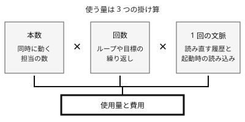

!!! abstract "要点"
    - **何が分かるか**：並列・ループ・workflows の費用は、本数と回数と 1 回の文脈の大きさの掛け算で膨らむ。
    - **いつ引くか**：並列やループで回す前に費用の見当をつけたいとき。夜通しのループで上限や請求が一気に増えたときにも引く。
    - **前提**：<!-- link:begin what-uses-up-limits -->[上限を早く使う要因](what-uses-up-limits.md)<!-- link:end -->

<!-- textlint-disable -->
別名：並列の費用・自動ループの費用・サブエージェントの費用・agent teams の費用・ultracode の費用
<!-- textlint-enable -->

並列・ループ・workflows のコストは、Claude を何本同時に動かし、何回繰り返し、1 回ごとにどれだけの文脈を読ませるかで決まる。1 回の作業は普通の大きさでも、掛け算になると、気づかないうちに使用量が大きくなる。始める前に決めるのは、同時に動かす数、止める条件、費用の上限の 3 つである。

## 費用が膨らむ掛け算 {#multiplication}

夜通しのループを回して朝に見ると、利用枠が尽きていたり、請求が増えていたりする。1 回ごとの作業は小さいのに、全体では大きい。理由は、使う量が足し算ではなく掛け算で決まることにある。

掛け合わせるのは 3 つである。

- **本数**：同時に動く担当の数。サブエージェント、エージェントチームのチームメイト、workflows の担当が当たる。
- **回数**：繰り返しの数。`/loop` の繰り返し、`/goal` のターン、外から同じ依頼を流し直すループが当たる。
- **1 回の文脈の大きさ**：1 回の作業が読む量。Claude は毎ターン、会話の履歴を読み直す。長い会話ほど 1 回が重くなる。担当は起動のたびに、自分の文脈に CLAUDE.md などを読み込む。

下の図は、この 3 つが掛け合わさって使用量になる関係を示す。ほかの 2 つが同じなら、どれか 1 つを 2 倍にすると使用量も 2 倍になる。3 つを少しずつ増やすと、全体は大きく増える。



仕組みを比喩で言い換える。受験者が毎回、問題用紙の最初から全部を読み直してから答えるとする。回答の回数が増えるほど、読み直す紙は厚くなる。別室の部下を増やすと、部下ごとに資料一式を渡して読ませることになり、読む量はその人数ぶん増える。

### 方式ごとの増え方

- **サブエージェント**：別室の部下に調べさせると、本筋の文脈は膨らまない。ただし部下の作業ぶんのトークンは余分にかかる。文脈を分けることは、全体の使用量を減らすことではない。現行の公式の説明は、サブエージェントが今も向く場面を、並べる作業、うるさい出力を本筋から離すこと、独立したレビューとする。どれも追加のトークンがかかる。この変化は <!-- link:begin outdated-advice-ledger#subagents-to-save-context -->[古くなった助言の台帳](../changes/outdated-advice-ledger.md#subagents-to-save-context)<!-- link:end --> に行がある。
- **エージェントチーム**：チームメイトはそれぞれ自分の文脈を持ち、起動したときに CLAUDE.md・MCP サーバー・スキルを読み込む。トークンの使用量は、動いているチームメイトの数に応じて増える。倍率の数字は条件つきである。公式の費用の文書は、チームメイトが plan mode で動くときの値として示す。条件を外して「何倍」と覚えない。どう選ぶかは <!-- link:begin choosing-parallel-modes#compare -->[並列の方式の選び方 › 方式の比較](../delegate/choosing-parallel-modes.md#compare)<!-- link:end --> が扱う。
- **dynamic workflows**：Claude が書いたスクリプトが多数のサブエージェントを背景で動かす。途中の結果はスクリプトの変数に残り、本筋の文脈には入らない。担当の数だけ使用量が増えるので、小さな範囲で試してから広げる（<!-- link:begin dynamic-workflows#when-and-start-small -->[dynamic workflows（スクリプトで多数のサブエージェントを動かす） › 向く規模と、小さく試す](../delegate/dynamic-workflows.md#when-and-start-small)<!-- link:end -->）。起動の語は呼び方が替わっていて、今は <!-- name:begin workflow-to-ultracode -->ultracode（dynamic workflows を起動するキーワード）<!-- name:end --> である。古い書き方は <!-- link:begin outdated-advice-ledger#workflow-keyword-extra-usage -->[古くなった助言の台帳](../changes/outdated-advice-ledger.md#workflow-keyword-extra-usage)<!-- link:end --> にある。
- **`/loop` と `/goal`**：開いているセッションの中で繰り返す。繰り返すほど履歴が伸び、1 回あたりの文脈も大きくなる。長いセッションで増える理由は <!-- link:begin what-uses-up-limits#long-sessions -->[上限を早く使う要因 › 長いセッションで増える理由](what-uses-up-limits.md#long-sessions)<!-- link:end --> にある。

### 枠が尽きたあと

夜通しの実行では、枠が尽きる場面も考える。枠を使い切った作業は、開いたままのセッションで待ち、リセットの後に自動で続く場合がある。この自動の継続は <!-- fact:begin auto-continue-max-times -->3 回まで（2026-11-05 時点）<!-- fact:end --> と決まっている（`/goal` も同じ）。止まり方の詳細は <!-- link:begin goal-until-done#at-usage-limits -->[/goal（完了するまで続けさせる） › 利用上限で止まったとき](../delegate/goal-until-done.md#at-usage-limits)<!-- link:end --> にある。

usage credits を有効にしていると、プランの枠を超えても従量課金で作業が続く。夜通しのループの請求が増える原因になりうる。切り替わる仕組みは <!-- link:begin usage-credits-basics#how-it-works -->[usage credits（上限を超えた分の従量課金） › 切り替わる仕組み](usage-credits-basics.md#how-it-works)<!-- link:end --> にある。

## 始める前に決める三つ {#decide-before-starting}

回す前に、同時に動かす数、止める条件、費用の上限の 3 つを決める。任せる幅を広げる内容なので、守りを先に置く。結果を確かめる手段も、同じ流れで決める。

1. **同時に動かす数**：本数は、機械の限界や予算ではなく、結果を確かめる人の手が回る数で決める。レビューの要る本流は少なく、調査や使い捨ての試作は多めにする。考え方は <!-- link:begin humans-set-the-parallel-limit#mainline-vs-scouting -->[並列の上限は人間が決める › 本流と偵察で本数を分ける](../delegate/humans-set-the-parallel-limit.md#mainline-vs-scouting)<!-- link:end --> と <!-- link:begin humans-set-the-parallel-limit#guards-before-widening -->[並列の上限は人間が決める › 本数を増やす前に置く守り](../delegate/humans-set-the-parallel-limit.md#guards-before-widening)<!-- link:end --> にある。方式の選び方は <!-- link:begin choosing-parallel-modes#who-coordinates -->[並列の方式の選び方 › 誰が調整するか](../delegate/choosing-parallel-modes.md#who-coordinates)<!-- link:end --> が扱う。
2. **止める条件**：回数の上限、終わりの状態、前より進まなくなったら止まる、の 3 つを依頼に書く。条件を書いていないループは、終わりの条件を満たすか別の上限に着くまで回りうる。`/goal` なら、条件に終わりの状態、証明、変えないもの、上限を入れる（<!-- link:begin goal-until-done#writing-conditions -->[/goal（完了するまで続けさせる） › 条件の書き方（終わりの状態・証明・変えないもの・上限）](../delegate/goal-until-done.md#writing-conditions)<!-- link:end -->）。やめる基準を着手前に書く考え方は <!-- link:begin decide-when-to-quit#write-criteria-first -->[やめどきを先に決める（撤退基準を着手前に書き、実装者以外が判定する） › 基準を着手前に書く](../judgment/decide-when-to-quit.md#write-criteria-first)<!-- link:end --> にある。
3. **費用の上限**：仕組みで止める上限を置く。非対話モードの `claude -p` には、ターン数の上限 `--max-turns` と、費用の上限 `--max-budget-usd` がある（<!-- link:begin outdated-advice-ledger#ralph-loops -->[古くなった助言の台帳](../changes/outdated-advice-ledger.md#ralph-loops)<!-- link:end --> も参照）。usage credits は、月の上限額と通知を先に決める（<!-- link:begin usage-credits-basics#set-a-cap -->[usage credits（上限を超えた分の従量課金） › 上限額と通知を決める](usage-credits-basics.md#set-a-cap)<!-- link:end -->）。

プロンプトに書いた上限は依頼であって、鍵ではない。確実に止めたい費用の上限は、依頼の文ではなく、`--max-turns`・`--max-budget-usd`・usage credits の上限額のような仕組みで置く。依頼の文の上限は、それを補う手がかりになる。

最初は小さな範囲で 1 回だけ試す。1 回に使った量を `/usage` で見て、本数と回数を掛けて全体の見当をつける。見方は <!-- link:begin what-uses-up-limits#find-what-uses-it -->[上限を早く使う要因 › /usage の内訳の読み方（自分の場合を確かめる）](what-uses-up-limits.md#find-what-uses-it)<!-- link:end --> にある。見当がついたら、本数か回数のどちらか 1 つだけを増やす。

次の雛形は、回数の上限と止める条件を依頼の本文に書く例である。

<!-- gen:begin snippet parallel-and-loop-costs/loop-with-limits -->
<!-- textlint-disable -->

??? example "雛形：回数の上限と止める条件を書いたループの依頼"

    ```markdown
    <作業の内容。例：src/legacy/ の関数を新しい書き方へ移す> を、次の決まりで進めてほしい。

    - 範囲：<触ってよいファイルやディレクトリ> だけ。最初は <全体の一部> で 1 回試し、1 回に使った量（ターン数とおおよそのトークン）を報告する。
    - 回数の上限：<N> 回まで。<N> 回目が終わったら、続きを自分で始めない。
    - 同時に動かす数：担当（サブエージェント）は同時に <M> つまで。<M> を超えて増やさない。
    - 終わりの条件：<測れる結果。例：`npm test` が全部通る>。実行したコマンドと出力を、そのまま返答に出す。
    - 止まって報告する条件：同じ失敗が <K> 回続いたとき、1 回の進みが前の回より小さくなったとき、上の回数の上限に着いたとき。試したことと残りを書いて止まる。
    - 最後の報告：実行した回数、通った件数と全体の件数、残った作業。
    ```

    動作を確かめていない雛形。要る最低の版：Claude Code 1.0.60。

<!-- textlint-enable -->
<!-- gen:end snippet parallel-and-loop-costs/loop-with-limits -->

人が見ていない実行は、終了コードや要約だけで終わりにしない。出力・記録・差分で確かめる（<!-- link:begin checking-unattended-runs#beyond-exit-codes -->[無人実行の結果を確かめる › 終了コードと要約だけで決めない](../verify/checking-unattended-runs.md#beyond-exit-codes)<!-- link:end -->）。戦略そのものを AI に改善させ続ける開いたループは、仕様の決まった閉じた反復とは別物で、回すほど良くなるとは限らない（<!-- link:begin open-ended-loop-trap#closed-vs-open -->[AI に改善を回させ続ける罠（開いたループ） › 閉じた反復と開いたループ](../delegate/open-ended-loop-trap.md#closed-vs-open)<!-- link:end -->）。

!!! example "判断例：夜通しの移行をどう始めるか"
    - **状況**：多数のファイルを新しい書き方へ移す作業を、夜のうちに workflows で終わらせたい。
    - **迷う候補**：全部を一度に流して、朝に結果を見る（うまくいけば最も早く終わる）。小さな範囲で 1 回試し、使用量を見てから広げる。
    - **選んだもの**：小さな範囲で 1 回試し、使用量を見てから広げる。
    - **理由**：全部を一度に流すと、1 回の使用量が分からないまま、担当の数だけ掛け算になる。朝に枠が尽きていれば、その日の作業ができない。小さく試せば、掛け算の見当がつき、止める条件も実際の失敗を見て書ける。時間はかかるが、夜の実行を無駄にしない。

## 実例の読み方（自己申告と時点） {#reading-examples}

記事や投稿には、並列やループの費用の実例がある。実例の金額は、そのまま自分の見積もりにしない。条件が違うためである。読むときは、次の 4 つを確かめる。

- **いつの値か**：モデル、料金、Claude Code の版が替われば、同じ作業の費用も替わる。
- **誰の申告か**：本人の自己申告か、論評の推定か、公式の記録か。
- **何を数えたか**：トークンと金額のどちらか、1 回の実行とチーム全体のどちらか。
- **どんな条件か**：plan mode のような条件、機能、期間。

実例の種類ごとに、何として読むかを表にする。

| 実例 | 何として読むか |
| --- | --- |
| 競技や大会での自律エージェントの費用の報告 | 時点依存。費用が反復の回数に比例して大きくなった、という向きの目安にする（根拠：弱）。1 つのプレプリントに頼る数字は、その研究の値として読む |
| Anthropic の 2025 年の Research 機能の報告 | マルチエージェントの構成は、通常のチャットの約 15 倍のトークンを使った（根拠：中）。2025 年の Research 機能の値で、Claude Code のサブエージェントには直接当てはまらない |
| エージェントチームの倍率 | 公式の費用の文書の値は、チームメイトが plan mode で動くときの条件つき。チームの文書は倍率を書かず、動いている数に応じて増えるとだけ書く |
| 数十のエージェントを役割分担させる構成の月額 | 論評の推定。計測ではない（根拠：弱）。ボトルネックが設計・計画・判断へ移る、という論点を読む |

この表の数字は、どれも「その時点のその条件の値」である。自分の作業の使用量は、小さく試して `/usage` で測る。

## 何に効くか（原理と原因） {#effects}

このページの知識は、原理の「握る」「縛る」と、Claude 側の原因の「合っていない」、人の側の落とし穴の「やめられない」に効く。全体の枠組みは <!-- link:begin four-principles -->[四つの原理と比例則（見せる・確かめる・縛る・握る）](../start/four-principles.md)<!-- link:end --> と <!-- link:begin six-causes -->[失敗の二つの軸と診断の入口](../start/six-causes.md)<!-- link:end --> にある。

- **握る**：本数、止める条件、費用の上限は、人が始める前に決める。始めた後に Claude の判断に任せると、掛け算の 3 つのどれもが伸びる。
- **縛る**：決めた上限は、仕組みで置く。`--max-turns`、`--max-budget-usd`、usage credits の上限額は、依頼の文より確かに止める。
- **合っていない（原因）**：本数や回数が、プランの枠や作業の大きさに合っていないと、枠にすぐ当たる。小さく試して、合う大きさを見つける。
- **やめられない（落とし穴）**：止める条件のないループは、費やした分だけ続けたくなる。やめる基準を着手前に書き、作った本人以外が判定する（<!-- link:begin decide-when-to-quit#separate-the-judge -->[やめどきを先に決める（撤退基準を着手前に書き、実装者以外が判定する） › 判定を作った本人から離す](../judgment/decide-when-to-quit.md#separate-the-judge)<!-- link:end -->）。

## 誤解 {#misconceptions}

- **「サブエージェントに任せれば節約になる」**：本筋の文脈は守れても、全体のトークンは増える。コンテキストを守るためだけに調べさせる助言は、条件つきになった（<!-- link:begin outdated-advice-ledger#subagents-to-save-context -->[古くなった助言の台帳](../changes/outdated-advice-ledger.md#subagents-to-save-context)<!-- link:end -->）。調査を任せる条件は <!-- link:begin research-in-subagents#when -->[出力の多い調査はサブエージェントに任せて要約だけ受け取る › 任せてよい調査、本筋で読むべきもの](../context/research-in-subagents.md#when)<!-- link:end --> にある。
- **「エージェントチームは何倍かかる」**：倍率は条件つきの値で、チームメイトが plan mode で動くときの公式の値である。数字だけを覚えず、動いている数と条件で考える。
- **「並列にすれば安く速く終わる」**：速くなっても、使用量は担当の数だけ増える。結果を確かめる手間も、本数に応じて増える。
- **「ループは何回でも 1 回ずつ同じ費用で済む」**：履歴が伸びて、回すほど 1 回が重くなる（<!-- link:begin what-uses-up-limits#long-sessions -->[上限を早く使う要因 › 長いセッションで増える理由](what-uses-up-limits.md#long-sessions)<!-- link:end -->）。
- **「外のループで流し直すのが確実」**：プラグインや自作の bash ループで回し続ける方法は、`/goal`・`/loop`・dynamic workflows に置き換わった。止まる条件と使う量の上限を先に決める（<!-- link:begin outdated-advice-ledger#ralph-loops -->[古くなった助言の台帳](../changes/outdated-advice-ledger.md#ralph-loops)<!-- link:end -->）。

<!-- gen:begin references -->
<!-- textlint-disable -->

## 参考 {#references}

- [Manage costs effectively](https://code.claude.com/docs/en/costs)：Anthropic・英語・確認日 2026-11-04
- [Orchestrate teams of Claude Code sessions](https://code.claude.com/docs/en/agent-teams)：Anthropic・英語・確認日 2026-11-04
- [Orchestrate subagents at scale with dynamic workflows](https://code.claude.com/docs/en/workflows)：Anthropic・英語・確認日 2026-11-04
- [Keep Claude working toward a goal](https://code.claude.com/docs/en/goal)：Anthropic・英語・確認日 2026-11-04
- [Run prompts on a schedule](https://code.claude.com/docs/en/scheduled-tasks)：Anthropic・英語・確認日 2026-11-04
- [Create custom subagents](https://code.claude.com/docs/en/sub-agents)：Anthropic・英語・確認日 2026-11-04
- [Interactive mode](https://code.claude.com/docs/en/interactive-mode)：Anthropic・英語・確認日 2026-11-04
- [CLI reference](https://code.claude.com/docs/en/cli-reference)：Anthropic・英語・確認日 2026-11-04
- [How we built our multi-agent research system](https://www.anthropic.com/research/multi-agent-research-system)：Anthropic・英語・確認日 2026-11-04

<!-- textlint-enable -->
<!-- gen:end references -->

<!-- gen:begin page-links -->
<!-- textlint-disable -->

<div class="ca-page-links" markdown>

**前提**

- [上限を早く使う要因](what-uses-up-limits.md)

**関連**

- [並列の上限は人間が決める](../delegate/humans-set-the-parallel-limit.md)
- [並列の方式の選び方](../delegate/choosing-parallel-modes.md)
- [/goal（完了するまで続けさせる）](../delegate/goal-until-done.md)
- [/loop と定期実行の方式](../delegate/loop-and-scheduling.md)
- [dynamic workflows（スクリプトで多数のサブエージェントを動かす）](../delegate/dynamic-workflows.md)
- エージェントチーム（複数の Claude に分担させる）（準備中）
- [出力の多い調査はサブエージェントに任せて要約だけ受け取る](../context/research-in-subagents.md)
- [無人実行の結果を確かめる](../verify/checking-unattended-runs.md)
- [やめどきを先に決める（撤退基準を着手前に書き、実装者以外が判定する）](../judgment/decide-when-to-quit.md)
- [AI に改善を回させ続ける罠（開いたループ）](../delegate/open-ended-loop-trap.md)
- [usage credits（上限を超えた分の従量課金）](usage-credits-basics.md)

</div>

<!-- textlint-enable -->
<!-- gen:end page-links -->
