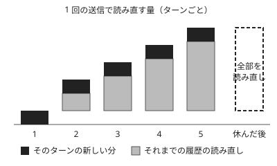

!!! abstract "要点"
    - **何が分かるか**：利用枠を早く減らす原因は、長い会話の送り直しと、ツール・effort・並列の作業で、/usage で自分の場合を確かめられる。
    - **いつ引くか**：使用量が急に増えた、何が枠を食っているのか分からない、/usage の内訳をどう読めばよいか知りたいとき。
    - **前提**：<!-- link:begin how-usage-limits-work -->[利用上限の仕組み（面をまたいで共有する枠）](how-usage-limits-work.md)<!-- link:end -->、<!-- link:begin rereads-whole-history -->[毎ターン全履歴を読み直す](../basics/rereads-whole-history.md)<!-- link:end -->

<!-- textlint-disable -->
別名：使用量が多い・トークンを食う・Claude Code のコストを見る・/usage の内訳
<!-- textlint-enable -->

上限を早く使う要因とは、同じ利用枠を、ふだんより速く減らしてしまう使い方のことである。原因は 1 つに決まらない。会話の長さ、添付、ツール、モデルと effort、並列の作業が重なって減る。このページは、原因の一覧と、自分の場合に何が使っているかを確かめる読み方を持つ。

## 枠を早く減らす原因 {#causes}

利用枠を早く減らす原因は、公式の案内に挙がるものを、次の表に並べる。上から順に、1 回の送信が大きくなるもの、1 回の作業の中で動きが増えるもの、作業そのものが数を増やすものである。アプリ・Claude Code・Desktop は同じ枠を分け合う（<!-- link:begin how-usage-limits-work#shared-limit -->[利用上限の仕組み（面をまたいで共有する枠） › 面をまたいで一つの枠](how-usage-limits-work.md#shared-limit)<!-- link:end -->）ので、どの面で使っても同じ枠から減る。

| 要因 | なぜ枠を使うか | 詳しく読む所 |
| --- | --- | --- |
| 会話の長さ・添付・メッセージの長さ | 毎回、会話の最初から読み直すので、積もった分が毎ターン乗る | <!-- link:begin rereads-whole-history#why -->[毎ターン全履歴を読み直す › なぜそうなるか](../basics/rereads-whole-history.md#why)<!-- link:end --> |
| ツールとコネクタ | 検索や調査で読み込む量が大きい。公式はトークンを多く使うものとして挙げる | <!-- link:begin always-on-costs#resident-vs-on-demand -->[常駐するもののコスト（CLAUDE.md・MCP・スキル） › 常駐するものと、使うときだけ読むもの](../context/always-on-costs.md#resident-vs-on-demand)<!-- link:end --> |
| モデルと effort | 高い effort ほど考えるトークンが増える。最上位のモデルは、ほかより速く減る | <!-- link:begin effort-levels#levels -->[effort の段階と使い分け › 段ごとの振る舞い](../models/effort-levels.md#levels)<!-- link:end -->、<!-- link:begin before-using-top-model#which-limit -->最上位のモデルを使う前に › どの枠から引かれるか（プランごとの表）（準備中）<!-- link:end --> |
| artifact の作成と利用 | 生成物を作って直すたびに、出力と読み直しが増える | <!-- link:begin saving-priorities#order -->[節約の優先順位（手戻りを減らすのが先） › 優先順位](saving-priorities.md#order)<!-- link:end --> |
| 多段の作業（コード実行・ファイル作成・ブラウジング） | 1 回の依頼の中で、ツールの呼び出しと結果の読み込みが連なる | <!-- link:begin saving-priorities#reduce-rework -->[節約の優先順位（手戻りを減らすのが先） › 手戻りを減らす](saving-priorities.md#reduce-rework)<!-- link:end --> |
| サブエージェント・並列・ループ・workflows | 本数と回数と 1 回の文脈の大きさの掛け算で増える | <!-- link:begin parallel-and-loop-costs#multiplication -->[並列・ループ・workflows のコスト › 費用が膨らむ掛け算](parallel-and-loop-costs.md#multiplication)<!-- link:end --> |

出典は、Help Center の利用上限の案内と、Claude Code の費用の文書である（2026-10 時点の確認）。公式が挙げる要因の数と並びは変わりうるので、この表を網羅とは読まない。

公式のエンジニアリング記事は、マルチエージェントの構成が通常のチャットよりかなり多くのトークンを使うと述べる（根拠：中。企業の一次の報告で、構成と課題に依存する）。

この辞典は、消費を最も左右するのはモデルの選択より、長い文脈の送り直しだと読む。サブエージェント・並列・workflows で数が増えることも大きい（根拠：中。公式文書からの読みで、版に依存する）。

## 長いセッションで増える理由 {#long-sessions}

長いセッションで使用量が増えるのは、1 回ごとの送信が重くなり、休んだ後はキャッシュが切れて、その重い履歴を全部読み直すからである。仕組みの本体は <!-- link:begin rereads-whole-history#what-happens -->[毎ターン全履歴を読み直す › 何が起きるか](../basics/rereads-whole-history.md#what-happens)<!-- link:end --> にあり、ここでは使用量の側から要点だけを並べる。

公式の費用の文書は、長いセッションで消費が膨らむ理由として、次を挙げる。

- 毎回のリクエストで、全履歴を送り直す。
- しばらく休んだ後は、キャッシュが切れて、同じ前置きをもう一度全部読み直す。
- `/loop` など、定期で動くタスクが、人の手を離れて回り続ける。
- サブエージェントや workflows が、別の文脈で作業を増やす。
- 圧縮そのものにも、履歴を要約する大きなリクエストの費用がかかる。

次の図は、最初の 3 つを 1 枚にしたものである。毎ターン、前までの履歴を読み直す分が積み上がり、休んだ後は、積み上げた分がまるごと読み直しになる。



比喩で言えば、毎回、最初から読み直す受験者に同じ長さの問題集を渡し続けているようなもので、1 問を足すたびに読み直しの量が増える。キャッシュは、同じ前置きが続く間だけ、その読み直しを安くする積み木である。

効く手は、長さを分けることである。無関係な作業の間で `/clear` すると、次の作業は空の文脈から始まり、`/clear` 自体に費用はかからない。一方、`/compact` のような圧縮は、要約を作る分の費用がかかる。どちらを使うかは、続きの作業が前の履歴を要るかで決める。

## /usage の内訳の読み方（自分の場合を確かめる） {#find-what-uses-it}

自分の場合に何が枠を使っているかは、推測せず、使用量の画面で測る。見る場所は面で違う。

=== "アプリ"

    公式の節約の案内が挙げるのは、設定の使用量（Settings > Usage）の進捗バーを見ることである。バーで見るのは枠の減り方である。減りが速いときは、節「枠を早く減らす原因」の表の要因を 1 つずつ疑って切り分ける。切り分ける順は <!-- link:begin hits-limits-quickly#diagnosis -->[すぐ上限に当たる › 原因を安く確かめる順](../symptoms/hits-limits-quickly.md#diagnosis)<!-- link:end --> にある。

=== "Claude Code"

    使用量を見るコマンドは、今は <!-- name:begin cost-stats-to-usage -->/usage<!-- name:end --> である。古い記事の `/cost` と `/stats` は、今も打てる別名として、`/usage` の該当のタブを開く（<!-- link:begin outdated-advice-ledger#slash-cost-and-stats -->[古くなった助言の台帳](../changes/outdated-advice-ledger.md#slash-cost-and-stats)<!-- link:end -->）。

    `/usage` は、セッションの費用、プランの枠の使用量、利用の統計を見せる。プランによっては、何が枠に数えられたかの内訳と、減らすための推奨も出る。内訳の項目の名前と並びは画面で変わりやすいので、ここでは項目の名前を決め打ちしない。2026-10 時点の公式の文書では、スキル・サブエージェント・プラグイン・MCP ごとの比率が挙がっている。

    Claude Code は WSL・Linux の CLI を基準にして書いている。ほかの OS と IDE 拡張の画面は未確認である。

読み方は 3 手で足りる。

1. 枠の使用量と、セッションの費用を分けて見る。セッションの費用は、API で使う人向けの推定値で、プランの枠の残りとは別物である。枠の減り方を知りたいときは、プランの枠の側を読む。
2. 内訳でいちばん大きい項目を 1 つ決める。全部を同時に減らそうとしない。
3. その項目を減らす手を 1 つだけ変え、次のセッションの内訳で変わったかを見る。変わらなければ、別の項目に移る。

!!! example "判断例：内訳でサブエージェントと MCP が大きいとき"
    - **状況**：Claude Code で 1 日作業した。`/usage` の内訳を見ると、サブエージェントの比率がいちばん大きく、次に MCP が来る。
    - **迷う候補**：サブエージェントを使うのをやめる。使わない MCP を外す。会話を短く切る。
    - **選んだもの**：先に、使わない MCP を外す。サブエージェントは、本数と 1 回の文脈の大きさを見直してから、残すかを決める。
    - **理由**：サブエージェントは別室の部下で、片付けの作業を本体の文脈から離せる利点もある。やめると、本体の文脈が太って逆に増えることがある。使わない MCP は外しても困らず、毎回の常駐の分が確実に減る。

内訳の判断（どれを削るか）は <!-- link:begin insights-and-usage-review#usage-breakdown -->/insights と /usage で振り返る › /usage の内訳から削るものを選ぶ（準備中）<!-- link:end --> が持つ。道具の一覧とステータスラインへの出し方は <!-- link:begin usage-context-statusline#instruments -->[/usage・/context・ステータスラインで状態を見る › 三つの道具で見えるもの](../cli/usage-context-statusline.md#instruments)<!-- link:end --> を引く。内訳を読んだ後に自分で試せる依頼を、下に置く。

<!-- gen:begin snippet what-uses-up-limits/ask-usage-breakdown -->
<!-- textlint-disable -->

??? example "雛形：内訳を読んで、減らす候補を出させる依頼"

    ```markdown
    /usage を開いて、使用量の内訳と推奨を見てください。
    内訳でいちばん大きい項目を 1 つ挙げて、
    それを減らすために私が次の作業で変えられることを、
    変える手間が小さい順に 3 つ以内で示してください。
    推奨をそのまま適用せず、私が選べるように理由を添えてください。
    ```

    動作を確かめていない雛形。要る最低の版：Claude Code 2.0.0。

<!-- textlint-enable -->
<!-- gen:end snippet what-uses-up-limits/ask-usage-breakdown -->

## 何に効くか（原理と原因） {#effects}

このページが効く原理は「見せる」である。使用量の内訳を見える形にすれば、減りが速い理由を推測でなく測って決められる。減る理由は、次の 2 つの原因に分けて読む。

- **散らかっている**：関係のない履歴や、常駐する指示・ツールの一覧が文脈に積もっている。毎回送り直す対象が太るので、枠を余分に使う。無関係な作業の間で切る、常駐を小さく保つ、が効く。
- **合っていない**：仕事の大きさに対して、モデルや effort が重い、または並列の本数が多い。成果が増えないまま、枠だけが減る。段を作業に合わせて下げるか、始める前に本数と止める条件を決める。

どちらから手を付けるかの優先順位は <!-- link:begin saving-priorities#order -->[節約の優先順位（手戻りを減らすのが先） › 優先順位](saving-priorities.md#order)<!-- link:end --> が持つ。小手先の節約より先に、手戻りを減らすほうが効く場面が多い。

## 誤解 {#misconceptions}

- **会話を片付ければ、使った分が戻る**：戻らない。`/clear` で減らせるのは、次のターン以降に送り直す量だけである。すでに減った枠は戻らない。
- **窓が広くなったので、長さを気にしなくてよい**：溢れる心配は減っても、関係のない文脈が答えの質と費用を下げる点は変わらない（<!-- link:begin large-context-window#cost-of-long-context -->広いコンテキストウィンドウとの付き合い方 › 長い文脈の費用（準備中）<!-- link:end -->）。
- **モデルを下げれば、いちばん節約できる**：下げて効く場面もある。ただ、長い文脈の送り直しと並列の増殖のほうが大きい場面が多い（根拠：中。公式文書からの読みで、版に依存する）。内訳で確かめてから決める。
- **「think hard」と書き足せば、考える深さが増える**：2026-10 の公式文書では、この言い回しは effort を上げる言葉として働かず、普通の文として渡る（<!-- link:begin thinking-keywords#plain-text-phrases -->[「考えて」と書くことの現在（ultrathink） › 普通の文として渡る言い回し](../models/thinking-keywords.md#plain-text-phrases)<!-- link:end -->）。深さは effort で決める（<!-- link:begin effort-levels#levels -->[effort の段階と使い分け › 段ごとの振る舞い](../models/effort-levels.md#levels)<!-- link:end -->）。

<!-- gen:begin references -->
<!-- textlint-disable -->

## 参考 {#references}

- [Manage costs effectively](https://code.claude.com/docs/en/costs)：Anthropic・英語・確認日 2026-11-04
- [Usage limit best practices](https://support.claude.com/en/articles/9797557-usage-limit-best-practices)：Anthropic・英語・確認日 2026-11-04
- [How do usage and length limits work?](https://support.claude.com/en/articles/11647753-how-do-usage-and-length-limits-work)：Anthropic・英語・確認日 2026-11-04
- [Claude Fable models on your plan](https://support.claude.com/en/articles/15424964-claude-fable-models-on-your-plan)：Anthropic・英語・確認日 2026-11-04
- [Commands](https://code.claude.com/docs/en/commands)：Anthropic・英語・確認日 2026-11-04
- [Model configuration](https://code.claude.com/docs/en/model-config)：Anthropic・英語・確認日 2026-11-04
- [Effort](https://platform.claude.com/docs/en/build-with-claude/effort)：Anthropic・英語・確認日 2026-11-04
- [How we built our multi-agent research system](https://www.anthropic.com/research/multi-agent-research-system)：Anthropic・英語・確認日 2026-11-04

<!-- textlint-enable -->
<!-- gen:end references -->

<!-- gen:begin page-links -->
<!-- textlint-disable -->

<div class="ca-page-links" markdown>

**前提**

- [利用上限の仕組み（面をまたいで共有する枠）](how-usage-limits-work.md)
- [毎ターン全履歴を読み直す](../basics/rereads-whole-history.md)

**次に読む**

- [節約の優先順位（手戻りを減らすのが先）](saving-priorities.md)
- [並列・ループ・workflows のコスト](parallel-and-loop-costs.md)

**関連**

- [すぐ上限に当たる](../symptoms/hits-limits-quickly.md)
- [/usage・/context・ステータスラインで状態を見る › 三つの道具で見えるもの](../cli/usage-context-statusline.md#instruments)
- /insights と /usage で振り返る（準備中）
- [常駐するもののコスト（CLAUDE.md・MCP・スキル）](../context/always-on-costs.md)
- [effort の段階と使い分け](../models/effort-levels.md)
- 広いコンテキストウィンドウとの付き合い方 › 長い文脈の費用（準備中）
- 最上位のモデルを使う前に（準備中）

</div>

<!-- textlint-enable -->
<!-- gen:end page-links -->
