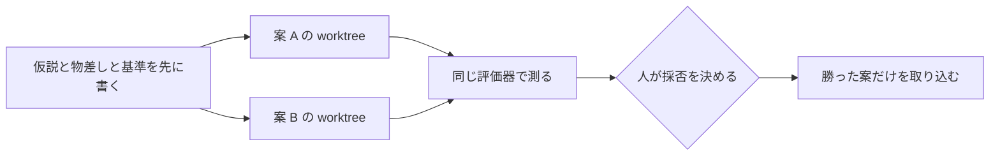

!!! abstract "要点"
    - **何ができるか**：仮説ごとに worktree かブランチを分けて別々に実装させ、同じ評価器で比べて、勝った方だけを取り込める。
    - **いつ引くか**：2 つの設計案を実際に作らせて比べたいとき。案を順に試していて、前の案と同じ条件で比べられなくなったとき。
    - **決めるのは人**：仮説、物差し、採否は人が決める。Claude に任せるのは、案ごとの実装と評価器の実行まで。
    - **前提**：<!-- link:begin parallel-with-worktrees -->[git worktree で並列にする](parallel-with-worktrees.md)<!-- link:end -->、<!-- link:begin experiment-log -->[実験台帳（仮説を先に書く・提案者・分母・検証器の版）](../eval/experiment-log.md)<!-- link:end -->

<!-- textlint-disable -->
別名：設計案を並べて実装する・A と B を作って比べる
<!-- textlint-enable -->

仮説ごとに並べて、同じ物差しで比べるとは設計案や解法の案ごとに worktree かブランチを分けて実装させ、同じ評価器で測り、勝った案だけを取り込む手順である。案を順に試すと、後の案ほど前の案で得た知識や変わった前提を引きずる。すると、同じ条件では比べられない。このページは、並べる前に決めておくことと、手順と、結果を信じてよいかの確かめ方を扱う。

比べる対象は、業務の設計案（キャッシュ層を入れるか、クエリを直すか）でも、コンテストの解法（解法 A と B）でもよい。負けた案は取り込まないので、2 つの案をまとめるための衝突の解決は要らない。

## 先に整える守り {#guards}

案を並べると、確かめていない結果が一度に増える。並べる前に、仮説と物差しと採否の基準を人が書いて固定する。並べる本数を増やすのは、その後である。

- **仮説を先に書く**：何と何を比べ、どちらがどの点で勝つと予想するかを、実装の前に書く。結果を見てからの後付けを防ぐ。書き方は <!-- link:begin experiment-log#hypothesis-first -->[実験台帳（仮説を先に書く・提案者・分母・検証器の版） › 仮説を先に書く](../eval/experiment-log.md#hypothesis-first)<!-- link:end --> を読む。
- **物差しを実装の前に固定する**：評価器（テスト、ベンチマーク、採点のスクリプト）は案を作る前に決め、案を作る Claude が書き換えられない場所に置く。案ごとに評価器が違うと、勝ち負けが案の差か物差しの差か分からない。評価器の版の残し方は <!-- link:begin experiment-log#verifier-version -->[実験台帳（仮説を先に書く・提案者・分母・検証器の版） › 検証器の版を残す](../eval/experiment-log.md#verifier-version)<!-- link:end --> にある。
- **勝ちの基準と打ち切りを書く**：どれだけの差で勝ちとするか、どこで打ち切るかを着手前に書く。書き方は <!-- link:begin decide-when-to-quit#write-criteria-first -->[やめどきを先に決める（撤退基準を着手前に書き、実装者以外が判定する） › 基準を着手前に書く](../judgment/decide-when-to-quit.md#write-criteria-first)<!-- link:end --> を読む。
- **採否を人が握る**：何を比べるか、何で測るか、どちらを取り込むかは人が決める。案を増やし続けさせたり、評価器を直させ続けたりする運用にはしない。その理由は <!-- link:begin open-ended-loop-trap -->[AI に改善を回させ続ける罠（開いたループ）](open-ended-loop-trap.md)<!-- link:end --> にある。
- **本数を人が読める量に絞る**：多くの比較は 2 案で足りる。結果を読んで採否を決められる数を超えて並べない。本数の決め方は <!-- link:begin humans-set-the-parallel-limit#mainline-vs-scouting -->[並列の上限は人間が決める › 本流と偵察で本数を分ける](humans-set-the-parallel-limit.md#mainline-vs-scouting)<!-- link:end --> にある。
- **worktree ごとの準備を決める**：依存の導入と秘密のファイルの扱いは worktree ごとに決める。やり方は <!-- link:begin parallel-with-worktrees#per-worktree-setup -->[git worktree で並列にする › worktree ごとの準備（依存・秘密・データベース）](parallel-with-worktrees.md#per-worktree-setup)<!-- link:end --> にある。

## 手順 {#steps}

案ごとに同じ基点から worktree を切り、同じ枠の依頼で別のセッションに実装させ、同じ評価器で測り、人が採否を決める。流れは次のとおりで、評価器と基準は案を作る前に決まっている。



各段の終わりに、その段が済んだことを確かめる。

1. **問いと仮説を書く**。比べる問いと、案 A・案 B の中身と予想を記録に書く。確かめ：実装を始める前の日付で、案ごとの予想が記録に残っている。
2. **評価器を固定する**。評価器を、案を作るディレクトリの外に置く。確かめ：案のない基点で評価器を 1 回走らせ、最後まで動き、基準の値が取れる。
3. **案ごとに worktree を切る**。同じ基点のコミットから、案ごとに worktree とブランチを作る。確かめ：`git worktree list` に案ごとの作業ディレクトリが並び、基点が同じである。
4. **案ごとに別のセッションで実装させる**。依頼の枠（目的、完了の条件、触ってよい範囲）は同じにして、案の違いだけを変える。評価器と評価の入力は書き換えさせない。確かめ：各案の差分が自分の worktree の中だけにあり、評価器のファイルを含まない。
5. **同じ評価器で測る**。評価器の版、入力、試行の数を案どうしでそろえる。結果がぶれるなら、試行を重ねる。試行の数の考え方は <!-- link:begin measure-changes#how-many-runs -->[変更が効いたかを測る（小さな eval） › 試行の数と差の大きさ](../eval/measure-changes.md#how-many-runs)<!-- link:end --> にある。確かめ：結果の表で、評価器の版・入力・試行が案どうしで同じである。
6. **人が採否を決める**。結果と差分を人が読み、あらかじめ書いた基準と照らして決める。測れない面（読みやすさ、保守のしやすさ）は、基準に書いてあるものだけを見る。確かめ：決めた理由が、基準のどれかに対応している。
7. **勝った案だけを取り込む**。負けた案は取り込まず、何を試し、何で負けたかを残してから worktree を片付ける。片付けと残すものは <!-- link:begin parallel-with-worktrees#cleanup -->[git worktree で並列にする › 片付けと残すもの](parallel-with-worktrees.md#cleanup)<!-- link:end --> にある。確かめ：本流に入った差分が 1 案分だけで、負けた案の記録が残っている。

!!! example "判断例：解法を順に作るか、並べて比べるか"
    - **状況**：コンテスト向けの最適化問題で、解法 A と解法 B のどちらで進めるか迷っている。どちらも、手元の入力に対する採点のスクリプトで点が出せる。
    - **迷う候補**：A を作り込んでから B に移る。または、A と B を worktree に分けて同時に実装させ、同じ採点で比べる。
    - **選んだもの**：同じ入力の集合と同じ採点のスクリプトを先に固定し、A と B を別の worktree で実装させて比べる。
    - **理由**：順に作ると、A の作り込みで得た知識が B に入り、手元の入力への慣れも変わるので、同じ条件で比べられない。並べれば、差を案の違いに絞れる。一方、勝敗が僅差なら案を足さず、ケースや試行を増やす。その進め方は <!-- link:begin running-contest-experiments#more-cases -->実験の回し方（ケース数・集計・パラメータ・勝率に要る試合数） › ぶれるならケースを増やす（準備中）<!-- link:end --> にある。

## 雛形：比較の記録と手順 {#template}

実装の前に埋める記録と、worktree の切り方、評価の表をまとめた雛形である。値は例なので、自分の問いと評価器に置き換える。

<!-- gen:begin snippet compare-hypotheses-in-parallel/compare-procedure -->
<!-- textlint-disable -->

??? example "雛形：仮説ごとの worktree と同じ評価器で比べる手順（記録の雛形）"

    ````markdown
    # 仮説ごとの比較（記録の雛形）

    ## 1. 実装を始める前に書く（日付：<書いた日>）

    - 比べる問い：<例：検索の遅さを、キャッシュ層で直すか、クエリの改善で直すか>
    - 仮説 A：<案の中身と、勝つと予想する理由>
    - 仮説 B：<案の中身と、勝つと予想する理由>
    - 物差し：評価器 `../eval/evaluate.sh`（版：<コミット>）、入力 <評価用の入力の場所>、試行 <回数> 回
    - 勝ちの基準：<例：指標がこの幅以上よくなり、既存のテストが全部通る。差がそれ未満なら引き分け>
    - 打ち切り：<例：どちらも基準に届かなければ、案を足さずここで止めて、方針を見直す>
    - 採否を決める人：<人の名前か役割>

    ## 2. 準備（同じ基点から、案ごとに分ける）

    ```bash
    git worktree add -b hyp-a ../hyp-a main
    git worktree add -b hyp-b ../hyp-b main
    git worktree list
    ```

    - 評価器は、どちらの worktree の外（`../eval/`）に置く。実装を頼むセッションには、評価器と評価の入力を書き換えないよう頼む
    - 依存の導入と、秘密のファイルの扱いは worktree ごとに決める

    ## 3. 実装の依頼（案ごとに別のセッションで、枠を同じにする）

    ```text
    目的：<同じ文>
    完了の条件：<同じ文。評価器 ../eval/evaluate.sh が最後まで走る、など>
    やり方：<案 A または案 B の違いだけをここに書く>
    触ってよい範囲：この worktree の中だけ。../eval/ は読むだけで、書き換えない
    ```

    ## 4. 同じ評価器で測る

    ```bash
    ../eval/evaluate.sh ../hyp-a
    ../eval/evaluate.sh ../hyp-b
    ```

    | 案 | 評価器の版 | 入力 | 試行 | 結果 | 既存のテスト |
    | --- | --- | --- | --- | --- | --- |
    | A | <同じ> | <同じ> | <同じ> | <値> | <通った／落ちた> |
    | B | <同じ> | <同じ> | <同じ> | <値> | <通った／落ちた> |

    ## 5. 採否を人が決めて、勝った方だけを取り込む

    - 決めた案：<A または B または引き分け>
    - 先に書いた基準との対応：<どの基準を満たしたか>
    - 基準にない理由で決めたとき：<理由と、次から基準に足すこと>

    ```bash
    git switch main
    git merge --no-ff hyp-a
    ```

    - 負けた案の記録（何を試し、何で負けたか）を残してから、worktree を片付ける

    ```bash
    git worktree remove ../hyp-b
    ```
    ````

    動作を確かめていない雛形。

<!-- textlint-enable -->
<!-- gen:end snippet compare-hypotheses-in-parallel/compare-procedure -->

## 確かめ方 {#check}

手順の各段の確かめとは別に、比較の全体が信用できるかを、次の 5 点で確かめる。

- **同じ条件か**：評価器の版、入力、試行の数、基点のコミットが案どうしで同じである。1 つでも違えば、その比較は無効とし、そろえて測り直す。
- **差が誤差より大きいか**：差が試行ごとのぶれの範囲に収まるなら、勝ちとは言わない。試行を増やすか、引き分けにする。見方は <!-- link:begin measure-changes -->[変更が効いたかを測る（小さな eval）](../eval/measure-changes.md)<!-- link:end --> にある。
- **評価器の穴に合わせていないか**：勝った案が評価器だけに通じる書き方をしていないか。評価に使わなかった入力か、人が読む確認で見直す。同じ評価器で良かった版を選び続けるほど、合わせ込みは強まる。その防ぎ方は <!-- link:begin selection-pressure#defenses -->[選択圧：良かった版を選び続ける罠 › 防ぎ方](../eval/selection-pressure.md#defenses)<!-- link:end --> にある。
- **体感で決めていないか**：決めた理由が、記録の値と差分にある。速そうに見えた、読みやすそうに見えた、という印象だけで決めていない。ずれる理由は <!-- link:begin felt-vs-measured -->[体感と実測](../eval/felt-vs-measured.md)<!-- link:end --> にある。
- **決めたことが残っているか**：採否と理由が、新しい人が文書だけで追える形で残っている。残し方は <!-- link:begin record-decisions -->決定を文書に残す（ADR と週次アップデート）（準備中）<!-- link:end --> にある。

## 失敗したとき {#when-it-fails}

比較がうまく回らないときは、次の形のどれかに当たることが多い。このページには症状ごとの振り分け先がないので、当たった形から、それぞれ指す先に進む。

- **勝敗が僅差、または試行ごとに入れ替わる**：案を足さず、試行を増やすか、物差しを見直す。数と差の見方は <!-- link:begin measure-changes#how-many-runs -->[変更が効いたかを測る（小さな eval） › 試行の数と差の大きさ](../eval/measure-changes.md#how-many-runs)<!-- link:end --> にある。
- **どちらの案も基準に届かず、3 案目を足したくなる**：先に書いた打ち切りへ戻る。頭打ちは、案を足すより方針を疑う合図である。判断は <!-- link:begin decide-when-to-quit#plateau -->[やめどきを先に決める（撤退基準を着手前に書き、実装者以外が判定する） › 頭打ちは方針を疑う合図](../judgment/decide-when-to-quit.md#plateau)<!-- link:end --> を読む。Claude に案を出させ続けない理由は <!-- link:begin open-ended-loop-trap -->[AI に改善を回させ続ける罠（開いたループ）](open-ended-loop-trap.md)<!-- link:end --> を読む。
- **案 A と案 B が似ている**：Claude に両方の案を出させると、案が近くなる場合もある。差が要る比較では、片方の案を人が書く。考え方は <!-- link:begin ai-ideas-are-everyones -->[AI の案は「みんなの案」（均質化）](../judgment/ai-ideas-are-everyones.md)<!-- link:end --> を読む。
- **実装の途中で評価器や入力が書き換わった**：その比較は無効である。評価器を固定し直し、案を基点から作り直す。
- **同じ物差しが作れない**：好みや読みやすさだけで差が付く比較は、並べても勝敗が出ない。並べて実装させるのは、案の中身を見比べる材料を作るときに限り、採否は設計の議論で決める。

<!-- gen:begin page-links -->
<!-- textlint-disable -->

<div class="ca-page-links" markdown>

**前提**

- [git worktree で並列にする](parallel-with-worktrees.md)
- [実験台帳（仮説を先に書く・提案者・分母・検証器の版）](../eval/experiment-log.md)

**関連**

- [変更が効いたかを測る（小さな eval）](../eval/measure-changes.md)
- [選択圧：良かった版を選び続ける罠](../eval/selection-pressure.md)
- [やめどきを先に決める（撤退基準を着手前に書き、実装者以外が判定する）](../judgment/decide-when-to-quit.md)
- [AI に改善を回させ続ける罠（開いたループ）](open-ended-loop-trap.md)
- [並列の上限は人間が決める](humans-set-the-parallel-limit.md)
- [AI の案は「みんなの案」（均質化）](../judgment/ai-ideas-are-everyones.md)
- [体感と実測](../eval/felt-vs-measured.md)
- 決定を文書に残す（ADR と週次アップデート）（準備中）
- 実験の回し方（ケース数・集計・パラメータ・勝率に要る試合数）（準備中）

</div>

<!-- textlint-enable -->
<!-- gen:end page-links -->
