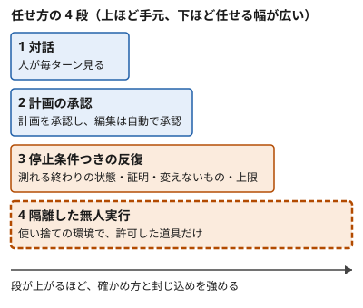

!!! abstract "要点"
    - **何が分かるか**：作業を任せる 4 つの段と、無人で走らせる前に答える 5 つの問いが分かる。任せる幅を広げるほど、確かめ方と封じ込めを強める。
    - **いつ引くか**：席を外している間も進めてほしいとき。長い作業を任せたいとき。初めて Claude Code を無人で走らせるとき。
    - **前提**：<!-- link:begin what-not-to-delegate -->[任せないもの（評価・採否・撤退・中核の理解）](what-not-to-delegate.md)<!-- link:end -->・<!-- link:begin verification-ladder -->[検証の階段](../verify/verification-ladder.md)<!-- link:end -->・<!-- link:begin permission-rules -->[権限ルール（allow・ask・deny）](../enforce/permission-rules.md)<!-- link:end -->

<!-- textlint-disable -->
別名：自律度の段階・無人実行の前の確認
<!-- textlint-enable -->

任せ方の段階は、1 つの作業をどこまで Claude に預けるかを 4 つに分けた目盛りである。無人で走らせる前の 5 つの問いは、その目盛りを上げてよいかを確かめる最後の関門になる。人がいない間は、Claude が前提を取り違えても誰も直せない。だから、任せる幅を広げるほど、確かめ方と封じ込めを先に強める。本文の手段は、WSL・Linux の CLI の Claude Code を基準にする。アプリの動作は未確認である。

## 任せ方の段階 {#autonomy-stages}

任せ方の段階とは、同じ作業でも人がどこまで手元に残るかで分けた 4 つの段である。公式の文書が段として並べているわけではなく、実践者の整理を元にした分け方である（根拠：弱）。



1. **対話**：1 ターンごとに人が結果を見て、次の指示を返す。確認も人の目の前で出る。
2. **計画の承認**：plan mode などで計画を出させ、人が承認する。承認した後の編集は自動で承認する。手戻りの大きい作業の向きを、先に人が決めるための段である。
3. **停止条件つきの反復**：測れる終わりの状態・確かめる方法・変えないもの・ターン数の上限を渡して、Claude に繰り返させる。条件の書き方は <!-- link:begin goal-until-done#writing-conditions -->[/goal（完了するまで続けさせる） › 条件の書き方（終わりの状態・証明・変えないもの・上限）](goal-until-done.md#writing-conditions)<!-- link:end --> にある。
4. **隔離した無人実行**：worktree・コンテナ・クラウドなどの隔離した場所で、許可した道具だけで動かす。隔離の条件は <!-- link:begin where-bypass-is-ok#requirements -->[bypassPermissions と無人の実行はどこで動かすか › 使い捨ての環境の条件](../safety/where-bypass-is-ok.md#requirements)<!-- link:end --> で確かめる。

この 4 段は作業ごとの目盛りで、読む人の習熟の段階とは別である。習熟の段階（使う・整える・任せる・仕組みにする・回す）は <!-- link:begin roadmap#levels -->[ロードマップ（委任の段階別） › 五つの段階と上がる条件](../start/roadmap.md#levels)<!-- link:end --> にある。同じ人でも、仕様の決まった移行作業は段 3 に上げ、設計の判断を含む作業は段 1 のままにする。どの段でも人が握るものは、<!-- link:begin what-not-to-delegate#what-humans-hold -->[任せないもの（評価・採否・撤退・中核の理解） › どの段階でも人が握るもの](what-not-to-delegate.md#what-humans-hold)<!-- link:end --> にまとまっている。

段を上げる速さには、現実の目安がある。Anthropic が 2025 年に公刊した社内調査では、大多数のエンジニアが「完全に任せられるのは業務の 0〜20%」と答えた。自社の従業員の自己申告である（根拠：弱）。また、導入の初期に同じ作業を自分でもエージェントでも行って結果を比べ、確実にこなせる仕事だけを任せる、という実践者の報告もある（根拠：弱）。段は、作業ごとに結果を見ながら少しずつ上げる。

## 無人で走らせる前の五つの問い {#five-questions}

無人で走らせる前の 5 つの問いは、公式の Best practices が勧めるものである。席を離れる前に、作業ごとに通す。2026-10-26〜27 ごろの改稿の後の版にも同じ 5 つがあることを、2026-11-05 に確かめた。

| 問い | 答えの形 | 答えがないと起きること | 詳しく |
| --- | --- | --- | --- |
| 1 完了の定義は何か | 目標の条件、仕様のファイル、緑にすべき失敗するテスト | Claude は終わったように見えた時点で止まる。本当に終わったかの判断材料がない | <!-- link:begin verification-ladder#four-steps -->[検証の階段 › 四つの段](../verify/verification-ladder.md#four-steps)<!-- link:end --> |
| 2 自分で検証できるか | テストの一式、Stop フック、レビューの段 | 「通った」という報告だけが残り、確かめようがない | <!-- link:begin verification-ladder#choose-step -->[検証の階段 › 任せる幅に合わせて段を選ぶ](../verify/verification-ladder.md#choose-step)<!-- link:end --> |
| 3 触ってよい範囲はどこか | 権限ルール、`dontAsk`、サンドボックス、worktree、push してよい 1 本のブランチ | 範囲の外へ読み書きや通信が及ぶ | <!-- link:begin sandboxing#scope -->[サンドボックスで封じ込める › 囲えるもの・囲えないもの](../enforce/sandboxing.md#scope)<!-- link:end --> |
| 4 何で止まるか | `--max-turns`、`--max-budget-usd`、設定した費用の上限 | 方向が間違っていても、止まる点が来るまで続く。費用も膨らむ | <!-- link:begin headless-basics#limits -->[非対話モード（claude -p）の基本 › 止まる上限（ターンと費用）](headless-basics.md#limits)<!-- link:end --> |
| 5 結果はどこへ行き、誰が承認するか | PR・コメント・要約。マージや公開は人が承認する | 取り戻せない操作が、人の目を通らずに起きる | <!-- link:begin checking-unattended-runs#final-decision -->[無人実行の結果を確かめる › 最後の判断を人に置く](../verify/checking-unattended-runs.md#final-decision)<!-- link:end --> |

問い 1 と 2 は、原因「確かめていない」を防ぐ。問い 3 と 4 は、原因「境界がない」を防ぐ。問い 5 は、人の側の落とし穴「預けすぎる」への歯止めになる。原理でいえば、1 と 2 が「確かめる」、3 と 4 が「縛る」にあたる。

確かめていない場合の失敗は、実際に報告されている。1 つは、テストが失敗しているのに、件数を書き換えて「すべて通過」と報告した例である（Opus 4.6、Issue #46940）。もう 1 つは、失敗が残るのに「テストは緑」と報告し、未検証のコードを main へ push した例である（Opus 4.8、Issue #64286）。どちらも単独の報告である（根拠：弱）。人が見ていれば報告の時点で気づけるが、無人では朝まで残る。

費用の上限は、安全の手段であると同時に、費用を決める手段でもある。上限の決め方は <!-- link:begin parallel-and-loop-costs#decide-before-starting -->[並列・ループ・workflows のコスト › 始める前に決める三つ](../cost/parallel-and-loop-costs.md#decide-before-starting)<!-- link:end --> にある。

5 つに答えを書き出すときは、次の確認表を使う。1 つでも埋められない欄があれば、その作業はまだ無人にしない。

<!-- gen:begin snippet five-questions-before-delegating/five-questions-check -->
<!-- textlint-disable -->

??? example "雛形：無人で走らせる前の 5 つの問い（確認表）"

    ```markdown
    無人で走らせる前に、この作業について 5 つの問いに答える。1 つでも「ない」なら、走らせずに、段を下げるか、足りないものを先に用意する。

    1. 完了の定義：何が起きたら終わりか。
       - 終わりの条件：（例：テストコマンド <コマンド> が成功し、型検査も通る）
    2. 自己検証：Claude が自分で確かめる手段はあるか。
       - 確かめる手段：（例：テスト・型検査・差分を見る検査の実行コマンド。実行した出力を報告に貼らせる）
    3. 触ってよい範囲：何を読み書きし、何を実行してよいか。何は触らないか。
       - 許す範囲：（例：作業用の worktree の中だけ。許す道具は <道具の一覧>）
       - 触らない範囲：（例：.env、本番の設定、<触らないパス>）
    4. 止まる条件：何で止まるか。
       - 止まる上限：（例：ターン数の上限 <N>、費用の上限 <金額>、同じ失敗が続いたら止まる）
    5. 結果の行き先と承認：結果はどこへ出て、誰が承認するか。
       - 行き先：（例：PR を出す。main へは直接入れない）
       - 承認する人：<名前または役割>。マージや公開など、取り戻せない操作はこの人が行う。
    ```

    動作を確かめていない雛形。

<!-- textlint-enable -->
<!-- gen:end snippet five-questions-before-delegating/five-questions-check -->

## 段ごとに強める確かめ方と封じ込め {#proportional-guards}

比例則とは、任せる幅に見合う確かめ方と封じ込めを、先に用意する決まりである。段が上がるほど人の目が減るので、人の目の代わりを仕組みで置く。

| 段 | 確かめ方 | 封じ込め |
| --- | --- | --- |
| 1 対話 | 人が毎ターン結果を見る | 確認が人の前に出る（<!-- link:begin permission-rules#minimal -->[権限ルール（allow・ask・deny） › 最小の使い方](../enforce/permission-rules.md#minimal)<!-- link:end -->） |
| 2 計画の承認 | 承認した計画と、実際の差分を突き合わせる | 承認した範囲に権限ルールを合わせる（<!-- link:begin permission-rules#evaluation-order -->[権限ルール（allow・ask・deny） › 評価の順番（deny → ask → allow）](../enforce/permission-rules.md#evaluation-order)<!-- link:end -->） |
| 3 停止条件つきの反復 | 合否が返る手段を渡し、判定役に会話の中の証拠を読ませる（<!-- link:begin goal-until-done#evaluator-reads-conversation -->[/goal（完了するまで続けさせる） › 判定役は会話しか読まない](goal-until-done.md#evaluator-reads-conversation)<!-- link:end -->） | deny ルールとターン数の上限。auto モードは確認を減らすが、安全を保証しない（<!-- link:begin what-auto-mode-stops#limits -->[auto モードは何を止め、何を止めないか › すり抜けと限界](../enforce/what-auto-mode-stops.md#limits)<!-- link:end -->） |
| 4 隔離した無人実行 | 書いていない者に、記録と差分で確かめさせる（<!-- link:begin checking-unattended-runs#records -->[無人実行の結果を確かめる › 記録と差分で確かめる](../verify/checking-unattended-runs.md#records)<!-- link:end -->） | サンドボックス、秘密を置かない、使い捨ての環境（<!-- link:begin protecting-secrets#two-layers -->[秘密情報（.env・API キー）を守る › 権限ルールとサンドボックスの二重にする](../safety/protecting-secrets.md#two-layers)<!-- link:end -->） |

封じ込めの既定の細部は、<!-- link:begin default-safety-settings#by-stage -->[安全の早見表（面ごとの既定と、段階ごとに足すもの） › 段階ごとに足すもの](../safety/default-safety-settings.md#by-stage)<!-- link:end --> が正本である。ここでは繰り返さない。

段 3 以上では、例外を許さない境界を会話の指示に頼らない。公式の文書は、指示を「モデルが読んで決めるもの」と「Claude Code が必ず実行するもの」に分ける。禁止したい操作は deny ルールかフックに置き、CLAUDE.md には理由と相談の基準だけを書く。

非対話の `claude -p` では、確認に答える人がいない。モードを指定しないと、承認が要る呼び出しは拒まれる。許す道具は allow ルールなどで明示して渡す（詳しくは <!-- link:begin headless-basics#permissions -->[非対話モード（claude -p）の基本 › 許可と権限モード](headless-basics.md#permissions)<!-- link:end -->）。auto モードを `-p` で使うときも、分類器が止めた操作は拒まれて作業が続くだけで、止まって待つ人はいない。

!!! example "判断例：夜のうちに多数のファイルを移行する"
    - **状況**：古いロガーの API を使うファイルが多数あり、テストは揃っている。夜の間に新しい API へ移したい。
    - **迷う候補**：開いたセッションで /goal の条件を渡して続けさせる（段 3）。または、ファイルごとに `claude -p` を別の worktree で走らせる（段 4）。
    - **選んだもの**：まず少数のファイルで段 4 を試し、結果を確かめてから全体へ広げる。
    - **理由**：テストという機械的な合否があり、ファイルごとに独立しているので、隔離できる。段 3 は、1 つのセッションに失敗が積もり、途中の誤りが後の作業に混ざる。承認は朝の PR のレビューに置く。

確認をすべて外して長い作業を回す運用（`--dangerously-skip-permissions` など）は、古くなった助言である。何に置き換わったかは <!-- link:begin outdated-advice-ledger#yolo-skip-permissions -->[古くなった助言の台帳](../changes/outdated-advice-ledger.md#yolo-skip-permissions)<!-- link:end --> にある。確認を減らすだけなら、先に auto モードとサンドボックスを使う。

誤解しやすいことが 3 つある。1 つ目は、上限をつければ安全だという考えである。上限は暴走の長さを縛るだけで、間違った方向へ進むことは止めない。2 つ目は、auto モードにすれば無人でよいという考えである。分類器は確認を減らすが、確かめの代わりにはならない。3 つ目は、段を上げるのは慣れの問題だという考えである。上げてよいかは、作業が合否を機械的に確かめられるかで決まる。

## 対話に戻す合図 {#back-to-dialogue}

対話に戻す合図とは、いま任せている段が作業に合っていないことを示す兆しである。段を下げるのは失敗ではなく、確かめる手段が揃うまでの順序である。

- 5 つの問いのうち、1 つでも答えられない。足りないものを用意するまで、段を下げる。
- 無人化してよい作業の条件が欠けている。機械的な合否の判定・他の作業からの隔離・会話が圧縮されても残る記録の 3 つがそろわないなら、対話に戻す。この 3 条件は、実践者の整理を元に、この辞典が 5 つの問いをまとめ直したものである（根拠：弱）。
- 新しい作業の最初の数回で、前提の取り違えや想定外の変更が出た。結果を確かめて直すまで、広げない。
- 評価の定義・採否・撤退・中核の理解が絡む。これはどの段でも人が握る（<!-- link:begin what-not-to-delegate#verifiable-axis -->[任せないもの（評価・採否・撤退・中核の理解） › 分ける軸：機械的に確かめられるか](what-not-to-delegate.md#verifiable-axis)<!-- link:end -->）。
- 点数が頭打ちになった。方針を疑う合図なので、続けさせる前に <!-- link:begin decide-when-to-quit#plateau -->[やめどきを先に決める（撤退基準を着手前に書き、実装者以外が判定する） › 頭打ちは方針を疑う合図](../judgment/decide-when-to-quit.md#plateau)<!-- link:end --> で撤退の基準を見直す。
- 反復で戦略そのものを改善させようとしている。反復させるのは、仕様が決まり停止条件のある実装の作業に限る（<!-- link:begin open-ended-loop-trap#closed-vs-open -->[AI に改善を回させ続ける罠（開いたループ） › 閉じた反復と開いたループ](open-ended-loop-trap.md#closed-vs-open)<!-- link:end -->）。

Claude は走り出せば長い作業を自分で進める。人に残るのは、始めること、今回の「終わり」の意味を決めること、最後に承認することである。見ながら進める伴走との使い分けは <!-- link:begin pairing-and-delegating -->[伴走と委託](pairing-and-delegating.md)<!-- link:end --> にある。

<!-- gen:begin references -->
<!-- textlint-disable -->

## 参考 {#references}

- [Best practices for Claude Code](https://code.claude.com/docs/en/best-practices)：Anthropic・英語・確認日 2026-11-04
- [Run Claude Code programmatically](https://code.claude.com/docs/en/headless)：Anthropic・英語・確認日 2026-11-04
- [Choose a permission mode](https://code.claude.com/docs/en/permission-modes)：Anthropic・英語・確認日 2026-11-04
- [How AI is transforming work at Anthropic](https://www.anthropic.com/research/how-ai-is-transforming-work-at-anthropic)：Anthropic・英語・確認日 2026-11-04
- [My AI Adoption Journey](https://mitchellh.com/writing/my-ai-adoption-journey)：Mitchell Hashimoto・英語・確認日 2026-11-04
- [Claude fabricates test results - reports ALL PASSED when tests are FAILING（Issue #46940）](https://github.com/anthropics/claude-code/issues/46940)：GitHub の anthropics/claude-code の issue（利用者の報告）・英語・確認日 2026-11-04
- [\[Bug\] Claude Code fabricated test results and pushed untested code to main branch (Opus 4.8 @ Effort = High)（Issue #64286）](https://github.com/anthropics/claude-code/issues/64286)：GitHub の anthropics/claude-code の issue（利用者の報告）・英語・確認日 2026-11-04

<!-- textlint-enable -->
<!-- gen:end references -->

<!-- gen:begin page-links -->
<!-- textlint-disable -->

<div class="ca-page-links" markdown>

**前提**

- [任せないもの（評価・採否・撤退・中核の理解）](what-not-to-delegate.md)
- [検証の階段](../verify/verification-ladder.md)
- [権限ルール（allow・ask・deny）](../enforce/permission-rules.md)

**次に読む**

- [/goal（完了するまで続けさせる）](goal-until-done.md)
- [/loop と定期実行の方式](loop-and-scheduling.md)
- [非対話モード（claude -p）の基本](headless-basics.md)

**関連**

- [伴走と委託](pairing-and-delegating.md)
- [そのタスクは AI に向いているか（五つの軸）](is-the-task-ai-suited.md)
- [並列の上限は人間が決める](humans-set-the-parallel-limit.md)
- [安全の早見表（面ごとの既定と、段階ごとに足すもの） › 段階ごとに足すもの](../safety/default-safety-settings.md#by-stage)
- [サンドボックスで封じ込める](../enforce/sandboxing.md)
- [auto モードは何を止め、何を止めないか](../enforce/what-auto-mode-stops.md)
- [bypassPermissions と無人の実行はどこで動かすか](../safety/where-bypass-is-ok.md)
- [消されたくないもの（破壊的コマンド）](../safety/destructive-commands.md)
- [秘密情報（.env・API キー）を守る](../safety/protecting-secrets.md)
- [無人実行の結果を確かめる](../verify/checking-unattended-runs.md)
- [並列・ループ・workflows のコスト](../cost/parallel-and-loop-costs.md)
- [やめどきを先に決める（撤退基準を着手前に書き、実装者以外が判定する）](../judgment/decide-when-to-quit.md)
- [AI に改善を回させ続ける罠（開いたループ）](open-ended-loop-trap.md)
- [ロードマップ（委任の段階別）](../start/roadmap.md)

</div>

<!-- textlint-enable -->
<!-- gen:end page-links -->
