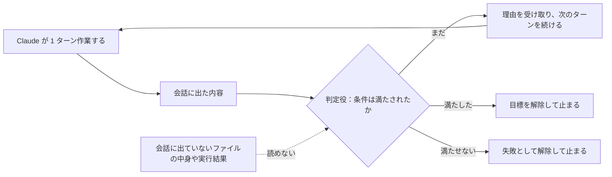

!!! abstract "要点"
    - **何ができるか**：完了の条件を満たすまで Claude にターンを続けさせ、席を外している間も作業を進められる。
    - **いつ引くか**：テストが通るまで終わらせたくないとき。条件を満たすまで、自分で作業を続けさせたいとき。席を外している間も進めてほしいとき。条件に入れた「テストを変えない」が、守られたか判定されないとき。
    - **強制力**：<!-- gen:begin feature enforcement -->モデルの判定<!-- gen:end feature enforcement -->。鍵には数えない。各ターンの後に判定役のモデルが条件を見るだけで、Claude の操作を止める仕組みではない。
    - **いちばんの注意**：判定役は会話に出たものしか読まない。条件の証拠を、Claude に会話へ出させる書き方にする。
    - **前提**：<!-- link:begin five-questions-before-delegating -->[任せ方の段階と、無人で走らせる前の五つの問い](five-questions-before-delegating.md)<!-- link:end -->

<!-- textlint-disable -->
別名：完了条件で続けさせる・自作ループ（Ralph など）・Ralph のループ
<!-- textlint-enable -->

`/goal` は、完了の条件を渡すと、各ターンの後に判定役のモデルが条件を満たしたかを見て、満たすまで Claude に次のターンを続けさせる機能である。このページは、条件の書き方と、無人で回すときの守り、自作のループからの移り方、利用上限で止まったときの動きを扱う。

## 使いどころ {#when}

`/goal` が防ぐのは、Claude が確かめないまま終わったと言う失敗（原因：確かめていない）である。作業しているモデルとは別のモデルが、ターンごとに条件を見る。だから、作業側の「終わった」の一言だけでは止まらない。原理は「確かめる」で、確かめる手段を依頼の外の仕組みに移す一段にあたる（<!-- link:begin verification-ladder#choose-step -->[検証の階段 › 任せる幅に合わせて段を選ぶ](../verify/verification-ladder.md#choose-step)<!-- link:end -->）。

向くのは、終わりの状態が測れる、大きめの作業である。公式の例は次のとおりである。

- 呼び出し側がすべてコンパイルでき、テストが通るまで、モジュールを新しい API へ移す。
- 設計書の受け入れ基準がすべて成り立つまで実装する。
- 大きなファイルを、それぞれが大きさの予算に収まるまで分ける。
- ラベルの付いた課題の待ち行列が空になるまで片づける。

終わりの状態を測れない作業には向かない。確かめる手段を先に作ってから使う。確かめ方の選び方は <!-- link:begin evidence-not-reports#what-counts -->[報告ではなく証拠を求める › 証拠の形（コマンド・生の出力・分母）](../verify/evidence-not-reports.md#what-counts)<!-- link:end --> にある。

## 最小の使い方 {#minimal}

席を外して回すほど、任せる幅が広がる。先に守りを決める。任せ方の段階と無人で走らせる前の問いは <!-- link:begin five-questions-before-delegating#five-questions -->[任せ方の段階と、無人で走らせる前の五つの問い › 無人で走らせる前の五つの問い](five-questions-before-delegating.md#five-questions)<!-- link:end --> にある。コマンドの読み書きと通信を囲むのは <!-- link:begin sandboxing#minimal -->[サンドボックスで封じ込める › 最小の使い方](../enforce/sandboxing.md#minimal)<!-- link:end -->、確認を減らす auto モードが止めるものと通すものは <!-- link:begin what-auto-mode-stops#defaults -->[auto モードは何を止め、何を止めないか › 既定で止めるもの・通すもの](../enforce/what-auto-mode-stops.md#defaults)<!-- link:end --> で確かめる。

=== "Claude Code"

    `/goal` は、1 つのセッションに 1 つの目標を持てる。同じコマンドが、引数で設定・状態の確認・解除を分ける。

    - `/goal <条件>`：目標を設定する。条件そのものを指示にして、直ちに 1 ターン目が始まる。目標がすでにあれば置き換わる。
    - `/goal`：状態を見る。条件、経過した時間、判定したターン数、使ったトークン、判定役の直近の理由が出る。
    - `/goal clear`：目標を解除する。`/clear` で新しい会話に移っても解除される。
    - 再開：目標が有効なままのセッションを再開すると、条件は復元される。ターン数と時間とトークンの基準は数え直しになる。

    目標は権限モードを変えない。確認を求める権限モード（Manual）のままだと、設定で許していない道具の呼び出しの前に、Claude は確認を求める。席を外して回すなら auto モードで設定する。

    `claude -p "/goal <条件>"` でも動き、ループが終わるまで 1 回の起動で走る。既定のテキスト出力は最後の返答しか出ないので、止まって見える。進みを見るには `--output-format stream-json --verbose` を付ける。対話のセッションと Remote Control でも使える。

    フックが無効な設定、または管理設定がフックを管理者のものに限る設定では使えない。そのときは理由が表示される。

## 判定役は会話しか読まない {#evaluator-reads-conversation}

判定役は、条件と会話をそのまま受け取って、条件が満たされたかを返す小型の高速モデルである。ファイルを開かず、コマンドも実行しない。見えるのは、Claude がすでに会話に出したものだけである。



図の要点は次のとおりである。判定役の入力は、会話に出た内容だけである。ファイルの中身や実行結果は、Claude が会話に出さない限り、判定役の入力に入らない。判定は 3 通りで、まだなら理由が次のターンの手がかりになり、満たしたか満たせないと判断したなら目標は自動で解除される。

この仕組みから、書き方の決まりが 2 つ出る。

- 測れる結果は、Claude に会話へ表示させる。「テストが通る」は、Claude がテストを実行し、結果が会話に出るから判定できる。
- 「変えていない」ことは、そのままでは判定できない。条件に「テストを変更しない」と書いても、Claude が変更の有無を会話に出さなければ、判定役には確かめようがない。`git status --porcelain` のような、変更の有無を出すコマンドの出力を、会話に出させる。

Ctrl+O で、判定ごとの理由を見られる。判定役が何を根拠にしたかが分かるので、条件が思ったように読まれているかを早めに確かめられる。

判定役は、判定のたびに道具を呼ぶことはない。会話に証拠を出すのは、作業しているモデルの役目である。作業側の報告をそのまま信じず、生の出力で受け取る考え方は <!-- link:begin evidence-not-reports#facts-win -->[報告ではなく証拠を求める › 説明と事実が食い違ったら](../verify/evidence-not-reports.md#facts-win)<!-- link:end --> にある。

判定には、動きの決まりがいくつかある。

- 実行中のサブエージェントや背景のシェルがあるターンは、判定を飛ばす。背景の作業がない状態でターンが終わるまで待つ。
- 背景の作業を待つ時間が長くなると、確認の呼びかけが入る（<!-- fact:begin goal-idle-checkins-max -->3 回まで（2026-11-05 時点）<!-- fact:end -->）。待つ間隔は最初が <!-- fact:begin goal-checkin-minutes -->30 分（2026-11-05 時点）<!-- fact:end --> で、呼びかけのたびに延びる。間隔は環境変数 `CLAUDE_CODE_GOAL_CHECKIN_MINUTES` で変えられ、0 にすると呼びかけと自動の再試行が止まる。
- Claude が道具を使わずに判定役へ答えるだけの状態が続くと、ループは止まり、目標を残したまま制御が戻る。次の入力で判定が再開する。

判定に使うのは小型の高速モデルである。判定のトークンは、公式の説明では本体の作業に比べて小さい。判定のモデルを変える環境変数は、判定以外の背景の処理にも効く。変える前に、公式の説明を読む。

## 条件の書き方（終わりの状態・証明・変えないもの・上限） {#writing-conditions}

何ターンも保つ条件は、次の 4 つを持つ。

- **終わりの状態**：測れる結果を 1 つ書く。テストの結果、ビルドの終了コード、ファイルの数、空になった待ち行列などである。
- **証明**：それを Claude が示す方法を書く。「`npm test` の終了コードが 0」「`git status` がきれい」のように、会話に出る形にする。
- **変えないもの**：途中で変えてはいけないものを書く。判定できるように、変更の有無を出すコマンドの出力を会話へ出させる。
- **上限**：`or stop after N turns` のような、ターンか時間の区切りを条件に入れる。Claude が毎ターン、その区切りに対する進みを報告し、判定役が会話から判断する。

条件の長さは、<!-- fact:begin goal-condition-max-chars -->4000 文字まで（2026-11-05 時点）<!-- fact:end -->。

Before/After で並べる。同じ依頼で、After が足したものを注記する。

| 区別 | 条件文 |
| --- | --- |
| Before | `/goal テストを全部通して。tests/ は変えないで` |
| After | `/goal tests/ 以下のテストがすべて通っている。確かめ方：最後に npm test を実行し、終了コードと出力の末尾を会話に表示する。変えないもの：git status --porcelain tests eval の出力が空であることも会話に表示されている。上限：または 20 ターンで止まる（or stop after 20 turns）` |

After が足したのは 3 つである。1 つめは、「通った」ことの確かめ方（コマンドと、会話に出す内容）。2 つめは、「変えていない」ことを判定させるための、`git status` の出力を会話に出す指定。3 つめは、止まるターン数である。

!!! example "判断例：テストを変えさせないとき、条件の文に何を足すか"
    - **状況**：リファクタリングを `/goal` で回す。終わりの状態はテストの成功で、テストと評価用のデータは変えさせたくない。
    - **迷う候補**：条件に「tests/ と eval/ を変更しない」と書くだけにする。または、変更の有無を出すコマンドの出力を会話に出させ、書き換えられない鍵も足す。
    - **選んだもの**：出力を会話に出させる条件と、書き換えを防ぐ鍵の組み合わせ。
    - **理由**：前者の文だけでは、変更したかどうかが会話に出ないので、判定役は判定できない。出力を出させる条件は、変更の有無を後から見分けるための証拠にはなるが、変更そのものを止めはしない。止めるのは鍵の役目で、層の組み方は <!-- link:begin protect-tests#layers -->[テストを守る（改ざんを防ぐ） › 守りの層](../verify/protect-tests.md#layers)<!-- link:end --> にある。

上限は、無限に続く場面に備える最後の網である。ある事例（根拠：中、単独の事例）では、Azure SRE エージェントを ISUCON13 の問題で動かしたところ、約 1 時間で本番 2 位水準まで進んだ。しかし 3〜4 時間後には、ベンチの実行とスコアの確認を繰り返すだけになり、プロファイルを取り直さなかった。これは `/goal` ではなく別のエージェントの事例で、`/goal` への当てはめは類推である。示唆は、上限を条件に入れておくことと、止まった後に新しい仮説や情報を入れることである。同じ確認を繰り返す状態の見分け方は <!-- link:begin stuck-in-a-check-loop#diagnosis -->[同じ確認のループにはまる › 原因を安く確かめる順](../symptoms/stuck-in-a-check-loop.md#diagnosis)<!-- link:end --> にある。

曖昧な条件は収束しない。たとえば「Lighthouse が 90 以上」のように決まった値のある条件は働くが、「洗練された見た目」のような条件は、いつ満たされたかを判定できない（根拠：弱、実務家の解説）。

## 雛形 {#templates}

1 つめは、停止条件つきの条件文である。終わりの状態と、確かめ方と、変えないものと、上限を 1 つの文に入れた。変えないものを判定できるよう、`git status` の出力を会話に出させる形にしてある。リファクタリングと移行で同じ条件を使うので、同じ雛形を <!-- link:begin spec-first#goal-with-stop-conditions -->[仕様を先に固める（spec・インタビュー・モック先行） › 決まった仕様の実装を停止条件つきで回す](../recipes/spec-first.md#goal-with-stop-conditions)<!-- link:end --> と <!-- link:begin refactor-and-migrate#goal-stop-conditions -->[リファクタリングと大規模な移行 › /goal で回すときの停止条件](../recipes/refactor-and-migrate.md#goal-stop-conditions)<!-- link:end --> でも取り込む。

<!-- gen:begin snippet goal-until-done/stop-condition -->
<!-- textlint-disable -->

??? example "雛形：停止条件つきの /goal の条件文（終わりの状態・確かめ方・変えないもの・上限）"

    ```text
    /goal tests/ 以下のテストがすべて通り、lint が警告なしで終わっている。確かめ方：最後に `npm test` と `npm run lint` を実行し、終了コードと出力の末尾を会話に表示する。変えないもの：`git status --porcelain tests eval` の出力が空であることも会話に表示されている。上限：または 20 ターンで止まり、残っている失敗と、試したことを報告する（or stop after 20 turns）。
    ```

    動作を確かめていない雛形。要る最低の版：Claude Code 2.1.139。

<!-- textlint-enable -->
<!-- gen:end snippet goal-until-done/stop-condition -->

2 つめは、席を外して `claude -p` で回すときの起動である。条件の上限とは別に、起動の外枠でターンと費用を絞る。

<!-- gen:begin snippet goal-until-done/run-unattended -->
<!-- textlint-disable -->

??? example "雛形：claude -p で /goal を無人で回す（ターンと費用の外枠つき）"

    ```bash
    # 席を外して回す例。auto モードで確認を減らし、サンドボックスで囲んだ環境で流す
    claude -p "/goal tests/ 以下のテストがすべて通っている。確かめ方：最後に npm test を実行し、終了コードと出力の末尾を会話に表示する。変えないもの：git status --porcelain tests eval の出力が空であることも会話に表示されている。上限：または 20 ターンで止まり、残っている失敗を報告する（or stop after 20 turns）。" \
      --permission-mode auto \
      --max-turns 40 \
      --max-budget-usd 10 \
      --output-format stream-json --verbose
    ```

    動作を確かめていない雛形。安全のための雛形なので、守りとして頼る前に、止めたい操作が自分の環境で止まるかを確かめる。要る最低の版：Claude Code 2.1.139。

<!-- textlint-enable -->
<!-- gen:end snippet goal-until-done/run-unattended -->

## 仕様の決まった実装に限る {#spec-tasks-only}

反復させてよいのは、仕様が決まり、停止条件のある実装の作業に限る。終わりの状態がテストや出力で測れるからである。大きな機能は、先に仕様を固め、仕様を渡した新しいセッションで `/goal` を回す。流れは <!-- link:begin spec-first#goal-with-stop-conditions -->[仕様を先に固める（spec・インタビュー・モック先行） › 決まった仕様の実装を停止条件つきで回す](../recipes/spec-first.md#goal-with-stop-conditions)<!-- link:end --> にある。挙動を変えないリファクタリングや大きな移行は、小さく確かめられる単位に分けて回す（<!-- link:begin refactor-and-migrate#goal-stop-conditions -->[リファクタリングと大規模な移行 › /goal で回すときの停止条件](../recipes/refactor-and-migrate.md#goal-stop-conditions)<!-- link:end -->）。

戦略そのものを AI に改善させ続ける使い方は、このページでは扱わない。評価が決まっていない開いたループは、手元の評価への過適合を自動で進める（<!-- link:begin open-ended-loop-trap#closed-vs-open -->[AI に改善を回させ続ける罠（開いたループ） › 閉じた反復と開いたループ](open-ended-loop-trap.md#closed-vs-open)<!-- link:end -->）。長く回せば良くなるとも限らない。Claude Code をループで回してエージェントを最適化した実験では、最良の構成を早く見つけた後は頭打ちになり、延長しても時間と費用の無駄だった（根拠：弱、単独の実験の自己申告）。詳しくは <!-- link:begin open-ended-loop-trap#longer-is-not-better -->[AI に改善を回させ続ける罠（開いたループ） › 長く回せば良くなるとは限らない](open-ended-loop-trap.md#longer-is-not-better)<!-- link:end --> にある。

長い作業の進みを人と Claude の両方に見せる方法は <!-- link:begin progress-logs-for-long-jobs -->[長時間ジョブの進捗ログを設計する](progress-logs-for-long-jobs.md)<!-- link:end --> にある。

## 自作ループ（Ralph など）から移る {#from-homemade-loops}

自作のループは、同じ依頼を外のループで流し直す回し方である。シェルのスクリプトの中で `claude -p` を繰り返し呼ぶ形と、ループのためのプラグインがある。`/goal` が入る前は、完了の条件を満たすまで続けさせる公式の手段がなく、こうした回し方が使われた。いまは、用途ごとに次のように置き換える。

- 完了の条件を満たすまで続けさせる：`/goal`
- 決まった間隔でくり返す：`/loop`（<!-- link:begin loop-and-scheduling#loop -->[/loop と定期実行の方式 › セッションの中で繰り返す（/loop）](loop-and-scheduling.md#loop)<!-- link:end -->）
- 大きな作業を多くのエージェントに分ける：dynamic workflows

移すときの対応は次のとおりである。

- 文字列やファイルの有無で止めていた判定は、会話に出る測れる結果へ置き換える。
- 反復の回数の上限は、条件の上限の節と、起動の外枠に移す。
- 止まる条件と使う量の上限がない回し方は、特に見直す。見つけ方は、シェルのスクリプトで `claude -p` をループから呼んでいるものを探す。

違いも 1 つある。`/goal` は同じセッションの中で続くので、会話が長くなる。外のループで毎回新しい会話にしていたなら、その切り替えがなくなる。長い会話で質が落ちる心配があるなら、仕様を渡した新しいセッションに分ける。

!!! example "判断例：自作ループを /goal に置き換えるか"
    - **状況**：テストが全部通るまで、シェルのループで `claude -p` を繰り返し呼んでいる。完了は、出力に特定の文字列が出たかで見ている。
    - **迷う候補**：ループを残して反復の回数の上限だけ足す。または、`/goal` に移して、完了を測れる条件で書く。
    - **選んだもの**：`/goal` に移し、文字列の代わりにテストの終了コードを条件にする。
    - **理由**：文字列の一致は、実際に終わったかと無関係に出うる。終了コードを会話に出させれば、判定役は終わった事実を読める。外のループが担っていた回数の上限も、条件の上限と起動の外枠で残せる。

この置き換えの扱いは、古くなった助言の台帳に行がある（<!-- link:begin outdated-advice-ledger#ralph-loops -->[古くなった助言の台帳](../changes/outdated-advice-ledger.md#ralph-loops)<!-- link:end -->）。

## 利用上限で止まったとき {#at-usage-limits}

`/goal` は、利用上限や障害で止まることがある。止まり方は 3 つに分かれる。

- **直すまで解除される**：認証の失敗（Claude Code が自分で認証を持つ場合）、クレジットの残高の枯渇、自動の圧縮でも収まらない文脈の溢れ、使えないモデル。警告が出て、目標は解除される。原因を直して、`/goal` を設定し直す。
- **再試行する**：サーバーの過負荷や接続の切断のように、待てば直りやすい失敗。待ち時間つきの通知が出て、回数は <!-- fact:begin goal-auto-retry-max -->3 回まで（2026-11-05 時点）<!-- fact:end -->。上限に達すると、一時停止になる。
- **一時停止する**：API のレートの制限、claude.ai の利用上限、フックによるターンの終了のように、再試行しても同じ結果になる失敗。通知が出る。

利用上限で止まった作業は、対話のセッションを開いたままなら、上限が戻った後に自動で続く設定がある（設定のキーは `autoContinueAtUsageLimit` である）。続ける回数は <!-- fact:begin auto-continue-max-times -->3 回まで（2026-11-05 時点）<!-- fact:end --> で、`/goal` も同じ回数に数える。続けた作業でも、許可の確認は出る。この自動の継続は対話のセッションの機能で、`claude -p`・背景のセッション・API キーを使う実行では使えない。席を外して `-p` で回すなら、止まった後に自分で再開する手を決めておく。

上限に当たりそうな時間帯に回すと、応答の途中で上限に達することがある。そのときは、区切りまで少しだけ続ける仕組み（Wrap-Up Allowance）が働く場合がある。導入の時期は確かめられておらず、段階的に展開中で、効き方はプランと実行の方法で違う。使った分は週の上限に数える。当てにせず、止まる前提で組む。

`/goal` のチェックインも使用量を使う。席を外して回すと、判定のトークンは小さくても、本体のターンの積み重ねが大きい。費用が掛け算で膨らむ理由は <!-- link:begin parallel-and-loop-costs#multiplication -->[並列・ループ・workflows のコスト › 費用が膨らむ掛け算](../cost/parallel-and-loop-costs.md#multiplication)<!-- link:end -->、始める前に決める 3 つは <!-- link:begin parallel-and-loop-costs#decide-before-starting -->[並列・ループ・workflows のコスト › 始める前に決める三つ](../cost/parallel-and-loop-costs.md#decide-before-starting)<!-- link:end --> にある。AI が止まっても仕事を続けられる備えは <!-- link:begin when-ai-is-unavailable#kinds -->[AI が使えないときの備え（障害・上限） › 止まり方の種類（障害・上限・規則）](../cost/when-ai-is-unavailable.md#kinds)<!-- link:end --> にある。プランごとの上限の差は、このページには書かない。

## 効かない場面・落とし穴 {#pitfalls}

- **証拠が会話に出ない条件**：判定役が読めないので、判定が外れる。「変えない」は特に起きやすい。
- **ファイルや環境の状態を直接見る期待**：判定役は読み取りも実行もしない。見せたいものは、Claude が会話に出す。
- **鍵の代わりに使うこと**：判定はモデルの判断で、操作を止める仕組みではない。「テストを書き換えない」は <!-- link:begin protect-tests#in-the-request -->[テストを守る（改ざんを防ぐ） › 依頼に書くこと](../verify/protect-tests.md#in-the-request)<!-- link:end --> の層で守る。
- **判定の外れ**：判定役は小型のモデルで、会話に出た内容の読み違いもありうる。重要な完了は、最後に自分で出力を読む。
- **目標だけでは無人にならない**：権限モードは変わらない。確認が出れば、そこで待つ。
- **測れない終わり**：「よくなった」のような条件は収束しない。止まり方を決めずに回すと、費用だけが増える。
- **止まったときの切り分け**：確認ばかりで進まない、または途中で止まるときは <!-- link:begin keeps-stopping#diagnosis -->[確認ばかりで進まない・途中で止まる › 原因を安く確かめる順](../symptoms/keeps-stopping.md#diagnosis)<!-- link:end -->、「完了」と言うのに終わっていないときは <!-- link:begin claims-done-but-isnt#diagnosis -->[「完了」と言うが終わっていない › 原因を安く確かめる順](../symptoms/claims-done-but-isnt.md#diagnosis)<!-- link:end --> を引く。
- **範囲の外**：Windows と macOS、IDE 拡張での動きは未確認である。本文は WSL・Linux の CLI を基準にしている。

## 比べる相手 {#compare}

続けさせる手段は、何が次のターンを始めるかで選ぶ。

- **`/goal`**：条件を満たすまで続けたいとき。判定役が条件を見て、次のターンを始める。
- **`/loop`**：時間の間隔で繰り返したいとき。条件ではなく時計で動く。使い分けは <!-- link:begin loop-and-scheduling#where-to-run -->[/loop と定期実行の方式 › どこで走らせるか（セッション・手元・クラウド）](loop-and-scheduling.md#where-to-run)<!-- link:end --> にある。
- **Stop フック**：確かめる処理を自分のスクリプトで決定的に書きたいとき。`/goal` との使い分けは <!-- link:begin stop-hooks#vs-goal -->[Stop フックで「終わらせない」 › /goal との使い分け](../enforce/stop-hooks.md#vs-goal)<!-- link:end -->、続けて止められる回数の上限は <!-- link:begin stop-hooks#block-cap -->[Stop フックで「終わらせない」 › 続けて止められる回数の上限](../enforce/stop-hooks.md#block-cap)<!-- link:end --> にある。
- **多数のファイルへ同じ作業を流す**：<!-- link:begin batch-and-p-loops -->多数のファイルに同じ作業を流す（/batch と -p のループ）（準備中）<!-- link:end --> を引く。
- **auto モード**：確認を減らすだけで、新しいターンは始めない。`/goal` は新しいターンを始めるが、確認は減らさない。両者は補い合うので、席を外すなら併用する。

完了の確かめ方を段で選ぶ考え方は <!-- link:begin verification-ladder#four-steps -->[検証の階段 › 四つの段](../verify/verification-ladder.md#four-steps)<!-- link:end -->、止まって報告してよいと渡す書き方は <!-- link:begin permission-to-stop#conditions -->[止まって報告する権利を渡す › 止まって報告する条件を書く](../prompting/permission-to-stop.md#conditions)<!-- link:end --> にある。

## 古くなった助言 {#outdated}

- 「keep going」「don't be lazy」と書く。こうした一言は消し、通すべきテストのような確かめる手段を渡す。誰も見ていない実行は `/goal` か Stop フックで続けさせる（<!-- link:begin outdated-advice-ledger#keep-going-dont-be-lazy -->[古くなった助言の台帳](../changes/outdated-advice-ledger.md#keep-going-dont-be-lazy)<!-- link:end -->）。
- プラグインや自作の bash ループで回し続ける。完了の条件で続けさせるなら `/goal` に移す（<!-- link:begin outdated-advice-ledger#ralph-loops -->[古くなった助言の台帳](../changes/outdated-advice-ledger.md#ralph-loops)<!-- link:end -->）。

<!-- gen:begin references -->
<!-- textlint-disable -->

## 参考 {#references}

- [Keep Claude working toward a goal](https://code.claude.com/docs/en/goal)：Anthropic・英語・確認日 2026-11-04
- [Interactive mode](https://code.claude.com/docs/en/interactive-mode)：Anthropic・英語・確認日 2026-11-04
- [All settings](https://code.claude.com/docs/en/settings-reference)：Anthropic・英語・確認日 2026-11-04
- [Claude Code Wrap-Up Allowance](https://support.claude.com/en/articles/17040437-claude-code-wrap-up-allowance)：Anthropic・英語・確認日 2026-11-04
- [Changelog](https://github.com/anthropics/claude-code/blob/main/CHANGELOG.md)：Anthropic・英語・確認日 2026-11-04
- [Orchestrate subagents at scale with dynamic workflows](https://code.claude.com/docs/en/workflows)：Anthropic・英語・確認日 2026-11-04
- [CLI reference](https://code.claude.com/docs/en/cli-reference)：Anthropic・英語・確認日 2026-11-04
- [Azure SRE エージェントは ISUCON で戦えるか？パフォーマンスチューニングに挑戦してみた](https://zenn.dev/microsoft/articles/78e01f5932c025)：Zenn（microsoft）・確認日 2026-11-04
- [Can Claude Code in a loop improve a production enterprise AI agent with $10,745 of budget?](https://jeremytian.substack.com/p/can-claude-code-in-a-loop-improve)：Jeremy Tian・英語・確認日 2026-11-04

<!-- textlint-enable -->
<!-- gen:end references -->

<!-- gen:begin page-links -->
<!-- textlint-disable -->

<div class="ca-page-links" markdown>

**前提**

- [任せ方の段階と、無人で走らせる前の五つの問い](five-questions-before-delegating.md)

**関連**

- [報告ではなく証拠を求める](../verify/evidence-not-reports.md)
- [検証の階段](../verify/verification-ladder.md)
- [Stop フックで「終わらせない」](../enforce/stop-hooks.md)
- [テストを守る（改ざんを防ぐ）](../verify/protect-tests.md)
- [auto モードは何を止め、何を止めないか](../enforce/what-auto-mode-stops.md)
- [サンドボックスで封じ込める](../enforce/sandboxing.md)
- [仕様を先に固める（spec・インタビュー・モック先行） › 決まった仕様の実装を停止条件つきで回す](../recipes/spec-first.md#goal-with-stop-conditions)
- [リファクタリングと大規模な移行 › /goal で回すときの停止条件](../recipes/refactor-and-migrate.md#goal-stop-conditions)
- [AI に改善を回させ続ける罠（開いたループ）](open-ended-loop-trap.md)
- [長時間ジョブの進捗ログを設計する](progress-logs-for-long-jobs.md)
- 終わったら知らせてもらう（準備中）
- [/loop と定期実行の方式](loop-and-scheduling.md)
- 多数のファイルに同じ作業を流す（/batch と -p のループ）（準備中）
- [止まって報告する権利を渡す](../prompting/permission-to-stop.md)
- [並列・ループ・workflows のコスト](../cost/parallel-and-loop-costs.md)
- [AI が使えないときの備え（障害・上限）](../cost/when-ai-is-unavailable.md)
- [「完了」と言うが終わっていない](../symptoms/claims-done-but-isnt.md)
- [確認ばかりで進まない・途中で止まる](../symptoms/keeps-stopping.md)
- [同じ確認のループにはまる](../symptoms/stuck-in-a-check-loop.md)
- [利用上限の仕組み（面をまたいで共有する枠）](../cost/how-usage-limits-work.md)

</div>

<!-- textlint-enable -->
<!-- gen:end page-links -->
