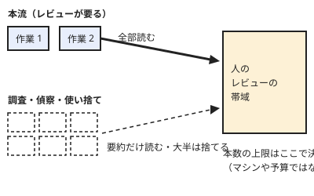

!!! abstract "要点"
    - **何が分かるか**：並列の本数を決めるのは、マシンや予算ではなく、結果をレビューする人の帯域だと分かる。
    - **いつ引くか**：何本まで並べてよいか決めたいとき。マシンや予算に余裕があるので、並べる本数を増やそうとしているとき。
    - **決め方**：レビューの要る本流は少なく、調査・偵察・使い捨ての試作は多めに並べる。
    - **前提**：なし

<!-- textlint-disable -->
別名：並列の本数・レビューの帯域
<!-- textlint-enable -->

並列の上限は人間が決める、とは、同時に走らせる Claude の本数を、人が結果を読んで採否を決められる量で縛るという考え方である。マシンの余力や利用枠は上限の必要条件にすぎない。このページは、本数を決める軸と、増やしすぎの兆しを扱う。

## 並べると何が起きるか {#what-happens}

マシンと予算に余裕があるので、Claude Code のセッションを 6 本並べたとする。各セッションは、それぞれ別の機能を実装している。

最初の 1 時間は速い。6 本とも進み、完了の通知が次々に届く。ここで人の仕事が変わる。実装を待つ側から、6 本分の差分を読み、動かし、採否を決める側になる。

読む時間は 6 本で並列にならない。人の注意は 1 つしかないからである。完了した順に差分が積まれ、後ろのものほど短く読まれる。やがて、要約だけ読んで承認する、テストが通ったから通す、という読み方に寄っていく。

この時点で本数は「増えた」のではなく、確かめていない変更が増えただけである。確かめない変更を本流に入れると、問題は後で、原因の分からない形で出る。

## 上限が人の側にある理由 {#why-human-side}

生成は並ぶが、読む・動かす・決めるは並ばない。この非対称が、上限が人の側にある理由である。

図のとおり、すべての作業の出口は人のレビューの帯域である。本流の出口は幅を全部使い、偵察の出口は要約だけを通す。本数を決める問いは「何本動かせるか」ではなく、「出てくる結果を、何本分なら読み切れるか」になる。

マシンと予算は、この帯域の手前にある別の制約である。台数や費用が膨らむ仕組みは <!-- link:begin parallel-and-loop-costs#multiplication -->並列・ループ・workflows のコスト › 費用が膨らむ掛け算（準備中）<!-- link:end --> で扱う。レビューと動作確認が人に積もる仕組みは <!-- link:begin review-bottlenecks#where-it-clogs -->[レビューのボトルネックと疲労 › 詰まる場所はレビューと動作確認](../team/review-bottlenecks.md#where-it-clogs)<!-- link:end --> にある。ここでは、費用が足りていても上限は消えないことだけを押さえる。

## 本流と偵察で本数を分ける {#mainline-vs-scouting}

作業の種類で本数を分ける。判断の軸は、その結果を人が読んで採否を決める必要があるかどうかである。多めに並べてよい作業にも、読む量が小さいという条件と、次の節の守りが前提になる。

| 作業の種類 | 結果の扱い | 本数の考え方 |
| --- | --- | --- |
| 本流の変更（マージする） | 差分を読み、動かして、採否を決める | 一度に読み切れる本数に絞る |
| 調査・コードの読み解き | 結論と根拠を読む。外れても安く捨てられる | 多めに並べてよい |
| 使い捨ての試作・仮説の比較 | 比べるために読む。大半は捨てる前提 | 多めに並べてよい。物差しは先に決める |
| 低リスクの保守 | 小さな差分を確かめて通す | 確かめ方が決まっていれば増やせる |
| マージしない前提の偵察 | 次の作業の材料として読む | 多めに並べてよい |

重要な変更は、一度に 1 つしかレビューしてマージできない、という実践者の指摘がある（根拠：弱。単独の経験談）。並列に向く作業として、同じ書き手は調査・試作・低リスクの保守・マージしない前提の偵察を挙げる。表はこの整理に沿っている。

捨てる前提で回す作業の考え方は <!-- link:begin choosing-parallel-modes#expect-to-discard -->[並列の方式の選び方 › 一部は捨てる前提で回す](choosing-parallel-modes.md#expect-to-discard)<!-- link:end --> にある。仮説ごとに分けて同じ物差しで比べる手順は <!-- link:begin compare-hypotheses-in-parallel -->仮説ごとに並べて、同じ物差しで比べる（準備中）<!-- link:end --> が持つ。作業ごとに別のチェックアウトを作る方法は <!-- link:begin parallel-with-worktrees -->git worktree で並列にする（準備中）<!-- link:end --> を引く。

!!! example "判断例：機能の実装 2 本と、原因調査をまとめて並べる"
    - **状況**：マージしたい機能の実装が 2 件あり、ほかに、遅い画面の原因調査と依存ライブラリの移行の影響調査がある。マシンと利用枠には余裕がある。
    - **迷う候補**：4 件すべてを同時に走らせる。実装 2 件を先に走らせ、調査は片方が終わってから足す。
    - **選んだもの**：4 件を同時に走らせる。ただし、実装 2 件は本流として全部読み、調査 2 件は結論と根拠の要約だけを読む。
    - **理由**：どちらの候補も筋は通る。調査は読む量が小さく、外れても捨てられるので、同時に走らせても人の帯域を圧迫しない。実装 2 件は読み切れる範囲に収まっている。実装が 4 件になった時点で、候補は変わる。

## 本数を増やす前に置く守り {#guards-before-widening}

本数を増やすことは、任せる幅を広げることである。幅を広げるなら、見合う守りを先に置く。守りは、本数より先に決める。

- 書いた本人ではない者にレビューさせる。分け方と理由は <!-- link:begin independent-review#who -->[書いた本人ではない者にレビューさせる › 誰にレビューさせるか](../verify/independent-review.md#who)<!-- link:end --> にある。AI の承認は人の承認に数えない（<!-- link:begin independent-review#ai-approval -->[書いた本人ではない者にレビューさせる › AI の承認を人の承認に数えない](../verify/independent-review.md#ai-approval)<!-- link:end -->）。
- 人が読む箇所を絞る。全部は読めないとき、テストの変更や例外の握りつぶしなど、必ず読む箇所を先に決める（<!-- link:begin diffs-humans-must-read#red-flags -->人間が読むべき差分の箇所 › 赤信号の一覧（準備中）<!-- link:end -->）。
- 確認を減らす場合も、残す確認は選ぶ。確認が多すぎると、中身を読まずに承認するようになる（<!-- link:begin approval-fatigue#keep-prompts -->承認疲れ › 残す確認を選ぶ（準備中）<!-- link:end -->）。
- 任せる段階に、確かめ方と封じ込めを合わせる（<!-- link:begin five-questions-before-delegating#proportional-guards -->[任せ方の段階と、無人で走らせる前の五つの問い › 段ごとに強める確かめ方と封じ込め](five-questions-before-delegating.md#proportional-guards)<!-- link:end -->）。

見ながら進める伴走と、任せて後で確かめる委託では、詰まる場所が違う。この違いは <!-- link:begin pairing-and-delegating -->伴走と委託（準備中）<!-- link:end --> で扱う。

## 疲れの兆し {#signs-of-fatigue}

本数が帯域を超えると、読み方が先に崩れる。次の兆しは、研究で測られた基準ではなく、実践者の報告と推論による整理である（根拠：弱）。

- 差分の要約だけ読んで承認している。テストが通ったことを、読んだことの代わりにしている。
- 各セッションが何を待っていて、何を終えたかを、見ずに言えない。
- セッションを切り替えるたびに、前の文脈を思い出す時間がかかる。
- 完了の通知を見ても、読むのを後回しにしている。後回しの変更が溜まっている。
- 失敗したときに、どのセッションのどの段が原因か分からない。

並列による文脈の切り替えで人が疲れ、スループットが上がっても品質が落ちうる、という実践者の指摘がある（根拠：弱。単独の経験談）。

疲労の数値には注意が要る。ある開発チームの社内アンケート（12 名、2025 年 7〜9 月、自己申告）では、「疲労感が増えた」と答えたのが 5 名（42%）、「並列作業が増えた」と答えたのが 8 名だった。この 2 つは別々の設問で、並列作業が疲労を起こしたという因果は示されていない。この記事の筆者は疲労の一因に、AI の作業を見守る時間を挙げている（根拠：弱。標本が小さく自己申告）。

兆しが出たら、原因を安く切り分ける順は <!-- link:begin parallel-fatigue#diagnosis -->[並列にしたら疲れた・レビューが追いつかない › 原因を安く確かめる順](../symptoms/parallel-fatigue.md#diagnosis)<!-- link:end --> にある。確認疲れで読まなくなる仕組みは <!-- link:begin approval-fatigue#why -->承認疲れ › なぜ読まなくなるか（準備中）<!-- link:end --> で扱う。

## 実践者の幅と、この辞典の推奨 {#practitioner-range}

並べる本数は、実践者の間でも大きく割れる。個人の構成を標準にせず、三段で並べる。

- **公式の立場**：公式の Best practices は、確かめ方を先に用意することを勧める。並べる本数の目安を示す記述は、この辞典ではまだ確認していない。確かめ方の考え方は <!-- link:begin independent-review -->[書いた本人ではない者にレビューさせる](../verify/independent-review.md)<!-- link:end --> にも通じる。
- **実践者の幅**（根拠：弱。いずれも自己申告）：背景で一度に動かすのは 1 本で、複数を並べたいとは思わない、と書く実践者がいる。Kaggle で 3 位に入った参加者は、開発の並列は最大 2 本で、Web 調査やデータ収集のほうがよく並列化できたと書く（類推。競技の事例）。3〜4 本程度が上限、という声もある。一方で、5 本以上を並走させる構成を紹介する記事もあるが、これは特殊な構成として読むのが安全である。
- **この辞典の推奨**（推論・実践例なし）：まず 1〜3 本から始める。本流は、一度に読み切れる本数に絞る。調査・偵察・使い捨ては、読む量が小さい範囲で多めに並べる。読み切れる余裕があれば増やし、兆しが出たら減らす。

実践者の本数は、その人のレビューの速さ、作業の種類、守りの厚さで決まっている。数字だけを持ち帰らず、軸を持ち帰る。

## 何に効くか {#what-it-prevents}

このページの考え方は、原理の「握る」に当たる。何を採用し、何を捨てるかを決める役を、人が握り続けるということである。本数の上限を人の帯域で決めるのは、その役を手放さないための具体的な形である。

防ぐ原因は、確かめていないことである。生成の速度に合わせて本数を増やすと、読まれない変更が増える。読まれない変更は、確かめていない変更と同じである。

関わる人の側の落とし穴は 2 つある。

- 預けすぎる：並べた本数が増えるほど、1 本あたりに払う注意が減り、確かめを Claude に預けていく。守りは <!-- link:begin independent-review#what-happens -->[書いた本人ではない者にレビューさせる › 同じ会話で確かめさせると何が起きるか](../verify/independent-review.md#what-happens)<!-- link:end --> で扱う。
- 体感を信じる：「自分は追えている」という感覚は、実際の読み方とずれうる。ずれる理由は <!-- link:begin felt-vs-measured#why -->[体感と実測 › なぜ体感はずれるか](../eval/felt-vs-measured.md#why)<!-- link:end --> にあり、記録で測る方法は <!-- link:begin felt-vs-measured#what-to-record -->[体感と実測 › 記録で測るもの](../eval/felt-vs-measured.md#what-to-record)<!-- link:end --> で扱う。

## よくある誤解 {#misconceptions}

- **マシンと予算に余裕があれば、本数を増やしてよい**：余裕は必要条件であって、十分条件ではない。上限を決めるのは、結果を読み切れるかどうかである。
- **承認を速くすれば追いつく**：速く承認することは、読まないことに近づく。確認が安全の仕組みとして働かなくなる流れは <!-- link:begin approval-fatigue -->承認疲れ（準備中）<!-- link:end --> にある。
- **疲れないから大丈夫**：疲れの感覚が出る前に、読み方が崩れていることがある（推論）。兆しの一覧を、感覚より先に見る。
- **並列は常に悪い**：そうではない。レビューの要らない調査や偵察は、増やしても帯域を圧迫しない。分ける軸は、本数ではなく作業の種類である。
- **実践者の本数がそのまま使える**：割れている数字を、1 つの標準として使えない。軸に直してから、自分の帯域に当てはめる。

<!-- gen:begin references -->
<!-- textlint-disable -->

## 参考 {#references}

- [Best practices for Claude Code](https://code.claude.com/docs/en/best-practices)：Anthropic・英語・確認日 2026-11-04
- [Embracing the parallel coding agent lifestyle](https://simonwillison.net/2025/Oct/5/parallel-coding-agents/)：Simon Willison・英語・確認日 2026-11-04
- [I Stopped Coding for 11 Weeks — and Still Placed 3rd on Kaggle](https://darragh.bearblog.dev/i-stopped-coding-for-11-weeks-and-still-placed-3rd-on-kaggle/)：Darragh・英語・確認日 2026-11-04
- [My AI Adoption Journey](https://mitchellh.com/writing/my-ai-adoption-journey)：Mitchell Hashimoto・英語・確認日 2026-11-04
- [Claude Code Tips I Wish I’d Had From Day One](https://marmelab.com/blog/2026/04/24/claude-code-tips-i-wish-id-had-from-day-one.html)：marmelab・英語・確認日 2026-11-04
- [Claude Code Tips and Best Practices](https://www.dsebastien.net/claude-code-tips-and-best-practices/)：Sébastien Dubois・英語・確認日 2026-11-04
- [Claude Code Tips - 40+ Tips from Basics to Advanced](https://awesomeclaude.ai/claude-code-tips)：Awesome Claude（ykdojo の Claude Code Tips）・英語・確認日 2026-11-04
- [Claude Code導入3ヶ月後の社内アンケートから分かったこと](https://zenn.dev/resqnet/articles/a1cfd81a562e07)：Zenn（resqnet）・確認日 2026-11-04

<!-- textlint-enable -->
<!-- gen:end references -->

<!-- gen:begin page-links -->
<!-- textlint-disable -->

**前提**

- なし

**関連**

- [並列にしたら疲れた・レビューが追いつかない](../symptoms/parallel-fatigue.md)
- [レビューのボトルネックと疲労](../team/review-bottlenecks.md)
- [並列の方式の選び方](choosing-parallel-modes.md)
- [任せ方の段階と、無人で走らせる前の五つの問い](five-questions-before-delegating.md)
- 伴走と委託（準備中）
- [書いた本人ではない者にレビューさせる](../verify/independent-review.md)
- 人間が読むべき差分の箇所（準備中）
- 承認疲れ（準備中）
- [体感と実測](../eval/felt-vs-measured.md)
- 並列・ループ・workflows のコスト（準備中）
- git worktree で並列にする（準備中）
- agent view と背景セッション（準備中）
- 仮説ごとに並べて、同じ物差しで比べる（準備中）

<!-- textlint-enable -->
<!-- gen:end page-links -->
