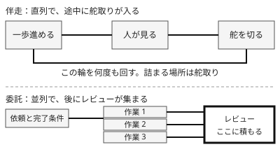

!!! abstract "要点"
    - **何が分かるか**：見ながら一緒に進める伴走と、任せて後で確かめる委託の違いが分かる。どちらを選ぶかで、詰まる場所が舵取りからレビューに移る。
    - **いつ引くか**：見ながら一緒に進めるか、任せて後で見るかを決めたいとき。任せたつもりが、ずっと画面を見張っているとき。
    - **前提**：<!-- link:begin what-not-to-delegate -->[任せないもの（評価・採否・撤退・中核の理解）](what-not-to-delegate.md)<!-- link:end -->

<!-- textlint-disable -->
別名：伴走モード・委託モード・丸投げ
<!-- textlint-enable -->

伴走と委託は、Claude との協業の進め方を 2 つに分ける見方である。人が途中を見て舵を取るのが伴走で、完了条件を渡して任せ、出てきた結果を後で確かめるのが委託である。どちらが上という話ではなく、作業ごとに選び、途中で切り替える。

## 伴走と委託の違い {#two-modes}

伴走は、人が Claude の進みを見ながら、一歩ずつ方向を直していく進め方である。作業は直列に進み、人の注意が進行の速さを決める。確かめは作業の途中で何度も入る。

委託は、依頼に完了条件を書いて任せ、人は別のことをしながら待つ進め方である。作業は並列にもでき、確かめは戻ってきた結果に対して後でまとめて行う。

| 観点 | 伴走 | 委託 |
| --- | --- | --- |
| 人がいる場所 | 作業の途中 | 依頼と、戻ってきた結果 |
| 進み方 | 直列で、制御が効く | 並列にできるが、途中の制御は弱い |
| 確かめる時 | 一歩ごと | 完了の後 |
| 詰まる場所 | 舵取り（人が見て決める速さ） | レビュー（戻ってくる量を読む速さ） |
| この辞典の level | 任せる | 回す |

この 2 分類は、直列で制御が効く協業と、並列でレビューが課題になる協業を分ける実務家の整理に基づく（根拠：弱）。公式の用語ではない。表の level は、この辞典のロードマップの段階に当てはめたものである。

## 同じ作業を二通りで進めると {#what-happens}

「認証まわりの失敗しているテストを直す」という同じ作業を、2 通りで進める。

伴走では、まず調べさせ、原因の見立てを読んで「そこではなく設定の読み込みを見て」と直す。次に修正案を出させ、差分を見てから適用させる。人は各段で見て決める。誤りは小さいうちに見つかるが、人が画面の前を離れられない。

委託では、完了条件（対象のテストがすべて通ること。変更は指定の範囲に収めること）を書いて投げる。人は別の作業に移り、戻ってきた変更をまとめて読む。待つ間は自由だが、方向がずれていると、ずれたまま大きな変更が出来上がる。

困るのは、委託の形で投げたのに、伴走の形で見張ってしまう場合である。画面の前を離れられないので、待つ間に別の作業をする委託の利点がなくなる。しかも見ているだけで舵を切らないなら、伴走の利点（早い方向修正）も生きない。「任せたつもりが、ずっと画面を見張っている」は、この状態である。

## 詰まる場所が移る理由 {#why-bottleneck-moves}

伴走では、確かめが作業の途中に分散している。1 回に見る量は小さいが、人が見て決めるまで次に進まないので、舵取りの速さが全体の速さになる。

委託では、確かめが作業の後ろに集まる。人が離れている間は作業が進むが、戻ってきた結果は、人が読まないと使えない。作業を並列にするほど、読む量が同時に増える。AI で変更が増えると、詰まるのはレビューと動作確認になる。その理由は <!-- link:begin review-bottlenecks#where-it-clogs -->[レビューのボトルネックと疲労 › 詰まる場所はレビューと動作確認](../team/review-bottlenecks.md#where-it-clogs)<!-- link:end --> にある。並列の本数を決める基準は <!-- link:begin humans-set-the-parallel-limit#why-human-side -->[並列の上限は人間が決める › 上限が人の側にある理由](humans-set-the-parallel-limit.md#why-human-side)<!-- link:end --> が持つ。

つまり、伴走から委託に移すと、人の仕事が舵取りからレビューに移る。人の仕事が消えるわけではない。

## どちらを選ぶか {#choose}

選ぶ基準は、方向が固まっているかと、結果を機械的に確かめられるかの 2 つである。

- **方針や範囲に迷う作業は、伴走に寄せる**。誤解は早く見つけるほど安く直せる。plan mode で編集を止めたまま調べさせ、計画を読んで直す使い方は <!-- link:begin when-to-plan#when -->[plan mode の使いどころ › 計画が効く作業、省いてよい作業](../cli/when-to-plan.md#when)<!-- link:end --> にある。
- **完了を機械的に確かめられる作業は、委託に寄せる**。テストやビルドの結果のように、人が読まなくても合否が出るなら、途中を見張る必要が薄い。分ける軸は <!-- link:begin what-not-to-delegate#verifiable-axis -->[任せないもの（評価・採否・撤退・中核の理解） › 分ける軸：機械的に確かめられるか](what-not-to-delegate.md#verifiable-axis)<!-- link:end --> にある。
- **作業そのものが AI に向くかは別に見積もる**。五つの軸での見積もりは <!-- link:begin is-the-task-ai-suited#five-axes -->[そのタスクは AI に向いているか（五つの軸） › 五つの軸](is-the-task-ai-suited.md#five-axes)<!-- link:end --> にある。

!!! example "判断例：古いライブラリの移行"
    - **状況**：古いライブラリから新しいものへ、数十ファイルの呼び出しを置き換える。既存のテストがあり、通れば挙動は保たれる。
    - **迷う候補**：最初から最後まで伴走で進める。完了条件を書いて、まとめて委託する。
    - **選んだもの**：最初の 1〜2 ファイルだけ伴走で進めて置き換えの型を決め、残りを委託する。
    - **理由**：型が決まるまでは方針に迷いがあり、伴走で早く直すほうが安い。型が決まり、既存のテストで合否が出るようになれば、残りは機械的に確かめられるので委託できる。最初から委託すると、型がずれたまま数十ファイルに広がる。最後まで伴走すると、人の注意が単純な置き換えに費やされる。

進め方は途中で切り替えてよい。計画を承認した後の流れは <!-- link:begin when-to-plan#after-approval -->[plan mode の使いどころ › 計画を承認した後](../cli/when-to-plan.md#after-approval)<!-- link:end --> にある。逆に、委託の途中で期待と違う方向へ進んだと分かったら、対話へ戻す。訂正を重ねない。戻す合図は <!-- link:begin five-questions-before-delegating#back-to-dialogue -->[任せ方の段階と、無人で走らせる前の五つの問い › 対話に戻す合図](five-questions-before-delegating.md#back-to-dialogue)<!-- link:end --> に、直し方は <!-- link:begin rewind-dont-correct#why -->[違うと返すより、巻き戻す・編集する › なぜ訂正より巻き戻しか](../context/rewind-dont-correct.md#why)<!-- link:end --> にある。

## 委託に寄せる前に置く守り {#guards-before-delegating}

委託に寄せるほど、人は途中を見ない。そのぶん、確かめる手段を先に渡しておく。手段を決めないまま任せる幅だけを広げると、結果の良し悪しが人の勘で決まる。

- **確かめる手段**：完了の確かめには段がある。依頼に書くだけの段から、書いていない者に確かめさせる段まで、任せる幅に応じて選ぶ。選び方は <!-- link:begin verification-ladder#choose-step -->[検証の階段 › 任せる幅に合わせて段を選ぶ](../verify/verification-ladder.md#choose-step)<!-- link:end --> にある。
- **書いた本人ではない者のレビュー**：変更を生んだ推論を見ていない者に読ませる。分け方は <!-- link:begin independent-review#who -->[書いた本人ではない者にレビューさせる › 誰にレビューさせるか](../verify/independent-review.md#who)<!-- link:end --> にある。AI の承認は人の承認に数えない。
- **任せ方の段階と封じ込め**：対話から無人実行までの段階があり、段が上がるほど確かめ方と封じ込めを強める。段階と、無人で走らせる前の問いは <!-- link:begin five-questions-before-delegating#autonomy-stages -->[任せ方の段階と、無人で走らせる前の五つの問い › 任せ方の段階](five-questions-before-delegating.md#autonomy-stages)<!-- link:end --> にある。
- **見張らなくてよい作業を投げる道具**：独立した作業を背景のセッションに投げられる。投げる前に決める守りは <!-- link:begin agent-view-and-background#guards-first -->[agent view と背景セッション › 投げる前に決める守り](agent-view-and-background.md#guards-first)<!-- link:end --> にある。

## 何に効くか {#what-it-prevents}

このページは、原理の「握る」「確かめる」に関わる。防ぐ原因は「合っていない」で、人の側の落とし穴は「預けすぎる」である。

- **握る**：伴走と委託のどちらでも、評価の定義・採否・撤退は人が持つ。委託は作業を預けるだけで、採否は預けない。どの段階でも人が握るものは <!-- link:begin what-not-to-delegate#what-humans-hold -->[任せないもの（評価・採否・撤退・中核の理解） › どの段階でも人が握るもの](what-not-to-delegate.md#what-humans-hold)<!-- link:end --> にある。
- **確かめる**：伴走では確かめが途中に入り、委託では後ろに集まる。どちらを選んでも、確かめる場所と手段を先に決めておく。決めないまま委託すると、確かめが抜ける。
- **合っていない**：出てきたものが頼みと合っていない、という原因に対して、伴走は途中で早く気づく。委託は完了条件を渡して、戻ってきた結果を条件と突き合わせて気づく。完了条件が曖昧だと、委託ではずれに気づく手がかりがない。
- **預けすぎる**：委託の形で投げ、Claude の「完了しました」という報告だけで採用すると、採否まで預けたことになる。報告ではなく、完了条件に照らした確かめを採否の根拠にする。

## よくある誤解 {#misconceptions}

- **委託は丸投げだ**：丸投げとは、完了条件も確かめ方も渡さない任せ方である。委託は、完了条件を渡して後で確かめる任せ方であり、丸投げとは別である。
- **伴走のほうが安全で、委託は雑だ**：作業に合う進め方が違うだけである。結果を機械的に確かめられる単純な作業まで伴走で見張ると、人の注意を無駄に使う。
- **委託にすれば人の手間が減る**：手間は舵取りからレビューに移る。並列にするほど、レビューの量は増える。
- **伴走なら最後の確かめは要らない**：途中で見ていても、見たのは一歩ごとの差分である。全体として完了条件を満たすかは、最後に確かめる。
- **どちらかに決めたら変えられない**：作業の途中で切り替えてよい。方針が固まったら委託へ、ずれたら対話へ戻す。

<!-- gen:begin page-links -->
<!-- textlint-disable -->

**前提**

- [任せないもの（評価・採否・撤退・中核の理解）](what-not-to-delegate.md)

**関連**

- [任せ方の段階と、無人で走らせる前の五つの問い](five-questions-before-delegating.md)
- [並列の上限は人間が決める](humans-set-the-parallel-limit.md)
- [plan mode の使いどころ](../cli/when-to-plan.md)
- [違うと返すより、巻き戻す・編集する](../context/rewind-dont-correct.md)
- [検証の階段](../verify/verification-ladder.md)
- [書いた本人ではない者にレビューさせる](../verify/independent-review.md)
- [agent view と背景セッション](agent-view-and-background.md)
- [レビューのボトルネックと疲労](../team/review-bottlenecks.md)
- [そのタスクは AI に向いているか（五つの軸）](is-the-task-ai-suited.md)

<!-- textlint-enable -->
<!-- gen:end page-links -->
