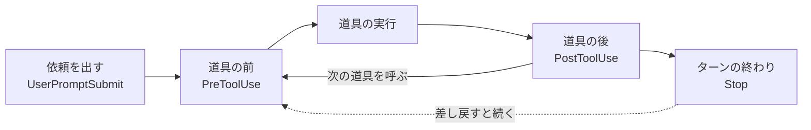

!!! abstract "要点"
    - **何ができるか**：フックで、決まったきっかけに必ずスクリプトを走らせ、規則を確実に守らせられる。止める・整える・知らせるに使うイベントも選べる
    - **いつ引くか**：編集のたびに必ず何かを実行したいとき。規則を、Claude への頼みなしに毎回確実に守らせたいとき。設定したフックが動いていないように見えるとき
    - **強制力**：<!-- gen:begin feature enforcement -->鍵<!-- gen:end feature enforcement -->。コマンドなどの決定的なフックは、Claude の判断に関係なく、イベントが起きれば走る。止められるのはフックが見ているイベントだけで、見ていない経路には効かない
    - **前提**：<!-- link:begin when-to-lock -->[お願いを鍵に移す判断](when-to-lock.md)<!-- link:end -->、<!-- link:begin agent-loop -->[エージェントループと tool use](../basics/agent-loop.md)<!-- link:end -->

<!-- textlint-disable -->
別名：hooks・フックイベント・hook events
<!-- textlint-enable -->

フックは、Claude Code の動きの決まった点（道具の実行の前後、ターンの終わりなど）で、利用者が書いたスクリプトを自動で走らせる仕組みである。CLAUDE.md の指示は Claude が読んで従う「お願い」だが、フックは Claude の判断を通らずに動く「鍵」になる。このページは、フックの考え方と、止める・整える・知らせるに合うイベントの選び方、置き場所と効く範囲を扱う。

## 使いどころ {#when}

「お願い」では守られない規則を、仕組みにするときに使う。公式は、CLAUDE.md やスキルに「`.env` を編集しない」と書くのは依頼であって保証ではないと書く。強制になるのは、PreToolUse のフックで止める方法である。このページが防ぐ原因は「縛っていない」である。

フックの用途は 3 つに分けられる。

| やりたいこと | 使うイベント | 要点 |
| --- | --- | --- |
| 止める | PreToolUse・Stop | 操作の前、またはターンの終わりで止める |
| 整える | PostToolUse・FileChanged・SessionStart | 動いた後に整形・検査をする、文脈を足す |
| 知らせる | Notification・Stop・SessionEnd | 通知を出す、記録を残す |

どのイベントがどの用途に合うかは、次の節で説明する。鍵に移すとよい規則と、鍵にしないほうがよい規則の見分け方は <!-- link:begin when-to-lock#signals -->[お願いを鍵に移す判断 › 鍵に移す合図](when-to-lock.md#signals)<!-- link:end --> と <!-- link:begin when-to-lock#what-not-to-lock -->[お願いを鍵に移す判断 › 鍵にしない規則（判断を含むもの）](when-to-lock.md#what-not-to-lock)<!-- link:end --> にある。

フックが入るのは、<!-- link:begin agent-loop#what-happens -->[エージェントループと tool use › 何が起きるか](../basics/agent-loop.md#what-happens)<!-- link:end --> で説明している輪の、決まった点である。Claude が何を考えているかには触れず、輪の中の出来事に反応する。

!!! example "判断例：編集後の整形を CLAUDE.md とフックのどちらに置くか"
    - **状況**：ファイルを編集するたびに、フォーマッタを必ず走らせたい。
    - **迷う候補**：CLAUDE.md に「編集したら整形する」と書く／PostToolUse のフックで整形を走らせる。
    - **選んだもの**：PostToolUse のフック。
    - **理由**：CLAUDE.md の指示は忘れられることがあり、守られる保証もない。整形は機械で決まる処理で、判断が要らない。判断が要らないものは、フックに移すと毎回走る。

## 代表的なイベント {#events}

フックのイベントは、Claude Code の輪の中の決まった点である。イベントの数は多く、全部の網羅は公式のフックのリファレンスに任せる。ここでは、止める・整える・知らせるに使う代表的なものだけを挙げる。



図の要点は 2 つある。道具の前後と、ターンの終わりが、フックを差し込める代表的な点であること。Stop で差し戻すと、輪がもう一度回ることである。会話の始まりと終わり（SessionStart・SessionEnd）は、この輪の外側にある。

| イベント | 起きるとき | 主な使い道 |
| --- | --- | --- |
| UserPromptSubmit | 依頼を出したとき | プロンプトごとに文脈（`additionalContext`）を足す |
| PreToolUse | 道具を実行する直前 | 操作を止める。理由と代わりを返す |
| PostToolUse | 道具が終わった直後 | 整形・検査をする。結果を Claude に返す |
| Stop | Claude がターンを終えようとするとき | 終わらせずに続けさせる。通知を出す |
| SubagentStop | サブエージェントが終えようとするとき | Stop と同じ形で、担当の終わりを確かめる |
| SessionStart | セッションが始まるとき | 文脈を入れる。圧縮の後に入れ直す |
| Notification | Claude が通知を出すとき | 通知を別の手段に流す |
| FileChanged | ファイルが書き換わったとき | どこから書き換えても拾う |
| PreCompact・PostCompact | 圧縮の前後 | 圧縮の前後で文脈を扱う |
| SessionEnd | セッションが終わるとき | 終わりに記録や通知を出す |

使い方の違いを、止める・整える・知らせるごとに見る。

- **止める**：PreToolUse は道具の実行の前に走るので、操作そのものを止められる。止め方は <!-- link:begin block-with-exit-2#exit-2-vs-json -->[フックで止めて理由を返す（exit 2 と JSON） › exit 2 と JSON の違い](block-with-exit-2.md#exit-2-vs-json)<!-- link:end --> にある。Stop は、確かめる処理が通るまでターンを終わらせないために使う（<!-- link:begin stop-hooks#block-cap -->Stop フックで「終わらせない」 › 続けて止められる回数の上限（準備中）<!-- link:end -->）
- **整える**：PostToolUse は道具が終わった後に走るので、すでに起きた操作は取り消せない。整形や検査の結果を返す用途に向く。exit 2 にすると、標準エラーの文が Claude に届く。Bash などでファイルが書き換わったときは、matcher が `Edit|Write` の PostToolUse は動かない。どこから書き換えても拾うなら FileChanged を使う
- **知らせる**：Notification・Stop・SessionEnd で通知を出す。画面に出る返事の文を差し替える MessageDisplay というイベントもあるが、表示を変えるだけで、止めることはできない

どのフックが走るかは、matcher で絞る。matcher は、完全一致、`|` 区切り、それ以外は JavaScript の正規表現として読まれる。MCP の道具は `mcp__server__.*` の形で指す。さらに `if` フィールドに権限ルールと同じ構文（例：`Bash(rm *)`）を書くと、道具の引数まで絞れる。matcher の絞りすぎ・広すぎは <!-- link:begin writing-safe-hooks#matcher -->フックを安全に書く › matcher で止めすぎない（準備中）<!-- link:end --> で扱う。

終了コードの意味は、どのイベントでもおおむね共通である。exit 0 は成功で、JSON を出していれば解釈される。exit 2 は止める印で、標準エラーが理由として Claude に渡る。それ以外の終了コードは、止めない種類のエラーである。つまり、スクリプトが想定外のコードで落ちると、操作は通る。1 つのイベントで当たったフックは並列に走るので、フック同士の実行順に頼らない。

フックのレシピは <!-- link:begin hook-recipes#format-after-edit -->代表的なフックのレシピ › 編集の後に整形する（準備中）<!-- link:end --> と <!-- link:begin hook-recipes#notify -->代表的なフックのレシピ › 終わったら知らせる（準備中）<!-- link:end --> にある。

## 最小の使い方 {#minimal}

フックは、設定ファイルの `hooks` に、イベント名・matcher・走らせるものの順で書く。スクリプトは標準入力で JSON を受け取る。JSON には、イベントの名前や道具の名前、道具に渡された引数が入る。

=== "Claude Code"

    設定ファイルに登録し、`/hooks` で一覧を見て、登録されたかを確かめる。

    1. 設定ファイル（プロジェクトの `.claude/settings.json` など）に `hooks` を書く
    2. 新しいセッションを始める。対話のセッションでは、フォルダの信頼のダイアログを受け入れる
    3. `/hooks` を開き、書いたフックが一覧に出ることを見る
    4. 道具を呼ばせ、フックが走ったことを確かめる（走ったかを見るだけなら、下の 2 つ目の雛形の記録用の設定が使える）

=== "API"

    Agent SDK では、設定ファイルのほかに、コードのコールバックとしてフックを渡せる。考え方（決まったイベントで走る、止められる）は Claude Code と同じである。書き方の詳しい手順はこのページでは扱わない。

雛形は 2 つある。1 つ目は、編集のたびに prettier を走らせる設定である。

<!-- gen:begin snippet hooks-basics/format-after-edit -->
<!-- textlint-disable -->

??? example "雛形：編集のたびに prettier を走らせる設定"

    ```json
    {
      "hooks": {
        "PostToolUse": [
          {
            "matcher": "Edit|Write",
            "hooks": [
              {
                "type": "command",
                "command": "jq -r '.tool_input.file_path' | xargs npx prettier --write"
              }
            ]
          }
        ]
      }
    }
    ```

    動作を確かめていない雛形。要る最低の版：Claude Code 1.0.38。

<!-- textlint-enable -->
<!-- gen:end snippet hooks-basics/format-after-edit -->

2 つ目は、フックが実際に走ったかを記録するだけの設定である。動作を確かめるために一時的に置く。

<!-- gen:begin snippet hooks-basics/log-hook-input -->
<!-- textlint-disable -->

??? example "雛形：フックが走ったかを記録する設定（動作の確認用）"

    ```json
    {
      "hooks": {
        "PreToolUse": [
          {
            "hooks": [
              {
                "type": "command",
                "command": "jq -c '{event: .hook_event_name, tool: .tool_name}' >> \"$CLAUDE_PROJECT_DIR\"/.claude/hook-events.log"
              }
            ]
          }
        ],
        "Stop": [
          {
            "hooks": [
              {
                "type": "command",
                "command": "jq -c '{event: .hook_event_name}' >> \"$CLAUDE_PROJECT_DIR\"/.claude/hook-events.log"
              }
            ]
          }
        ]
      }
    }
    ```

    動作を確かめていない雛形。要る最低の版：Claude Code 1.0.38。

<!-- textlint-enable -->
<!-- gen:end snippet hooks-basics/log-hook-input -->

## 置き場所と効く範囲（サブエージェントと信頼の確認） {#locations}

フックは、設定ファイルのほか、いくつかの場所に書ける。どれも、上書きではなく、合わさって走る。

| 置き場所 | 効く範囲 |
| --- | --- |
| ユーザーの設定（`~/.claude/settings.json`） | 自分のすべてのプロジェクト |
| プロジェクトの設定（`.claude/settings.json`） | そのリポジトリを開いた全員 |
| 手元だけの設定（`.claude/settings.local.json`） | 自分の、そのリポジトリだけ |
| 管理の設定 | 組織が配る |
| プラグインの `hooks/hooks.json` | プラグインを入れた環境 |
| スキルやサブエージェントのフロントマター | そのスキルやサブエージェントが動く間 |

登録済みのフックは `/hooks` で閲覧できる。設定の層の優先順位と、効いているかの確かめ方は <!-- link:begin settings-layers#layers -->設定ファイルの階層と優先順位 › 層と優先順位（準備中）<!-- link:end --> と <!-- link:begin settings-layers#verify -->設定ファイルの階層と優先順位 › 効いているかを確かめる（準備中）<!-- link:end --> にある。

**サブエージェントの中でも走る。** 設定ファイル・管理の設定・プラグインのフックは、サブエージェントの中でも走り、PreToolUse と PostToolUse がメインの会話と同じように発火する。サブエージェントのフロントマターに書いたフックは、その担当が動く間だけ走る。このとき Stop は SubagentStop に変わる。サブエージェントの作り方は <!-- link:begin writing-subagents#define -->サブエージェントの作り方と使いどころ › 定義の書き方（ファイルを書くか、Claude に作らせる）（準備中）<!-- link:end --> にある。

フックへの入力には `agent_id` が付き、呼び出しがサブエージェントの中のものかを見分けられる。`agent_id` が付くのはサブエージェントなどの中で発火したときだけで、メインの会話には付かない。`agent_type` は `--agent` で起動したセッションのメインにも付くので、見分けには使わない。ワークフローの担当でフックが走るかは、文書に明記がなく、このページでは未確認である。

!!! example "判断例：メイン以外に commit させない"
    - **状況**：commit はメインの会話だけに許し、サブエージェントには禁じたい。
    - **迷う候補**：`agent_type` で判定する／`agent_id` の有無で判定する。
    - **選んだもの**：`agent_id` の有無。
    - **理由**：`agent_type` は `--agent` で起動したメインの会話にも付くので、サブエージェントだけを選べない。`agent_id` はサブエージェントなどの中でだけ付く。

**信頼の確認の前は走らない。** 対話のセッションでは、フォルダの信頼のダイアログを受け入れるまで、どの設定ファイルのフックも走らない。自分のユーザー設定のフックも同じである。`-p` と Agent SDK はダイアログを出さず、信頼したものとして `.claude/settings.json` のフックを走らせる。権限ルールの deny と ask は、信頼と関係なく効く。リポジトリを開くと他人のフックが走ることになるので、<!-- link:begin writing-safe-hooks#runs-as-you -->フックを安全に書く › フックは利用者の権限で動く（準備中）<!-- link:end --> を先に読む。

**クラウドのセッションでは、ユーザーの設定が届かない。** クラウドのセッションは、ユーザーの `~/.claude/settings.json` と `.claude/settings.local.json` を読まない。リポジトリの `.claude/settings.json` は読まれる。確実に縛りたいフックは、リポジトリの設定に置く。

## 決定的なフックと、モデルが判断するフック {#deterministic}

フックには複数のハンドラ（走らせるものの種類）があり、すべてが決定的なわけではない。鍵として頼れるかは、誰が判定するかで決まる。

| ハンドラ | 判定する主体 | 鍵に数えるか |
| --- | --- | --- |
| command | 自分のスクリプト。標準入力で JSON を受け取る | 数える |
| http | 自分のサーバー。POST で JSON を受け取る | 数える |
| prompt | 別のモデルが 1 回判定する | 数えない |
| agent | ツールを使えるサブエージェントが検証する（experimental） | 数えない |

ほかに `mcp_tool` のハンドラもある。この辞典は、規則を確実に守らせる用途には command か http を使う。prompt と agent は、別のモデルが判断するので、同じ入力でも結果が変わりうる。判断を含む規則を補助的に見張る用途には使えるが、例外を許さない規則の鍵にはしない。agent は experimental なので、操作の手順は書かない。

!!! example "判断例：「コミットメッセージが適切か」をフックで見張る"
    - **状況**：コミットメッセージの質を、フックで保ちたい。
    - **迷う候補**：prompt のフックでメッセージを読ませて判定する／command のフックで、形式（接頭辞や文字数）だけを機械で検査する。
    - **選んだもの**：形式は command のフック。質の判断は鍵にしない。
    - **理由**：形式は機械で決まるので、command で確実に止められる。「適切か」は判断を含み、prompt の判定は決定的でない。判断を含むものは CLAUDE.md の依頼に残し、機械で判定できる部分だけを切り出して鍵にする。

イベントの前後で、何を鍵にできるかの全体は <!-- link:begin request-lock-table#where-locks-act -->お願いと鍵の対応表 › 鍵にできるのはどこか（ターンの終わりと道具の前後）（準備中）<!-- link:end --> にある。

## 動いていないように見えるとき {#not-running}

設定したフックが動いていないように見えるときは、次の順に確かめる。

1. **信頼の確認を済ませたか**：対話のセッションでは、ダイアログを受け入れるまで走らない。新しいセッションで開き直す
2. **登録されているか**：`/hooks` を開き、フックが一覧に出るか見る。出ないなら、書いた設定ファイルが読まれていない。効いている層は <!-- link:begin settings-layers#verify -->設定ファイルの階層と優先順位 › 効いているかを確かめる（準備中）<!-- link:end --> で確かめる
3. **イベントと matcher が合っているか**：道具の名前が matcher と合うか、イベントがそもそも起きる操作かを見る。Bash で書き換えたファイルは、`Edit|Write` の PostToolUse では拾えない
4. **スクリプトが落ちていないか**：想定外の終了コードで落ちると、操作は通る。止めたいフックほど、落ちたときに通る既定が働いていないかを確かめる（<!-- link:begin writing-safe-hooks#fail-open -->フックを安全に書く › 既定は失敗すると通す（fail-open）（準備中）<!-- link:end -->）
5. **フックを止める設定が入っていないか**：`disableAllHooks` などで止まっていないかを、設定の層をまたいで見る

どこで切れているかを見るには、雛形の記録用の設定を一時的に入れ、ログに行が足されるかを見る。足されるなら、フックは走っている。足されないなら、登録・信頼・層のどれかで切れている。

## 効かない場面と落とし穴 {#limits}

フックが効くのは、イベントが起き、matcher が当たり、スクリプトが想定どおり終わったときだけである。

- **ターンの終わりと、道具の前後だけを強制できる。** ツールの合間の一言を、画面に出す前に止める仕組みはない。MessageDisplay は表示を変えるだけである
- **道具の後のフックは、操作を取り消せない。** 止めたいなら PreToolUse に置く
- **見ていない経路には効かない。** 1 つの道具に当てたフックは、別の道具から同じ結果になる経路を止めない。縛る範囲を、権限ルールやサンドボックスとの二重にする（<!-- link:begin request-lock-table#by-surface -->お願いと鍵の対応表 › 面ごとの鍵の手段（準備中）<!-- link:end -->）
- **失敗すると通すのが既定である。** 止める用途では、失敗を止めに倒す書き方が要る。詳しくは <!-- link:begin writing-safe-hooks#fail-open -->フックを安全に書く › 既定は失敗すると通す（fail-open）（準備中）<!-- link:end --> を見る
- **版によって、効く範囲が違う。** Bash に当てたフックは、新しい版では Monitor の道具が起動するシェルコマンドにも走る。止める・確認を求めることはできるが、許可や書き換えはできない。それより前の版では、Bash のフックは Monitor のコマンドを素通しにしていた。自分の版で確かめる
- **フックは利用者の権限で動く。** 他人のフックを入れるときは、コードとして読んでから使う（<!-- link:begin writing-safe-hooks#runs-as-you -->フックを安全に書く › フックは利用者の権限で動く（準備中）<!-- link:end -->）
- **Claude Code は WSL・Linux の CLI を基準に書いている。** ほかの OS と IDE 拡張でのフックの動きは、このページでは未確認である

## 比べる相手 {#compare}

フックと近い手段を、選ぶ場面ごとに挙げる。

| 迷う相手 | 選び方の違い | 読むページ |
| --- | --- | --- |
| スキル | スキルは Claude が判断して使うお願い。フックは決まったときに必ず動く鍵 | <!-- link:begin hook-vs-skill -->フックとスキルの違い（準備中）<!-- link:end --> |
| CLAUDE.md・権限ルール・出力形式 | 用途ごとに、お願いの書き方と鍵の手段が違う | <!-- link:begin request-lock-table#table -->お願いと鍵の対応表 › 用途ごとの対応表（準備中）<!-- link:end --> |
| 拡張機能の全体 | 強制力・読み込みの時期・コストで並べて選ぶ | <!-- link:begin extensions-at-a-glance -->拡張機能の全体図と使い分け早見表（準備中）<!-- link:end --> |

フックを実際に組むときは、止める側は <!-- link:begin block-with-exit-2 -->[フックで止めて理由を返す（exit 2 と JSON）](block-with-exit-2.md)<!-- link:end -->、決まったレシピは <!-- link:begin hook-recipes -->代表的なフックのレシピ（準備中）<!-- link:end -->、textlint を回す例は <!-- link:begin textlint-hook -->[textlint をフックで回す](../japanese/textlint-hook.md)<!-- link:end --> を見る。

<!-- gen:begin page-links -->
<!-- textlint-disable -->

<div class="ca-page-links" markdown>

**前提**

- [お願いを鍵に移す判断](when-to-lock.md)
- [エージェントループと tool use](../basics/agent-loop.md)

**次に読む**

- [フックで止めて理由を返す（exit 2 と JSON）](block-with-exit-2.md)
- フックを安全に書く（準備中）

**関連**

- 代表的なフックのレシピ（準備中）
- Stop フックで「終わらせない」（準備中）
- フックとスキルの違い（準備中）
- お願いと鍵の対応表（準備中）
- 拡張機能の全体図と使い分け早見表（準備中）
- 設定ファイルの階層と優先順位（準備中）
- サブエージェントの作り方と使いどころ（準備中）
- [textlint をフックで回す](../japanese/textlint-hook.md)

</div>

<!-- textlint-enable -->
<!-- gen:end page-links -->

<!-- gen:begin references -->
<!-- textlint-disable -->

## 参考 {#references}

- [Hooks reference](https://code.claude.com/docs/en/hooks)：Anthropic・英語・確認日 2026-11-04
- [Automate actions with hooks](https://code.claude.com/docs/en/hooks-guide)：Anthropic・英語・確認日 2026-11-04
- [Extend Claude Code](https://code.claude.com/docs/en/features-overview)：Anthropic・英語・確認日 2026-11-04
- [Create custom subagents](https://code.claude.com/docs/en/sub-agents)：Anthropic・英語・確認日 2026-11-04
- [Claude Code changelog](https://code.claude.com/docs/en/changelog)：Anthropic・英語・確認日 2026-11-04
- [Steering Claude Code: when to use CLAUDE.md, skills, hooks, and subagents](https://claude.com/resources/articles/steering-claude-code-skills-hooks-rules-subagents-and-more)：Anthropic・英語・確認日 2026-11-04

<!-- textlint-enable -->
<!-- gen:end references -->
