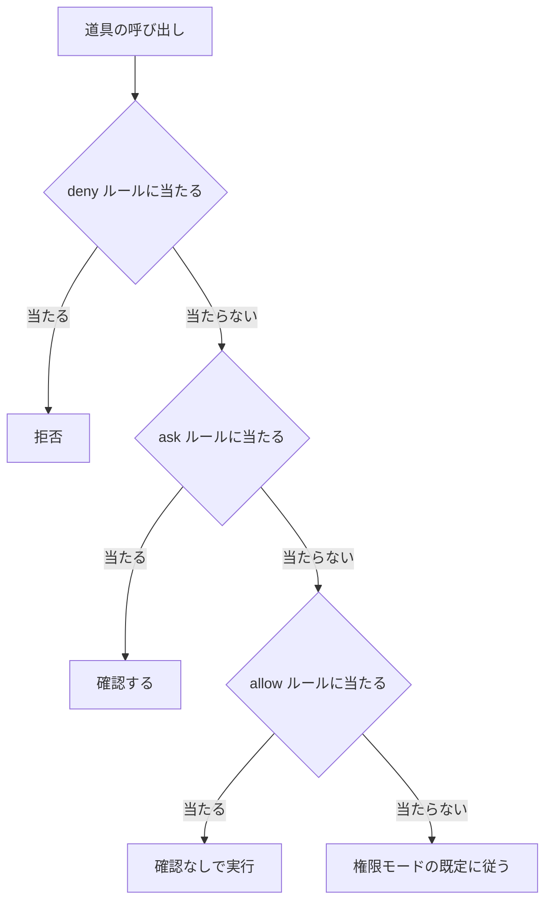
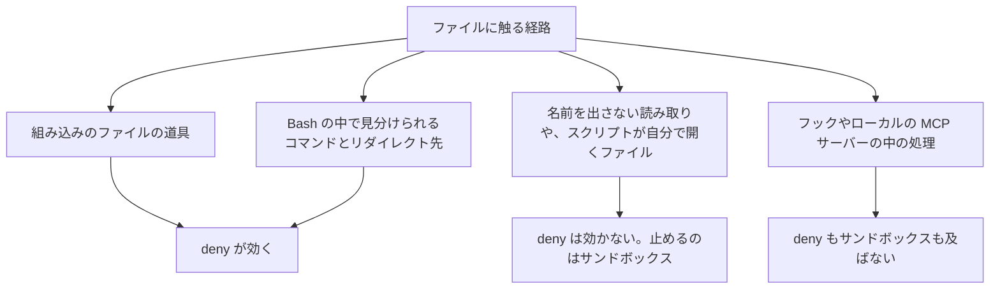

!!! abstract "要点"
    - **何ができるか**：allow ルール・ask ルール・deny ルールで、Claude が使える道具とファイルを決められる。deny が先に評価されるが、当たらないパスと効かない子プロセスがある
    - **いつ引くか**：`.env` や migrations を絶対に触らせたくないとき。よく使う安全なコマンドを毎回確認させたくないとき。deny に書いたのに、下のフォルダの同じ名前のファイルを読まれたとき
    - **強制力**：<!-- gen:begin feature enforcement -->鍵<!-- gen:end feature enforcement -->。当たった操作は Claude の判断に関係なく止まる。止められるのは Claude Code が見分ける道具の呼び出しだけで、子プロセスの中の処理や、何にも当たらない書き方のルールは止まらない
    - **前提**：<!-- link:begin permission-modes-overview -->[権限モードの選び方](../cli/permission-modes-overview.md)<!-- link:end -->

<!-- textlint-disable -->
別名：permissions・permission rules・許可ルール・確認ルール・拒否ルール・allow ルール・ask ルール・deny ルール・/permissions
<!-- textlint-enable -->

権限ルールは、Claude が道具を呼ぶたびに、そのまま実行（allow ルール）・確認（ask ルール）・拒否（deny ルール）のどれにするかを決める設定である。このページは、ルールの評価の順番と、効く範囲の限界を扱う。

## 使いどころ {#when}

「お願い」では縛れない境界を、設定の鍵にする場面で使う。このページが防ぐのは、原因の「縛っていない」と「境界がない」である。

- `.env` や migrations を絶対に触らせたくない。CLAUDE.md に「触らない」と書くのはお願いにとどまる。公式は、権限ルールはモデルではなく Claude Code が強制し、指示は Claude が試みることを変えても許すことは変えない、と書く。deny ルールは bypassPermissions を含むどのモードでも止める
- よく使う安全なコマンドを毎回確認させたくない。allow ルールで、決まったコマンドだけ確認を省ける
- 会話で言った禁止は、圧縮で消えうる。設定に書いたルールは圧縮の影響を受けない。理由は <!-- link:begin when-to-lock#spoken-rules-fade -->[お願いを鍵に移す判断 › 会話で言った禁止は圧縮で消える](when-to-lock.md#spoken-rules-fade)<!-- link:end --> にある

任せる幅を広げる側の注意がある。確認を減らして長い作業を任せ始めるときは、allow を足す前に deny と ask を書く。守りの層は、ルールだけにしない。ルールが届かない範囲は <!-- link:begin sandboxing#scope -->[サンドボックスで封じ込める › 囲えるもの・囲えないもの](sandboxing.md#scope)<!-- link:end --> で囲む。モードを問わず保護される場所は <!-- link:begin protected-paths#protected -->消せない場所・触れない場所（protected paths） › 保護される場所と、モードごとの扱い（準備中）<!-- link:end --> で確かめる。auto モードを使うなら、<!-- link:begin what-auto-mode-stops#limits -->[auto モードは何を止め、何を止めないか › すり抜けと限界](what-auto-mode-stops.md#limits)<!-- link:end --> で、すり抜けうる操作を知っておく。

どの規則をルールにするかは、機械的に判定でき、害の大きいものに絞る。判断を含む規則は鍵にしない（<!-- link:begin when-to-lock#what-not-to-lock -->[お願いを鍵に移す判断 › 鍵にしない規則（判断を含むもの）](when-to-lock.md#what-not-to-lock)<!-- link:end -->、<!-- link:begin lock-side-effects#what-to-lock -->縛りすぎの害と見直し（止めすぎ・回り込み） › 縛る規則の選び方（機械的に判定でき、害の大きいものだけ）（準備中）<!-- link:end -->）。

## 最小の使い方 {#minimal}

=== "Claude Code"

    ルールは設定ファイルの `permissions` の下に、`allow`・`ask`・`deny` の 3 つの一覧として書く。対話では `/permissions` で、ルールの閲覧・追加・削除と、作業ディレクトリの管理ができる。確認の画面で「Yes, and don't ask again」を選ぶと、`.claude/settings.local.json` に allow ルールとして保存される。

    | 対象 | ルールの例 | 当たるもの |
    | --- | --- | --- |
    | シェルのコマンド | `Bash(npm run *)` | `npm run` で始まるコマンド |
    | ファイルの読み取り | `Read(./.env)` | 現在のディレクトリ直下の `.env` |
    | ファイルの書き込み | `Edit(/migrations/**)` | 設定の置き場所を基点にした migrations の下 |
    | Web | `WebFetch(domain:example.com)` | そのドメイン（サブドメインは `*.example.com`） |
    | MCP の道具 | `mcp__server__tool` | その道具 |
    | サブエージェント | `Agent(Explore)` | その名前のサブエージェント |
    | スキル | `Skill(deploy *)` | `deploy` で始まるスキルの呼び出し |

    `Bash` の末尾の ` *`（空白とアスタリスク）は前方一致である。空白なしの `Bash(git diff*)` は `git diff-index` にも当たるので、空白を入れて書く。`:*` の書き方も同じ意味である。

    ルールは設定の層をまたいで合わさる。同じキーを優先順位の高い層が上書きする設定とは動きが違う（<!-- link:begin settings-layers#merge -->設定ファイルの階層と優先順位 › 合わさる設定、上書きされる設定（準備中）<!-- link:end -->）。効いているかは `/status` で読み込まれた層を見て確かめる（<!-- link:begin settings-layers#verify -->設定ファイルの階層と優先順位 › 効いているかを確かめる（準備中）<!-- link:end -->）。

    確認の数を減らしたいが、どのコマンドを allow に入れるか決められないときは、公式のスキル `/fewer-permission-prompts` が、過去の記録から読み取り専用コマンドの allow の案を作る。案は自分で読んでから入れる。

ルールを書いた設定ファイルの完全な例は、下の雛形の節にある。モードごとに確認なしで進むものは <!-- link:begin permission-modes-overview#modes -->[権限モードの選び方 › モードごとに確認なしで進むもの](../cli/permission-modes-overview.md#modes)<!-- link:end --> にある。ルールは、そのモードの上に重ねる規則である。

## 評価の順番（deny → ask → allow） {#evaluation-order}

権限ルールは、deny、ask、allow の順に評価され、最初に当たったものが勝つ。次の図は、1 回の道具の呼び出しがどう振り分けられるかを示す。



図の要点は 3 つである。

- 具体的なルールが優先されるわけではない。順番は deny、ask、allow で固定で、ルールの具体さでは変わらない。`Bash(git push origin main)` を allow に書いても、`Bash(git push *)` が ask にあれば、確認が出る
- 設定の層をまたいでも deny が勝つ。ユーザーの設定の allow は、プロジェクトの設定の deny を外せない
- フックでも deny は外せない。PreToolUse のフックが allow を返しても、deny と ask のルールは評価される。exit 2 で止めるフックは allow ルールより先に効く

!!! example "判断例：git の読み取り系だけを確認なしにする"
    - **状況**：`git status` や `git diff` は毎回確認させたくない。`git push` は必ず確認させたい。
    - **迷う候補**：`Bash(git *)` を allow に書き、`Bash(git push *)` を ask に足す／読み取り系のコマンドを 1 つずつ allow に書く。
    - **選んだもの**：読み取り系を 1 つずつ allow に書き、push は ask に残す。
    - **理由**：前者も、ask が先に評価されるので push は確認になり、筋は通る。ただし `git *` の allow は、`git reset` のような書き換える副コマンドまで含む。確認を省くものは、安全と分かっているものだけにして、ask は広い allow を後から足されたときの守りに残す。

## パスの書き方と、何にも当たらないルール {#path-rules}

ファイルの権限は、`Edit(path)` と `Read(path)` のルールだけで判定される。`Write(path)`・`NotebookEdit(path)`・`Glob(path)` と、古い `MultiEdit(path)` にパスを付けたルールは、受け付けられるが、どの読み書きにも当たらない。書き込みは `Edit(...)`、Glob の代わりは `Read(...)` で書く。パスを付けずに道具の名前だけ書いたルールは、その道具の使用すべてに当たる。

新しい版では、当たらないルールに起動時の警告が出る。対話では deny と ask のルールだけが 1 行表示され、allow のルールはデバッグログにだけ出る。警告が出ない古い版では、書いたつもりのルールが黙って効いていないことがある。

`Read` の deny は、同じパスの `Edit` と `Write` も止める。ただし、これは新しい版の挙動である。また `NotebookEdit` は止めない。そのため、変えさせたくないパスには、`Read` と `Edit` の両方の deny を書く。

パスは gitignore の形式で書く。基点の違いは次のとおり。

| 書き方 | 基点 |
| --- | --- |
| `//path` | ファイルシステムの絶対パス |
| `~/path` | ホームディレクトリ |
| `/path` | 設定ファイルの置き場所。`.claude/settings.json` なら主な作業ディレクトリ、`~/.claude/settings.json` なら `~/.claude` |
| `path`・`./path` | 現在のディレクトリ |

`/Users/x` のような書き方は、絶対パスにならない。ユーザーの設定に書くルールは、`//` か `~/` で書く。worktree では、`Edit(/eval/**)` のようなルールは、その worktree の同じ場所に当たる。

`.env` を守るルールには、典型的な落とし穴がある。`Read(./.env)` は、現在のディレクトリ直下の `.env` だけに当たる。先頭の `./` が、現在のディレクトリに固定するためである。下のフォルダにある `.env` は止まらない。どの深さの `.env` も止めたいなら `Read(.env)` か `Read(**/.env)` と書く。なお `secrets/**` のような書き方は、deny と ask では任意の深さに当たり、allow では現在のディレクトリの直下だけに当たる。拒否のルールに書いたのに、下のフォルダにある同じ名前のファイルを読まれたときは、まずこの当たり方を疑う。

生成物の手書きを止めたいときは `Edit(/生成先/**)` と書く。生成するスクリプトは子プロセスなので、この deny を置いても生成そのものは止まらない。意図どおりの動きである。

## 子プロセスには効かない {#child-processes}

`Read` と `Edit` の deny が効くのは、Claude Code が見分けられる経路だけである。具体的には、組み込みのファイルの道具、Claude Code が Bash の中で見分けるファイルのコマンド（`cat`・`head`・`tail`・`sed`・`tee` など）、リダイレクトの先である。次の図は、ファイルに触れる経路ごとの、deny の効き方を示す。



効かないものは 3 つある。

- ファイル名を出さずに読むコマンド。そのフォルダでの `grep -r パターン .` が例である
- 自分でファイルを開くスクリプト。Python や Node のプログラムが例である
- フックや、ローカルで動く MCP サーバーの中の処理。これらはサンドボックスの外にあり、全権で動く

すべてのプロセスを止められるのはサンドボックスで、OS の層で Bash・PowerShell・Monitor とその子プロセスを囲む。`Read` と `Edit` の deny はサンドボックスの設定にも合わさる。一方、サンドボックスの `denyRead` は `Read` の道具を止めない。2 つは別の層で、足し合わせて使う。囲める範囲は <!-- link:begin sandboxing#scope -->[サンドボックスで封じ込める › 囲えるもの・囲えないもの](sandboxing.md#scope)<!-- link:end -->、二重にする組み方は <!-- link:begin protecting-secrets#two-layers -->[秘密情報（.env・API キー）を守る › 権限ルールとサンドボックスの二重にする](../safety/protecting-secrets.md#two-layers)<!-- link:end --> にある。

道具の側にも、作業ディレクトリの外への書き込みを止める設定 `permissions.blockWritesOutsideWorkingDirectories` がある。`Write`・`Edit`・`NotebookEdit` が、bypassPermissions を含むどのモードでも、外への書き込みを拒む。これも、シェルのコマンド・MCP の道具・フックが動かすプログラムは縛らない。公式はサンドボックスとの併用を勧める。リポジトリの設定からも true にできるが、利用者の設定を外すことはできない。true にすると、EnterWorktree と ExitWorktree の道具が使えなくなる。読み取り側の `blockReadsOutsideWorkingDirectories` もある。詳しくは <!-- link:begin protected-paths#outside-working-directory -->消せない場所・触れない場所（protected paths） › 作業ディレクトリの外への読み書きを閉じる（準備中）<!-- link:end --> を見る。

!!! example "判断例：Python 製のプロジェクトで .env を守る"
    - **状況**：`.env` に本物の鍵が入っている。Claude にテストのスクリプトを書かせて実行させている。
    - **迷う候補**：`Read(**/.env)` の deny を書く／deny に加えてサンドボックスを有効にする。
    - **選んだもの**：deny とサンドボックスの両方。そもそも鍵を作業ディレクトリに置かない形も検討する。
    - **理由**：deny だけだと、Claude の書いたスクリプトが `.env` を自分で開く経路が残る。道具の側の deny と、OS の層のサンドボックスは止める範囲が違う。秘密を置かない設計は <!-- link:begin protecting-secrets#keep-out -->[秘密情報（.env・API キー）を守る › 秘密を作業ディレクトリと会話に置かない](../safety/protecting-secrets.md#keep-out)<!-- link:end --> にある。

評価資産のように「絶対に書き換えさせない」ファイルを凍結するときも同じで、deny だけでは子プロセスを止められない。組み方は <!-- link:begin freeze-eval-assets#how-to-freeze -->評価資産を凍結し、触れる範囲を絞る › 設定で止める（権限ルール・サンドボックス・ファイルの権限）（準備中）<!-- link:end --> にある。

## 信頼の前に効くもの・後に効くもの {#workspace-trust}

対話のセッションで、フォルダの信頼のダイアログを受け入れる前と後で、効く設定が違う。

| 設定 | 信頼の前 | 信頼の後 |
| --- | --- | --- |
| deny ルール・ask ルール | 効く | 効く |
| `.claude/settings.json` の allow ルールと `additionalDirectories` | 使われない | 使われる |
| どの設定ファイルのフックも（自分の `~/.claude/settings.json` を含む） | 走らない | 走る |

読み方は 2 つある。まず、リポジトリが共有の設定に書いた allow は、利用者が信頼するまで効かない。知らないリポジトリが allow で確認を外すことはできない。次に、deny と ask は信頼と関係なく効く。共有の設定に deny を書けば、開いた直後から効く。

`-p` と SDK はダイアログを出さず、信頼したものとして `.claude/settings.json` のフックを走らせる。非対話の実行では確認が出ない点は <!-- link:begin before-opening-unknown-repos#headless -->[知らないリポジトリを開く前に › 非対話の実行では確認が出ない](../safety/before-opening-unknown-repos.md#headless)<!-- link:end --> にある。信頼の前後で何が効くかは <!-- link:begin before-opening-unknown-repos#trust -->[知らないリポジトリを開く前に › 信頼の前と後で効くもの](../safety/before-opening-unknown-repos.md#trust)<!-- link:end -->、チームの共有設定では <!-- link:begin share-team-settings#after-trust -->チームで設定を共有する › 信頼してから効く設定（準備中）<!-- link:end --> を見る。

`permissions.defaultMode` の `auto` と `bypassPermissions` は、プロジェクトと手元の設定では無効である。ユーザーか管理の設定に書く。管理側で使えなくする設定は <!-- link:begin managed-settings-enforcement#disable-modes -->管理設定と組織の強制 › モードを使えなくする設定（準備中）<!-- link:end --> にある。

## 雛形 {#templates}

1 つめは、`.env`・migrations・生成物の置き場への読み書きを拒む例である。`.env` は読み取りと書き込みの両方、migrations と生成物は書き込みだけを拒む。`Edit(/migrations/**)` は新しいファイルの追加も拒む。既存のファイルだけを止めて追加は通したいなら、条件を書けるフックを使う。

<!-- gen:begin snippet permission-rules/deny-secrets -->
<!-- textlint-disable -->

??? example "雛形：秘密のファイルと生成物への読み書きを拒む権限ルール"

    ```json
    {
      "permissions": {
        "deny": [
          "Read(**/.env)",
          "Read(**/.env.*)",
          "Edit(**/.env)",
          "Edit(**/.env.*)",
          "Edit(/migrations/**)",
          "Edit(/src/generated/**)"
        ]
      }
    }
    ```

    動作を確かめていない雛形。安全のための雛形なので、守りとして頼る前に、止めたい操作が自分の環境で止まるかを確かめる。

<!-- textlint-enable -->
<!-- gen:end snippet permission-rules/deny-secrets -->

この例が止めるのは、Claude の道具の呼び出しである。Python のスクリプトが開く `.env` は止まらないので、前節のとおりサンドボックスを重ねる。

2 つめは、読み取り中心のコマンドだけを確認なしにして、push の確認を残す例である。allow のコマンドが何を書き換えうるかは、入れる前に自分で確かめる。

<!-- gen:begin snippet permission-rules/allow-safe-commands -->
<!-- textlint-disable -->

??? example "雛形：読み取り中心のコマンドだけを確認なしにし、push は確認に残す権限ルール"

    ```json
    {
      "permissions": {
        "allow": [
          "Bash(npm run test *)",
          "Bash(npm run lint *)",
          "Bash(git status)",
          "Bash(git diff *)",
          "Bash(git log *)"
        ],
        "ask": [
          "Bash(git push *)"
        ]
      }
    }
    ```

    動作を確かめていない雛形。安全のための雛形なので、守りとして頼る前に、止めたい操作が自分の環境で止まるかを確かめる。

<!-- textlint-enable -->
<!-- gen:end snippet permission-rules/allow-safe-commands -->

プロジェクトの設定の allow は、信頼の後でだけ使われる。

## 比べる相手 {#compare}

権限ルールは、パスと道具の名前で決められる単純な規則に向く。ほかの手段との分担は次のとおり。

| 縛りたいこと | 先に使うもの | 権限ルールとの違い |
| --- | --- | --- |
| 子プロセスまで含めて読み書きを閉じる | <!-- link:begin sandboxing -->[サンドボックスで封じ込める](sandboxing.md)<!-- link:end --> | OS の層で止める。deny は Claude Code が見分ける経路だけ |
| 既存ファイルだけを止める、理由と代わりを返す | フック | 条件を書ける。deny はパスと道具の単純な一致 |
| どのモードでも守りたい場所 | <!-- link:begin protected-paths -->消せない場所・触れない場所（protected paths）（準備中）<!-- link:end --> | 設定なしで保護される場所と、足りない境界を足す設定 |
| 利用者の設定で外せない規則 | <!-- link:begin managed-settings-enforcement#cannot-override -->管理設定と組織の強制 › 利用者の側から外せない範囲（準備中）<!-- link:end --> | 管理設定で組織として強制する |
| 判断を含む規則 | スキルやお願い | 鍵にせず、理由と相談の基準を伝える |

スキルとフックの選び方は <!-- link:begin hook-vs-skill -->[フックとスキルの違い](../extend/hook-vs-skill.md)<!-- link:end --> にある。縛りを足しすぎたときの止めすぎと回り込みは <!-- link:begin lock-side-effects#review-blocks -->縛りすぎの害と見直し（止めすぎ・回り込み） › 止めた記録の見直し（準備中）<!-- link:end --> で見直す。

## 古くなった助言 {#outdated}

権限ルールの周りには、古い呼び方と書き方が残っている。

旧名のコマンド `/allowed-tools` は、今は <!-- name:begin allowed-tools-to-permissions -->/permissions<!-- name:end --> である。古い記事や手順にあれば読み替える。

`/permissions` のタブ Recently denied は、Recently blocked に名前が変わった。古い記事の説明と画面が合わないときは、これである。

`Write(...)` や `Glob(...)` にパスを付けたルールを勧める古い記事や自作の設定は、効いていない。`Edit(...)` と `Read(...)` に書き直す。

<!-- gen:begin page-links -->
<!-- textlint-disable -->

<div class="ca-page-links" markdown>

**前提**

- [権限モードの選び方](../cli/permission-modes-overview.md)

**次に読む**

- [サンドボックスで封じ込める](sandboxing.md)
- [知らないリポジトリを開く前に](../safety/before-opening-unknown-repos.md)
- [消されたくないもの（破壊的コマンド）](../safety/destructive-commands.md)
- [任せ方の段階と、無人で走らせる前の五つの問い](../delegate/five-questions-before-delegating.md)
- 消せない場所・触れない場所（protected paths）（準備中）
- 管理設定と組織の強制（準備中）
- dynamic workflows（スクリプトで多数のサブエージェントを動かす）（準備中）
- Agent SDK（Claude Code をライブラリとして使う）（準備中）
- ほか 1 ページ

**関連**

- [auto モードは何を止め、何を止めないか](what-auto-mode-stops.md)
- [秘密情報（.env・API キー）を守る](../safety/protecting-secrets.md)
- [お願いを鍵に移す判断](when-to-lock.md)
- 設定ファイルの階層と優先順位（準備中）
- 評価資産を凍結し、触れる範囲を絞る（準備中）
- 縛りすぎの害と見直し（止めすぎ・回り込み）（準備中）
- チームで設定を共有する（準備中）
- [フックとスキルの違い](../extend/hook-vs-skill.md)

</div>

<!-- textlint-enable -->
<!-- gen:end page-links -->

<!-- gen:begin references -->
<!-- textlint-disable -->

## 参考 {#references}

- [Configure permissions](https://code.claude.com/docs/en/permissions)：Anthropic・英語・確認日 2026-11-04
- [Choose a permission mode](https://code.claude.com/docs/en/permission-modes)：Anthropic・英語・確認日 2026-11-04
- [Settings files and precedence](https://code.claude.com/docs/en/settings)：Anthropic・英語・確認日 2026-11-04
- [All settings](https://code.claude.com/docs/en/settings-reference)：Anthropic・英語・確認日 2026-11-04
- [Configure the sandboxed Bash tool](https://code.claude.com/docs/en/sandboxing)：Anthropic・英語・確認日 2026-11-04
- [Error reference](https://code.claude.com/docs/en/errors)：Anthropic・英語・確認日 2026-11-04
- [Hooks reference](https://code.claude.com/docs/en/hooks)：Anthropic・英語・確認日 2026-11-04
- [Commands](https://code.claude.com/docs/en/commands)：Anthropic・英語・確認日 2026-11-04
- [Changelog](https://github.com/anthropics/claude-code/blob/main/CHANGELOG.md)：Anthropic・英語・確認日 2026-11-04

<!-- textlint-enable -->
<!-- gen:end references -->
