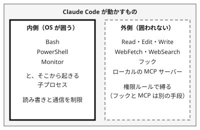

!!! abstract "要点"
    - **何ができるか**：Claude が動かすシェルのコマンドと子プロセスの、ファイルの読み書きと通信を OS の層で囲える
    - **いつ引くか**：確認を減らしても壊されたり外へ送られたりしないようにしたいとき。拒否のルールを書いたのに、スクリプト経由で読まれたとき。コンテナで動かすか決めたいとき
    - **強制力**：<!-- gen:begin feature enforcement -->鍵<!-- gen:end feature enforcement -->。囲えるのは Bash などのシェルのコマンドとその子プロセスだけで、ファイルの道具・フック・ローカルの MCP サーバーは囲えない
    - **前提**：<!-- link:begin permission-rules -->[権限ルール（allow・ask・deny）](permission-rules.md)<!-- link:end -->

<!-- textlint-disable -->
別名：sandbox・Sandboxing・/sandbox・bubblewrap・denyRead
<!-- textlint-enable -->

サンドボックスは、Claude Code が動かすシェルのコマンドを、OS の仕組みでファイルと通信の境界の内側に閉じ込める機能である。権限ルールは Claude Code が見分けた呼び出しだけを止めるが、サンドボックスは、コマンドが起こす子プロセスまで含めて OS が止める。このページは、囲える範囲と囲えない範囲、読み取りの既定、依存が欠けたときの動き、WSL2 での使い方、コンテナとの使い分けを扱う。

## 使いどころ {#when}

確認を減らして任せる幅を広げるとき、先に敷く守りとして使う。このページが防ぐのは、原因の「境界がない」である。原理は「縛る」で、お願いではなく OS が止める。

- スクリプトやテストを確認なしで実行させたい。サンドボックスの中で動くコマンドは、確認を省く設定にできる。確認を省く前に、囲いの中身（「囲えるもの・囲えないもの」の節以降）を決めておく
- 拒否のルールを書いたのに、スクリプト経由で読まれた。Read と Edit の deny は、Python や Node のスクリプトが自分でファイルを開く経路には効かない。OS の層で囲うと、その経路も止まる。ルール側の限界は <!-- link:begin permission-rules#child-processes -->[権限ルール（allow・ask・deny） › 子プロセスには効かない](permission-rules.md#child-processes)<!-- link:end --> にある
- auto モードに任せて大丈夫か。auto モードは確認を減らす仕組みで、安全を保証しない。任せる段階では、サンドボックスで囲う。すり抜けうる操作は <!-- link:begin what-auto-mode-stops#limits -->[auto モードは何を止め、何を止めないか › すり抜けと限界](what-auto-mode-stops.md#limits)<!-- link:end --> にある
- 秘密と外への送信を断ちたい。サンドボックスは、秘密の読み取りと外への通信の 2 つの経路に効く。3 つの能力の考え方は <!-- link:begin lethal-trifecta#three-capabilities -->[三つを同時に持たせない（lethal trifecta と Rule of Two） › 三つの能力](../safety/lethal-trifecta.md#three-capabilities)<!-- link:end --> にある

確認の数を減らす順番は <!-- link:begin approval-fatigue#reduce-prompts -->承認疲れ › 確認を減らす順番（準備中）<!-- link:end -->、段階ごとの既定は <!-- link:begin default-safety-settings#by-stage -->[安全の早見表（面ごとの既定と、段階ごとに足すもの） › 段階ごとに足すもの](../safety/default-safety-settings.md#by-stage)<!-- link:end --> にある。確認を全部外すモードや無人の実行は、サンドボックスでは代わりにならない。隔離した使い捨ての環境だけで使う話で、<!-- link:begin where-bypass-is-ok#why-isolate -->bypassPermissions と無人の実行はどこで動かすか › なぜ隔離した環境だけか（準備中）<!-- link:end --> にある。

## 最小の使い方 {#minimal}

=== "Claude Code"

    `/sandbox` で有効にする。または設定ファイルの `sandbox.enabled` を true にする。`/sandbox` で選んだモードは `.claude/settings.local.json` に保存される。モードは 2 つある。

    - auto-allow：サンドボックスの中で動くコマンドを、確認なしで実行する
    - regular permissions：サンドボックスの中のコマンドにも、通常の権限の確認をかける

    公式は、分類器なしで Bash の確認を減らしたいなら、手動の確認モードに `/sandbox` の auto-allow を重ねる形を勧める。auto-allow の動きは `autoAllowBashIfSandboxed` のキーで決まる。

    依存が足りないと、`/sandbox` の Dependencies のタブに欠けが出る。入れた後は再起動する。OS ごとの入れ方は公式を見る。

    最初に決めるのは、秘密の置き場の読み取りを塞ぐこと（「読み取りは既定で広い」の節）と、依存が欠けたときの動き（「起動できないときに通さない」の節）である。

## 囲えるもの・囲えないもの {#scope}

サンドボックスが囲うのは、Bash・PowerShell・Monitor の道具が動かすコマンドと、そこから起きた子プロセスである。ファイルの読み書きは、OS が許す範囲に絞られる。通信は、ローカルのプロキシを通り、許可したドメインかどうかが調べられる。

囲われないものが、仕組みの限界になる。



| 場所 | 例 | 止める手段 |
| --- | --- | --- |
| 内側 | Bash・PowerShell・Monitor のコマンドと子プロセス | サンドボックス |
| 外側 | Read・Edit・Write・WebFetch・WebSearch | 権限ルール |
| 外側 | フック・ローカルの MCP サーバー・プラグインの監視・LSP サーバー・ステータスラインのコマンド・`apiKeyHelper` | サンドボックスでは止まらない。コードとして確かめて使う |
| 外側 | `!` で打つシェルのコマンド（ほとんどのセッション） | 自分で打つものなので対象外 |
| 外側 | `excludedCommands` に当たるコマンドと、`dangerouslyDisableSandbox` の再試行 | 設定で絞る（「効かない場面・落とし穴」の節） |

内側と外側で、止める道具が違う。ファイルの道具の拒否は権限ルール、シェルの先は OS の層で受け持つ。2 つは足し合わせて使う。サンドボックスは、Read の deny ルールと `WebFetch(domain:...)` のルールも取り込む。権限ルールに書いた拒否が、シェルのコマンドにも効くようになる。

## 読み取りは既定で広い {#default-reads}

サンドボックスの既定では、読み取りは機械全体に及ぶ。書き込みは作業ディレクトリと一時のディレクトリなどに絞られるが、読み取りは広い。拒否したディレクトリを除き、`~/.ssh` や `~/.aws/credentials` も読める。秘密の置き場は、自分で明示して塞ぐ。

塞ぐには、`sandbox.filesystem.denyRead` に置き場を書く。サンドボックスの外で動く Read の道具は、`denyRead` では止まらない。Read の道具には、権限ルールの deny を別に書く。この二重が、秘密を守る基本の形になる。組み方の全体は <!-- link:begin protecting-secrets#two-layers -->[秘密情報（.env・API キー）を守る › 権限ルールとサンドボックスの二重にする](../safety/protecting-secrets.md#two-layers)<!-- link:end --> にある。

公式の例には、ホームの下をまとめて塞ぎ、プロジェクトだけを読めるようにする書き方（`denyRead` に `~/`、`allowRead` に `.`）もある。重なったときは、狭い側のパスが勝つ。この辞典では動作を確かめていないので、使うなら自分の環境で試す。

2 つの設定で、パスの書き方が違う。

| 設定 | `~/` | `/` で始まる | 注意 |
| --- | --- | --- | --- |
| サンドボックスの `filesystem` | 自分のホーム | 絶対パス | `./` と `.` は設定ファイルの置き場所が基点。`//` で始まる書き方は使わない |
| 権限ルールの Read・Edit | 自分のホーム | プロジェクトが基点 | 絶対パスは `//` で始める |

権限ルール側の書き方は <!-- link:begin permission-rules#path-rules -->[権限ルール（allow・ask・deny） › パスの書き方と、何にも当たらないルール](permission-rules.md#path-rules)<!-- link:end --> にある。両方に同じ場所を書くときは、写さずに、それぞれの書き方で書く。

!!! example "判断例：スクリプトが ~/.aws を読む"
    - **状況**：Claude が書いた Python のスクリプトを、確認なしで動かしたい。`~/.aws` の認証情報は読ませたくない。
    - **迷う候補**：Read の deny だけにする。サンドボックスの `denyRead` だけにする。
    - **選んだもの**：両方を書く。
    - **理由**：Read の deny は、スクリプトが自分で開くファイルを止めない。`denyRead` は、Read の道具を止めない。止める層が違うので、片方では穴が残る。

## 起動できないときに通さない {#fail-if-unavailable}

依存が欠けているか、対応しない環境だと、サンドボックスは既定で黙って無効のまま、コマンドを囲わずに動かす。囲っているつもりで囲えていない状態になる。サンドボックスに頼る設定には、`sandbox.failIfUnavailable` を true にして入れる。起動時に条件を満たさなければ、Claude Code が終了する。

起動した後に初期化へ失敗した場合は、各コマンドが「Sandbox is required」で拒否される。通してしまう方向には倒れない。

もう 1 つ、通す抜け道がある。囲いの中で失敗したコマンドを、Claude が `dangerouslyDisableSandbox` で囲いの外へ再試行できる。これを止めるのは `sandbox.allowUnsandboxedCommands` を false にする設定である。

失敗すると通してしまう既定は、フックにもある。同じ考え方は <!-- link:begin writing-safe-hooks#fail-open -->フックを安全に書く › 既定は失敗すると通す（fail-open）（準備中）<!-- link:end --> にある。

## Linux と WSL2 で使う {#linux-wsl}

サンドボックスは macOS・Linux・WSL2 で動く。この辞典は WSL・Linux を基準にする。macOS の動作と IDE 拡張での動きは、ここでは未確認とする。

- 仕組み：Linux と WSL2 では、bubblewrap がファイルの隔離、socat がプロキシへの中継を受け持つ。macOS は Seatbelt を使う。両方とも入れる必要がある
- WSL1 は使えない。ネイティブの Windows でも使えず、コマンドはサンドボックスなしで動く。`failIfUnavailable` を true にしていれば、その環境では起動時に止まる
- 一部の Ubuntu（24.04 以降）では、既定の AppArmor が bubblewrap の動きを止めることがある。その場合は公式の手順に従って設定を足す
- 任意の部品として、seccomp のフィルタがある。入れると Unix ソケットを塞げる

WSL2 には、見落としやすい経路がある。サンドボックスの中から、Windows の実行ファイル（`cmd.exe` や `/mnt/c` の下のプログラム）を起動できる。この起動は Unix ソケットを通るので、止めるには seccomp のフィルタが要る。WSL2 で Windows 側のプログラムまで止めたいときは、フィルタまで入れて確かめる。この辞典の環境では、止まる範囲の確認がまだ済んでいない。

## 雛形 {#templates}

サンドボックスを有効にし、秘密の置き場を二重に塞ぐ設定の例である。`failIfUnavailable` を入れてあるので、依存が欠けた環境では起動時に止まる。`denyRead` の側と権限ルールの側で、パスの書き方が違う点は、「読み取りは既定で広い」の節の表にある。

<!-- gen:begin snippet sandboxing/enable-and-block-secrets -->
<!-- textlint-disable -->

??? example "雛形：サンドボックスを有効にし、秘密の置き場の読み取りを二重に塞ぐ設定"

    ```json
    {
      "sandbox": {
        "enabled": true,
        "failIfUnavailable": true,
        "filesystem": {
          "denyRead": [
            "~/.ssh",
            "~/.aws",
            "~/.gnupg"
          ]
        }
      },
      "permissions": {
        "deny": [
          "Read(~/.ssh/**)",
          "Read(~/.aws/**)",
          "Read(~/.gnupg/**)"
        ]
      }
    }
    ```

    動作を確かめていない雛形。安全のための雛形なので、守りとして頼る前に、止めたい操作が自分の環境で止まるかを確かめる。要る最低の版：Claude Code 2.0.24。

<!-- textlint-enable -->
<!-- gen:end snippet sandboxing/enable-and-block-secrets -->

試すときは、本物の鍵ではなく、偽の値だけを入れたファイルを使う。

## コンテナ（Docker・devcontainer）との使い分け {#containers}

サンドボックスとコンテナは、囲う範囲が違う。サンドボックスは、Claude Code のプロセスの中で、シェルのコマンドだけを OS の層で囲う。コンテナ（Docker や devcontainer）や仮想マシンは、Claude Code のプロセス全体を、手元のマシンから隔てる。サンドボックスの外にあるフックやローカルの MCP サーバーも、コンテナの中では、手元のマシンとは別の環境で動く。

公式の Security は、機密性の高いリポジトリでは、プロジェクト固有の権限設定、サンドボックスのランタイム（sandbox runtime）や dev container での実行、権限の定期的な監査を勧める。

| 状況 | まず使うもの | 理由 |
| --- | --- | --- |
| 手元のマシンで、スクリプトやテストを確認なしで動かしたい | サンドボックス | 読み書きと通信を OS の層で囲える。コンテナを用意しなくてよい |
| 機密性の高いリポジトリ。フックや MCP も含めて隔離したい | コンテナか仮想マシンに、サンドボックスを重ねる | 外側の経路もコンテナが受ける |
| 確認を全部外す、または無人で動かす | 隔離した使い捨ての環境 | サンドボックスでは代わりにならない。条件は <!-- link:begin where-bypass-is-ok#requirements -->bypassPermissions と無人の実行はどこで動かすか › 使い捨ての環境の条件（準備中）<!-- link:end --> |
| 知らないリポジトリを開く | 隔離した環境 | 手順は <!-- link:begin before-opening-unknown-repos#isolate -->知らないリポジトリを開く前に › 隔離して動かす（準備中）<!-- link:end --> |

チームの運用の例として、devcontainer にファイアウォールを置き、`.env` の読み取りの拒否や deny ルールと組み合わせる報告がある（根拠：弱。1 件の発表）。コンテナの中でも、Claude Code の設定の守りは省かない。

!!! example "判断例：コンテナの中で動かすか"
    - **状況**：個人の開発マシンで、機密性が中くらいのリポジトリを扱う。テストとスクリプトは確認なしで動かしたい。
    - **迷う候補**：サンドボックスだけにする。devcontainer の中で、サンドボックスも併用する。
    - **選んだもの**：まずサンドボックスと秘密の二重の拒否にする。フックや MCP を他人のものから借りる、または無人で動かすなら、コンテナに上げる。
    - **理由**：どちらも筋が通る。コンテナは外側の経路まで受けるが、用意と保守の手間がかかる。外側の経路が自分で確かめたものだけなら、サンドボックスで足りる。

無人の実行でコンテナを使う手順と雛形は、この辞典では <!-- link:begin where-bypass-is-ok -->bypassPermissions と無人の実行はどこで動かすか（準備中）<!-- link:end --> が持つ。このページには置かない。この辞典の制作の環境では、コンテナを動かして確かめられていない。

## 効かない場面・落とし穴 {#pitfalls}

- 依存が欠けたまま使う。既定で黙って囲いなしで動く。`failIfUnavailable` を付ける
- `denyRead` で Read の道具が止まると思う。止まらない。権限ルールの deny も書く
- Read の deny だけで、スクリプト経由の読み取りまで止まると思う。止まらない。サンドボックスで囲う
- 外側のものを任せる。フック・ローカルの MCP サーバー・ファイルの道具は囲いの外で、利用者の権限で動く。
  - フックは <!-- link:begin writing-safe-hooks#runs-as-you -->フックを安全に書く › フックは利用者の権限で動く（準備中）<!-- link:end -->。
  - 作業ディレクトリの外への書き込みを道具の側で止める設定は <!-- link:begin protected-paths#outside-working-directory -->消せない場所・触れない場所（protected paths） › 作業ディレクトリの外への読み書きを閉じる（準備中）<!-- link:end --> にある
- `WebFetch` の許可の一覧が、サンドボックスの通信の許可になると思う。`allowedDomains` は WebFetch の道具を縛らない。一方、`WebFetch(domain:...)` の権限ルールはサンドボックスの通信の一覧に入り、Bash の通信にも効く
- `dangerouslyDisableSandbox` の再試行と `excludedCommands` を放置する。囲いの外で動く経路になる
- WSL2 で Windows の実行ファイルが起動できる経路を知らない。seccomp のフィルタなしでは止まらない
- 「サンドボックスがあるから安全」と考える。囲うのはシェルのコマンドだけで、安全を保証しない。確認の数を減らす前後は <!-- link:begin approval-fatigue#keep-prompts -->承認疲れ › 残す確認を選ぶ（準備中）<!-- link:end --> で、残す確認を選ぶ

サンドボックスは会話の外の仕組みなので、圧縮で消えない。評価用のファイルを書き換えさせない使い方は <!-- link:begin freeze-eval-assets#how-to-freeze -->評価資産を凍結し、触れる範囲を絞る › 設定で止める（権限ルール・サンドボックス・ファイルの権限）（準備中）<!-- link:end --> にある。

## 比べる相手 {#compare}

| 縛りたいこと | 先に使うもの | サンドボックスとの違い |
| --- | --- | --- |
| ファイルの道具と、見分けられるシェルのコマンド | <!-- link:begin permission-rules -->[権限ルール（allow・ask・deny）](permission-rules.md)<!-- link:end --> | ルールは道具の呼び出しを止める。子プロセスは止まらない。サンドボックスは OS の層で子プロセスまで囲う |
| 分類器による確認の削減 | <!-- link:begin what-auto-mode-stops -->[auto モードは何を止め、何を止めないか](what-auto-mode-stops.md)<!-- link:end --> | 分類器は確認を減らす仕組みで、安全を保証しない。サンドボックスは境界を OS が保つ |
| フックによる止め方 | <!-- link:begin writing-safe-hooks -->フックを安全に書く（準備中）<!-- link:end --> | フックは条件を書けるが、失敗すると通す既定がある。サンドボックスは条件を書けず、範囲で囲う |
| 手元のマシンの外への隔離 | このページの「コンテナ」の節 | コンテナは Claude Code 全体を隔てる |
| 面ごとの既定と段階 | <!-- link:begin default-safety-settings#by-stage -->[安全の早見表（面ごとの既定と、段階ごとに足すもの） › 段階ごとに足すもの](../safety/default-safety-settings.md#by-stage)<!-- link:end --> | 段階ごとに足す設定の正本 |

<!-- gen:begin page-links -->
<!-- textlint-disable -->

<div class="ca-page-links" markdown>

**前提**

- [権限ルール（allow・ask・deny）](permission-rules.md)

**次に読む**

- [秘密情報（.env・API キー）を守る](../safety/protecting-secrets.md)
- 評価資産を凍結し、触れる範囲を絞る（準備中）
- bypassPermissions と無人の実行はどこで動かすか（準備中）

**関連**

- [auto モードは何を止め、何を止めないか](what-auto-mode-stops.md)
- 承認疲れ（準備中）
- 消せない場所・触れない場所（protected paths）（準備中）
- [三つを同時に持たせない（lethal trifecta と Rule of Two）](../safety/lethal-trifecta.md)
- [安全の早見表（面ごとの既定と、段階ごとに足すもの） › 段階ごとに足すもの](../safety/default-safety-settings.md#by-stage)
- 知らないリポジトリを開く前に（準備中）
- フックを安全に書く（準備中）
- dynamic workflows（スクリプトで多数のサブエージェントを動かす）（準備中）

</div>

<!-- textlint-enable -->
<!-- gen:end page-links -->

<!-- gen:begin references -->
<!-- textlint-disable -->

## 参考 {#references}

- [Configure the sandboxed Bash tool](https://code.claude.com/docs/en/sandboxing)：Anthropic・英語・確認日 2026-11-04
- [Configure permissions](https://code.claude.com/docs/en/permissions)：Anthropic・英語・確認日 2026-11-04
- [Security](https://code.claude.com/docs/en/security)：Anthropic・英語・確認日 2026-11-04
- [All settings](https://code.claude.com/docs/en/settings-reference)：Anthropic・英語・確認日 2026-11-04
- [Best practices for Claude Code](https://code.claude.com/docs/en/best-practices)：Anthropic・英語・確認日 2026-11-04

<!-- textlint-enable -->
<!-- gen:end references -->
