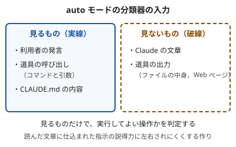

!!! abstract "要点"
    - **何ができるか**：auto モードの分類器が既定で止める操作と、すり抜けうる操作を知り、権限ルールやサンドボックスで補うものを決められる。
    - **いつ引くか**：auto モードに任せて大丈夫か迷うとき。auto モードに操作を止められて作業が進まないとき。確認なしで進めつつ、危ない操作だけは止めたいとき。
    - **強制力**：<!-- gen:begin feature enforcement -->モデルの判定<!-- gen:end feature enforcement -->。鍵には数えない。止めるかどうかを別のモデルが判断するので、決定論ではない。公式も、確認を減らすが安全は保証しない、と書く。
    - **前提**：<!-- link:begin permission-modes-overview -->[権限モードの選び方](../cli/permission-modes-overview.md)<!-- link:end -->

<!-- textlint-disable -->
別名：auto mode・オートモード・auto モードの分類器・権限の分類器
<!-- textlint-enable -->

auto モードは、道具を呼ぶ前に別のモデル（分類器）が審査して、危ないものだけを止める権限モードである。確認の回数は減るが、止め漏らしはある。このページは、止まるもの・通るもの・すり抜けうるものと、止められたときの直し方を扱う。

## 既定で止めるもの・通すもの {#defaults}

分類器が止めるのは、取り返しがつかない操作、破壊的な操作、環境の外に向かう操作である。既定の一覧は Claude Code の版で変わる。いま手元で効いている一覧は `claude auto-mode defaults` で全文が出る。ここには型だけを書く。

既定で止める操作の例は次のとおりである。

- `curl | bash` のように、取ってきたものをそのまま実行する
- 機密データを外へ送る
- 本番へのデプロイとマイグレーション
- force push と `git reset --hard`
- `terraform destroy` のような、基盤を壊す操作
- 承認されていない PR のマージと、IAM の権限の付与
- 確認を飛ばす起動で、エージェントの繰り返しを走らせる

既定で通す操作の例は次のとおりである。

- 作業ディレクトリの中のファイル操作
- lockfile に書かれた依存の導入
- 読み取り専用の HTTP
- 作業中のリポジトリへの push。ただし、本番や公開の用途を名前に持つブランチは、分類器が本番へのデプロイとして別に判断する

作業ディレクトリの中の操作は、既定で通す側にある。ここに注意が要る。中に `.env` があっても、読むこと自体を止める保証にはならない。読ませたくないものは、権限ルールとサンドボックスで閉じる（<!-- link:begin protecting-secrets#two-layers -->[秘密情報（.env・API キー）を守る › 権限ルールとサンドボックスの二重にする](../safety/protecting-secrets.md#two-layers)<!-- link:end -->）。

分類器が何を見て判断するかには、決まりがある。見るのは利用者の発言と道具の呼び出しで、CLAUDE.md の内容も読む。Claude の文章と道具の出力は見ない。ファイルや Web ページに仕込まれた指示は、その文章の出来でなく、それで Claude が実際に呼ぼうとした操作として審査される。



分類器より前に効く仕組みもある。deny ルールと、内容を絞った明示の ask ルールは、分類器より先に評価される。deny は分類器にも利用者の意図にも覆せず、ask は分類器が自動で承認することを許さない。評価の順番は <!-- link:begin permission-rules#evaluation-order -->[権限ルール（allow・ask・deny） › 評価の順番（deny → ask → allow）](permission-rules.md#evaluation-order)<!-- link:end --> にある。

分類器の判断は、利用者の発言で動く。「force push して」のように、これからやる操作を具体的に言った発言は、分類器が通す根拠になる。「リポジトリを片づけて」のような一般的な依頼は、force push を認める根拠にならない。

## すり抜けと限界 {#limits}

auto モードは確認を減らす仕組みで、安全を保証しない。限界は 5 つある。

1. **見逃しがある。** 公式のエンジニアリングの記事（2026-03-25）は、2 つの割合を報告する。社内の実際のトラフィック 10,000 件では、無害な操作を誤って止める割合が 0.4% だった。実際のセッションから集めた行き過ぎた操作 52 件では、見逃す割合が 17% だった（根拠：中。対象は分類器の二段の流れで、データは Anthropic の社内）。合成した「データの持ち出し」では見逃しが 5.7% と、データの作り方で大きく違う。1 つの値に丸めず、見逃しは 0 にならないものとして計画する。
2. **広い allow ルールは働かない。** auto モードに入ると、`Bash(*)` や、インタプリタをワイルドカードで許すルールのような、任意のコードを動かせる広い allow ルールは止まる。一方で `Bash(npm test)` のような狭いルールは、分類器より先に解決されて残る。狭いルールは、想定しなかったスクリプトのパスや引数が付いても、分類器が見ないまま通りうる。全部のシェルコマンドを分類器に通したいなら、`autoMode.classifyAllShell` を `true` にする。待ち時間が増える代わりに、見る範囲が広がる。
3. **会話で言った境界は消えうる。** 「push しないで」と言うと分類器は尊重するが、会話の圧縮でその発言が消えると効かなくなる。消えてはいけない境界は、deny ルールか ask ルールに書く（<!-- link:begin when-to-lock#spoken-rules-fade -->[お願いを鍵に移す判断 › 会話で言った禁止は圧縮で消える](when-to-lock.md#spoken-rules-fade)<!-- link:end -->）。
4. **設定の足し方にも穴がある。** `autoMode` は、利用者の設定と管理設定からだけ読まれる。プロジェクトの `.claude/settings.json` に書いても読まれない。リポジトリに入れた設定で、分類器の許可を書き換えられないようにするためである。各階層の項目は足し合わされるので、個人の `allow` の項目が組織の `soft_deny` の項目の例外になりうる。絶対に止めたい操作は、管理設定の `permissions.deny` に書く。
5. **連続して止められると手動に戻る。** ブロックが <!-- fact:begin auto-mode-block-pause-thresholds -->未確認<!-- fact:end --> に達すると、auto モードは一時停止して手動の確認に戻る。無人の実行では、そこで進まなくなる。

この限界を補う守りは、同じ流れの中で先に決めておく。

| 補いたいこと | 使う守り | 詳しい解説 |
| --- | --- | --- |
| 絶対に実行させない操作 | deny ルール | <!-- link:begin permission-rules#minimal -->[権限ルール（allow・ask・deny） › 最小の使い方](permission-rules.md#minimal)<!-- link:end --> |
| 必ず人が見る操作（push など） | ask ルール | 下の雛形（<!-- link:begin permission-rules#evaluation-order -->[権限ルール（allow・ask・deny） › 評価の順番（deny → ask → allow）](permission-rules.md#evaluation-order)<!-- link:end -->） |
| 子プロセスの読み書きと通信 | サンドボックス | <!-- link:begin sandboxing#scope -->[サンドボックスで封じ込める › 囲えるもの・囲えないもの](sandboxing.md#scope)<!-- link:end --> |
| 消されたくないもの | 権限ルールとバックアップ | <!-- link:begin destructive-commands#guard -->[消されたくないもの（破壊的コマンド） › 確認を求めさせる頼み方と、鍵](../safety/destructive-commands.md#guard)<!-- link:end --> |
| 信頼できない入力・秘密・外への送信が揃う構成 | 三つを同時に持たせない | <!-- link:begin lethal-trifecta#three-capabilities -->[三つを同時に持たせない（lethal trifecta と Rule of Two） › 三つの能力](../safety/lethal-trifecta.md#three-capabilities)<!-- link:end --> |

確認を全部外す bypassPermissions は、auto モードの代わりにならない。使い捨てて隔離した環境だけで使う（<!-- link:begin where-bypass-is-ok#why-isolate -->[bypassPermissions と無人の実行はどこで動かすか › なぜ隔離した環境だけか](../safety/where-bypass-is-ok.md#why-isolate)<!-- link:end -->）。承認が多すぎて読まなくなる問題は <!-- link:begin approval-fatigue#reduce-prompts -->[承認疲れ › 確認を減らす順番](../safety/approval-fatigue.md#reduce-prompts)<!-- link:end --> で扱う。

!!! example "判断例：夜間に長い作業を auto モードで任せたい"
    - **状況**：作業ディレクトリには `.env` があり、会社の別のリポジトリへ push する作業も含む。夜に離席して進めたい。
    - **迷う候補**：auto モードの既定のままで任せる。または、auto モードに加えて deny ルールと ask ルールを足してから任せる。
    - **選んだもの**：auto モードに加えて、`.env` の読み取りを deny ルールで閉じ、push を ask ルールにする。夜の無人の実行は、確認に答える人がいないので、push が必要な作業は昼に回す。
    - **理由**：作業ディレクトリの中の操作は既定で通る側にあり、見逃しもある。止めたい操作を分類器の判断だけに預けると、預けすぎになる。

## 止められたときの見直し方 {#when-blocked}

auto モードに操作を止められたら、止めた理由を読み、足りない文脈を足す。ルールを広げて黙らせない。

**1. 止めた操作を確かめる。** 止めた通知の角かっこの中に、当たった規則の名前が出る。全文は `claude auto-mode defaults --label '<規則の名前の先頭>'` で読める。通知は、コマンド名、再試行されること、`/permissions` で見直せることも示す。
**2. 操作を見る。** `/permissions` を開き、<!-- name:begin recently-denied-to-blocked -->Recently blocked（/permissions のタブ）<!-- name:end -->の行を選ぶ。行の説明は Claude や道具が書いた文なので、読むのは下に出るコマンドか入力のほうにする。
**3. 直し方を選ぶ。** 取る手は、止められた理由で決める。

| 止められた理由 | 取る手 |
| --- | --- |
| 作業全体で要る行き先（社内のレジストリ、社内のドメイン、リポジトリのホスト）が信頼されていない | `autoMode.environment` に足す。`/auto-mode-setup` が下書きを作る |
| 毎回同じ定番のコマンドが止まる | 狭い allow ルールを足す。広い allow ルールは auto モードで止まる |
| 一度だけやりたい操作だった | 次の発言で、その操作を具体的に言って、再試行させる |
| 実は止めてよい操作だった | 何もしない。止めた理由を、ルールの見直しに使う |

**4. 行で承認するときの性質を知る。** `r` で承認して再試行させても、ルールは増えない。再試行はもう一度審査されるので、また止められうる。毎回通したいなら、`allow` ルールか `environment` の項目にする。
**5. 確かめる。** 設定を直したら、`claude auto-mode config` を流して、実際に効く設定に自分の項目が入ったかを確かめる。

分類器の判定が返らない場合もある。通知が「判定がなかった」ことを示し、`/permissions` にも行が出ないなら、分類器は答えていないだけで、危ないと判断してはいない。公式のエラーの案内に沿って、操作のやり方を直す。

止めすぎて回り込む動きが出ていないかは、止めた記録で見る（<!-- link:begin lock-side-effects#review-blocks -->[縛りすぎの害と見直し（止めすぎ・回り込み） › 止めた記録の見直し](lock-side-effects.md#review-blocks)<!-- link:end -->）。確認の回数そのものを調整するなら <!-- link:begin wrong-amount-of-approvals#diagnosis -->[承認の確認が多すぎる・少なすぎる › 原因を安く確かめる順](../symptoms/wrong-amount-of-approvals.md#diagnosis)<!-- link:end --> を引く。

## 面ごとの違い {#by-surface}

面ごとに、auto モードが働く条件と既定が違う。既定は版とプランで変わってきたので、手元の画面で確かめる。

=== "アプリ"

    アプリには、確認なしで進める Auto と、毎回確かめる Manual がある。既定の選択はプランで違う。選び方、読める範囲と行動できる範囲を同時に広げない置き方は、<!-- link:begin permission-modes-in-the-app#two-conditions -->[アプリの権限モード（Auto と Manual）と安全 › 読める範囲と行動できる範囲を同時に広げない](../app/permission-modes-in-the-app.md#two-conditions)<!-- link:end --> に任せる。ここで書いた分類器の細かい設定（`autoMode` と `claude auto-mode`）は、Claude Code の機能である。

=== "Claude Code"

    何も決めていなければ、対話の端末と VS Code のセッションは auto モードで始まる（入った時期は <!-- link:begin outdated-advice-ledger#approve-everything-first -->[古くなった助言の台帳](../changes/outdated-advice-ledger.md#approve-everything-first)<!-- link:end --> の行にある）。毎回確かめたいなら、`permissions.defaultMode` を `default`（表示は Manual）にするか、`--permission-mode manual` で起動する。

    `claude -p` と Agent SDK は、決めていなければ Manual で動く。承認の要る呼び出しは、allow ルール・フック・`canUseTool`・`--permission-prompt-tool` で認めない限り拒まれる。auto で動かすなら `--permission-mode auto` を明示する。無人のときの許可と上限の渡し方は <!-- link:begin headless-basics#permissions -->[非対話モード（claude -p）の基本 › 許可と権限モード](../delegate/headless-basics.md#permissions)<!-- link:end --> にある。

    `autoMode` の設定は、`~/.claude/settings.json`・管理設定・`--settings` で渡す JSON の 3 か所から読まれる。`claude auto-mode` の副コマンドで、`defaults`（既定の一覧）・`config`（実際に効く設定）・`critique`（自分の項目の点検）・`reset`（利用者の設定の初期化）が使える。

面ごとの既定の一覧は <!-- link:begin default-safety-settings#defaults-by-surface -->[安全の早見表（面ごとの既定と、段階ごとに足すもの） › 面ごとの既定（生成の表）](../safety/default-safety-settings.md#defaults-by-surface)<!-- link:end --> にある。本文は WSL・Linux の CLI を基準にしていて、ほかの OS と IDE 拡張の動作は未確認である。

## 雛形 {#templates}

1 つめは、分類器に自分の環境を説明する設定である。既定で分類器が信頼するのは、作業ディレクトリと、いまのリポジトリの remote だけである。会社の別のリポジトリへの push や、社内のバケットへの書き込みは止められる。`"$defaults"` を先頭に置くと、既定の項目を残して足せる。置かずに書くと、その節の既定の一覧が丸ごと置き換わる。項目は正規表現ではなく、新しく入った同僚に説明する調子の文である。

<!-- gen:begin snippet what-auto-mode-stops/auto-mode-environment -->
<!-- textlint-disable -->

??? example "雛形：auto モードに環境を説明する設定（autoMode.environment）"

    ```json
    {
      "autoMode": {
        "environment": [
          "$defaults",
          "Organization: Example Corp. Primary use: software development",
          "Source control: github.example.com/example-corp and all repos under it",
          "Trusted cloud buckets: s3://example-build-artifacts",
          "Trusted internal domains: *.corp.example.com",
          "Key internal services: Jenkins at ci.example.com, Artifactory at artifacts.example.com"
        ]
      }
    }
    ```

    動作を確かめていない雛形。安全のための雛形なので、守りとして頼る前に、止めたい操作が自分の環境で止まるかを確かめる。

<!-- textlint-enable -->
<!-- gen:end snippet what-auto-mode-stops/auto-mode-environment -->

2 つめは、auto モードのまま、push と PR の作成の前だけ人が見る設定である。ask ルールは分類器より先に評価される。ただし、`git -C <dir> push` のように書き方を変えた push は、このルールに当たらない。コマンドの全文を見たいなら、フックで書く（<!-- link:begin permission-rules#child-processes -->[権限ルール（allow・ask・deny） › 子プロセスには効かない](permission-rules.md#child-processes)<!-- link:end -->）。

<!-- gen:begin snippet what-auto-mode-stops/ask-before-push -->
<!-- textlint-disable -->

??? example "雛形：push と PR の作成の前だけ、auto モードでも確認を挟む設定"

    ```json
    {
      "permissions": {
        "ask": [
          "Bash(git push *)",
          "Bash(gh pr create *)"
        ]
      }
    }
    ```

    動作を確かめていない雛形。安全のための雛形なので、守りとして頼る前に、止めたい操作が自分の環境で止まるかを確かめる。

<!-- textlint-enable -->
<!-- gen:end snippet what-auto-mode-stops/ask-before-push -->

## 比べる相手 {#compare}

auto モードは、確認を減らす方法の 1 つである。ほかの方法と、判断する者と向く境界が違う。

| 手段 | 判断する者 | 向く境界 |
| --- | --- | --- |
| auto モード | 別のモデルの分類器 | 取り返しのつかない操作と、環境の外に向かう操作の、広い網 |
| 権限ルール | Claude Code のルールの一致 | 機械的に判定できる、絶対の禁止と必ず確認する操作 |
| サンドボックス | OS の層 | 子プロセスを含む、読み書きと通信の範囲 |
| bypassPermissions | 判断しない | 隔離した使い捨ての環境だけ |

層は、重ねて使う。広い網は auto モード、絶対の禁止は deny ルール、届かない範囲はサンドボックスと分ける。権限モード全体の選び方は <!-- link:begin permission-modes-overview#modes -->[権限モードの選び方 › モードごとに確認なしで進むもの](../cli/permission-modes-overview.md#modes)<!-- link:end --> を見る。

任せる幅を広げる前の問いは <!-- link:begin five-questions-before-delegating#five-questions -->[任せ方の段階と、無人で走らせる前の五つの問い › 無人で走らせる前の五つの問い](../delegate/five-questions-before-delegating.md#five-questions)<!-- link:end --> で確かめる。

## 古くなった助言 {#outdated}

auto モードの周りには、古い前提の助言が残っている。

- 「最初はすべての確認を承認していく」前提の手順。いまは何も設定しなければ auto モードで始まる。今どうするかは <!-- link:begin outdated-advice-ledger#approve-everything-first -->[古くなった助言の台帳](../changes/outdated-advice-ledger.md#approve-everything-first)<!-- link:end --> にある。
- 「確認が面倒なら `--dangerously-skip-permissions` で YOLO 運用にする」という勧め。ふだんは auto モードにサンドボックスを重ねる。今どうするかは <!-- link:begin outdated-advice-ledger#yolo-skip-permissions -->[古くなった助言の台帳](../changes/outdated-advice-ledger.md#yolo-skip-permissions)<!-- link:end --> にある。

<!-- gen:begin page-links -->
<!-- textlint-disable -->

<div class="ca-page-links" markdown>

**前提**

- [権限モードの選び方](../cli/permission-modes-overview.md)

**次に読む**

- [bypassPermissions と無人の実行はどこで動かすか](../safety/where-bypass-is-ok.md)
- [agent view と背景セッション](../delegate/agent-view-and-background.md)
- [/loop と定期実行の方式](../delegate/loop-and-scheduling.md)
- エージェントチーム（複数の Claude に分担させる）（準備中）

**関連**

- [権限ルール（allow・ask・deny）](permission-rules.md)
- [サンドボックスで封じ込める](sandboxing.md)
- [承認疲れ](../safety/approval-fatigue.md)
- [安全の早見表（面ごとの既定と、段階ごとに足すもの）](../safety/default-safety-settings.md)
- [消されたくないもの（破壊的コマンド）](../safety/destructive-commands.md)
- [秘密情報（.env・API キー）を守る](../safety/protecting-secrets.md)
- [三つを同時に持たせない（lethal trifecta と Rule of Two）](../safety/lethal-trifecta.md)
- [アプリの権限モード（Auto と Manual）と安全](../app/permission-modes-in-the-app.md)
- [承認の確認が多すぎる・少なすぎる](../symptoms/wrong-amount-of-approvals.md)
- [任せ方の段階と、無人で走らせる前の五つの問い](../delegate/five-questions-before-delegating.md)
- [非対話モード（claude -p）の基本](../delegate/headless-basics.md)
- [お願いを鍵に移す判断](when-to-lock.md)
- [縛りすぎの害と見直し（止めすぎ・回り込み）](lock-side-effects.md)

</div>

<!-- textlint-enable -->
<!-- gen:end page-links -->

<!-- gen:begin references -->
<!-- textlint-disable -->

## 参考 {#references}

- [Choose a permission mode](https://code.claude.com/docs/en/permission-modes)：Anthropic・英語・確認日 2026-11-04
- [Configure auto mode](https://code.claude.com/docs/en/auto-mode-config)：Anthropic・英語・確認日 2026-11-04
- [Security](https://code.claude.com/docs/en/security)：Anthropic・英語・確認日 2026-11-04
- [Configure permissions](https://code.claude.com/docs/en/permissions)：Anthropic・英語・確認日 2026-11-04
- [How we built Claude Code auto mode: a safer way to skip permissions](https://www.anthropic.com/research/claude-code-auto-mode)：Anthropic・英語・確認日 2026-11-04
- [Auto mode is now the default in Claude Code for Pro, Max, Ultra, and Team plans](https://claude.com/resources/articles/auto-mode-default-in-claude-code)：Anthropic・英語・確認日 2026-11-04
- [Claude Cowork and chat are one Claude](https://support.claude.com/en/articles/16761823-claude-cowork-and-chat-are-one-claude)：Anthropic・英語・確認日 2026-11-04
- [Changelog](https://github.com/anthropics/claude-code/blob/main/CHANGELOG.md)：Anthropic・英語・確認日 2026-11-04

<!-- textlint-enable -->
<!-- gen:end references -->
