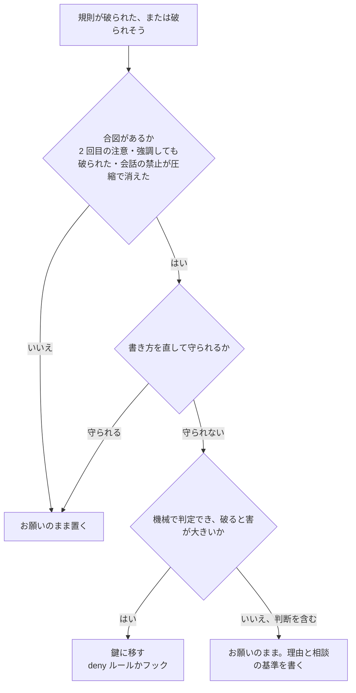

!!! abstract "要点"
    - **何が分かるか**：頼んだ規則のうち、どれを deny ルールやフックに移すかを判断できる。
    - **いつ引くか**：CLAUDE.md に「〜しない」と書いたのに破られるとき、「push しないで」と言ったのに push されたとき、例外なく守らせたい規則があるとき。
    - **判断の基準**：合図は 3 つ。同じ注意を 2 回した、強調しても破られた、会話で言った禁止が圧縮で消えた。合図が出て、しかも機械で判定でき、破ると害が大きい規則だけを鍵に移す。
    - **前提**：<!-- link:begin request-vs-lock -->[お願いと鍵（決定論的か、非決定論的か）](../basics/request-vs-lock.md)<!-- link:end -->、<!-- link:begin what-survives-compaction -->[圧縮（compaction）で何が残り、何が消えるか](../basics/what-survives-compaction.md)<!-- link:end -->

<!-- textlint-disable -->
別名：お願いから鍵へ・指示を仕組みに移す・決定論的な制御に移す・会話で言った禁止事項は圧縮で消える
<!-- textlint-enable -->

お願いを鍵に移す判断は、Claude に頼んでいる規則のうち、どれを権限ルールやフックのような鍵に置き直すかを決める判断である。お願いと鍵そのものの違いは <!-- link:begin request-vs-lock#why -->[お願いと鍵（決定論的か、非決定論的か） › なぜそうなるか](../basics/request-vs-lock.md#why)<!-- link:end --> が持つ。このページは、どの規則を、どの合図で移すかだけを扱う。

## 鍵に移す合図 {#signals}

鍵に移す合図は 3 つある。どれも「お願いのままでは、この規則は守られ続けない」と分かる出来事である。

1. **同じ注意を 2 回した**。1 回目の訂正は、CLAUDE.md の 1 行で足りることが多い。同じ規則をもう一度言うことになったなら、お願いが効いていない。2 回目の注意は、規則の置き場所を見直す合図になる。
2. **強調しても破られた**。IMPORTANT や全部大文字で書き足しても守られない行は、公式が鍵にすべき合図として挙げている。CLAUDE.md は指針であり、Claude は当てはまらないと判断してよいからである。強調で直らない理由は <!-- link:begin emphasis-words#why-not -->[強調語（IMPORTANT・必ず）の現在 › 強調で直らない二つの理由（長すぎる・例外がない）](../prompting/emphasis-words.md#why-not)<!-- link:end --> にある。この助言の変遷は <!-- link:begin outdated-advice-ledger#important-caps -->[古くなった助言の台帳](../changes/outdated-advice-ledger.md#important-caps)<!-- link:end --> に載っている。
3. **会話で言った禁止が圧縮で消えた**。「push しないで」と言ったのに、長い作業の後で push された場合である。詳しくは、この後の「会話で言った禁止は圧縮で消える」の節で扱う。

合図が出ても、すぐに鍵へ移さない。先に 2 つを確かめる。

- **書き方で直らないか**：ファイルが長すぎて埋もれていないか、規則同士が矛盾していないかを、安く確かめる。順番は <!-- link:begin instructions-ignored#diagnosis -->[CLAUDE.md や指示が守られない › 原因を安く確かめる順](../symptoms/instructions-ignored.md#diagnosis)<!-- link:end --> にある。これで直るなら鍵は要らない。
- **鍵にしてよい規則か**：機械で判定でき、破ったときの害が大きい規則だけを移す。選び方は <!-- link:begin lock-side-effects#what-to-lock -->[縛りすぎの害と見直し（止めすぎ・回り込み） › 縛る規則の選び方（機械的に判定でき、害の大きいものだけ）](lock-side-effects.md#what-to-lock)<!-- link:end --> が持つ。

次の図は、この判断の流れである。合図が出たら、まず書き方を確かめ、それでも直らず、機械で判定できて害が大きい規則だけが鍵に移る。判断を含む規則は、お願いのまま残る。



## 会話で言った禁止は圧縮で消える {#spoken-rules-fade}

会話で言った禁止は、会話の履歴の一部である。圧縮で履歴が要約に置き換わると、禁止の一文は要約に溶け、圧縮の後の Claude から見えなくなりうる。何が残り何が消えるかの一覧は <!-- link:begin what-survives-compaction#dissolved -->[圧縮（compaction）で何が残り、何が消えるか › 要約に溶けて消えるもの](../basics/what-survives-compaction.md#dissolved)<!-- link:end --> に任せ、ここでは繰り返さない。

auto モードでも同じである。会話で「push しないで」と言えば、分類器はブロックの合図として尊重する。ただし、その一文が圧縮で失われうるので、公式は、確実に守らせたいなら deny ルールを使うよう勧める。

そこで、禁止を会話の外へ移す。移し先として、圧縮の影響を受けないものが 2 つある。

- **deny ルール**：設定にあるルールは、圧縮の影響を受けない。止めるのはモデルではなく Claude Code なので、会話の履歴に何が残っているかと関係なく止まる。
- **フック**：会話の外で動くので、圧縮の後も働く。決まったきっかけで必ずスクリプトを走らせる。

CLAUDE.md に書く手もある。ルートの CLAUDE.md は圧縮の後にディスクから入れ直される。ただし CLAUDE.md はお願いであり、強制ではない。約束の種類ごとの置き場所は <!-- link:begin promises-after-compaction#where-to-put -->[圧縮で消えない場所に約束を置く › 約束の種類ごとの置き場所](../context/promises-after-compaction.md#where-to-put)<!-- link:end --> が持つ。このページが持つのは、会話で言った禁止を deny ルールとフックに移すか、という判断だけである。

!!! example "判断例：レビューまで push しない"
    - **状況**：「レビューが終わるまで push しないで」と会話で頼んだ。作業が長引き、途中で圧縮が走った。
    - **迷う候補**：禁止を CLAUDE.md の 1 行に書く。または、`git push` を deny ルールに置く。
    - **選んだもの**：deny ルールに置き、CLAUDE.md には理由と、止められたときの代わりの手段だけを書く。
    - **理由**：push は機械で判定でき、共有のブランチに載ると取り消しに手間がかかる。CLAUDE.md の 1 行は圧縮の後も読み直されるが、お願いなので破られうる。レビュー後に push する権限は、人が自分の端末で持つ。

## 移し先の選び方 {#where-to-move}

移し先は、規則の形で決める。

- **特定のコマンドや特定のパスを止めれば足りる**：deny ルールにする。許可・確認・拒否のうち、拒否は先に評価される。使いどころは <!-- link:begin permission-rules#when -->[権限ルール（allow・ask・deny） › 使いどころ](permission-rules.md#when)<!-- link:end -->、評価の順番は <!-- link:begin permission-rules#evaluation-order -->[権限ルール（allow・ask・deny） › 評価の順番（deny → ask → allow）](permission-rules.md#evaluation-order)<!-- link:end --> にある。
- **コマンドの中身、ファイルの内容、ターンの終わりの状態を見て判定する**：フックにする。鍵に数えるのは、スクリプトが決まった手順で判定する決定論のフックである。別のモデルに判断させるフックは、鍵ではなくお願いに近い。使いどころは <!-- link:begin hooks-basics#when -->[フックの考え方とイベント › 使いどころ](hooks-basics.md#when)<!-- link:end -->、違いは <!-- link:begin hooks-basics#deterministic -->[フックの考え方とイベント › 決定的なフックと、モデルが判断するフック](hooks-basics.md#deterministic)<!-- link:end --> にある。
- **毎回 Claude に判断させている作業**：判断そのものをスクリプトに移す。見分け方は <!-- link:begin move-judgment-into-scripts#what-to-move -->[判断を決定論的なスクリプトに移す › 移す作業の見分け方](move-judgment-into-scripts.md#what-to-move)<!-- link:end --> にある。

この節の例は Claude Code の設定である。アプリと API で使える鍵は面によって違うので、<!-- link:begin request-lock-table#by-surface -->[お願いと鍵の対応表 › 面ごとの鍵の手段](request-lock-table.md#by-surface)<!-- link:end --> で確かめる。会話で言った禁止を deny ルールに移す設定の例を次に示す。

<!-- gen:begin snippet when-to-lock/deny-git-push -->
<!-- textlint-disable -->

??? example "雛形：会話で言った「push しないで」を deny ルールに移す設定"

    ```json
    {
      "permissions": {
        "deny": [
          "Bash(git push *)"
        ]
      }
    }
    ```

    動作を確かめていない雛形。安全のための雛形なので、守りとして頼る前に、止めたい操作が自分の環境で止まるかを確かめる。

<!-- textlint-enable -->
<!-- gen:end snippet when-to-lock/deny-git-push -->

鍵に移したら、新しいセッションで、止めたい操作をわざと頼んで止まることを確かめる。止まらないなら、ルールの書き方かパスが合っていない。そのうえで、CLAUDE.md の元の行は、禁止の言い方から、理由と代わりの手段の言い方に書き換える。鍵が止めたとき、Claude が理由を読み、回り込まずに済むようにするためである。止めるときに返すことは <!-- link:begin lock-side-effects#reason-and-alternative -->[縛りすぎの害と見直し（止めすぎ・回り込み） › 止めるときに返すこと](lock-side-effects.md#reason-and-alternative)<!-- link:end -->、CLAUDE.md の残す行と外す行は <!-- link:begin what-to-put-in-claude-md#what-to-leave-out -->[CLAUDE.md に書くこと・書かないこと › 書かないことと、移し先](../extend/what-to-put-in-claude-md.md#what-to-leave-out)<!-- link:end --> が持つ。

<!-- gen:begin snippet when-to-lock/reason-for-push-in-claude-md -->
<!-- textlint-disable -->

??? example "雛形：deny ルールの理由と代わりの手段だけを書く CLAUDE.md の行"

    ```markdown
    ## git push

    - `git push` は deny ルールで止まる。レビュー前の変更が共有のブランチに載ると、取り消しに手間がかかるため。
    - 止められたら、回り込まずに、変更の内容を報告に書いて人の確認を待つ。
    ```

    動作を確かめていない雛形。要る最低の版：Claude Code 1.0.38。

<!-- textlint-enable -->
<!-- gen:end snippet when-to-lock/reason-for-push-in-claude-md -->

## 鍵にしない規則（判断を含むもの） {#what-not-to-lock}

鍵にしない規則は、判断を含むものである。機械で判定できない規則をフックや deny ルールにすると、正しい操作まで止める。止めすぎた Claude や人は、別の手段で回り込もうとする。この害は <!-- link:begin lock-side-effects#what-to-lock -->[縛りすぎの害と見直し（止めすぎ・回り込み） › 縛る規則の選び方（機械的に判定でき、害の大きいものだけ）](lock-side-effects.md#what-to-lock)<!-- link:end --> と、止めた記録の見直し（<!-- link:begin lock-side-effects#review-blocks -->[縛りすぎの害と見直し（止めすぎ・回り込み） › 止めた記録の見直し](lock-side-effects.md#review-blocks)<!-- link:end -->）が持つ。

判断を含む規則の例は、次のようなものである。

- 何が小さな直しかを決める規則。
- 命名や文体を、周りのコードに合わせる規則。
- 設計の方針に沿うかどうかを見る規則。

これらは CLAUDE.md や依頼に、理由と相談の基準を添えて書く。二層の書き方は <!-- link:begin request-vs-lock#two-layers -->[お願いと鍵（決定論的か、非決定論的か） › 二層で書く](../basics/request-vs-lock.md#two-layers)<!-- link:end --> にある。

!!! example "判断例：「小さな直しにとどめて」を鍵にするか"
    - **状況**：Claude が、頼んでいないリファクタリングまで一緒に直してしまう。注意は 2 回した。
    - **迷う候補**：変更した行数の上限をフックで決めて止める。または、CLAUDE.md に「小さな直しにとどめる」と理由を書く。
    - **選んだもの**：CLAUDE.md に理由と相談の基準を書く。行数でなく、「依頼の範囲を超えそうなら先に聞く」と書く。
    - **理由**：何が小さいかは、依頼によって変わる。行数の上限は、必要な大きい直しも止め、小さな無関係の直しは止めない。機械で判定できない規則を鍵にすると、止めすぎと回り込みが起きる。

判断を含む規則の中にも、機械で判定できる部分が混ざっていることがある。たとえば「設定ファイルの特定のパスは触らない」の部分だけは、deny ルールにできる。こうして切り出せる部分は、鍵に移す。

## 何に効くか {#effects}

鍵に移すことは、原理の「縛る」を実行する手段である。規則を Claude の判断から切り離し、効く範囲と条件の中で毎回同じように働く形にする。

- **縛っていない**：例外なく守らせたい規則が、お願いのまま置かれている原因である。鍵に移すと、直接なくなる。権限ルールは、モデルではなく Claude Code が強制する。プロンプトや CLAUDE.md の指示は Claude が試みることを変えるが、許すことは変えない。
- **散らかっている**：会話で言った禁止や、長い CLAUDE.md に埋もれた規則が、圧縮や長さのために見えなくなる原因である。鍵に移した規則は会話にも CLAUDE.md にも置かなくてよくなる。CLAUDE.md が短くなり、残った行は埋もれにくくなる。

鍵が効く範囲には限りがある。移す前に、次の 3 つで確かめる。

- **deny ルールが当たるパス**：<!-- link:begin permission-rules#path-rules -->[権限ルール（allow・ask・deny） › パスの書き方と、何にも当たらないルール](permission-rules.md#path-rules)<!-- link:end -->
- **deny ルールが効かない子プロセス**：<!-- link:begin permission-rules#child-processes -->[権限ルール（allow・ask・deny） › 子プロセスには効かない](permission-rules.md#child-processes)<!-- link:end -->
- **フックを置く場所と、効く範囲**：<!-- link:begin hooks-basics#locations -->[フックの考え方とイベント › 置き場所と効く範囲（サブエージェントと信頼の確認）](hooks-basics.md#locations)<!-- link:end -->

## 誤解 {#misconceptions}

- **強調を重ねれば守られる**：強調を足しても直らない行が、鍵に移す合図である。強調はかえって規則を当てはめすぎる原因にもなる。見直しは <!-- link:begin emphasis-words#overreaction -->[強調語（IMPORTANT・必ず）の現在 › 強い言い方が過剰に効く](../prompting/emphasis-words.md#overreaction)<!-- link:end --> にある。
- **会話で一度言えば、ずっと守られる**：会話の禁止は圧縮で溶けうる。長い作業で守らせたい禁止は、会話の外に置く。
- **スキルにすれば確実に動く**：スキルは Claude が判断して使うお願いである。必ず動かしたい手順は、フックで走らせる。違いは <!-- link:begin hook-vs-skill -->[フックとスキルの違い](../extend/hook-vs-skill.md)<!-- link:end --> にある。
- **鍵が多いほど安全になる**：縛りを足しすぎると、止めすぎと回り込みが起きる。移すのは、機械で判定でき、害の大きい規則だけにする。

<!-- gen:begin references -->
<!-- textlint-disable -->

## 参考 {#references}

- [Extend Claude Code](https://code.claude.com/docs/en/features-overview)：Anthropic・英語・確認日 2026-11-04
- [Configure permissions](https://code.claude.com/docs/en/permissions)：Anthropic・英語・確認日 2026-11-04
- [Choose a permission mode](https://code.claude.com/docs/en/permission-modes)：Anthropic・英語・確認日 2026-11-04
- [Best practices for Claude Code](https://code.claude.com/docs/en/best-practices)：Anthropic・英語・確認日 2026-11-04
- [How Claude remembers your project](https://code.claude.com/docs/en/memory)：Anthropic・英語・確認日 2026-11-04
- [Automate actions with hooks](https://code.claude.com/docs/en/hooks-guide)：Anthropic・英語・確認日 2026-11-04
- [Explore the context window](https://code.claude.com/docs/en/context-window)：Anthropic・英語・確認日 2026-11-04

<!-- textlint-enable -->
<!-- gen:end references -->

<!-- gen:begin page-links -->
<!-- textlint-disable -->

<div class="ca-page-links" markdown>

**前提**

- [お願いと鍵（決定論的か、非決定論的か）](../basics/request-vs-lock.md)
- [圧縮（compaction）で何が残り、何が消えるか](../basics/what-survives-compaction.md)

**次に読む**

- [お願いと鍵の対応表](request-lock-table.md)
- [フックの考え方とイベント](hooks-basics.md)
- 失敗を仕組みに戻す（ポストモーテム）（準備中）

**関連**

- [権限ルール（allow・ask・deny）](permission-rules.md)
- [縛りすぎの害と見直し（止めすぎ・回り込み）](lock-side-effects.md)
- [判断を決定論的なスクリプトに移す](move-judgment-into-scripts.md)
- [CLAUDE.md や指示が守られない](../symptoms/instructions-ignored.md)
- [圧縮の後に約束を忘れた](../symptoms/forgot-after-compaction.md)
- [圧縮で消えない場所に約束を置く](../context/promises-after-compaction.md)
- [CLAUDE.md に書くこと・書かないこと › 書かないことと、移し先](../extend/what-to-put-in-claude-md.md#what-to-leave-out)
- [強調語（IMPORTANT・必ず）の現在](../prompting/emphasis-words.md)
- [フックとスキルの違い](../extend/hook-vs-skill.md)

</div>

<!-- textlint-enable -->
<!-- gen:end page-links -->
