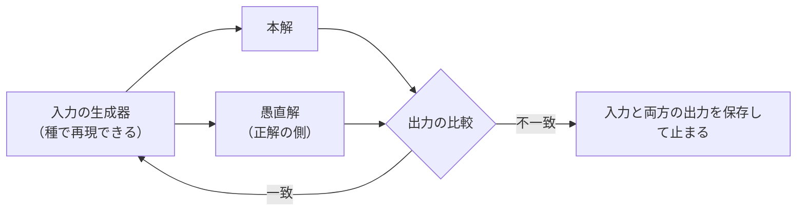

!!! abstract "要点"
    - **何ができるか**：遅くても明らかに正しい解（愚直解・旧実装・公式の道具）と突き合わせる差分テストを、Claude に作らせて回させられる。
    - **いつ引くか**：正解の分かる遅い実装と突き合わせて正しさを確かめたいとき。テストでは見つからない間違いが本番の入力で出るとき。古い実装を新しく書き直しているとき。
    - **前提**：<!-- link:begin verifier-three-conditions -->[検証器の三条件（正しい・書き換えられない・本番を代表する）](verifier-three-conditions.md)<!-- link:end -->

<!-- textlint-disable -->
別名：オラクル・ストレステスト・参照実装との比較・愚直解との比較
<!-- textlint-enable -->

答えの分かる遅い解と比べる差分テストは、同じ入力を正解の側と確かめたい側（本解）の両方に流し、出力が食い違う入力を探す技法である。正解の側は、遅くてよいので仕様を読んだだけで正しいと分かるものを選ぶ。愚直解（全探索などの素直な解）、書き直す前の旧実装、公式の道具が当たる。入力の生成、両方の実行、比較、食い違いの保存までを Claude に作らせて回させられる。ただし、食い違いが出たときに Claude が正解の側を動かして緑にしないよう、先に守りを置く。

## 先に整える守り {#guard-first}

差分テストでは、正解の側が検証器の役目を負う。検証器の条件の点検は <!-- link:begin verifier-three-conditions#audit -->[検証器の三条件（正しい・書き換えられない・本番を代表する） › 三条件を点検する](verifier-three-conditions.md#audit)<!-- link:end --> が持つ。この技法では、回す前に次の 3 つを整える。

- **正解の側が正しい**：愚直解の答えは、手で解ける小さい入力を使って人が確かめる。確かめ方は <!-- link:begin test-the-verifier#hand-calculated -->[検証器そのものを確かめる（red/green・手で計算したケース） › 手で計算したケース](test-the-verifier.md#hand-calculated)<!-- link:end --> と同じである。
- **書き換えられない**：正解の側と比較のコードは、Claude が作業中は触れない場所へ置く。置き方は <!-- link:begin build-test-harness#separate-eval-assets -->[検証環境・テスト基盤を作らせる › 検証の資産を分けて置く](../recipes/build-test-harness.md#separate-eval-assets)<!-- link:end --> を参照する。
- **本番を代表する**：入力の生成器が、本番で出る形と境界の入力を出しているかを、人が出力を見て確かめる。

守りを先に置く理由は、Claude に「テストを書け」と頼むと、今あるバグ入りの挙動を正解として固めやすいことにある。LLM ベースのテスト生成ツールを調べた研究（2024）では、最終的なテストの集まりの 59.6〜68.1% が、バグを正当化するテストだった（根拠：中）。詳しくは <!-- link:begin pitfalls-of-ai-written-tests#pinning-bugs -->[AI に書かせたテストの落とし穴 › 今の挙動を正解として固める](../verify/pitfalls-of-ai-written-tests.md#pinning-bugs)<!-- link:end --> が持つ。差分テストでも、食い違いが出たとき手近な解消の道は、正解の側か比較を本解に合わせて緑にすることである（類推）。

## 手順 {#steps}

全体の流れは次のとおりである。入力の生成器が作った入力を本解と愚直解の両方に流し、出力を比べる。一致すれば次の入力へ進み、食い違えば入力と両方の出力を保存して止まる。



各段に、終わったことを確かめる印を付ける。

1. **正解の側を決める**。愚直解を新しく書かせるか、旧実装や公式の道具を使うか選ぶ。愚直解は、本解のコードを見せずに仕様から書かせる。本解の考え違いを写さないためである。
    - 終わりの印：手で解ける小さい入力 3 つで、愚直解の答えが人の計算と一致した。
2. **入力の生成器を作らせる**。乱数の種を引数にとり、同じ種なら同じ入力を出すようにさせる。小さい入力を中心に、境界の入力も出させる。
    - 終わりの印：同じ種で同じ入力が出た。出た入力の分布を人が見て、本番の形に近いと判断した（<!-- link:begin test-the-verifier#input-distribution -->[検証器そのものを確かめる（red/green・手で計算したケース） › 入力の生成器の分布を人が見る](test-the-verifier.md#input-distribution)<!-- link:end --> を参照）。
3. **比較の駆動役を作らせる**。種を順に増やして両方を動かし、最初の不一致で止まらせる。止まったときは、種・入力・両方の出力を保存させる。
    - 終わりの印：本解にわざと間違いを入れた版で、駆動役が止まり、保存物ができた（<!-- link:begin test-the-verifier#broken-copy -->[検証器そのものを確かめる（red/green・手で計算したケース） › わざと壊した検証器で落ちるか](test-the-verifier.md#broken-copy)<!-- link:end --> と同じ考え方）。
4. **回す**。不一致が出ても、本解をその場で直させない。保存物を報告させて、止める。
    - 終わりの印：不一致なしなら、回した件数と種の範囲が実行ログに出ている。不一致ありなら、再現できる保存物がある。
5. **不一致を縮めて、直させる**。保存した入力が大きいときは、<!-- link:begin shrink-failing-inputs -->失敗する入力を縮めるスクリプトを書かせる<!-- link:end --> の手順で最小の再現例に縮めてから、<!-- link:begin fix-a-bug -->[バグを直す](../recipes/fix-a-bug.md)<!-- link:end --> の流れで直させる。
    - 終わりの印：縮めた入力で、直す前は食い違い、直した後は一致する。
6. **同じ種の範囲で回し直す**。直した後に、直す前と同じ範囲を回し、不一致 0 件を実行ログで示させる。
    - 終わりの印：実行ログに、種の範囲と不一致 0 件がある。

手順 3 と 4 を 1 つの依頼にまとめた雛形を置く。

<!-- gen:begin snippet differential-testing/stress-test -->
<!-- textlint-disable -->

???+ example "雛形：愚直解と入力の生成器でストレステストを回させる依頼の雛形"

    ```text
    次の問題について、本解と愚直解を突き合わせるストレステストを作って回してください。

    〔問題の文、または入出力の仕様〕
    〔本解のファイル〕
    〔入力の大きさの上限（愚直解が終わる範囲）〕

    作るもの
    1. 愚直解：遅くてよいので、仕様を読んだだけで正しいと分かる全探索で書く。本解のコードは見ない
    2. 入力の生成器：乱数の種を引数にとり、同じ種なら同じ入力を出す。小さい入力を中心に、境界（最小・最大・同じ値が並ぶ・空に近い）も出す
    3. 比較の駆動役：種を 0 から順に増やし、本解と愚直解の出力を比べる。最初の不一致で止まり、入力・本解の出力・愚直解の出力・種をファイルに保存する

    守ること
    - 最初の不一致で止まったら、本解を直さず、保存したものを私に報告する
    - 愚直解を本解の出力に合わせて書き換えない。比較を緩めない（空白や順序の許容は、仕様で認められる範囲だけ）
    - 愚直解が正しいことは、手で解ける小さい入力 3 つで先に確かめ、その結果を見せる
    - 不一致がないときは、回した件数と種の範囲を実行ログで示す
    ```

    動作を確かめていない雛形。

<!-- textlint-enable -->
<!-- gen:end snippet differential-testing/stress-test -->

## 正解の側を守る {#protect-the-oracle}

食い違いが出たとき、Claude に許してはならない動きが 3 つある。いずれも、食い違いを解消したように見せる近道である。

- 正解の側（愚直解・旧実装の写し）を、本解の出力に合わせて書き換える。
- 比較を緩める。許容する誤差を広げる、並び順を無視する、食い違う項目を比較から外す。
- 食い違いが出る入力を、生成器から外す。

どれも、緑になった結果は「正しい」ことを示さない。依頼の本文に 3 つの禁止を書き、食い違いが出たら止まって報告させる。例外を許さない禁止にしたいときは、正解の側のファイルへの書き込みを deny ルールやフックで止める。依頼の文面は、お願いにとどまる。

!!! example "判断例：食い違いが出て、愚直解のほうが間違って見える"
    - **状況**：ストレステストが最初の不一致で止まった。保存した小さい入力では、本解の答えのほうが妥当に見える。
    - **迷う候補**：愚直解を Claude に直させて回し直す。仕様に戻って、人が答えを決める。
    - **選んだもの**：仕様に戻って、人が小さい入力を手で解き、どちらが正しいかを決める。
    - **理由**：愚直解を Claude に直させると、本解に合わせた直しが紛れ込み、正解の側の信頼が崩れる。どちらが正しいかを人が先に決めておけば、直す側が決まり、正解の側を守れる。

## 業務とコンテストの例 {#examples}

同じ型の技法が、業務とコンテストの両方で使える。

**業務の例：旧い実装との突き合わせ。** 古い実装を書き直したときは、旧実装を正解の側とし、本番に近い入力を両方へ流す。比較の前に、旧実装を同じ入力で 2 回動かさせ、出力が毎回同じかを確かめる。時刻や乱数、並び順のように揺れる項目が見つかったら、一覧にして、比較から外すかは人が決める。次の雛形がその依頼である。

<!-- gen:begin snippet differential-testing/legacy-compare -->
<!-- textlint-disable -->

??? example "雛形：旧い実装との突き合わせを作って回させる依頼の雛形"

    ```text
    旧い実装を新しく書き直した。旧い実装を正解の側として、新しい実装と出力を突き合わせる比較の仕組みを作って回してください。

    〔旧い実装の呼び出し方（コマンドや関数）〕
    〔新しい実装の呼び出し方〕
    〔本番に近い入力の置き場所、または入力の作り方〕

    進め方
    1. 先に、旧い実装を同じ入力で 2 回動かし、出力が毎回同じかを確かめる。揺れる項目（時刻・乱数・並び順）があれば、一覧にして私に見せる。比較から外すかは私が決める
    2. 入力を 1 件ずつ両方に流し、出力を比べる。違いがあれば、最初の 1 件で止まり、入力と両方の出力を保存する
    3. 違いが出ても、旧い実装と比較のコードは書き換えない。違いが旧い実装の誤りだと思うときは、根拠を添えて私に聞く

    報告に入れるもの：流した入力の件数、一致した件数、比較から外した項目とその理由
    ```

    動作を確かめていない雛形。

<!-- textlint-enable -->
<!-- gen:end snippet differential-testing/legacy-compare -->

旧実装は、仕様どおりとは限らない。旧実装の誤りまで再現されていた場合は、違いを「新しい実装のバグ」と「旧実装のバグを直した結果」に人が分ける。挙動を保つ移行の全体は <!-- link:begin refactor-and-migrate#behavior-preserved -->[リファクタリングと大規模な移行 › 挙動が変わっていないことを確かめる](../recipes/refactor-and-migrate.md#behavior-preserved)<!-- link:end --> が持つ。

速くした後の出力の一致の確かめ方は <!-- link:begin performance-tuning#same-output-and-timing -->[性能改善を頼む（プロファイルが先・出力の一致と実測） › 出力の一致と実測を証拠にする](../recipes/performance-tuning.md#same-output-and-timing)<!-- link:end --> が持つ。

**コンテストの例：ストレステスト。** 生成器・本解・愚直解・不一致で止まる駆動役の組は、競技プログラミングの古典的なストレステストである。USACO Guide は、テストケースの生成器を書き、より単純で遅い解の出力と比べる手を、誤答を調べる手の 1 つとして挙げている（根拠：弱。実践者の案内）。この組は、そのまま Claude に作らせられる。依頼の雛形は、手順の節に置いたストレステストの雛形である。

Anthropic の Engineering ブログ（2026-02）には、C コンパイラを並列の Claude で作った事例がある。GCC を既知の正解として使い、並列のエージェントが別々のバグを直せるように問題を分けた。事例は版と条件に依存するので、真似る手順としてではなく、正解の側を置いた構成の例として読む。

局所探索で差分スコアを更新するコードは、全再計算との一致を assert させる形に広がる。探索コードに固有の点検は <!-- link:begin search-code-checklist#search-code -->探索コードと高速化の点検表（AI に書かせたとき）<!-- link:end --> が持つ。入力から性質を確かめる別の方法には <!-- link:begin property-based-tests -->プロパティテストを書かせる<!-- link:end --> がある。性質が書けない問題では、参照の解との一致が使いやすい。

## 確かめ方と失敗したとき {#check-and-failure}

全体の確かめは、次の 2 点を見る。

- 間違いを入れた本解が、駆動役に捕まった。捕まらなければ、生成器が狭いか、比較が緩い。
- 不一致なしの実行ログに、種の範囲と件数がある。「通りました」だけの報告は受け取らない。

不一致が 1 件も出ないのに、本番で間違いが出るときは、次の原因が考えられる。

- **愚直解が本解と同じ考え違いをしている**。同じ Claude が同じ文脈で両方を書くと、仕様の読み違いが両方に入りうる（推論・実践例なし）。愚直解は本解を見せずに書かせ、仕様の解釈が分かれる点は人が確かめる。
- **生成器が本番の入力に届いていない**。大きい入力・特殊な形・本番だけの値を出していない。入力の分布を人が見直す。
- **愚直解が遅すぎて、小さい入力しか回せない**。小さい入力で出ない間違いは、別の確かめ（<!-- link:begin property-based-tests -->プロパティテストを書かせる<!-- link:end --> など）と組み合わせる。

直した後に別の場所が壊れたときは、<!-- link:begin bisect-regressions -->退行の原因を git bisect で探させる<!-- link:end --> で原因の変更を絞る。

<!-- gen:begin references -->
<!-- textlint-disable -->

## 参考 {#references}

- [Design choices made by LLM-based test generators prevent them from finding bugs](https://arxiv.org/abs/2412.14137)：arXiv（Mathews, Noble Saji ほか）・英語・確認日 2026-11-04
- [Building a C compiler with a team of parallel Claudes](https://www.anthropic.com/research/building-c-compiler)：Anthropic・英語・確認日 2026-11-04
- [How to Debug](https://usaco.guide/general/debugging-general)：USACO Guide・英語・確認日 2026-11-05

<!-- textlint-enable -->
<!-- gen:end references -->

<!-- gen:begin page-links -->
<!-- textlint-disable -->

<div class="ca-page-links" markdown>

**前提**

- [検証器の三条件（正しい・書き換えられない・本番を代表する）](verifier-three-conditions.md)

**次に読む**

- [リファクタリングと大規模な移行](../recipes/refactor-and-migrate.md)
- [性能改善を頼む（プロファイルが先・出力の一致と実測）](../recipes/performance-tuning.md)

**関連**

- [AI に書かせたテストの落とし穴](../verify/pitfalls-of-ai-written-tests.md)
- [検証器そのものを確かめる（red/green・手で計算したケース）](test-the-verifier.md)
- [バグを直す](../recipes/fix-a-bug.md)
- [検証環境・テスト基盤を作らせる](../recipes/build-test-harness.md)

</div>

<!-- textlint-enable -->
<!-- gen:end page-links -->
