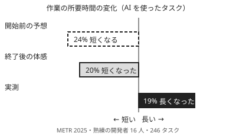

!!! abstract "要点"
    - **何が分かるか**：速くなった・良くなったという体感は、実測とずれうる。判断には、始める前に決めた同じ物差しで取った記録を使う。
    - **いつ引くか**：AI で速くなった気がするが、本当か分からないとき。良くなった・悪くなったという自分の感じを、どこまで信じてよいか知りたいとき。AI を使った効果を、感覚ではなく記録で確かめたいとき。
    - **前提**：<!-- link:begin human-pitfalls -->[人の側の五つの落とし穴（総論）](../judgment/human-pitfalls.md)<!-- link:end -->
    - **根拠の強さ**：体感と実測のずれは、実験で確かめられている（根拠：強）。ただし、熟練の開発者 16 人を調べた 2025 年前半の道具の結果で、今の Claude Code に当てはまるかは分からない（類推）。

<!-- textlint-disable -->
別名：体感を信じる・生産性の錯覚・実測で確かめる
<!-- textlint-enable -->

「体感と実測」とは、AI を使って速くなった・良くなったという自分の感覚と、同じ物差しで取った記録を分け、判断には記録を使う決まりである。体感は、何を測るかを決める手がかりにする。結論には使わない。

## 何が起きるか（研究と根拠の強さ） {#evidence}

体感と実測のずれは、研究で確かめられている。ただし確かめられたのは特定の条件での結果で、「AI は遅い」とも「AI は速い」とも言えない。次の 3 つの研究が手がかりになる。

- **生産性（METR、2025 年 7 月）**：[熟練のオープンソース開発者 16 人が、自分のプロジェクトの実タスク 246 件を行った](https://metr.org/blog/2025-07-10-early-2025-ai-experienced-os-dev-study/)。AI の使用を許したタスクは、許さないタスクより所要時間が 19% 長かった。一方、開発者は開始前に「24% 短くなる」と予想し、終了後も「20% 短くなった」と感じていた。道具は Cursor Pro と Claude 3.5 / 3.7 Sonnet で、2025 年前半の旧世代の結果である（根拠：強）。ただし 16 人の研究で、標本が小さい。
- **同じ研究の追試（METR、2026 年 2 月）**：[57 人・800 課題超の追試](https://metr.org/blog/2026-02-24-uplift-update/)は、速くなる方向の値を示した。しかし信頼区間がゼロをまたぎ、参加者の選び方に偏りがあるとして、METR 自身が実験の設計を変えると表明した（根拠：中）。この追試でも、遅いとも速いとも決められない。
- **学習（Bastani ほか、PNAS、2025 年）**：[約 1,000 人の高校生が、GPT-4 を使って数学を練習した](https://ideas.repec.org/a/nas/journl/v122y2025pe2422633122.html)。AI を使って練習した生徒は、練習中の成績は上がり、AI を外した試験の成績は下がった（数値は、原文を開けず確かめていないので書かない）（根拠：強・類推）。AI があるときの成績と、AI を外したときの力は別物だと分かる。開発への当てはめは類推になる。



どの研究も、コンテストや今の Claude を直接調べたものではない。ここから言えるのは、自分の感じは、記録で確かめるまで判断の根拠にならない、というところまでである。「AI を使うと遅くなる」の根拠には使わない。報道の[解説](https://the-decoder.com/ai-coding-can-make-developers-slower-even-if-they-feel-faster/)は二次の出典（根拠：弱）で、数値は METR の原文で確かめる。

根拠の強さが現象ごとに違うことは、<!-- link:begin human-pitfalls#evidence-strength -->[人の側の五つの落とし穴（総論） › 根拠の強さは現象ごとに違う](../judgment/human-pitfalls.md#evidence-strength)<!-- link:end -->にある。

## なぜ体感はずれるか {#why}

体感がずれるのは、体感が作業の全体の記録ではなく、作業中の感じと事前の期待から作られるからだと考えられる。研究が直接示したのは、ずれがあることである。仕組みの部分は推論になる。

- **期待が、そのまま感想になる**：METR の研究では、終了後の感想（20% 短くなった）は、開始前の予想（24% 短くなる）に近かった。実測は逆の向きだった。感想が結果ではなく、事前の期待に引かれたように見える（推論・実践例なし）。
- **感じられるのは作業中の快適さである**：案がすぐ出る、手が止まらない、待ち時間が減る。これらは作業中に感じられる。指示の書き直し、出力の読み込み、手直しにかかった時間は、感じにくい（推論・実践例なし）。全体の所要時間は、測らなければ分からない。
- **物差しの取り違え**：「速くなった」は、着手から完了までの時間とも、書いた量とも、動くまでの早さとも読める。学習の研究のように、AI があるときの成績で良し悪しを決めると、AI を外したときの力を見落とす。物差しを決めずに感じると、感じた物差しが人によって違う（推論・実践例なし）。
- **比べる相手が記憶である**：「前より」の「前」は、覚えている範囲の前である。同じ課題で比べていないので、課題の難しさの違いが「良くなった」「悪くなった」に混ざる。

AI の言葉も、体感を強める。「うまくいきました」と返されると、確かめる動機が下がる。AI に賛成されると確信が上がり、信頼まで増える仕組みは、<!-- link:begin agreement-is-not-evidence#hard-to-notice -->[同意は根拠に数えない（AI レビュアーの一致を含む） › 迎合された応答は信頼され、好まれる](../judgment/agreement-is-not-evidence.md#hard-to-notice)<!-- link:end -->にある。

「前より賢くなくなった気がする」という感じは、この落とし穴の現れ方の 1 つである。原因を安く確かめる順は、<!-- link:begin seems-less-capable#diagnosis -->[急に賢くなくなった気がする › 原因を安く確かめる順](../symptoms/seems-less-capable.md#diagnosis)<!-- link:end -->にある。

## 人が握るもの {#what-you-keep}

人が握るのは、何を「良くなった」と呼ぶかと、どの記録で判断するかの 2 つである。AI に決めさせると、AI の言葉が体感を強めるだけになる。

- **物差しを、結果を見る前に自分で決める**：所要時間、手直しの回数、テストの通過件数、レビューの指摘の数など。結果を見てから選ぶと、都合のよい物差しが残る。実験として残す書き方は、<!-- link:begin experiment-log#hypothesis-first -->[実験台帳（仮説を先に書く・提案者・分母・検証器の版） › 仮説を先に書く](experiment-log.md#hypothesis-first)<!-- link:end -->にある。
- **比べる相手を決める**：AI なしで行った同じ種類のタスク、変更前の版、同じ課題の別の日の結果。比べる相手がない「良くなった」は、記録に数えない。
- **効いたと判断する基準を、先に書く**：基準を後から動かせると、どんな結果でも「効いた」と言える。続ける、変える、やめるの基準を先に書く点は、<!-- link:begin decide-when-to-quit#write-criteria-first -->[やめどきを先に決める（撤退基準を着手前に書き、実装者以外が判定する） › 基準を着手前に書く](../judgment/decide-when-to-quit.md#write-criteria-first)<!-- link:end -->と同じである。
- **体感は捨てない**：体感が示すのは、何を測るかを決める手がかりである。「速くなった気がする」と思ったときが、記録を始める合図である。

AI が「速くなりましたね」と言っても、それは記録に数えない。数えるものは、<!-- link:begin agreement-is-not-evidence#what-counts -->[同意は根拠に数えない（AI レビュアーの一致を含む） › 証拠として数えるもの](../judgment/agreement-is-not-evidence.md#what-counts)<!-- link:end -->にある。

!!! example "判断例：チームの「かなり速くなった」を、導入を広げる根拠にしてよいか"
    - **状況**：チームで Claude Code を使い始めて 1 か月になる。メンバーのほとんどが「かなり速くなった」と言う。次の月から、ほかのチームにも広げるかを決める必要がある。
    - **迷う候補**：（A）全員が同じ感想で、実際に使っている人の感覚は重いので、そのまま広げる。（B）広げる前に 2 週間、タスクごとに予想時間・実測時間・手直しの回数を記録して比べ、結果を見てから決める。（C）記録が十分でないので、結論が出るまで導入を止める。
    - **選んだもの**：B。
    - **理由**：全員の感想が一致しても、それは感想が一致したことしか示さない。METR の研究でも、開発者は実測と逆の向きに感じていた。A は広げた後に取り消しにくい。C は、効果がある可能性まで止めてしまう。B は 2 週間で済み、基準（所要時間の中央値、手直しの回数）を先に書けば、結果を見た後で判断を動かせない。記録が 1 チーム分で件数が少ないことは、判断に「傾向」と書き添える。

## 記録で測るもの {#what-to-record}

記録で測るものは、始める前に決める 4 つである。予想、実測、条件、判定の基準を、タスク 1 件ごとに残す。

1. **予想**：始める前に、かかる時間と、できあがりの見込みを 1 行で書く。終わった後の感想と並べると、ずれが見える。
2. **実測**：開始と完了の時刻、手直しの回数、テストや検査の結果。測れないものは「未確認」と書き、感想で埋めない。
3. **条件**：AI の有無、モデルと effort、使った面、タスクの種類、日付。条件が変わったら、記録を分けて比べる。劣化を疑うときの記録の取り方は、<!-- link:begin suspected-degradation#measure -->[劣化を疑ったら測って確かめる › 版と effort を記録して、同じ課題で比べる](../models/suspected-degradation.md#measure)<!-- link:end -->にある。
4. **判定の基準**：何が起きたら「効いた」と呼ぶかを、記録を見る前に書く。

下の雛形は、この 4 つを 1 枚にした表である。

<!-- gen:begin snippet felt-vs-measured/effect-log -->
<!-- textlint-disable -->

??? example "雛形：AI の効果の記録（予想・実測・条件を残す表）"

    ```markdown
    # AI の効果の記録

    ## 始める前に書く（結果を見る前に決める）

    - 確かめたいこと：<例：レビュー指摘の対応を AI に手伝わせると、所要時間が短くなるか>
    - 見る物差し：<例：着手から完了までの時間、手直しの回数、テストの通過件数>
    - 比べる相手：<例：同じ種類のタスクを、AI なしで行った直近 5 件>
    - 記録する期間と件数：<例：2 週間、各条件で 5 件以上>
    - 「効いた」と判断する基準：<例：所要時間の中央値が 2 割以上短く、手直しの回数が増えていない>
    - 判定する人：<自分以外の人。いなければ、基準に照らして機械的に決められる物差しだけを使う>

    ## 記録（タスク 1 件につき 1 行）

    | 日付 | タスクの種類 | AI の有無 | モデルと effort | 予想（分） | 実測（分） | 手直しの回数 | 結果の確認 | 気づき |
    | --- | --- | --- | --- | --- | --- | --- | --- | --- |
    |  |  | あり / なし |  |  |  |  | テスト通過 / レビュー済み / 未確認 |  |

    ## 期間の終わりに

    - 体感：<記録を見る前に、効いたかどうかの感じを 1 行で書く>
    - 実測：<物差しごとの数値と、件数>
    - 体感と実測のずれ：<ずれた物差しと、その大きさ>
    - 判断：<続ける・変える・やめる。基準に照らした理由>
    ```

    動作を確かめていない雛形。

<!-- textlint-enable -->
<!-- gen:end snippet felt-vs-measured/effect-log -->

記録は、毎回ではなく、判断が要るときに取る。AI を使い始めたとき、設定や頼み方を変えたとき、導入を広げるかを決めるときである。

- **件数**：数件の記録は傾向としてしか読めない。差の大きさと件数の考え方は、<!-- link:begin measure-changes#how-many-runs -->[変更が効いたかを測る（小さな eval） › 試行の数と差の大きさ](measure-changes.md#how-many-runs)<!-- link:end -->にある。
- **採点**：自分の作業を自分の感覚で採点すると、体感が戻ってくる。テストの通過件数のように、機械的に決まる物差しを優先する。
- **測れないもの**：理解や学習は、時間では測れない。AI を外して自分で説明できるかを、小さく試して記録する。
- **自動の集計**：使い方の内訳を見る道具は、物差しを選ぶ手がかりにする。出てきた提案は下書きとして読む。読み方は、<!-- link:begin insights-and-usage-review#insights-as-drafts -->[/insights と /usage で振り返る › /insights の提案を下書きとして読む](insights-and-usage-review.md#insights-as-drafts)<!-- link:end -->にある。
- **変更の効果**：CLAUDE.md やプロンプトの変更が効いたかは、同じ課題を前後で走らせる小さな eval で比べられる。手順は、<!-- link:begin measure-changes#small-eval -->[変更が効いたかを測る（小さな eval） › 小さな eval の手順](measure-changes.md#small-eval)<!-- link:end -->にある。

確かめ方は、期間の終わりに、記録を見る前に書いた体感と実測を並べることである。ずれた物差しが分かれば、次から何を信じてよいかの目安になる。

<!-- gen:begin references -->
<!-- textlint-disable -->

## 参考 {#references}

- [Measuring the Impact of Early-2025 AI on Experienced Open-Source Developer Productivity](https://metr.org/blog/2025-07-10-early-2025-ai-experienced-os-dev-study/)：METR・英語・確認日 2026-11-04
- [We are Changing our Developer Productivity Experiment Design](https://metr.org/blog/2026-02-24-uplift-update/)：METR・英語・確認日 2026-11-04
- [AI coding can make developers slower even if they feel faster](https://the-decoder.com/ai-coding-can-make-developers-slower-even-if-they-feel-faster/)：The Decoder・英語・確認日 2026-11-04
- [Generative AI without guardrails can harm learning: Evidence](https://ideas.repec.org/a/nas/journl/v122y2025pe2422633122.html)：RePEc IDEAS（PNAS の論文の書誌）・英語・確認日 2026-11-04

<!-- textlint-enable -->
<!-- gen:end references -->

<!-- gen:begin page-links -->
<!-- textlint-disable -->

<div class="ca-page-links" markdown>

**前提**

- [人の側の五つの落とし穴（総論）](../judgment/human-pitfalls.md)

**次に読む**

- [劣化を疑ったら測って確かめる](../models/suspected-degradation.md)
- [変更が効いたかを測る（小さな eval）](measure-changes.md)
- [/insights と /usage で振り返る](insights-and-usage-review.md)

**関連**

- [急に賢くなくなった気がする](../symptoms/seems-less-capable.md)
- [判断を預けすぎる（過度依存）](../judgment/over-reliance.md)
- [同意は根拠に数えない（AI レビュアーの一致を含む）](../judgment/agreement-is-not-evidence.md)
- [やめどきを先に決める（撤退基準を着手前に書き、実装者以外が判定する）](../judgment/decide-when-to-quit.md)
- [AI の案は「みんなの案」（均質化）](../judgment/ai-ideas-are-everyones.md)
- [実験台帳（仮説を先に書く・提案者・分母・検証器の版）](experiment-log.md)

</div>

<!-- textlint-enable -->
<!-- gen:end page-links -->
