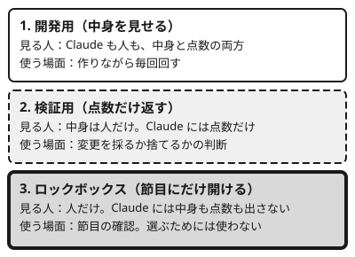

!!! abstract "要点"
    - **何が分かるか**：入力を開発用・検証用・人だけが持つロックボックスに分け、節目にだけ見る運用が分かる。Claude には点数だけを返し、中身を見せない。
    - **いつ引くか**：Claude に見せない検証用のデータを持ちたいとき。見えているテストは通るのに、隠れたテストで大きく落ちるとき。
    - **前提**：<!-- link:begin verifier-three-conditions -->[検証器の三条件（正しい・書き換えられない・本番を代表する）](verifier-three-conditions.md)<!-- link:end -->、<!-- link:begin selection-pressure -->[選択圧：良かった版を選び続ける罠](selection-pressure.md)<!-- link:end -->

<!-- textlint-disable -->
別名：ホールドアウト・隠しテスト・見せない検証データ・lockbox
<!-- textlint-enable -->

ロックボックスと hold-out は、作ったものが新しい入力でも通用するかを、Claude が中身を知らないデータで確かめる置き方である。hold-out は、作る途中の調整では使わず、取り置く検証用のデータを指す。ロックボックスは、その中でも人だけが持ち、節目にしか開けない最後の層を指す。

## 何が起きるか {#what-happens}

Claude は、見えている指標に素直に合わせて作る。公開テストや可視のテストが通っても、隠れたテストや本番では大きく落ちることがある。

SpecBench という論文（arXiv、2026）は、見えている検証用のテストと、機能を組み合わせて確かめる非公開の hold-out の差を測った。Claude Code（Opus 4.6）では、その差が探索の方法によらず約 43〜48 ポイントあった。最も多い失敗は、機能を 1 つずつは満たすが組み合わせると壊れるもので、意図的な悪用はまれだった（根拠：中）。

Claude 以外のモデルの例では、公開テストの期待出力をハッシュ表に持つだけの C コンパイラが、可視のテストで 97%、非公開のテストで 0% だった（同じ論文）。これは Claude の結果ではない。Claude の値としては、Claude Code（Opus 4.6）の約 43〜48 ポイントの差を使う。

つまり、悪意がなくても、見えているものだけで採点すると、見えていない入力での出来は測れない。見せないデータを別に持つのは、この差を測るためである。

## 三層に分ける {#three-tiers}

入力を、見せ方の違う 3 つの層に分ける。この分け方は実践者の運用に、機械学習の hold-out の考え方を当てはめたものである（根拠：中・類推）。



- **開発用**：Claude に中身を見せ、作りながら毎回回す。見えているテストはここに置く
- **検証用（hold-out）**：中身は人が持つ。Claude には点数だけを返す。変更を採るか捨てるかの判断に使う
- **ロックボックス**：人だけが持つ。点数さえ Claude に返さず、節目にだけ人が開けて、最終の確認に使う

層を 2 つの隠す層に分けるのは、検証用を何度も使うと、検証用にも少しずつ合わせ込まれるからである。点数を見て良かった変更を選び続けることが、そのまま選択圧になる（<!-- link:begin selection-pressure#defenses -->[選択圧：良かった版を選び続ける罠 › 防ぎ方](selection-pressure.md#defenses)<!-- link:end -->）。ロックボックスは、選ぶために使わないので、合わせ込まれていない最後のものさしとして残る。

ロックボックスを開く頻度は少ないほどよい。長期戦でも定期の確認は月単位にとどめる、という実践者の経験則がある（根拠：弱）。開ける回数が増えるほど、ロックボックスも検証用と同じになる。

層の切り方は、元のデータの作り方で決まる。

- **ヒューリスティックなど、入力を生成器で作れるとき**：生成器の別の seed や、別の分布で、検証用とロックボックスを作る
- **既にあるデータを分けるとき**：期間や対象で分け、分布の差を確かめる（<!-- link:begin evaluators-by-format#cv -->[形式別の評価器（テスタ・ベンチマーカー・CV・flag・対戦場） › データ分析：分布の差を確かめた CV](../contest/evaluators-by-format.md#cv)<!-- link:end -->）
- **どちらでも**：検証用が本番を代表していなければ、点数が良くても意味がない（<!-- link:begin verifier-three-conditions#representative -->[検証器の三条件（正しい・書き換えられない・本番を代表する） › 本番を代表する](verifier-three-conditions.md#representative)<!-- link:end -->）

三層の置き場所の例を、次の雛形に載せる。

<!-- gen:begin snippet lockbox-and-holdout/tier-layout -->
<!-- textlint-disable -->

??? example "雛形：三層の置き場所の例"

    ```text
    # 三層の置き場所の例（パスは自分の環境に置き換える）

    リポジトリの中（Claude が作業する場所）
      data/dev/            開発用。Claude に中身を見せる
      eval/score_dev.py    開発用の点数を出す。Claude が回してよい

    リポジトリの外（Claude の作業場所から読めない場所）
      ~/eval-private/holdout/       検証用。人が持つ。変更の採否に使う
      ~/eval-private/lockbox/       ロックボックス。人だけが持つ。節目にだけ開ける
      ~/eval-private/score_holdout.sh   検証用の点数だけを出す。人が回して点数を返す

    作り方の目安
      - 検証用とロックボックスは、同じ元のデータを作る手順（別の乱数の種、別の期間、別の分布）から作る
      - ロックボックスの点数は、記録だけして Claude には返さない
    ```

    動作を確かめていない雛形。要る最低の版：Claude Code 2.0.24。

<!-- textlint-enable -->
<!-- gen:end snippet lockbox-and-holdout/tier-layout -->

## 点数だけを返す {#scores-only}

検証用の点数は、中身を見せずに点数だけを Claude に返す。中身や失敗した入力の例を返すと、中身を見せたのと同じになり、Claude はその例に合わせて直せるからである。

点数だけでも、何度も問い合わせれば少しずつ合わせ込める（類推）。そのため、返す点数の粒度と回数を絞る。

- 点数は、変更を採るか捨てるかの判断ごとに 1 回、全体の 1 つの値で返す。入力ごとの点数や、失敗した件の一覧は返さない
- 問い合わせの回数と、そのときの変更を、台帳に残す（<!-- link:begin experiment-log#verifier-version -->[実験台帳（仮説を先に書く・提案者・分母・検証器の版） › 検証器の版を残す](experiment-log.md#verifier-version)<!-- link:end -->）
- 点数を出すスクリプトは、人が回すか、Claude の権限の外で動かす。Claude の権限で動くスクリプトが hold-out を読めるなら、Claude もそれを読める

ロックボックスの点数は、Claude に返さない。返すと、選ぶ根拠に使われて、検証用と同じになる。

Claude への依頼は、次の雛形のように、使ってよいデータと、点数の受け取り方を先に決めて書く。

<!-- gen:begin snippet lockbox-and-holdout/score-only-request -->
<!-- textlint-disable -->

??? example "雛形：検証用の点数だけを受け取って進める依頼"

    ```markdown
    この変更を採るか捨てるかは、検証用のデータの点数で決める。検証用のデータの中身は読めない場所にあり、人が管理している。次の決まりで進めてほしい。

    1. 開発用のデータ（`data/dev/`）は自由に読んで、手元の確認に使ってよい
    2. 変更ごとに、開発用のデータでの点数と、変更の内容を 1 行ずつ書いて、検証用の点数を人に頼む。点数は人が返す
    3. 検証用の点数が返ってきたら、前の点数との差だけを見て、採るか捨てるかを理由付きで提案する
    4. 検証用のデータとロックボックスの場所を探さない。中身を推測して開発用に写さない。点数が上がるように、点数の返し方や評価の仕組みに手を入れない
    5. 点数が急に大きく上がったときは、採る前に、リークや評価の省略がないかを自分で点検して報告する

    ロックボックスは、人が節目にだけ開ける。ロックボックスの点数は返さないので、選ぶ根拠にしない。
    ```

    動作を確かめていない雛形。要る最低の版：Claude Code 2.0.24。

<!-- textlint-enable -->
<!-- gen:end snippet lockbox-and-holdout/score-only-request -->

!!! example "判断例：ロックボックスをいつ開けるか"
    - **状況**：Claude に変更を毎晩試させ、検証用の点数が上がり続けている。ロックボックスはまだ一度も開けていない。
    - **迷う候補**：検証用の点数が上がるたびにロックボックスも見て、実際に通用しているかを確かめる。節目の提出や大きな方針の転換の前までは開けない。
    - **選んだもの**：節目まで開けない。
    - **理由**：開けるたびに、その点数を見て次の変更を選ぶことになり、ロックボックスも検証用と同じく合わせ込まれていく。検証用の点数が急に上がりすぎたときは、開ける前に、リークや評価の省略がないかを疑う（<!-- link:begin suspect-too-good-results -->[良すぎる結果を疑う](../verify/suspect-too-good-results.md)<!-- link:end -->）。

## 読めない所に置く {#keep-out-of-reach}

検証用とロックボックスは、Claude の作業場所の外に置き、Claude が読めない所に置く。中身を隠す層が読めるなら、点数だけを返す運用は成り立たない。

最初に決めるのは置き場所である。リポジトリの外に置くのが基本で、リポジトリの中に置くなら、読み取りを設定で塞ぐ。

「読まないで」と依頼や CLAUDE.md に書くのは、お願いである。Claude が探索の途中で見つけたファイルは、お願いだけでは読まれうる。読めなくするのは鍵で、権限ルールとサンドボックスが担う（<!-- link:begin protect-tests#layers -->[テストを守る（改ざんを防ぐ） › 守りの層](../verify/protect-tests.md#layers)<!-- link:end -->）。

鍵には限りがある。<!-- link:begin permission-rules -->[権限ルール（allow・ask・deny）](../enforce/permission-rules.md)<!-- link:end -->の Read と Edit の deny は、組み込みのファイルの道具と、Claude Code が Bash の中で見分けられるファイルのコマンドにだけ効く。名前を挙げずに読むコマンド（そのフォルダでの `grep -r パターン .` など）や、自分でファイルを開く Python や Node のスクリプトには効かない（<!-- link:begin permission-rules#child-processes -->[権限ルール（allow・ask・deny） › 子プロセスには効かない](../enforce/permission-rules.md#child-processes)<!-- link:end -->）。

そのため、Bash とその子プロセスまで止めるには、OS の層のサンドボックスを組み合わせる。サンドボックスの `denyRead` は Read の道具を止めないので、権限ルールの Read の deny と、サンドボックスの `denyRead` の両方を置く。サンドボックスは既定で無効で、読み取りは既定で広い（<!-- link:begin sandboxing#default-reads -->[サンドボックスで封じ込める › 読み取りは既定で広い](../enforce/sandboxing.md#default-reads)<!-- link:end -->）。フックとローカルの MCP サーバーはサンドボックスの外で動くので、hold-out を扱う処理をそこに置かない。

設定の具体は、評価資産の凍結のページにある。<!-- link:begin freeze-eval-assets#how-to-freeze -->[評価資産を凍結し、触れる範囲を絞る › 設定で止める（権限ルール・サンドボックス・ファイルの権限）](../enforce/freeze-eval-assets.md#how-to-freeze)<!-- link:end -->を見る。効いているかの確かめ方も同じページにある。<!-- link:begin freeze-eval-assets#check -->[評価資産を凍結し、触れる範囲を絞る › 凍結が効いているかを確かめる](../enforce/freeze-eval-assets.md#check)<!-- link:end -->を見る。このページの話は WSL・Linux の CLI を基準にする。ほかの OS と IDE 拡張の動作は未確認である。

## 何に効くか {#what-it-affects}

このページの運用は、2 つの原理と 2 つの原因に結び付く。

- **縛る**：読めなくする鍵である。防ぐ原因は「縛っていない」で、お願いだけで hold-out が読める状態を、権限ルールとサンドボックスで塞ぐ
- **握る**：人が、層の持ち主になり、点数の返し方と、ロックボックスを開ける時期を決める。人が握らないと、Claude が見える層を増やしたり、開ける回数が増えたりする
- **確かめていない**（原因）：見えているテストが通っただけで、見えていない入力では確かめていない状態を、検証用とロックボックスで確かめる

症状で言えば、見えているテストは通るのに隠れたテストで大きく落ちるときに効く。原因の切り分けは<!-- link:begin misses-broken-evaluation#diagnosis -->[手元の評価は良いのに本番で通用しない › 原因を安く確かめる順](../symptoms/misses-broken-evaluation.md#diagnosis)<!-- link:end -->にある。

効かない場面もある。検証用が本番を代表していなければ、点数が良くても本番では通用しない。ロックボックスを頻繁に開ければ、合わせ込みは防げない。評価の仕組み自体が書き換えられるなら、先にそちらを塞ぐ（<!-- link:begin verifier-three-conditions#tamper-proof -->[検証器の三条件（正しい・書き換えられない・本番を代表する） › 書き換えられない](verifier-three-conditions.md#tamper-proof)<!-- link:end -->、<!-- link:begin protect-tests -->[テストを守る（改ざんを防ぐ）](../verify/protect-tests.md)<!-- link:end -->）。指標そのものが目的とずれているときは、データを分けても直らない（<!-- link:begin check-the-metric -->[評価指標そのものを確かめる](check-the-metric.md)<!-- link:end -->）。

## よくある誤解 {#misconceptions}

- **hold-out があれば合わせ込みは起きない**：検証用の点数を見て選び続ければ、検証用にも合わせ込まれる。ロックボックスを別に持つのはそのためである
- **隠すのは Claude が不正をするからだ**：SpecBench では、最も多い失敗は機能を 1 つずつしか満たさないもので、意図的な悪用はまれだった。隠す目的は、悪意の対策より、見えている指標に素直に合わせる傾向の対策である
- **CLAUDE.md に「hold-out を読むな」と書けば足りる**：それはお願いである。読ませたくないデータは、鍵で読めなくする
- **Read の deny を書けば、子プロセスからも読めなくなる**：Read の deny は、任意の子プロセスには効かない。サンドボックスを組み合わせる
- **ロックボックスの点数が良ければ、次の変更を選んでよい**：選ぶために見た時点で、そのロックボックスは検証用と同じになる

データ分析で、集計の裏を生データで取る方法は<!-- link:begin data-analysis -->[データを分析する](../recipes/data-analysis.md)<!-- link:end -->、形式ごとの検証器は<!-- link:begin evaluators-by-format -->[形式別の評価器（テスタ・ベンチマーカー・CV・flag・対戦場）](../contest/evaluators-by-format.md)<!-- link:end -->を見る。

<!-- gen:begin references -->
<!-- textlint-disable -->

## 参考 {#references}

- [SpecBench: Measuring Reward Hacking in Long-Horizon Coding Agents](https://arxiv.org/abs/2605.21384)：arXiv（Zhao, Bingchen ほか）・英語・確認日 2026-11-04
- [Configure permissions](https://code.claude.com/docs/en/permissions)：Anthropic・英語・確認日 2026-11-04
- [Configure the sandboxed Bash tool](https://code.claude.com/docs/en/sandboxing)：Anthropic・英語・確認日 2026-11-04

<!-- textlint-enable -->
<!-- gen:end references -->

<!-- gen:begin page-links -->
<!-- textlint-disable -->

<div class="ca-page-links" markdown>

**前提**

- [検証器の三条件（正しい・書き換えられない・本番を代表する）](verifier-three-conditions.md)
- [選択圧：良かった版を選び続ける罠](selection-pressure.md)

**関連**

- [テストを守る（改ざんを防ぐ）](../verify/protect-tests.md)
- [評価資産を凍結し、触れる範囲を絞る](../enforce/freeze-eval-assets.md)
- [サンドボックスで封じ込める](../enforce/sandboxing.md)
- [権限ルール（allow・ask・deny）](../enforce/permission-rules.md)
- [良すぎる結果を疑う](../verify/suspect-too-good-results.md)
- [実験台帳（仮説を先に書く・提案者・分母・検証器の版）](experiment-log.md)
- [評価指標そのものを確かめる](check-the-metric.md)
- [手元の評価は良いのに本番で通用しない](../symptoms/misses-broken-evaluation.md)
- [データを分析する](../recipes/data-analysis.md)
- [形式別の評価器（テスタ・ベンチマーカー・CV・flag・対戦場）](../contest/evaluators-by-format.md)

</div>

<!-- textlint-enable -->
<!-- gen:end page-links -->
