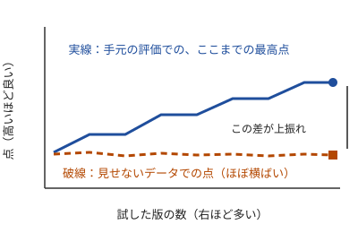

!!! abstract "要点"
    - **何が分かるか**：Claude が正直でも、良かった版を選び続けるだけで評価の穴に合わせ込む罠が分かる。試行を増やすほど強まり、一変更一評価・台帳・見せないデータで防ぐ。
    - **いつ引くか**：いちばん点の良かった版を選んだのに新しい入力では平凡だったとき。何十通りも試させて、いちばん良かった版を採っているとき。
    - **前提**：<!-- link:begin verifier-defines-problem -->[検証器が問題を定義する（Claude は置かれたループを何でも加速する）](verifier-defines-problem.md)<!-- link:end -->、<!-- link:begin measure-changes -->[変更が効いたかを測る（小さな eval）](measure-changes.md)<!-- link:end -->

<!-- textlint-disable -->
別名：勝者の呪い・評価への過適合・選んだ版の上振れ
<!-- textlint-enable -->

選択圧とは、試した版の中から点の良いものを残し続けることで、手元の評価にだけ合った版が選ばれてしまう働きである。Claude がずるをしなくても、選ぶ側の手順だけで起きる。

## 何が起きるか {#what-happens}

プロンプトや設定の改良案を Claude に何十通りも出させ、同じ評価入力で測って、いちばん点の高かった版を採るとする。採った版を新しい入力に使うと、手元の点ほど良くならない。

!!! example "判断例：点の高い版をそのまま採るか"
    - **状況**：Claude が出した 30 通りの変更案を、手元の 50 件の入力で測った。最高点の版は、元の版より明らかに高い。
    - **迷う候補**：最高点の版をそのまま採る。または、最高点の版を見せていない入力でもう一度測ってから採る。
    - **選んだもの**：見せていない入力でもう一度測ってから採る。
    - **理由**：30 通りの中の最高点は、本当に良い版と、たまたま手元の入力で運が良かった版の両方から選ばれている。最高点だから採る、という手順自体が後者を拾う。

## なぜ正直でも外れるか {#why}

測った点は、本当の実力・測定のぶれ・その評価入力との相性の合計である。ぶれと相性は、次に使う入力では持ち越せない。ところが「いちばん良かった版を選ぶ」という操作は、この持ち越せない部分が大きかった版を、実力が同じなら優先して拾う。

たとえば、100 人にコインを投げさせて、表が多く出た人を「コインを投げるのが上手い人」として選ぶ場面を考える。選ばれた人は、もう一度投げれば平均に戻る。版の選択も同じ形で、選ぶ数が多いほど、最高点に混ざる運の分が大きくなる。

この図は、効果のない変更を試し続けた場合の模式図である。実線の「ここまでの最高点」は、新記録が出るたびに上がり、決して下がらない。破線の見せないデータでの点は、変更に効果がないので上がらない。線の差が、選んだことで生じた上振れである。

測定のぶれは、Claude を使う実験では小さくない。Anthropic は Terminal-Bench 2.0 で、実行環境の資源の設定だけで結果が 6 ポイント動いたと報告している。設定が揃うまで 3 ポイント未満の差は懐疑的に扱うべきだとしている（根拠：中。2026 年 2 月、測ったのは Claude のモデル）。この大きさのぶれがあれば、数ポイントの「改善」は、選択の結果として出てもおかしくない。

## 防ぎ方 {#defenses}

防ぐ手段は、選ぶ回数を減らすことではなく、選ぶ根拠を手元の評価の外に置くことである。次の 4 つを組み合わせる。

1. **一変更一評価**：1 回に変えるのは 1 つにする。複数を同時に変えると、点が上がった理由が分からないまま採ることになる。測り方は <!-- link:begin measure-changes#how-many-runs -->[変更が効いたかを測る（小さな eval） › 試行の数と差の大きさ](measure-changes.md#how-many-runs)<!-- link:end --> にある。
2. **台帳に試した数を残す**：実行の前に仮説を書き、採否と判定者を残す。残した行の数が「何通り試した中の最高点か」の分母になり、その点を割り引いて読める。書き方は <!-- link:begin experiment-log#hypothesis-first -->[実験台帳（仮説を先に書く・提案者・分母・検証器の版） › 仮説を先に書く](experiment-log.md#hypothesis-first)<!-- link:end --> と <!-- link:begin experiment-log#verifier-version -->[実験台帳（仮説を先に書く・提案者・分母・検証器の版） › 検証器の版を残す](experiment-log.md#verifier-version)<!-- link:end --> にある。
3. **見せないデータで確かめる**：入力を開発用・検証用・人だけが持つものに分け、人だけが持つ入力は節目にだけ見る。Claude には点数だけを返す。何度も見れば、それも選ぶ根拠に使うことになる（推論）。分け方は <!-- link:begin lockbox-and-holdout#three-tiers -->[ロックボックスと hold-out（人だけが持つ検証用データ） › 三層に分ける](lockbox-and-holdout.md#three-tiers)<!-- link:end --> にある。点数だけを返す運用は <!-- link:begin lockbox-and-holdout#scores-only -->[ロックボックスと hold-out（人だけが持つ検証用データ） › 点数だけを返す](lockbox-and-holdout.md#scores-only)<!-- link:end --> を見る。
4. **差がぶれより大きいかを見る**：採る前に、同じ版を何度か測ってぶれの幅を知り、点の差がその幅を超えているかを確かめる。急な高速化や満点に近い点は、採る前に <!-- link:begin suspect-too-good-results#what-to-suspect -->[良すぎる結果を疑う › まず疑うもの](../verify/suspect-too-good-results.md#what-to-suspect)<!-- link:end --> の手順で疑う。

試行の数を増やす前に、この守りを先に置く。`/goal` やサブエージェントを多数動かす仕組みは、試す数を一気に増やすので、選択圧も同じ割合で強まる。仕様が決まり停止条件のある作業に限る話は <!-- link:begin goal-until-done#spec-tasks-only -->[/goal（完了するまで続けさせる） › 仕様の決まった実装に限る](../delegate/goal-until-done.md#spec-tasks-only)<!-- link:end --> にある。
規模を小さく始める話は <!-- link:begin dynamic-workflows#when-and-start-small -->[dynamic workflows（スクリプトで多数のサブエージェントを動かす） › 向く規模と、小さく試す](../delegate/dynamic-workflows.md#when-and-start-small)<!-- link:end --> にある。

## 同じアイデアの再挑戦に上限を置く {#retry-cap}

同じアイデアを少しずつ変えて何度も試せば、そのどれかが運よく通る確率が上がる。再挑戦の回数に上限を置くのは、この運による通過を減らすためである。

チェスエンジンの Stockfish の検定基盤 Fishtest の FAQ は、同じアイデアの再挑戦に、回数の上限を置いている。理由は、変更を試すことと、運のよい試行を通しすぎないことの釣り合いである（根拠：中・類推。チェスエンジンの検定の慣行を、Claude の実験に当てはめている）。その回数はその検定基盤の慣行であり、自分の実験の上限は評価の入力数とぶれの大きさで決める。

!!! example "判断例：同じ案の 3 回目の再挑戦"
    - **状況**：ある案の 1 回目と 2 回目は点が上がらなかった。3 回目に条件を少し変えたところ、手元の評価で初めて点が上がった。
    - **迷う候補**：この結果をそのまま採る。または、再挑戦は 2 回までと決めてあったので、手元の点が高くても捨てる。
    - **選んだもの**：どちらにも決めず、見せない入力で測ってから採否を決める。
    - **理由**：3 回目で初めて通った点は、案が良いからか、試す数が増えたからかを区別できない。回数の上限は、通ったら採るのではなく、通った結果を割り引いて見るための印として使う。

上限を守らせるには、台帳に「同じアイデア」の印を付けて、再挑戦の回数を数えられるようにする。Claude が前に効かなかった案を、少し言い換えて出してくることがあるので、人が「同じ案か」を判定する。上限を超えた案は、手元の点が高くても、見せないデータで確かめてから採る。

## 何に効くか {#what-it-affects}

このページが関わる原理は、握る・確かめるである。採る版を決める基準と、それを確かめる入力は、Claude に任せず人が握る。確かめるには、手元の評価の外で測る。

防ぐ原因は、確かめていないである。点が上がったという報告を、手元の評価の内側だけで受け取るのは、確かめたことにならない。選んだ後の版を、選ぶ根拠に使っていない入力で一度測って、初めて確かめたことになる。

比べる版を並べて同じ物差しで測る手順は <!-- link:begin compare-hypotheses-in-parallel -->[仮説ごとに並べて、同じ物差しで比べる](../delegate/compare-hypotheses-in-parallel.md)<!-- link:end --> にある。コンテストの実験でケース数や試合数を決める話は <!-- link:begin running-contest-experiments#games-for-win-rate -->[実験の回し方（ケース数・集計・パラメータ・勝率に要る試合数） › 勝率に要る試合数](../contest/running-contest-experiments.md#games-for-win-rate)<!-- link:end --> を使う。

## よくある誤解 {#misconceptions}

- **「Claude が不正をしなければ起きない」**：起きる。選ぶのが人でも、Claude に自動で選ばせても、選び続ける手順があれば生じる。
- **「長く回せば良くなり続ける」**：Claude Code をループで回してエージェントを最適化した事例では、最良の構成を早い段階で見つけた後は頭打ちになり、延長しても時間と金が無駄になった（根拠：弱。単独の実務家の報告）。回す長さの話は <!-- link:begin open-ended-loop-trap#longer-is-not-better -->[AI に改善を回させ続ける罠（開いたループ） › 長く回せば良くなるとは限らない](../delegate/open-ended-loop-trap.md#longer-is-not-better)<!-- link:end --> にある。やめる基準は着手前に書く（<!-- link:begin decide-when-to-quit#write-criteria-first -->[やめどきを先に決める（撤退基準を着手前に書き、実装者以外が判定する） › 基準を着手前に書く](../judgment/decide-when-to-quit.md#write-criteria-first)<!-- link:end -->）。
- **「見せないデータを持てば安全になる」**：持つだけでは足りない。その点を見て選び直すたびに、見せないデータも選ぶ根拠に変わる。見る回数を節目に絞る。

<!-- gen:begin references -->
<!-- textlint-disable -->

## 参考 {#references}

- [Thirty percent of AI kernel wins fail on held-out configurations](https://aiweekly.co/editors-blog/found-first-thirty-percent-of-ai-kernel-wins-fail-on-held-out-configurations)：AI Weekly・英語・確認日 2026-11-04
- [Fishtest FAQ](https://github.com/official-stockfish/fishtest/wiki/Fishtest-faq)：GitHub（official-stockfish）・英語・確認日 2026-11-04
- [Quantifying infrastructure noise in agentic coding evals](https://www.anthropic.com/research/infrastructure-noise)：Anthropic・英語・確認日 2026-11-04
- [Can Claude Code in a loop improve a production enterprise AI agent with $10,745 of budget?](https://jeremytian.substack.com/p/can-claude-code-in-a-loop-improve)：Jeremy Tian・英語・確認日 2026-11-04

<!-- textlint-enable -->
<!-- gen:end references -->

<!-- gen:begin page-links -->
<!-- textlint-disable -->

**前提**

- [検証器が問題を定義する（Claude は置かれたループを何でも加速する）](verifier-defines-problem.md)
- [変更が効いたかを測る（小さな eval）](measure-changes.md)

**次に読む**

- [実験台帳（仮説を先に書く・提案者・分母・検証器の版）](experiment-log.md)
- [ロックボックスと hold-out（人だけが持つ検証用データ）](lockbox-and-holdout.md)
- [AI に改善を回させ続ける罠（開いたループ）](../delegate/open-ended-loop-trap.md)

**関連**

- [仮説ごとに並べて、同じ物差しで比べる](../delegate/compare-hypotheses-in-parallel.md)
- [/goal（完了するまで続けさせる）](../delegate/goal-until-done.md)
- [dynamic workflows（スクリプトで多数のサブエージェントを動かす）](../delegate/dynamic-workflows.md)
- [やめどきを先に決める（撤退基準を着手前に書き、実装者以外が判定する）](../judgment/decide-when-to-quit.md)
- [良すぎる結果を疑う](../verify/suspect-too-good-results.md)
- [実験の回し方（ケース数・集計・パラメータ・勝率に要る試合数）](../contest/running-contest-experiments.md)

<!-- textlint-enable -->
<!-- gen:end page-links -->
